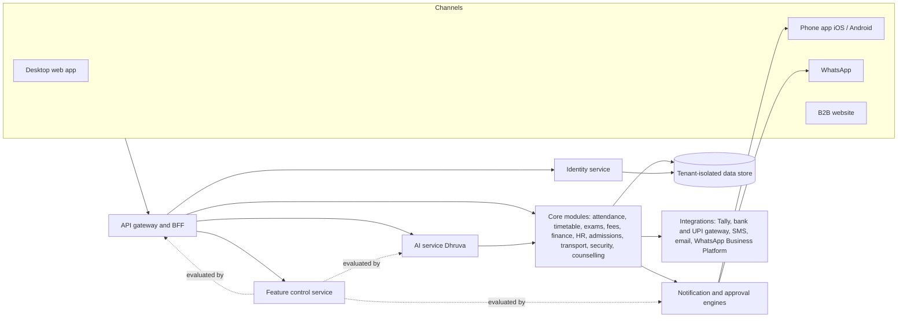

# DhruvaOne: End-to-End Functional Specification

| | |
|---|---|
| **Product** | DhruvaOne school ERP with the Dhruva AI assistant |
| **Document** | Functional specification v1.1 (draft for client review) |
| **Date** | 31 October 2026 (v1.1: API and event conflicts resolved, missing APIs added, website section added; see 10.2, decisions 11 to 25) |
| **Status** | Draft: product body for sign-off, engineering annexes for build. All decisions in 10.2 (1 to 25) confirmed by the client on 31 October 2026 |
| **Sample data** | All names, numbers and amounts are sample data (group "DPS Group", hero campus DPS Gurugram Sec 45, sample day Fri 9 Oct 2026; standalone school "Saraswati Vidya Niketan", Karnal) |
| **Derived from** | The DhruvaOne design prototypes (desktop, phone, WhatsApp, website), the MVP scope and roadmap, and the functional overview (214 pages) |

**Contents**

- [1. Introduction and conventions](#1-introduction-and-conventions)
- [2. Platform overview](#2-platform-overview)
- [3. Identity Management](#3-identity-management)
- [4. Tenant Administration and Feature Control](#4-tenant-administration-and-feature-control)
- [5. AI: the Dhruva assistant](#5-ai-the-dhruva-assistant)
- [6. App - Desktop](#6-app---desktop)
- [7. App - Mobile](#7-app---mobile)
- [8. WhatsApp](#8-whatsapp)
- [9. Cross-cutting Platform Requirements](#9-cross-cutting-platform-requirements)
- [10. Release phasing and decisions](#10-release-phasing-and-decisions)
- [11. Website](#11-website)
- [Appendix A: Feature flag registry](#appendix-a-feature-flag-registry)
- [Appendix B: Glossary](#appendix-b-glossary)
- [Appendix C: Design gaps](#appendix-c-design-gaps)

---

# 1. Introduction and conventions

## 1.1 Purpose
This specification defines what DhruvaOne must do, end to end, so that the client can sign it off and engineering can build and test from it. It covers five areas requested by the client: **AI**, **App - Desktop**, **App - Mobile**, **Identity Management** and **WhatsApp**, plus the **B2B website** (Section 11). It adds the capability the client asked for on top of those: **a tenant administrator can enable or disable AI features and other features for a tenant** (Section 4), and the shared platform services every area depends on (Section 9).

## 1.2 Audience and how to read it
Each section has a **product body** in plain language (purpose, requirements with acceptance criteria, business rules, notifications, feature switches) and an **engineering annex** (data entities, APIs, events, state machines, permission matrix). Owners and principals can read the bodies; engineering and QA use the annexes and the acceptance criteria.

## 1.3 What is designed and what this specification adds
The prototypes show how DhruvaOne looks and behaves, but not everything a product needs (for example token lifetimes, retention, error handling or an administration console). Every requirement therefore carries a source tag:

- **[Design]**: behaviour shown in the prototypes. Where a design shows an exact label or message it is quoted.
- **[Spec]**: a requirement this document adds because the product needs it. These are decisions for the client and the team to confirm; they are not drawn anywhere yet. Appendix C lists the screens that still need design.

## 1.4 Requirement format
Every requirement is one block:

```
**IDM-OTP-001 · Must · MVP · flag: idm.web_login · [Design]**
The system shall ...
- Acceptance: Given ... When ... Then ...
- Rules: (optional)
```

| Field | Meaning |
|---|---|
| ID | `AREA-MODULE-nnn`, unique across the whole document. Areas: IDM identity, TFC tenant feature control, AI, DSK desktop, MOB mobile, WAB WhatsApp, XCT cross-cutting, WEB website. |
| Priority | **Must** (needed for the release), **Should** (expected, can slip with agreement), **Could** (nice to have). |
| Phase | **MVP** (build Oct to Dec 2026, go-live Jan to Mar 2027), **P2** (Phase 1 of the roadmap, Apr to Sep 2027), **P3** (Phase 2 of the roadmap, Oct 2027 to Mar 2028). |
| flag | The feature switch (Section 4) that turns the requirement off for a tenant, campus or role. `core` means it can never be switched off (sign-in, audit, consent, safety). Appendix A lists every flag. |
| Source tag | `[Design]` or `[Spec]`, as above. `[Design] + [Spec]` marks a designed behaviour that this document extends. |
| Acceptance | Testable conditions in Given / When / Then form, using exact labels where designed. |

## 1.5 Principles that every requirement follows
1. **Dhruva prepares, a person approves.** Anything that changes a record or reaches a family needs a named person's approval (Section 5).
2. **Manual always works.** Every AI feature has a manual path, so switching AI off never blocks a task.
3. **One thing at a time.** Each role opens on one focus card, then a queue.
4. **One number, many profiles.** Identity comes from the mobile number and the school's record; profiles never mix data (Section 3).
5. **Server-side enforcement.** Roles, scope and feature switches are enforced on the server, never only in the interface (Sections 3, 4).
6. **Everything important is audited**: who did what, when, with whose approval (Section 9).

## 1.6 Requirement counts

| Section | Area | Requirements | MVP | P2 | P3 | Design | Spec | Design + Spec |
|---|---|---|---|---|---|---|---|---|
| 3 | Identity Management (IDM) | 90 | 80 | 9 | 1 | 41 | 49 | 0 |
| 4 | Tenant Administration and Feature Control (TFC) | 102 | 98 | 4 | 0 | 4 | 98 | 0 |
| 5 | AI: the Dhruva assistant (AI) | 89 | 81 | 8 | 0 | 56 | 33 | 0 |
| 6 | App - Desktop (DSK) | 196 | 191 | 1 | 4 | 187 | 4 | 5 |
| 7 | App - Mobile (MOB) | 163 | 160 | 3 | 0 | 126 | 37 | 0 |
| 8 | WhatsApp (WAB) | 122 | 48 | 71 | 3 | 67 | 55 | 0 |
| 9 | Cross-cutting platform (XCT) | 112 | 108 | 4 | 0 | 54 | 58 | 0 |
| 11 | Website (WEB) | 34 | 33 | 1 | 0 | 22 | 12 | 0 |
| | **Total** | **908** | **799** | **101** | **8** | **557** | **346** | **5** |

Priorities across all areas: 726 Must, 168 Should, 14 Could.

## 1.7 Document map

| Section | Title | Contents |
|---|---|---|
| 1 | Introduction and conventions | This section |
| 2 | Platform overview | Surfaces, roles, tenancy model, architecture |
| 3 | Identity Management | Mobile-number and OTP sign-in, profiles and switching, PIN and biometrics, sessions, roles and scope, lifecycle |
| 4 | Tenant Administration and Feature Control | Admin console, feature catalogue, scope and schedule, AI controls, plans, audit and rollback |
| 5 | AI: the Dhruva assistant | Principles, every AI capability, control plane, safety and evaluation |
| 6 | App - Desktop | Shell and every role module (leadership, academics, operations, students) |
| 7 | App - Mobile | App shell and every role on the phone, offline, push, stores |
| 8 | WhatsApp | Business account, parent, teacher and staff flows, handover, compliance |
| 9 | Cross-cutting platform | Notifications, approvals, audit, integrations, data, security, non-functional |
| 10 | Release phasing and decisions | Roadmap mapping, decisions taken, open decisions |
| 11 | Website | B2B website pages, demo and pricing requests, website sign-in |
| Appendix A | Feature flag registry | |
| Appendix B | Glossary | |
| Appendix C | Design gaps | Screens and decisions still to be designed |

---

# 2. Platform overview

## 2.1 Surfaces
| Surface | Who | Notes |
|---|---|---|
| Desktop web app | Office roles: group owner, principal, school admin, academic coordinator, head of department, exam cell, counsellor, teacher, HR and payroll, finance and accounts, admissions, security and IT, transport in-charge; student desktop views | Sidebar with role modules, Ask Dhruva, profile switcher |
| Phone app (iOS and Android) | All of the above on the phone, plus parents, students (Classes 6 to 8 and 9 to 12) and bus attendants | English and Hindi; push notifications; offline queue for attendance and bus taps |
| WhatsApp | Parents, teachers and support staff who do not use the app | Official school account; menus, forms, photo of register or marks, voice notes (Hindi and English), handover to a person |
| B2B website | Prospective schools; anyone who needs the app link or a computer sign-in | Product, trust and pricing pages, demo and pilot requests, mobile-number sign-in (Section 11) |

## 2.2 Tenancy model
- A **group** (sample: DPS Group, 14 campuses, 43,240 students, 2,976 staff) has an owner who sees every campus on one scorecard and approves only what exceeds a campus limit. Each **campus** has its own principal, staff, students and approvals.
- A **standalone school** (sample: Saraswati Vidya Niketan, Karnal) is a separate tenant with its own admin and, where needed, a trustee. It never sees group data.
- A person may hold several **profiles** under one mobile number (for example parent at two campuses and teacher at one). Profiles and tenants never mix data.
- The **Tenant Administrator** is the person who controls the tenant's features and settings: for a group, the Group Owner or a delegated Group Admin; for a standalone school, the School Admin (Section 4).
- **DhruvaOne staff** (the Platform Owner) manage plans, entitlements and kill switches across tenants (Section 4).

## 2.3 Role catalogue
Group Owner, Principal, School Admin (standalone), Academic Coordinator, Head of Department, Exam Cell, Counsellor, Teacher, HR and Payroll, Finance and Accounts, Admissions Counsellor (CRM), Security and IT, Transport In-charge, Bus Attendant, Parent, Student (Classes 6 to 8), Student (Classes 9 to 12), Trustee (approver only), Tenant Administrator and Group Admin (new, Section 4), Platform Owner (DhruvaOne staff). Section 3 defines scope for each.

## 2.4 System context



Reading the diagram: every request passes the gateway, which asks Identity who the caller is and the Feature control service whether the capability is on for that tenant, campus and role. The AI service and the notification engine ask the same Feature control service, so a switch has the same effect on every channel.

## 2.5 API and event conventions
These rules apply to every engineering annex. They were added in v1.1 to remove duplicate and conflicting APIs (Section 10.2, decisions 11 to 22).

- **Paths.** Public platform APIs are under `/v1`, and every annex table writes the full path. Service-to-service APIs are under `/internal/v1` and are never exposed through the public gateway. WhatsApp gateway APIs (`/wa/...`, Section 8) are served by the WhatsApp gateway, not the platform API.
- **One function, one API.** Each API is defined once, in the annex of the section that owns the capability. Other sections refer to it instead of defining their own.

| Owner | APIs it defines |
|---|---|
| Section 3 Identity | Sign-in and OTP, sessions, profiles and switching, PIN and step-up, devices and push tokens, number-add requests, people, profiles, memberships, roles, guardianships, identity policy |
| Section 4 Feature control | Feature switches, change requests, snapshots, tenant settings, AI consent, AI settings, AI pause, AI quota, plans, entitlements, platform kill switches, platform console, tenant administrators and hierarchy |
| Section 5 AI | Ask Dhruva, focus list, suggestions, drafts, mark-sheet reading, homework checking, voice, translation, AI usage, explanations, models and evaluations |
| Section 6 Desktop | Business modules: dashboards, group, onboarding, academics, timetables, exams, counselling, HR and payroll, finance, admissions, security, transport, students |
| Section 7 Mobile | Phone-only services: offline sync, SOS, version policy, deep links, photo upload, parent and bus-attendant views, payment intents |
| Section 8 WhatsApp | The WhatsApp gateway (`/wa/...`) |
| Section 9 Cross-cutting | Notifications and notification preferences, push fan-out, notices, approvals, audit, reports, calendar, search, files, imports, campuses, consent and data requests, provider webhooks, integrations, telemetry, support, status |
| Section 11 Website | Website requests (leads) |

- **Errors.** Every API uses the envelope `{"error":{"code","message","feature?","reason?","request_id"}}` (Section 4).
- **Events.** Names are lower case: `domain.entity.action`, or `domain.action` where the domain is the entity, with underscores inside a multi-word part (for example `ai.quota_threshold`, `change_request.approved`). Each event is defined once, in the owner's annex; other sections list it as consumed.

---
# 3. Identity Management

Area code: IDM. Related sections: Section 4 (Tenant feature control and administration, TFC) defines the Tenant Administrator role and the flag mechanism; Section 6 (Desktop), Section 7 (Mobile), Section 8 (WhatsApp) and Section 11 (Website) consume the identity services defined here; cross-cutting audit and notification rules live in XCT.

## 3.1 Purpose, scope and out-of-scope

### Purpose
DhruvaOne has one rule for identity: **the school's record is the account.** A person never creates an account, a username or a password. The school (through the student sheet, the staff sheet, HR, or the office) records a mobile number against a person; that number, proved by a one-time code (OTP), is the only credential. One number can open several profiles (for example parent at DPS Gurugram, parent at DPS Noida, parent at Saraswati Vidya Niketan, teacher and Head of Maths at DPS Gurugram). Profiles never mix: each is a separate window onto one school's data with its own role, menu and permissions. Staff profiles and sensitive actions sit behind an app PIN or phone biometric (Face ID, fingerprint).

### In scope
- Sign-in by mobile number and OTP on the iOS/Android app, the website sign-in page and the desktop web app.
- Handling of unregistered numbers, discovery of schools and roles from a verified number, multiple profiles and switching.
- Strict separation of data between profiles, campuses and tenants.
- App PIN, biometric unlock, step-up for sensitive actions, app lock.
- Sessions, tokens, devices, sign-out and revocation.
- Role catalogue, permission scope model, role assignment and lifecycle (invite, activate, change, deactivate, offboard).
- Person and profile records, parent-child linking and guardian verification, student accounts by age band, staff identity from HR.
- Identity of WhatsApp users (number matching, PIN, shared numbers, unknown numbers).
- Privacy, consent and audit of identity events; recovery when a mobile number changes; tenant-level identity controls.

### Out of scope (covered elsewhere)
- Content of role home screens (sections of each role) and approval chains (see Section XCT approvals).
- Feature-flag engine and flag scheduling (see TFC).
- Notification delivery tiers (see XCT notifications); this section only defines identity-related alerts.
- Single sign-on with Google or Microsoft (idm.sso): shown as a website tile, planned later (P3); only the extension points are defined here.
- Passwords, security questions and email-link sign-in: deliberately not offered.

## 3.2 Actors and roles

| Actor | Identity relevance |
|---|---|
| Any signed-in person | Signs in by OTP, switches profiles, sets PIN and biometric, manages own devices. |
| Parent / guardian | Profile per school (children of one school grouped); can create or switch off a child's student login. |
| Student (Classes 6-8, 9-12) | Own student login only from the age/class band the school enables; no login for younger children (Junior pod inside the parent app). |
| Staff (teaching, non-teaching, support) | Identity created from the staff sheet and HR record; staff profiles are PIN-protected. |
| Group Owner, Principal, Standalone School Admin, Trustee | Approvers; step-up required on approvals. |
| School office / front office | Records and corrects mobile numbers and child links for families (school office creates child links). |
| HR and payroll | Source of truth for staff identity; triggers activation, role change and offboarding. |
| Tenant Administrator (NEW, defined in Section 4) | Manages users, role assignments, identity policy and idm.* flags inside the tenant, without default access to academic, fee or HR content. |
| DhruvaOne support (platform) | Break-glass access to identity records of a tenant only on a written school request, always audited. |
| Dhruva (AI) | Never signs in, never holds a profile; acts only inside the session of the person who asked, with that person's permissions. |

The full role catalogue with scopes is in 3.3.8.

## 3.3 Functional requirements

### 3.3.1 Mobile number and OTP sign-in (app, website, desktop web)

**IDM-OTP-001 · Must · MVP · flag: core · [Design]**
A person can start sign-in by entering the mobile number the school has on record, with country code +91 and a 10-digit number.
- Acceptance: Given the sign-in screen "Enter your mobile number" When the person types digits Then the field accepts digits only and trims to 10; the line "Your number is only used to sign you in and to send school messages." is visible; the button reads "Send code".
- Acceptance: Given fewer than 10 digits When "Send code" is tapped Then the message "Enter your 10-digit mobile number" is shown and no code is sent.
- Rules: Same flow and wording on the iOS/Android app (Design: App shell > Login), the website "Sign in to Dhruva One" page and the desktop web app. Non-Indian numbers are out of scope for MVP (see Open questions).

**IDM-OTP-002 · Must · MVP · flag: core · [Design]**
The system shall send a 6-digit one-time code by SMS and show it only masked on screen.
- Acceptance: Given a registered number When "Send code" is tapped Then the screen "Enter the 6-digit code" shows "Sent to +91 98••• ••210 by SMS. It expires in 10 minutes." with six boxes and a "Verify" button that is disabled until six digits are entered.
- Acceptance: Given fewer than 6 digits on the web page When "Verify" is pressed Then the message "Enter the 6-digit code" is shown.
- Rules: The masked form keeps the first two and last three digits ("+91 98••• ••210"). The full number is never shown after the first screen except to the owner of the profile in Me.

**IDM-OTP-003 · Must · MVP · flag: core · [Design]**
The app shall auto-fill the code from the phone's SMS where the platform allows it.
- Acceptance: Given the iOS keyboard suggestion "From Messages 482913" or the Android SMS-sourced code When the person taps it Then the six boxes fill and "Verify" becomes active.
- Rules: SMS body follows the platform one-time-code format so autofill works (domain-bound on iOS, app hash on Android) [Spec]. The code is never shown in a push notification.

**IDM-OTP-004 · Must · MVP · flag: core · [Spec]**
The system shall enforce OTP validity, attempt and resend limits.
- Acceptance: Given an issued code When 10 minutes pass Then verification fails with "This code has expired. Send a new code." and the challenge is closed.
- Acceptance: Given a code When the wrong code is entered 5 times Then the challenge is closed with "Too many wrong codes. Send a new code." 
- Acceptance: Given a challenge When "Resend code" is used Then the previous code stops working at once.
- Rules: Code is single-use, stored only as a salted hash, generated by a cryptographic random source, compared in constant time. Resend cooldown 30 seconds (design shows a 0:24 / 0:28 countdown). At most 3 resends per challenge and 5 challenges per number per rolling hour.

**IDM-OTP-005 · Must · MVP · flag: core · [Spec]**
The system shall lock sign-in for a number or source that exceeds the abuse limits.
- Acceptance: Given 5 closed challenges for one number in one hour When a 6th code is requested Then the screen says "Too many attempts. Try again in 30 minutes." and no SMS is sent.
- Acceptance: Given more than 10 code requests from one IP address in 10 minutes across different numbers When another is requested Then the request is blocked and a CAPTCHA or device-attestation check is required [Spec].
- Rules: Responses for registered and unregistered numbers take the same time and the same rate-limit budget so numbers cannot be enumerated at scale (see IDM-NF-002). Lockouts are visible to the Tenant Administrator in the identity audit view and never expose the code.

**IDM-OTP-006 · Should · MVP · flag: core · [Design]**
A person can ask for the code on WhatsApp instead of SMS.
- Acceptance: Given the code screen When "Use WhatsApp instead" is tapped Then a new challenge is issued over the school's verified WhatsApp number (authentication template) and the screen keeps the same masked wording with "by WhatsApp".
- Rules: Available only when ch.whatsapp is on for the tenant and the number has WhatsApp opt-in; otherwise the link is hidden. Same limits as IDM-OTP-004; SMS and WhatsApp codes count against one budget.

**IDM-OTP-007 · Must · MVP · flag: core · [Design]**
A person can correct a wrong number without leaving the flow.
- Acceptance: Given the code screen When "Use a different number" is chosen Then the number screen reopens with the previous number kept and any open challenge closed.

**IDM-OTP-008 · Must · MVP · flag: idm.web_login · [Design]**
A person can sign in on the website or the desktop web app with the same mobile number and OTP.
- Acceptance: Given the page "Sign in to Dhruva One" (for parents, students, staff and school admins on a computer) When the number and code are verified Then the person sees "We found your school" (one profile), "Choose your school" (several), or the profile picker per IDM-DSC-001, then lands on the desktop view of the profile.
- Rules: The page also shows the panel "Get the Dhruva One app" (App Store, Google Play, "Scan to download"). When idm.web_login is off the page shows only the app panel. The desktop web app is additionally gated by ch.desktop_web.

**IDM-OTP-009 · Must · MVP · flag: core · [Spec]**
The system shall deliver OTP through a provider with failover and shall never reveal provider failure details.
- Acceptance: Given the primary SMS route fails or is not delivered within 20 seconds When the person waits Then the screen offers "Use WhatsApp instead" (where allowed) and the failed route is logged as an event.
- Rules: SMS must use DLT-registered sender and template (India). Provider is a listed sub-processor (SMS/OTP provider). OTP content is the only message category sent without the person's opt-in.

**IDM-OTP-010 · Must · MVP · flag: core · [Spec]**
The system shall not offer or accept passwords, and shall use OTP only for proof of the number.
- Acceptance: Given any sign-in surface When inspected Then there is no password, username, security-question or "forgot password" control.
- Rules: Biometric and PIN (3.3.5) unlock the app but never replace OTP at first sign-in on a device or after a session is revoked.

### 3.3.2 Number not registered, and discovery of school and role

**IDM-NF-001 · Must · MVP · flag: core · [Design]**
The system shall tell a person whose number is on no school record how to get in, with two ways forward.
- Acceptance: Given an unregistered number When "Send code" is tapped Then the app shows "We could not find this number" with "+91 90000 12345 is not on any school's record yet. Ask your school office to add it, or try the number you gave at admission." and buttons "Try another number" and "Ask my school to add me".
- Acceptance: Given the website or desktop web When the number is unregistered Then the inline message "This number is not registered with any school. Ask your school office to add it, then try again." is shown.

**IDM-NF-002 · Must · MVP · flag: core · [Spec]**
The system shall limit what an unregistered-number check reveals.
- Acceptance: Given any number When it is checked Then the response never names a school, person or role before OTP is verified.
- Acceptance: Given an unregistered number When the check is made Then the rate limits of IDM-OTP-005 apply and no OTP is sent.
- Rules: Design shows the "not found" screen before the code step; to stay consistent with enumeration protection the check is permitted but throttled (10 checks per IP per 10 minutes). See Open questions for the alternative (send OTP first, reveal later).

**IDM-NF-003 · Should · MVP · flag: core · [Spec]**
"Ask my school to add me" shall create an add-request that reaches the school office, because the designs do not draw what the button sends.
- Acceptance: Given the not-found screen When "Ask my school to add me" is tapped Then the person enters name, optional school name or code and relationship (parent, staff, student), consents to be contacted, and sees "Sent. The school office will contact you."
- Acceptance: Given a request When it is received Then the school's office queue shows it as "Number add request" with the number masked until the office opens it; it expires after 30 days.
- Rules: The request never creates a profile; only the office or HR can (IDM-LIF-001). Rate limit: 3 requests per number per day. Matching school is found by typed school name or code, never by number.

**IDM-DSC-001 · Must · MVP · flag: idm.multi_profile · [Design]**
After OTP the system shall find every school and role linked to the number and show the right next step.
- Acceptance: Given a verified number with one active profile When sign-in succeeds Then "We found your school" shows school, place and board (for example "DPS Gurugram Sec 45, Gurugram · DPS Group · CBSE"), "Signing in as Pooja Sharma", "Your role: Parent of Vivaan (5-B) and Aarav (2-A)" and "Continue as Pooja".
- Acceptance: Given 2 or more schools When sign-in succeeds Then "Choose your school: This number is registered with 2 schools. Pick the one to open now." shows cards; the button is grey "Choose a school" until one is picked, then "Continue with <school>".
- Acceptance: Given several profiles (app) When sign-in succeeds Then "Hi Neha, who are you today?" shows "One login, 4 profiles on this number", grouped by school group, campus and role, with new-item chips, and "Continue as teacher" (label follows the selection).
- Rules: With idm.multi_profile off, only the profile chosen at sign-in is opened and the person signs out to change (see IDM-PRF-005).

**IDM-DSC-002 · Must · MVP · flag: idm.multi_profile · [Design]**
A person can ask the app to reopen the last profile used.
- Acceptance: Given the picker When "Open the last profile I used next time" is ticked Then the next sign-in or app open goes straight to that profile (after biometric/PIN if required) and the picker is available from the profile chip.
- Rules: A locked staff profile never opens straight on a new device before PIN setup (IDM-LCK-001).

**IDM-DSC-003 · Must · MVP · flag: core · [Spec]**
The system shall show only active, current profiles in discovery.
- Acceptance: Given a number with a deactivated profile or a child who has left When discovery runs Then the profile is not listed, and if no profiles remain the person sees the unregistered screen (IDM-NF-001).
- Rules: Profiles in "Invited" state are listed as "Accept invite" only when opened from the invite link; otherwise the first successful sign-in activates them (IDM-LIF-002).

### 3.3.3 Multiple profiles and switching

**IDM-PRF-001 · Must · MVP · flag: idm.multi_profile · [Design]**
One mobile number shall be able to hold any number of profiles, each being one (person, school or campus, role) combination.
- Acceptance: Given Pooja Sharma's number When profiles are listed Then she has Parent at DPS Gurugram (Vivaan 5-B, Aarav 9-A together), Parent at DPS Noida (Myra 2-A), Parent at Saraswati Vidya Niketan (Ananya 3-A) and Teacher at DPS Gurugram (Science, 8-A, 8-B).
- Rules: Rule "same school, same screen": children of one school appear together in one parent profile with a child chip. Rule "another campus is another profile": the same group's other campus is a separate profile. Rule "another school is another tenant".

**IDM-PRF-002 · Must · MVP · flag: mod.profile_switching · [Design]**
A person can switch profile from the header chip without signing out.
- Acceptance: Given any home screen When the chip showing school and role is tapped Then the sheet "Switch profile" lists the phone number (masked), one row per profile (school, role tag, children or classes, "needs you" line such as "Fee due ₹9,600 · 2 new"), a tick on the current one and the dashed button "+ Add a profile with another number".
- Acceptance: Given another profile is tapped When it is not locked Then a short hand-over screen ("Switching to DPS Noida Sec 132. Parent of Rhea and Veer. Your teacher profile stays signed in and one tap away.") appears, the home reloads with that profile's colours and menu, and the toast "Switched to <school> · <role>" shows.
- Rules: Tapping the current profile only closes the sheet. The profile in use (school and role) is visible at the top of every screen.

**IDM-PRF-003 · Must · MVP · flag: mod.profile_switching · [Design]**
A person can see alerts from all profiles and jump to the right one.
- Acceptance: Given the bell on the header When tapped Then "All alerts" lists alerts from every profile labelled "<SCHOOL> · <ROLE>"; tapping one switches to that profile and, for a locked staff profile, asks for PIN or biometric first.
- Rules: The bell badge counts items needing the person in other profiles (aria: "<n> items need you in your other profiles"). Alert text from a locked staff profile shows only a generic line until unlocked (for example "You have items in Teacher · DPS Gurugram") [Spec].

**IDM-PRF-004 · Should · MVP · flag: idm.multi_profile · [Design]**
A person can add a profile that belongs to another number.
- Acceptance: Given the switch sheet When "+ Add a profile with another number" is tapped Then the person enters the other number and verifies it by OTP, after which that number's profiles join the sheet on this device.
- Rules: Profiles added this way stay tied to that number's own Person (no merge, see IDM-REC-003). Each added number has its own session, so signing out of one does not affect the others. Maximum 5 numbers per device [Spec].

**IDM-PRF-005 · Must · MVP · flag: idm.multi_profile · [Spec]**
With multi-profile switched off for a tenant, the system shall keep one profile per sign-in.
- Acceptance: Given idm.multi_profile is off for DPS Group When a person with two DPS profiles signs in Then the picker still lists them, one is opened, the profile chip does not open the switch sheet, and "Sign out to use another profile" is shown in Me.
- Rules: Profiles of other tenants are unaffected by one tenant's flag; if the person also has a profile in a tenant with the flag on, the switch sheet shows only those profiles.

**IDM-PRF-006 · Must · MVP · flag: mod.profile_switching · [Design]**
A person can switch profile from the desktop web app.
- Acceptance: Given the desktop view When the "SWITCH PROFILE" menu is used, or Ctrl + K is pressed and a school name typed Then the profile switches as on the phone with the same toast.
- Rules: Staff profiles ask for the PIN again after 15 minutes of inactivity in that browser (IDM-LCK-005).

**IDM-PRF-007 · Must · MVP · flag: idm.multi_profile · [Design]**
A person can switch school and campus later from settings as well.
- Acceptance: Given Me (or the gear on the notification centre) When "Switch profile" (shows current, "Teacher at DPS Gurugram · now") is chosen Then the same sheet opens.
- Rules: Design records show the switch at the top chip (ProfileSwitch board) and in Settings (design decision). Both entry points are built and open the same sheet.

### 3.3.4 Strict data separation between profiles and tenants

**IDM-SEP-001 · Must · MVP · flag: core · [Design]**
The system shall never mix data between profiles of the same person.
- Acceptance: Given Neha Arora with a teacher profile and a parent profile When she uses the teacher profile Then her own children never appear in lists, searches, Ask Dhruva answers, notices or reports; when she uses the parent profile no class data appears.
- Acceptance: Given the footer "Your own children never appear in your staff profile." When shown Then it appears on the profile picker for staff.
- Rules: Separation is enforced by the server on every request (profile id in the token), not by the app only.

**IDM-SEP-002 · Must · MVP · flag: core · [Design]**
The system shall isolate tenants completely.
- Acceptance: Given Saraswati Vidya Niketan (standalone) and DPS Group When any user of one calls any API Then no row, count, file or search hit from the other is returned.
- Acceptance: Given the Noida campus of DPS Group When a Gurugram parent profile is active Then the line "Fees, circulars and teachers here belong to the Noida campus only. Nothing from Gurugram is mixed in." holds for Noida profiles in the reverse direction.
- Rules: Each tenant has its own tenant id on every record, per-tenant encryption keys [Spec], and per-tenant caches. Only the Person (the mobile number) is global; it holds no school data.

**IDM-SEP-003 · Must · MVP · flag: core · [Spec]**
The system shall bind each token and each Dhruva request to exactly one profile.
- Acceptance: Given a session When an access token is issued Then it carries one profile id, tenant id and scope; switching profile issues a new token and the old one is not valid for the new profile.
- Acceptance: Given Ask Dhruva or any AI action When it runs Then it uses the active profile's scope and cites only records that profile may see.
- Rules: Group-level roles (Owner, group HR) may query across campuses of the same group tenant only. Cross-tenant queries do not exist.

**IDM-SEP-004 · Must · MVP · flag: core · [Spec]**
The system shall keep the lists shown before profile selection free of school data.
- Acceptance: Given a verified number before a profile is picked When the picker loads Then it shows school name, role, child first names and counts of "new" items only, and never fee amounts, marks or health or counselling details.
- Rules: The "needs you" line on the switch sheet may show fee amounts only for the current profile's own family and only after the profile's lock (if any) has been passed.

### 3.3.5 PIN, biometric and app lock

**IDM-LCK-001 · Must · MVP · flag: idm.app_pin · [Design]**
A staff person can protect staff profiles with a 4-digit app PIN.
- Acceptance: Given a staff profile opened for the first time on a device When no PIN exists Then the person must create one before the home screen opens; the Security row shows "App PIN: Required for staff pages and payments" with "Change".
- Acceptance: Given the lock screen "Unlock your teacher profile" When shown Then it carries the message "Staff profiles are protected, so a child with your phone cannot open your class data.", a four-dot keypad, "Use Face ID" (or fingerprint on Android) and "Cancel".
- Rules: PIN rejects trivial values (0000, 1234, repeated or sequential digits) and, where known, the person's birth year [Spec]. A parent-only profile can use the PIN voluntarily unless the tenant requires it (IDM-ADM-003).

**IDM-LCK-002 · Must · MVP · flag: idm.biometric · [Design]**
A person can turn on Face ID or fingerprint to unlock the app on a phone.
- Acceptance: Given first launch or Security When "Turn on Face ID" (iOS) or "Turn on fingerprint" (Android) is chosen Then the OS biometric prompt appears; after success the next app open asks for the biometric instead of the code and the screen says "Skip the code next time. Your login stays on this phone only, and you can turn it off in Settings."
- Acceptance: Given "Not now" When chosen Then sign-in continues without it and the toggle "Open with Face ID" stays off.
- Rules: Biometric data never leaves the phone; the app only receives pass/fail from the OS and uses it to release a device-held key (IDM-SES-005). If the OS enrolment changes (new face or finger added) the biometric is switched off and the PIN is asked [Spec].

**IDM-LCK-003 · Must · MVP · flag: idm.app_pin · [Design]**
The system shall ask for PIN or biometric before a staff profile opens on a switch.
- Acceptance: Given a locked staff profile When it is chosen from the sheet, the "All alerts" list or the picker Then "Unlock your teacher profile" appears; success shows the toast "Unlocked · Teacher at DPS Gurugram" (or "Unlocked with Face ID · Teacher at DPS Gurugram").
- Rules: Teacher, HoD, accounts, HR, principal, owner, admin and every other non-parent role count as staff profiles. Cancel returns to the previous profile.

**IDM-LCK-004 · Must · MVP · flag: idm.app_pin · [Design]**
The system shall require PIN or biometric for payments and approvals (step-up).
- Acceptance: Given a parent about to pay fees, or finance/principal/owner about to approve, release money or open a payslip When the action is confirmed Then PIN or biometric is asked if the last unlock was more than 5 minutes ago [Spec: window].
- Acceptance: Given Accounts ("Payments ask for PIN or biometrics") When a payment or bank file is released Then the unlock prompt appears and the action is logged with "step-up: pin" or "step-up: biometric".
- Rules: Default sensitive-action list in 3.4; tenants can add (IDM-ADM-003) but not remove payments, approvals or payslips. Dhruva can prepare these actions but the person unlocks them.

**IDM-LCK-005 · Must · MVP · flag: idm.app_pin · [Design]**
The browser shall ask for the PIN again after 15 minutes of inactivity on a staff profile.
- Acceptance: Given a staff profile on the desktop web app When no keyboard or pointer activity occurs for 15 minutes Then a PIN prompt covers the screen and data behind it is hidden; PIN success resumes in place.
- Rules: Biometric is not available in the browser unless the device supports WebAuthn platform authenticators, then it is optional [Spec]. On the phone, the app lock timeout is a setting: immediately, 1, 5 (default) or 15 minutes.

**IDM-LCK-006 · Must · MVP · flag: idm.app_pin · [Spec]**
The system shall limit PIN guesses and recover a forgotten PIN.
- Acceptance: Given the PIN keypad When 5 wrong PINs are entered Then the profile locks for 30 minutes (increasing to 2 hours after 10 total) and biometric is also disabled until PIN or OTP succeeds.
- Acceptance: Given "Forgot PIN" When the person verifies a fresh OTP Then a new PIN can be set and every other device's PIN-unlocked state is cleared.
- Rules: PIN is stored as a slow salted hash (Argon2id) server-side so the same PIN works on web and WhatsApp (see IDM-WAB-004); wrong-attempt counters are server-side per Person.

**IDM-LCK-007 · Should · MVP · flag: idm.app_pin · [Design]**
A person can hide balances and marks in the phone's app switcher.
- Acceptance: Given Security When "Hide balances on app switcher" is on Then fee and marks screens are blurred in recent apps and screenshots are blocked on payment and payslip screens where the OS allows.

**IDM-LCK-008 · Must · MVP · flag: idm.biometric · [Spec]**
The system shall treat biometric as a convenience over PIN and OTP, never as a standalone first factor.
- Acceptance: Given a new device When no OTP has been verified on it Then biometric cannot be used to sign in.
- Rules: With idm.biometric off the Security rows hide the biometric controls and PIN remains.

### 3.3.6 Sessions and device management

**IDM-SES-001 · Must · MVP · flag: core · [Spec]**
The system shall issue short-lived access tokens with refresh tokens and fixed lifetimes.
- Acceptance: Given a successful OTP When tokens are issued Then the access token lives 15 minutes; the refresh token lives 30 days sliding on mobile (absolute 90 days), 12 hours absolute on a browser (8 hours idle for staff profiles), and rotates on every use.
- Acceptance: Given a refresh token is used twice When the server sees the reuse Then the whole session family is revoked and the person must sign in again.
- Rules: Tokens are bound to device id; mobile refresh tokens live in the OS keychain/keystore; browser tokens use HttpOnly, Secure, SameSite cookies. Lifetimes are platform defaults; a tenant may only shorten them.

**IDM-SES-002 · Must · MVP · flag: core · [Design]**
A person can see the devices signed in and sign out of one or all of them.
- Acceptance: Given Me > Security When opened Then "Signed in on" lists "This phone · iPhone 15" (or "Pixel 8") marked "Active" and other devices with last-used time and approximate city.
- Acceptance: Given "Sign out everywhere" ("Use if you lose a phone") When the red "Sign out" is confirmed Then every session of this number on every device is revoked within 60 seconds and push tokens for those devices are removed.
- Rules: The red button "Sign out of this phone" ends only the local session of all profiles on that device. "Sign out everywhere" is available on web as well.

**IDM-SES-003 · Must · MVP · flag: core · [Spec]**
The system shall treat sign-out as sign-out of all profiles on that device.
- Acceptance: Given a device with three profiles unlocked When "Sign out of this phone" is chosen Then all three are signed out and the next open starts at "Enter your mobile number".
- Rules: Signing out of a single profile is not offered; to hide a profile the person uses the switch sheet. A profile removed by the school disappears on the next token refresh.

**IDM-SES-004 · Should · MVP · flag: core · [Spec]**
The system shall support trusted devices to reduce OTP prompts without weakening staff profiles.
- Acceptance: Given a phone where the person signed in with OTP When the refresh token is valid Then no new OTP is asked; on a browser, "Trust this computer for 30 days" is off by default for staff profiles and on-ticked only on a personal-computer confirmation.
- Rules: Shared devices (staffroom desktops, kiosks) are not trusted: sessions end at close of browser and the PIN timeout is 5 minutes (IDM-ADM-003 option).

**IDM-SES-005 · Must · MVP · flag: core · [Spec]**
The system shall register each device with a hardware-backed key.
- Acceptance: Given sign-in on a phone When the session is created Then a key pair is generated in the secure enclave/StrongBox, the public key is registered, and PIN/biometric step-up responses are signed with it.
- Rules: Rooted or jailbroken devices and failed app attestation lower trust: staff profiles and payments are refused with "This phone cannot run Dhruva One safely" [Spec].

**IDM-SES-006 · Must · MVP · flag: core · [Spec]**
The system shall revoke sessions when identity changes require it.
- Acceptance: Given a profile is deactivated, a number is changed, a role is removed or the PIN is reset When the change is saved Then the sessions and refresh tokens for the affected profile are revoked within 60 seconds and open apps show "Your access has changed. Sign in again."
- Rules: Role downgrades revoke only the changed profile; other profiles on the number keep working.

**IDM-SES-007 · Should · MVP · flag: core · [Spec]**
The system shall alert the person on unusual sign-ins.
- Acceptance: Given a sign-in from a new device, or after a "Sign out everywhere" When it succeeds Then a notice "New sign-in on <device>, <city>. Not you? Sign out everywhere." is sent to the person's other devices and, for staff, to the Tenant Administrator log.

### 3.3.7 Roles and permission scope model

**IDM-ROL-001 · Must · MVP · flag: core · [Spec]**
The system shall model every permission as capability plus scope, and evaluate it on the server for every request.
- Acceptance: Given a profile with role Class Teacher scoped to class 10-C When it requests marks of 10-B Then the server returns 403 "You do not have access to this class." and the attempt is audited.
- Rules: Capability names are stable strings (for example attendance.mark, fees.view, approvals.decide); roles are bundles of capabilities; scope levels are those in 3.4.1. Deny wins over allow.

**IDM-ROL-002 · Must · MVP · flag: core · [Design]**
The system shall provide the role catalogue in 3.3.8 and no role can reach outside its scope.
- Acceptance: Given each catalogued role When its permission matrix row is tested (Annex permission matrix) Then every allowed capability works inside scope and every other capability returns 403.
- Rules: A profile holds exactly one primary role in one campus or tenant. Someone who is both teacher and HoD holds two memberships under one profile card (see IDM-ROL-005).

**IDM-ROL-003 · Must · MVP · flag: core · [Design]**
Own-child scope shall limit parents to their linked children.
- Acceptance: Given a parent profile at DPS Gurugram When any API lists students, marks, attendance, fees or messages Then only children linked to that Person at that school are returned; other families, class lists and other children appear nowhere.
- Rules: Marks of a child are visible only to the student and the linked parents (Design: Student > Privacy). Both parents may be linked to one child; each sees the same child data.

**IDM-ROL-004 · Must · MVP · flag: core · [Design]**
Roles that carry special privacy shall be enforced as restricted capabilities.
- Acceptance: Given a counsellor's private session notes When any other role (including principal, owner and Tenant Administrator) requests them Then access is denied; only the authoring counsellor can read them (Design: Counsellor > private notes).
- Acceptance: Given a trustee When the profile opens Then only the payroll log and refund log are read-only visible.
- Rules: No teacher-observation capability exists (decision 11 Oct).

**IDM-ROL-005 · Must · MVP · flag: idm.multi_profile · [Design]**
One person can hold several roles at one school as separate memberships (teacher and Head of Maths).
- Acceptance: Given Neha Arora is Teacher (Maths) and Head of Maths at DPS Gurugram When the profile card is shown Then it reads "Teacher · Maths (10-C, 10-B, 9-C · Head of Maths)" and opens the combined staff profile; reviews and approvals appear only when the HoD membership is active.
- Rules: HoD actions are audited under the HoD role. A person cannot approve their own request in any of their roles (segregation of duties, see 3.4).

**IDM-ROL-006 · Must · MVP · flag: core · [Spec]**
The system shall support group, campus, department and class-section scopes for staff.
- Acceptance: Given the Academic Coordinator at Gurugram When cover is assigned Then only teachers and periods of Gurugram appear; at the group level only the Owner and group HR see more than one campus.
- Rules: Scope is stored on the Membership (tenant id, optional campus id, optional department id, optional class-section ids). Class-section scope for class teachers and subject teachers comes from the timetable/section assignment and updates without re-invite.

### 3.3.8 Role catalogue

Every role in the inventories is listed below. "Staff profile" means PIN/biometric-protected (IDM-LCK-003).

| Role | Typical scope | Profile type | Source of identity | Notes (source) |
|---|---|---|---|---|
| Group Owner | Tenant (group), all campuses, read-heavy | Staff | Owner invited by DhruvaOne onboarding | Does not edit campus classroom data; approves above-limit items (Design: Owner) |
| Trustee / Chairperson (standalone) | Tenant, payroll log and refund log read-only | Staff | School admin invite | Approves admin's own leave, salary, fee waivers (Design: Admin) |
| Principal | Campus | Staff | Principal named in Add a campus step 2 | Bell opens Approvals |
| Vice principal | Campus | Staff | Staff sheet and campus setup step 5 | Leadership tag set in campus setup |
| Standalone School Admin | Tenant (single school) | Staff | Onboarding | Runs the whole school day (Design: Admin) |
| Tenant Administrator (NEW, Section 4) | Tenant (or campus when delegated) | Staff | Nominated by owner / school admin | Identity, flags, roles; no default content access |
| Academic Coordinator | Campus | Staff | Staff sheet | Cover, syllabus, timetable |
| Exam Cell | Campus | Staff | Staff sheet | Papers, date sheets, report cards |
| Head of Department (HoD) | Department | Staff | Staff sheet | Approves team leave up to 2 days outside exam weeks |
| Teacher (subject) and Class Teacher | Class/section | Staff | Staff sheet | Class teacher also approves student leave |
| Counsellor | Campus, referral caseload | Staff | Staff sheet | Private notes |
| HR and payroll | Campus or group | Staff | HR system itself | Staff identity source |
| Accounts / Finance | Campus or group | Staff | Staff sheet | PIN/biometric on payments |
| Front office and admissions (CRM) | Campus | Staff | Staff sheet | Creates child links and number corrections |
| Security & IT | Campus | Staff | Staff sheet | Gate and jobs |
| Transport in-charge | Campus | Staff | Staff sheet | Fleet, routes |
| Bus attendant (English/Hindi) | Own bus and route | Staff (light) | Transport roster | Taps picked up, reached, left; WhatsApp-capable |
| Support staff (driver, guard, housekeeping) | Self only | WhatsApp or app | HR record | Payslip, leave, duty (Design: WhatsApp staff) |
| Parent / guardian | Own children at one school | Parent | Student record guardian numbers | One profile per school |
| Student, Classes 6-8 | Self | Student | Parent-created login | No payments, no messages to parents |
| Student, Classes 9-12 | Self | Student | Parent-created login or school-created at age band | No payment or admin functions |
| DhruvaOne support | Platform, break-glass | Platform | Internal | Audited, school-approved (see IDM-ADM-007) |

**IDM-ROL-007 · Must · MVP · flag: core · [Spec]**
The Tenant Administrator role shall be able to manage identity but not read business content.
- Acceptance: Given a Tenant Administrator When the profile opens Then identity pages (people, roles, devices, sign-in audit, idm.* flags) are available; attendance, marks, fee, payroll, counselling and message content are not.
- Rules: Role defined in Section 4 (see TFC). The Tenant Administrator may assign or remove roles but not assign themselves a business role (needs the owner or school admin, SoD).

### 3.3.9 Role assignment and lifecycle

**IDM-LIF-001 · Must · MVP · flag: core · [Design]**
The system shall create staff and parent profiles from the school's imported records and invites.
- Acceptance: Given the staff sheet (Staff and leave balances) is imported When processing completes Then a "Staff accounts" count appears in onboarding ("created from the staff sheet"); no OTP is sent yet.
- Acceptance: Given the student sheet is imported When it passes validation Then parent profiles are prepared and the "Parents" invite line moves from "Invites go out once the student sheet is in" to "App and WhatsApp invites go out in Week 3".
- Rules: Principal and onboarding lead are created by the owner at "Add a campus" (name and 10-digit mobile required; invites on WhatsApp and email "when the campus is added"). Missing mobile numbers and duplicates are flagged by import validation, not silently accepted.

**IDM-LIF-002 · Must · MVP · flag: core · [Spec]**
The system shall use invite, activate, suspend and deactivate states for a profile.
- Acceptance: Given a prepared profile When the invite is sent (WhatsApp, SMS, email) Then the state is "Invited"; the first successful OTP sign-in by the number sets "Active".
- Acceptance: Given an Invited profile not accepted within 30 days When the date passes Then the invite expires, is shown as "Invite expired" to the office and can be re-sent.
- Rules: State machine in the Annex. Invite links carry a one-time token that only pre-selects the profile; they do not sign anyone in.

**IDM-LIF-003 · Must · MVP · flag: core · [Spec]**
A role can be changed, added or removed by the person with authority, with an audit record and immediate effect.
- Acceptance: Given HR records a promotion to HoD When saved Then the HoD membership is added within one minute, the person's switch sheet shows it and an audit event "role.assigned" stores who, when, old and new.
- Rules: Who may assign: HR (staff roles), Tenant Administrator (any role in tenant except Owner, Principal), Owner (Principal, Tenant Administrator), Trustee (School Admin). Self-assignment is blocked.

**IDM-LIF-004 · Must · MVP · flag: core · [Spec]**
The system shall offboard staff identity automatically when HR records an exit.
- Acceptance: Given HR starts an exit ("Start exit") When the last working day passes Then staff memberships become "Deactivated", sessions are revoked and the person's staff profile disappears from their picker.
- Acceptance: Given an exit with open clearance (for example "laptop not returned") When the last day passes Then access is still removed on the last day; clearance and final settlement continue in HR without a login.
- Rules: Access can be cut earlier by HR or Principal ("cut access now"). Authored records (attendance, marks, approvals) stay and show the former name. The person's other profiles (for example as a parent) are untouched.

**IDM-LIF-005 · Should · MVP · flag: core · [Spec]**
The system shall offer a temporary suspend for leave, investigation or lost phone without deleting the profile.
- Acceptance: Given a suspend by HR, Principal or Tenant Administrator When saved Then all sessions are revoked, sign-in shows "Your access is paused. Please contact the school office." and re-enabling restores the profile.

**IDM-LIF-006 · Must · MVP · flag: core · [Spec]**
The system shall deactivate and retain parent and student profiles when a child leaves.
- Acceptance: Given a child's status becomes Left (transfer certificate issued) When saved Then the child link is archived; if it was the parent's only child at that school the parent profile moves to "Deactivated" after 30 days (fee dues and receipts remain visible read-only during that time).
- Rules: Data retention follows Section XCT; deletion 90 days after exit with written confirmation (Design: Trust page).

**IDM-LIF-007 · Should · MVP · flag: core · [Spec]**
Staff movement between campuses of one group shall move the membership, not create a new Person.
- Acceptance: Given a teacher transfers from Gurugram to Noida When HR records it Then the Gurugram membership ends on the transfer date, a Noida membership starts and the Noida profile appears in the picker; Gurugram data stays at Gurugram.

### 3.3.10 User and profile records, parent-child linking, student and staff accounts

**IDM-REC-001 · Must · MVP · flag: core · [Spec]**
The system shall keep a Person record (one per verified mobile number) and Profile records, and show the person only their own.
- Acceptance: Given Me When opened Then the card shows name, masked number ("+91 98••• ••898 · 4 profiles"), language, and rows Switch profile, Language, Notifications, Security, Help and support, About Dhruva.
- Rules: The Person holds number, preferred language, PIN, devices; the Profile holds school, role, linked children or scope. The Person never stores school data. Display name shown inside a school is the school's record name.

**IDM-REC-002 · Must · MVP · flag: core · [Design]**
The school office shall create and maintain child-to-guardian links; parents cannot link themselves.
- Acceptance: Given a student record with guardian numbers When the office saves Then the matching parent profile shows the child; children of one school appear together (child chip, "Your children at DPS Gurugram Sec 45").
- Rules: Link fields: relation (father, mother, guardian), primary-contact flag, fee-payer flag, pickup-authorised flag, consent-holder flag. Several guardians may link one child; one guardian may link several children.

**IDM-REC-003 · Must · MVP · flag: core · [Spec]**
The system shall verify a guardian before a new link takes effect.
- Acceptance: Given the office adds or changes a guardian number When saved Then the link is "Pending" until the guardian signs in by OTP on that number, or the office confirms by recorded identity check (admission form or ID sighted) with a note; the existing primary guardian receives "A new guardian number was added for <child>" within 1 hour.
- Rules: A link to a child after admission requires two office staff or Principal approval when it grants fee-payer or pickup rights [Spec]. Persons are never merged automatically even if names match.

**IDM-REC-004 · Must · MVP · flag: core · [Spec]**
The system shall resolve a number shared by several guardians or several children correctly.
- Acceptance: Given one mobile number recorded for two children in one school When that parent signs in Then one profile lists both children together.
- Acceptance: Given one mobile number recorded as guardian of children in different schools When the person signs in Then one profile per school is listed (IDM-PRF-001).
- Rules: Two real guardians sharing one number are treated as one Person; the office is warned at entry ("This number is already linked to <relation> of <child>").

**IDM-STU-001 · Must · MVP · flag: mod.student_learning · [Design]**
A child shall have a student login only from the age band the school enables, created and controlled by a parent.
- Acceptance: Given the parent app When the parent turns on "Dhruva student app" for a child in Class 6 or above Then the toast "Student login created for <child> · details sent to you" appears; turning it off shows "<child>'s student login is switched off · the Junior pod is in your app".
- Acceptance: Given a child in Classes 1-5 (for example Arjun, Class 2) When the parent opens the app Then the child has no login and the "Junior pod" tile is shown; a younger child who has been given a login shows "Student app".
- Rules: Default bands [Spec]: Classes Nursery-5 no login (Junior pod), 6-8 and 9-12 login on parent request. Tenant may change bands (IDM-ADM-005). Student login uses the same OTP flow on a number the parent registers (the child's own number or the parent's number with a student profile). Student profiles never hold payment or messaging capabilities.

**IDM-STU-002 · Must · MVP · flag: mod.student_learning · [Spec]**
The system shall give students limited identity rights suitable for minors.
- Acceptance: Given a student profile When the Security screen opens Then biometric and PIN are optional, "Sign out everywhere" is available and the parent can also revoke the student's sessions from the parent app.
- Rules: Student leave runs two-step: the parent confirms, then the class teacher approves ("Sent to <parent> to confirm"). Only the student and linked parents see marks and attendance. No marketing messages to students; Class 6 and above get homework and results only (Design: notifications rules). Consent for under 18 is per child and held by the guardian (see IDM-ADM-007).

**IDM-STF-001 · Must · MVP · flag: core · [Design]**
Staff identity shall come from the HR record and stay in step with it.
- Acceptance: Given an employee in HR with a mobile number and employment type When the record is Active, Probation or Joins-on date reached Then the staff profile is available; Contract, Visiting and part-time staff get the same identity with scope limited to their assignment.
- Acceptance: Given HR edits a staff mobile number When saved Then the account recovery procedure in 3.3.13 runs; no change is accepted from the staff member's own app.
- Rules: The designs show "Logins and ID cards are ready" in onboarding checklists; login readiness is part of the joiner checklist (HR > Hiring and onboarding).

**IDM-STF-002 · Should · MVP · flag: core · [Spec]**
The system shall give support staff with no smartphone or no app a number-only identity.
- Acceptance: Given a driver or housekeeper in the staff sheet When the person uses WhatsApp Then identity works as in IDM-WAB-001; the app is optional.
- Rules: Staff PIN is set with HR (IDM-WAB-004).

### 3.3.11 Identity of WhatsApp users

**IDM-WAB-001 · Must · P2 · flag: ch.whatsapp · [Design]**
The system shall identify a WhatsApp sender by matching the sending number to school records, with no sign-in.
- Acceptance: Given a message from a number that matches a guardian number of one school When "Hi" is sent Then Dhruva greets by name and shows the parent menu; no OTP or password is requested.
- Acceptance: Given a staff or teacher number When "Hi" is sent Then numbers are checked against HR records and the staff or teacher bot (ch.whatsapp.staff_bot, ch.whatsapp.teacher_bot) responds.
- Rules: Only the school's verified green-tick number is used; number normalisation to E.164. The WhatsApp channel for Dhruva is Phase 1 (April to September 2027); outbound alerts and notices on WhatsApp are MVP (see Section 7).

**IDM-WAB-002 · Must · P2 · flag: ch.whatsapp.parent_bot · [Design]**
A number linked to several schools shall be asked which school is meant, and the choice remembered for 30 minutes.
- Acceptance: Given a number linked to 3 schools When "Hi" is sent Then "Hi Pooja, this number is linked to 3 schools. Which one do you mean?" appears with buttons such as "DPS Gurugram · Vivaan, Aarav", "DPS Noida · Myra", "Saraswati Vidya Niketan · Ananya".
- Acceptance: Given a choice When made Then Dhruva says "I will remember this school for the next 30 minutes. Type 'switch' to change." and keeps it for 30 minutes or until "switch".
- Rules: The school is the tenant for that chat session. Teacher and parent profiles of one number are chosen the same way and never answered together.

**IDM-WAB-003 · Must · P2 · flag: ch.whatsapp.parent_bot · [Spec]**
A number shared by one parent with several children shall show one answer per child on request.
- Acceptance: Given two children at one school When the parent asks "attendance" Then Dhruva replies with a list "Which child?" showing child first names and class, or both if the parent chooses "Both".
- Rules: Marks are sent only for the child asked about. Messages are never sent to a shared number about a child the number is not linked to.

**IDM-WAB-004 · Must · P2 · flag: ch.whatsapp.staff_bot · [Design]**
Sensitive data on WhatsApp shall need the person's 4-digit PIN.
- Acceptance: Given "My payslip" When no PIN has been entered in this chat Then "Your payslip is protected. Please enter your 4-digit PIN to open it." appears with "Enter PIN"; the sheet "Enter your PIN" says "Dhruva never asks for this PIN anywhere else." and shows "Please enter 4 digits." on error.
- Rules: PIN is entered in a WhatsApp Flow (masked), never in chat text. The PIN unlock lasts 10 minutes of chat [Spec]. Five wrong PINs lock WhatsApp payslips for 30 minutes (IDM-LCK-006). Dhruva never asks for UPI PINs, OTPs or passwords (parent footer).

**IDM-WAB-005 · Must · P2 · flag: ch.whatsapp · [Design]**
The system shall give unknown numbers a polite refusal and a way to reach the school.
- Acceptance: Given a number that matches no school record When any message arrives Then the reply asks the sender to contact the school office; no data is given and no profile or request is created.
- Rules: Reply wording is a [Spec]; the designs state only that registered numbers only work. At most 1 refusal reply per number per day to avoid spam loops. Opt-in at admission; reply STOP turns school alerts off and is honoured immediately.

**IDM-WAB-006 · Must · P2 · flag: ch.whatsapp · [Spec]**
The system shall add protection against number recycling and SIM swap on WhatsApp.
- Acceptance: Given a number was reassigned by the telecom When the school office is told or a bounce occurs Then the office can mark the number "Verify before use"; WhatsApp then requires a one-time code sent by SMS before any data is shown.
- Rules: Out-of-hours handover to humans (office, HR) is separate; identity does not extend to the human agent beyond the matched profile.

**IDM-WAB-007 · Should · P2 · flag: ch.whatsapp · [Spec]**
All WhatsApp actions shall be audited under the matched profile with channel = whatsapp.
- Acceptance: Given a photo of a register published via WhatsApp When it is saved Then the audit event shows profile, channel, message id and "Undo" availability (Design: teacher photo flow).

### 3.3.12 Privacy, consent and audit of sign-ins

**IDM-PRV-001 · Must · MVP · flag: core · [Design]**
The system shall state plainly how the number is used.
- Acceptance: Given the number screen When shown Then "Your number is only used to sign you in and to send school messages." is visible; Me > "About Dhruva" shows "How your data is used".
- Rules: No ads, no tracking, no sale of student data (Design: Trust page).

**IDM-PRV-002 · Must · MVP · flag: core · [Design]**
The system shall record parental consent per child under 18 and per purpose.
- Acceptance: Given a guardian profile When consent is requested (child student login, WhatsApp opt-in, photo use) Then each consent shows purpose, date, who gave it and is revocable in Me > Privacy.
- Rules: Consent is per child and per purpose. WhatsApp opt-in is collected at admission; reply STOP withdraws it. Withdrawal of student-login consent switches the student login off.

**IDM-PRV-003 · Must · MVP · flag: core · [Spec]**
The system shall log every identity event.
- Acceptance: Given any of sign-in, OTP request, failed OTP, lockout, profile switch, PIN set/failed, biometric toggle, session revoke, role change, link change, number change, add-request When it occurs Then an AuditEvent is written with actor, profile, tenant, channel, device, coarse IP, result and time.
- Rules: Audit is append-only and tamper-evident; OTP codes and PINs are never logged. Retention 2 years minimum for identity events [Spec]. Exportable by the school's Tenant Administrator and the Owner (audit exports for business customers).

**IDM-PRV-004 · Should · MVP · flag: core · [Spec]**
A person can see their own recent sign-in activity.
- Acceptance: Given Security When "Recent activity" is opened Then the last 30 days of sign-ins, switches and failures for their number appear with device and approximate city.

**IDM-PRV-005 · Must · P2 · flag: core · [Design]**
The system shall handle access, correction and deletion requests under the DPDP Act, routed through the school.
- Acceptance: Given a data request from a guardian When logged Then it appears for the school (data fiduciary) to approve; DhruvaOne acts as processor; the Grievance Officer address "grievance@dhruvaone.in" is shown in About Dhruva.
- Rules: Identity data held by DhruvaOne (number, devices, audit) is deleted 90 days after the last profile ends unless law requires longer.

### 3.3.13 Account recovery when the mobile number changes

**IDM-REC-005 · Must · MVP · flag: core · [Spec]**
The system shall recover access by the school updating the number, because the school's record is the account.
- Acceptance: Given a guardian or staff member has a new number When the office (parents) or HR (staff) updates the record and the new number passes OTP Then the person's profiles move to the new Person, all sessions on the old number are revoked and PIN is reset.
- Rules: The person cannot change their own number inside the app. The change request shows "Number change" with old and new masked numbers; the office confirms identity by a documented check (ID sighted or call to the old number). A notification goes to the old number by SMS and the previous device.

**IDM-REC-006 · Must · MVP · flag: core · [Spec]**
The system shall handle a lost phone or lost number in the same way.
- Acceptance: Given a lost phone with the same number When the person uses another phone and "Sign out everywhere" Then no school action is needed; if the number is also lost the office or HR starts IDM-REC-005 and may suspend the profile meanwhile (IDM-LIF-005).
- Rules: Biometric and PIN do not allow recovery; only OTP on the new number or the school's record change.

**IDM-REC-007 · Should · MVP · flag: core · [Spec]**
The system shall detect and surface duplicate or conflicting numbers.
- Acceptance: Given the same number is recorded for two staff or for a staff member and an unrelated family When the record is saved Then the office or HR sees "This number is already used by <name/role>" and must confirm (shared family phone) or correct it.

### 3.3.14 Admin controls for identity

**IDM-ADM-001 · Must · MVP · flag: core · [Spec]**
A Tenant Administrator can see and manage people, profiles and roles in their tenant.
- Acceptance: Given the Identity admin page When opened Then it lists Persons and Profiles with state, role, last sign-in, device count and filters (campus, role, state); actions are Invite, Re-send invite, Change role, Suspend, Reactivate, Deactivate, Revoke sessions.
- Rules: The page shows masked numbers; full numbers need a click that is audited. Campus-scoped delegates see only their campus.

**IDM-ADM-002 · Must · MVP · flag: core · [Spec]**
The Tenant Administrator can switch idm.* flags per tenant, campus or role, through the flag screen of Section 4 (see TFC).
- Acceptance: Given idm.biometric is turned off for role Parent When saved Then the biometric option disappears from the next sign-in or screen refresh for parent profiles and existing biometric unlocks fall back to PIN or code.
- Rules: Flags that never switch off: OTP sign-in, audit, consent (flag: core). A change takes effect within the propagation target in TFC-RUN-004 (95% within 60 seconds) and is logged.

**IDM-ADM-003 · Must · MVP · flag: idm.app_pin · [Spec]**
The Tenant Administrator can enforce PIN and biometric policy.
- Acceptance: Given policy "Require app PIN for staff profiles" (default on, cannot be turned off for payments, approvals and payslips) When enabled for parents or students Then the next sign-in asks to create a PIN before use.
- Rules: Options: require PIN for parent profiles; require biometric where the phone supports it; app lock timeout (immediately to 15 minutes); web inactivity timeout (5 to 15 minutes; default 15, Design); extra sensitive actions.

**IDM-ADM-004 · Should · MVP · flag: core · [Spec]**
The Tenant Administrator can configure sign-in policy within platform limits.
- Acceptance: Given policy options When saved Then they may set session lengths shorter than the platform default, "no trusted computers" and "no WhatsApp OTP" and these apply from the next sign-in.
- Rules: Longer lifetimes than the defaults in IDM-SES-001 are refused.

**IDM-ADM-005 · Could · P2 · flag: mod.student_learning · [Spec]**
The Tenant Administrator can change the class bands for student logins.
- Acceptance: Given the bands (default 6-12) When changed Then newly created logins follow them; existing logins are not removed without the parent's action.

**IDM-ADM-006 · Should · P3 · flag: idm.sso · [Design]**
A tenant can turn on Google or Microsoft sign-in for staff.
- Acceptance: Given idm.sso is on When a staff member signs in Then "Sign in with Google" or "Sign in with Microsoft" is offered in addition to OTP, and the mapped staff profile is found by the verified work email on the HR record.
- Rules: Shown as a website tile ("Google and Microsoft sign-in, single sign-on"); phasing unconfirmed. OTP stays available; multi-factor for staff (website) means SSO plus device or PIN step-up. Parents and students do not use SSO.

**IDM-ADM-007 · Must · MVP · flag: core · [Spec]**
The system shall support DhruvaOne support break-glass access to identity records.
- Acceptance: Given a written request from the Owner or school admin When support opens a Tenant Administrator view for 4 hours Then the access is time-boxed, shows a banner to the tenant and is audited; support cannot read business content.

### 3.3.15 Security requirements

**IDM-SEC-001 · Must · MVP · flag: core · [Spec]**
The system shall encrypt identity data in transit and at rest, hold it in an India region and keep secrets out of logs.
- Acceptance: Given a penetration test When run Then no OTP, PIN, token or full number appears in logs, analytics or crash reports; TLS 1.2+ is enforced.
- Rules: Matches the Trust page claims (India hosting, encryption, annual penetration test).

**IDM-SEC-002 · Must · MVP · flag: core · [Design]**
The OTP shall be 6 digits, the number shall be masked as "+91 98••• ••210" on screen, and no password shall exist.
- Acceptance: Given any screen showing a number When viewed Then it is masked (first 2 and last 3 digits) except in the owner's own entry field; the web design masks "98••• ••210", the app boards "98••• ••898", the switch board "98•••• 4521" (one display format is chosen: first two and last three, see Open questions).

**IDM-SEC-003 · Must · MVP · flag: core · [Spec]**
The system shall protect against automated abuse and replay.
- Acceptance: Given a captured OTP request When replayed Then it is rejected by nonce, device attestation or CAPTCHA; every sign-in API requires an app attestation or CAPTCHA token.

**IDM-SEC-004 · Must · MVP · flag: core · [Spec]**
The system shall never log a person in because of a link, a screenshot or a deep link.
- Acceptance: Given an invite or notification deep link When opened Then the app asks for sign-in or unlock first, then goes to the screen.

## 3.4 Business rules and policies

### 3.4.1 Permission scope levels
| Level | Meaning | Examples |
|---|---|---|
| Tenant | Everything in one tenant (group or standalone) | Trustee (read-only logs), Tenant Administrator (identity only), Standalone School Admin |
| Group | All campuses of one group tenant | Group Owner, group HR |
| Campus | One campus of a group, or the whole of a standalone school | Principal, Accounts, Front office, Security & IT, Counsellor |
| Department | One department's staff, plans and papers | HoD |
| Class/section | Assigned classes and sections | Class teacher, subject teacher |
| Own child | Children linked to this Person at this school | Parent |
| Self | Own records only | Student, support staff, any "Me" page |

Rules: scopes narrow, never widen. A role can only be assigned at or below the assigner's own scope. No profile ever receives scope in two tenants.

### 3.4.2 Sensitive actions that need step-up
Default list, enforced by IDM-LCK-004: fee payment and refund initiation; any Approve or Decline in Approvals; release of a salary bank file or payroll approval; opening a payslip; changing bank details; changing a mobile number or guardian link; export of student or staff lists; "Sign out everywhere"; viewing counselling notes. Step-up window 5 minutes.

### 3.4.3 Other policy rules
- **No passwords, ever.** OTP proves the number; PIN and biometric only unlock a device or step up an action.
- **Segregation of duties.** A person cannot assign, approve or deactivate their own role, leave, concession or access, in any role they hold.
- **The school's record is the account.** Names, numbers, relations and roles are changed only by the school's office, HR or Tenant Administrator, never by the person in the app.
- **Dhruva has no identity of its own.** Dhruva acts with the profile of the person asking, drafts only, and a person approves anything that changes a record or reaches a family.
- **One person, one Person.** Persons are keyed by verified mobile number; the same human with two numbers has two Persons unless a number change (IDM-REC-005) moves one to the other.
- **Minors.** Student logins exist by parent consent; students have no payment, message-to-parent or admin function.
- **Kill switch.** Flags off hide features and retain data; core items (sign-in, audit, consent) cannot be switched off.

## 3.5 Notifications and approvals raised by this section

| Event | Who is told | Channel / tier | Approval needed |
|---|---|---|---|
| New sign-in on a new device | The person (other devices); Tenant Administrator log for staff | Push, High | None |
| Sign out everywhere done | The person | Push on remaining devices, Normal | None |
| Lockout after wrong OTP or PIN | The person (screen); Tenant Administrator log | In-screen | None |
| Invite sent / invite expired | The invitee; office/HR | WhatsApp, SMS, email; Normal | None |
| Number add request | School office queue | In-app task, Normal | Office decides |
| New guardian number added | Existing primary guardian | WhatsApp or push, High | Office or Principal for fee-payer or pickup rights |
| Number change request | Office or HR; old number | In-app task; SMS to old number | Office or HR confirms identity |
| Role assigned / removed | The person; assigner's audit | Push, Normal | Assigner per IDM-LIF-003 |
| Staff offboarding done | HR, Principal, Tenant Administrator | In-app, Normal | None (HR starts the exit) |
| Flag change on idm.* | Tenant Administrator, Owner | In-app, Normal | Owner for tenant-wide security downgrades [Spec] |
| Support break-glass opened | Owner, school admin | Push, High | Written school request |

## 3.6 Feature switches in this section

| Flag key | What it controls | Default | Notes |
|---|---|---|---|
| core | OTP sign-in, number-not-found, sessions and revocation, roles and scope, audit, consent, recovery | On, cannot be turned off | Safety and compliance items only |
| idm.web_login | Website and desktop-web sign-in | On | When off, the page shows only the app download panel; also needs ch.desktop_web for the web app |
| idm.multi_profile | Several profiles per number, picker, "Add a profile with another number", combined staff roles | On | Off = one profile per sign-in (IDM-PRF-005) |
| mod.profile_switching | Switch sheet, "All alerts", Ctrl + K switching | On | Independent of idm.multi_profile for display only |
| idm.app_pin | App PIN, staff profile lock, step-up, web re-PIN | On (staff), optional (parents) | Cannot be off for payments, approvals, payslips on any role |
| idm.biometric | Face ID / fingerprint unlock | On | Off hides toggles; PIN stays |
| idm.sso | Google/Microsoft sign-in for staff | Off | P3; extension points only |
| ch.whatsapp, ch.whatsapp.parent_bot, .teacher_bot, .staff_bot | WhatsApp identity matching and PIN flow | Per tenant | P2 for the bot; see Section 7 |
| ch.mobile_ios, ch.mobile_android, ch.desktop_web | Whether each channel can sign in | On | Channel off = sign-in on that channel refused with "Please use the app or website your school has turned on" |
| mod.student_learning | Student login creation and bands | On | See Section on student learning |

## 3.7 Non-functional requirements (identity)

- **IDM-NFR-001 · Must · MVP · flag: core · [Spec]** OTP SMS delivered to the provider within 3 seconds at p95; sign-in (verify to picker) under 1.5 seconds at p95; token refresh under 300 ms at p95.
- **IDM-NFR-002 · Must · MVP · flag: core · [Spec]** Sign-in service availability 99.9% monthly; if SMS is down the WhatsApp OTP route and a status banner are shown; existing sessions keep working.
- **IDM-NFR-003 · Must · MVP · flag: core · [Spec]** Peak load: all parents of a campus opening the app at 8:00 am. Sizing for 14 campuses in a quarter (about 3,800 new students, 296 staff on one campus) with 10 sign-ins per second sustained and 100 per second burst.
- **IDM-NFR-004 · Must · MVP · flag: core · [Spec]** Revocation (sign-out everywhere, deactivation) takes effect in 60 seconds worst case; role changes in 60 seconds.
- **IDM-NFR-005 · Should · MVP · flag: core · [Spec]** Sign-in works on the low-end Android phones and 3G; the app asks for SMS-read permission only through the OS one-tap flow, not blanket permission.
- **IDM-NFR-006 · Must · MVP · flag: core · [Spec]** Accessibility: OTP boxes work with screen readers; error text is not colour-only; Hindi and English labels for every sign-in string.
- **IDM-NFR-007 · Must · MVP · flag: core · [Spec]** Audit write is synchronous for sign-in, role and link changes; no such action succeeds if the audit write fails.

## 3.8 Open questions

1. **Check before OTP or after.** The designs show "We could not find this number" right after entering the number. That reveals whether a number is registered. Keep the design with throttling (IDM-NF-002), or send an OTP first and say "not found" only after verification? Decision for client and security review.
2. **Where is the switch?** The ProfileSwitch board puts it on the header chip; the design decision says "in Settings (gear on the notification centre)". Spec builds both (IDM-PRF-007); confirm.
3. **Web vs app login interpretation** ("not matching") is flagged unconfirmed in the design status; confirm the unregistered-number behaviour on web.
4. **One PIN or two.** App PIN (4 digits, "Required for staff pages and payments") and WhatsApp payslip PIN ("the PIN you set with HR"). Spec treats them as one account PIN; confirm, and confirm 4 digits vs 6.
5. **Mask format.** Designs show "+91 98••• ••210", "98••• ••898" and "98•••• 4521". Spec picks first two and last three digits.
6. **Parents on staff profiles.** Should a parent-only profile be allowed biometric without PIN? Spec allows it (IDM-LCK-001).
7. **Campus admin vs Tenant Administrator.** WhatsApp board shows a "Campus admin" settings card. Is it the principal's office, or a campus-delegated Tenant Administrator? Spec assumes the latter (IDM-ADM-001).
8. **Standalone School Admin vs Tenant Administrator.** Does the school admin hold both roles by default? Spec: yes at standalone schools, with the SoD rule applying to the admin's own access.
9. **Students' own numbers.** Whether Class 9-12 students may register their own number, and how a school creates logins when parents never installed the app.
10. **Non-Indian numbers** (NRI guardians) and email OTP: not designed; out of MVP.
11. **Owner identity at tenant creation.** How the first Owner or School Admin is verified (design shows only "Add a campus" invites). Spec assumes DhruvaOne onboarding with a signed order form.
12. **Phase of WhatsApp bot.** mvp-scope puts "Dhruva on WhatsApp" in Phase 1; prototypes show it now. Spec marks IDM-WAB as P2.
13. **Retention of identity audit** (2 years proposed) and deletion 90 days after exit need Legal confirmation.
14. **Who can approve a guardian link** that grants pickup rights (office vs two-person rule) and the relation to early-pickup approvals in Security & IT.

---

## Annex 3-A (engineering)

### Data entities
| Entity | Key fields | Notes |
|---|---|---|
| Person | person_id, mobile_e164 (unique), mobile_verified_at, language, pin_hash, pin_failed_count, pin_locked_until, status, created_at | Global; one per verified number. Holds no school data. |
| Profile | profile_id, person_id, tenant_id, campus_id?, kind (staff, parent, student), display_name_from_school, state, last_used_at, color_theme | Unit of access. Parent profile groups all children of one school. |
| Membership | membership_id, profile_id, role_id, scope {tenant, campus, department, section_ids}, source (hr, import, invite), starts_on, ends_on, state | One per role held; teacher + HoD = two memberships on one staff profile. |
| Role | role_id, key, capabilities[], scope_levels_allowed, is_staff, system (bool), tenant_id? | Catalogue roles are system roles; tenants may not edit capability sets in MVP. |
| Guardianship | guardian_link_id, parent_profile_id, student_id, relation, is_primary, is_fee_payer, can_pickup, consent_holder, state (pending, active, archived), verified_by, verified_at | Created by school office only. |
| StudentAccount | student_account_id, student_id, profile_id?, band, enabled_by_guardian_id, mobile_e164?, state | Exists only if parent enabled "Dhruva student app". |
| Device | device_id, person_id, platform, model_label, public_key, attestation_state, push_token, trusted_until, last_seen_at, last_city, revoked_at | One per install/browser. |
| Session | session_id, device_id, person_id, active_profile_id, refresh_family_id, issued_at, idle_expires_at, absolute_expires_at, step_up_at, state | Access token is a short JWT referencing session_id. |
| OTPChallenge | challenge_id, mobile_e164, channel (sms, whatsapp), code_hash, salt, created_at, expires_at, attempts, resends, state, ip_hash, device_id | Never stores the code in clear. |
| PinCredential | person_id, hash, algo, set_at, failed_count, locked_until | Could sit inside Person; split for key rotation. |
| Consent | consent_id, subject_student_id, given_by_person_id, purpose, text_version, given_at, withdrawn_at, channel | Per child per purpose. |
| InviteToken | invite_id, profile_id, channel, token_hash, expires_at, used_at | Preselects a profile only. |
| NumberAddRequest | request_id, mobile_hash, name, school_hint, relation, status, created_at, expires_at | From "Ask my school to add me". |
| WhatsAppBinding | wa_number, person_id, tenant_id_last_chosen, chosen_until, verify_before_use | 30-minute school memory. |
| AuditEvent | event_id, ts, tenant_id?, actor_person_id, actor_profile_id, action, target_type, target_id, channel, device_id, ip_coarse, result, reason | Append-only, hash-chained per tenant. |

### APIs
| Method + path | Purpose | Authz / role scope | Key errors |
|---|---|---|---|
| POST /v1/auth/lookup | Optional registered-number check (throttled) | Public, attestation | 400 invalid_number, 429 rate_limited |
| POST /v1/auth/otp/request | Send OTP (sms or whatsapp). Used by the phone app, the desktop web app and the website | Public, attestation | 400 invalid_number, 404 not_registered (if lookup enabled), 429 rate_limited, 423 locked |
| POST /v1/auth/otp/verify | Verify code, create session, return profile list | Public with challenge id | 400 invalid_code, 410 expired, 429 too_many_attempts |
| POST /v1/auth/refresh | Rotate refresh token | Refresh token | 401 reused_token (revokes family) |
| POST /v1/auth/logout | End session on this device (all profiles) | Authenticated | |
| POST /v1/auth/logout-all | Sign out every other device | Authenticated (own) | |
| POST /v1/auth/stepup | Challenge and verify PIN or biometric assertion | Authenticated | 401 stepup_required |
| POST /v1/auth/number-add-requests | Ask the school to add this number (sign-in "not registered", phone app "Ask to be added") | Public, throttled | 429 |
| GET /v1/me/profiles | Profiles for the session's Person, with counts of new items | Authenticated | 401 |
| POST /v1/me/profiles/{id}/switch | Make a profile active; returns a profile-scoped token | Authenticated | 403 profile_not_available, 423 locked_needs_pin |
| POST /v1/me/pin | Set or change the PIN (hash and salt wrapped by the device key) | Authenticated | 400 weak_pin |
| POST /v1/me/pin/verify | Verify the PIN on the server (after 5 local failures) | Authenticated | 423 pin_locked, 429 |
| POST /v1/me/pin/reset | Reset the PIN; needs a fresh OTP | Authenticated with fresh OTP | 401 otp_required |
| GET /v1/devices | List signed-in devices and their sessions | Authenticated (own); Tenant Administrator for staff | |
| POST /v1/devices | Register or update a device (key, attestation, app version) | Authenticated | 403 attestation_failed, 409 too_many_devices |
| DELETE /v1/devices/{id} | Revoke a device and its sessions | Own; Tenant Administrator for staff | 403, 404 |
| PUT/DELETE /v1/devices/{id}/push-token | Register, replace or remove the push token | Authenticated, same device | 400 bad_token |
| GET /v1/idm/roles | Role catalogue with scope levels | Staff | |
| GET/POST /v1/idm/people, /v1/idm/profiles, /v1/idm/memberships | Admin management of identity | Tenant Administrator, HR, Office (scoped) | 403, 409 conflict |
| POST /v1/idm/profiles/{id}/invite, /suspend, /reactivate, /deactivate | Lifecycle | Per IDM-LIF-003 | 409 invalid_transition |
| POST /v1/idm/number-changes | Start/confirm number change | Office (parents), HR (staff) | 409 number_in_use |
| POST /v1/idm/guardianships and PATCH /v1/idm/guardianships/{id} | Child links and verification | Office, Principal | 409, 403 two_person_required |
| POST /v1/idm/student-accounts | Create/switch off student login | Guardian of the child | 403, 409 band_not_allowed |
| GET/PUT /v1/idm/policy | Read/set sign-in and PIN policy | Tenant Administrator | 422 beyond_platform_limits |
| POST /internal/v1/wa/identify | Resolve WhatsApp number to profiles | Internal service (WhatsApp gateway) | 404 unknown_number |
| POST /internal/v1/wa/pin/verify | Verify PIN from WhatsApp Flow | Internal service (WhatsApp gateway) | 423 pin_locked |

Identity audit events are read and exported through `GET /v1/audit?category=identity` and `POST /v1/audit/exports` (Section 9).

### Events
| Event | Emitted when | Payload highlights | Consumers |
|---|---|---|---|
| auth.otp.requested | Code issued | challenge_id, channel, masked number | Audit, abuse monitor |
| auth.otp.failed / auth.otp.locked | Wrong code / limit hit | attempts, ip_hash | Audit, security alerts |
| auth.signin.succeeded | OTP verified | person_id, device_id, profile_count | Audit, notifications (new device) |
| auth.profile.switched | Active profile changed | from, to, step_up | Audit |
| auth.stepup.succeeded / failed | PIN or biometric step-up | action, method | Audit, finance, approvals |
| auth.pin.set / reset / locked | PIN change | person_id | Audit, WhatsApp |
| device.registered | Device first registered | device_id, platform, app_version | Audit, notification service |
| device.revoked | Device or session revoked (one, all others, lost phone) | device_id, scope, reason, unsynced_items | Push, API gateway, audit |
| push.token.registered / invalidated | Push token set, or provider reports it invalid | token_id, provider | Notification service |
| idm.profile.invited / activated / suspended / deactivated | Lifecycle change | profile_id, by | Audit, notifications, HR |
| idm.membership.assigned / removed | Role change | role, scope, by | Audit, permission cache |
| idm.guardianship.created / verified / archived | Child link change | student_id, relation | Audit, fees, transport, notices |
| idm.number.changed | Number moved | old_masked, new_masked | Audit, WhatsApp, sessions |
| idm.studentaccount.created / disabled | Student login change | student_id, guardian | Audit, student app |
| hr.employee.exit_started / exit_completed (consumed) | HR exit | last_day | Identity offboarding job |

Consent events are `consent.recorded` and `consent.withdrawn` (Section 9). Changes to `idm.*` flags raise `feature.changed` (Section 4).

### State machines / workflows
**OTP challenge:** Created -> Sent -> (Verified | Expired | Locked | Superseded by resend | Cancelled by "Use a different number"). Verified is terminal; Locked after 5 wrong codes.

**Profile lifecycle:** Prepared (from import or office) -> Invited -> Active -> (Suspended <-> Active) -> Deactivated. Invited -> Invite expired -> Invited (re-send). Deactivated -> Archived after retention. Active -> Deactivated via exit, child left (parents, after 30 days), or admin action.

**Guardianship:** Pending -> Active (guardian OTP or office check) -> Archived (child left, guardian removed). Pending expires after 30 days.

**Session:** Created -> Active -> (Idle-expired | Absolute-expired | Revoked | Reuse-detected). Step-up is an attribute of an Active session (valid 5 minutes), not a separate session.

**Lock state per device profile:** Locked -> Unlocked (PIN or biometric) -> Locked (timeout, switch away on web, app background past app lock timeout). 5 wrong PINs: Locked-out (30 min).

**Number change:** Requested -> Identity checked -> New number OTP-verified -> Applied (sessions revoked, PIN reset) | Rejected | Expired.

**Staff offboarding:** HR exit started -> last working day -> Deactivate memberships -> revoke sessions -> exit clearance continues without login.

### Permission matrix
Legend: Y = allowed in own scope; O = own records only; R = read only; A = approve; - = not allowed.

| Capability | Owner | Principal / Admin | Tenant Admin | HR | Office / Admissions | HoD / AC / Teacher | Parent | Student | Trustee |
|---|---|---|---|---|---|---|---|---|---|
| Sign in, switch own profiles, own devices | Y | Y | Y | Y | Y | Y | Y | Y | Y |
| Set own PIN / biometric | Y | Y | Y | Y | Y | Y | Y | Y (optional) | Y |
| View people and profiles of tenant | R (group) | R (campus) | Y | Y (staff) | R (families) | - | - | - | - |
| Invite / resend invite | - | Y (staff of campus) | Y | Y (staff) | Y (parents) | - | - | - | - |
| Assign / change / remove role | A (Principal, Tenant Admin) | - | Y (not Owner, Principal) | Y (staff roles) | - | - | - | - | A (School Admin) |
| Suspend / deactivate profile | - | Y (cut access) | Y | Y | - | - | - | - | - |
| Create / edit child-guardian link | - | A (two-person) | - | - | Y | - | - | - | - |
| Change a person's mobile number | - | - | - | Y (staff) | Y (parents) | - | - | - | - |
| Create / switch off student login | - | - | - | - | - | - | Y (own child) | - | - |
| Revoke another person's sessions | - | Y (campus staff) | Y | Y (staff) | - | - | - | - | - |
| Read identity audit | R (group) | R (campus) | Y | R (staff) | - | - | O (own activity) | O | R (logs only) |
| Switch idm.* flags | A | - | Y | - | - | - | - | - | - |
| Set PIN / biometric / session policy | A | - | Y | - | - | - | - | - | - |
| Read counselling notes | - | - | - | - | - | Counsellor only | - | - | - |
| Open payslip, approve, pay | A (approvals) | Y, step-up | - | Y, step-up | - | O (payslip) | Pay own fees | - | R (logs) |

### Proposed flags
None. All flags used are in the canonical catalogue.

# 4. Tenant Administration and Feature Control

Area code: TFC. Every requirement in this section is tagged `[Spec]` unless it says `[Design]`. The designs show no admin console, no feature page, no plan screen and no audit screen. The only designed control surface is the "Campus admin · Settings" card on the WhatsApp overview board (four on/off toggles). Everything else here is the specification of a new capability, requested by the client as: "as an admin enable or disable AI features or other features for a tenant". A list of screens that still need design is in 4.8.

## 4.1 Purpose, scope and out-of-scope

**Purpose.** Let the right person at a school or group decide which parts of DhruvaOne, and which AI abilities, are switched on, for whom, where and from when. Let DhruvaOne staff control what each customer is entitled to. Make every change safe (previewed, approved when risky, reversible) and traceable (audited), and make the switch real everywhere (screens, APIs, WhatsApp, background jobs), not only on the screen.

**The four decisions the client chose (all in scope):**
1. Per-tenant on/off for every module (and every channel, AI capability and identity option in the catalogue).
2. Fine-grained AI controls: consent, per-capability toggles, human-approval policy, quotas, data use, kill switch, pilot.
3. Scoping by campus, role, user group and date (start and optional end).
4. Platform-owner plan gating: what a customer has paid for is an upper limit that no tenant admin can raise.

**In scope:** actors and delegation; the feature catalogue; the Features console; effective-state resolution; behaviour when a feature is off; AI controls; approvals; audit, snapshots and rollback; the runtime evaluation service; notifications about changes; plans and entitlements; a short list of tenant-level settings; group and standalone hierarchy; the Platform Owner console.

**Out of scope (covered elsewhere):**
- What each module does (Sections 5 onward by module; Section 3 Identity for sign-in, PIN, profiles).
- Billing, invoicing and payment collection from customers. This section only reads a plan and its dates.
- The behaviour of AI capabilities themselves (Section AI). This section decides whether they run and how they are governed.
- Role definitions for everyday staff roles (Section 3 and module sections). This section adds only the administration roles in 4.2.
- Data migration, import and campus go-live checklists (Owner > Onboarding is [Design], covered in the owner section). This section only lets a go-live batch drive feature dates (TFC-HIE-005).

**Design status.** `[Design]` items in this section: the four WhatsApp channel toggles; the group owner's approval of items above the campus limit; the standalone chairperson who approves the admin's own leave, salary and fee waivers and reads the payroll and refund log; "Audit trail" claims on the website; the campus setup option "Copy settings from a campus"; AI statements "Dhruva drafts, a person approves". Everything else is new.

## 4.2 Actors and roles

| Actor | Who | What they can do in feature control | Source |
|---|---|---|---|
| Platform Owner (PO) | DhruvaOne staff, in four sub-roles: Platform Admin, Platform Security, Platform Support, Platform Billing | Define plans and the catalogue; set per-tenant entitlements, trials and expiry; flip global or per-tenant kill switches; see usage; read a tenant's configuration (support, with consent and audit). Never reads school records through this console. | Spec |
| Tenant Administrator (TA), group | Group Owner (for example Mr. V.K. Shunglu, DPS Group) or a Group Admin delegated by the Group Owner | Change any feature the plan allows, at tenant, campus, role and user-group scope; accept AI consent; approve or request changes; set delegation to principals; manage tenant settings | Group Owner is Design; Group Admin is Spec |
| Tenant Administrator (TA), standalone | School Admin (for example Mrs. Meena Sharma, Saraswati Vidya Niketan). Where the school has a chairperson or trustee (Mr. R. K. Gupta), the trustee is the second approver for risky changes | As above, for the single school. Risky changes need the second approver. | School Admin is Design; trustee role in feature control is Spec (the design only gives the trustee the admin's own leave, salary, fee waivers and a read-only payroll and refund log) |
| Campus Principal (CP) | Principal of one campus of a group (for example Ms. Neelam Mehra, Gurugram Sec 45) | Within the delegation the group allows: switch features off (narrow) for the campus, request enablement, run a pilot in the campus, view the campus feature list and campus audit. Cannot widen beyond the group, cannot touch plan, consent or other campuses. | Spec |
| Everyone else (teacher, parent, student, HoD, accounts, HR, and so on) | | Experience the result. Can see "Why is this not available?" on a blocked deep link. No edit rights. | Spec |
| System / Dhruva | | Never changes a flag. Dhruva may only report ("Marks from photo is switched off for you") and may draft a change request text for an admin to review. | Spec |

**TFC-ACT-001 · Must · MVP · flag: core · [Spec]**
The system shall give each actor in the table above exactly the rights shown in the permission matrix (Annex 4-A) and no others.
- Acceptance: Given a Campus Principal, When they open the Features page, Then they see only their campus, and the controls for features the group has delegated to them; every other control is disabled with the tooltip "Set by your group office".
- Acceptance: Given a teacher, When they call a feature-admin API, Then the response is 403 `FORBIDDEN_ROLE`.
- Rules: Role rights are checked on the server (see TFC-RUN-005), never only hidden in the UI.

**TFC-ACT-002 · Must · MVP · flag: core · [Spec]**
The Group Owner can appoint a Group Admin and choose which categories (Channels, Modules, AI, Identity) and which campuses that Group Admin may change.
- Acceptance: Given a Group Admin limited to "Modules, campuses Gurugram and Noida", When they try to change an AI feature or the Pune campus, Then the change is refused with "You can change Modules for Gurugram Sec 45 and Noida Expressway only."
- Rules: A Group Admin cannot appoint other admins, accept AI consent, change plan data, or approve their own request. Group Owner can remove a Group Admin at any time; their pending requests are withdrawn.

**TFC-ACT-003 · Must · MVP · flag: core · [Spec]**
The Campus Principal can act only inside the delegation policy set per feature by the tenant admin: "None" (view only), "Narrow only" (can switch off for the campus), "Request" (can raise a request that the group approves), "Full" (can switch on and off for the campus).
- Acceptance: Given policy "Narrow only" on `mod.homework`, When the principal switches it off for the campus, Then it applies immediately; When the principal tries to switch on a feature that is off at tenant level, Then the button reads "Ask group office" and creates a request.
- Rules: Default policy by risk level: Low and Medium = Narrow only; High and Critical = None; AI = Request. Tenant admin can change per feature.

**TFC-ACT-004 · Should · MVP · flag: core · [Spec]**
For a standalone school the system shall route the second approval of risky changes to the trustee (chairperson) when one is registered, and show the trustee a read-only list of changes awaiting approval.
- Acceptance: Given a standalone school with a trustee, When the School Admin requests `ai.payroll_checks`, Then the request shows "Waiting for Mr. R. K. Gupta, chairperson" and the trustee can Approve or Decline from the app or WhatsApp link.
- Rules: Trustee sees only change requests and the payroll and refund log, consistent with the designed trustee limit. If no trustee is registered, see TFC-APR-004.

**TFC-ACT-005 · Must · MVP · flag: core · [Spec]**
The system shall prevent any change that would lock every Tenant Administrator out of the console.
- Acceptance: Given any configuration, When effective state is computed for a Tenant Administrator, Then `ch.desktop_web` and `idm.web_login` are On regardless of rules, and an attempt to disable them for admin roles returns `ADMIN_LOCKOUT_PREVENTED`.
- Rules: The tenant's mobile admin view is not guaranteed; web is the console of record.

**TFC-ACT-006 · Must · MVP · flag: core · [Spec]**
The system shall treat the following capabilities as never switchable by any tenant: sign-in by mobile number and OTP, audit logging, safety alerts and SOS, consent records, data export for the school's own data, and the console itself.
- Acceptance: Given the catalogue, When listing features, Then none of these appear as switchable; the Features page footer reads "Sign-in, safety alerts, audit and data export are always on."
- Rules: These are the only `core` items. Safety alerts may change channel (push, WhatsApp, SMS) but are never suppressed.

## 4.3 Functional requirements

### Feature catalogue (FLAG)

**TFC-FLAG-001 · Must · MVP · flag: core · [Spec]**
The system shall keep one versioned catalogue of feature definitions as the single source of truth for keys, names, categories, dependencies, risk, defaults per plan, and switching rules; the tables below are its initial content.
- Acceptance: Given a feature key used anywhere in the product, When it is not in the catalogue, Then the build fails the "flag lint" check; and the Features page lists exactly the catalogue entries the tenant's plan can see.
- Rules: Only the Platform Owner (Platform Admin) edits the catalogue. Each edit creates a new catalogue version; tenants keep their settings across versions.

**TFC-FLAG-002 · Must · MVP · flag: core · [Spec]**
The system shall give every feature a risk level (Low, Medium, High, Critical) that drives default delegation, approval and consent rules.
- Acceptance: Given a Critical feature, When a Tenant Administrator changes it, Then the two-person rule applies in the direction shown in the "Appr" column.
- Rules: Risk meaning: Low = convenience, no effect on records or families; Medium = reaches users or changes workflow; High = touches student safety, marks, attendance, staff records or family messages; Critical = touches money, payroll, minors' sensitive data, or approvals.

**TFC-FLAG-003 · Must · MVP · flag: core · [Spec]**
The system shall treat every `ai.*` flag as off for a tenant until the tenant has accepted AI consent (TFC-AIC-001), even if the plan includes it.
- Acceptance: Given a new tenant on Premium, When an admin opens an AI feature, Then the status chip is "Requires approval" and the toggle is disabled with the message "Accept the AI data-processing terms first".
- Rules: Non-AI features follow plan defaults.

**TFC-FLAG-004 · Must · MVP · flag: core · [Spec]**
The system shall register new flags proposed by other sections (the `NEW:` flags) in the catalogue before release, with a default that is Off for any feature that reaches families or touches money.
- Acceptance: Given a release containing a flag not in the catalogue, When the release pipeline runs, Then it is blocked until the flag is added with all columns of the catalogue table.
- Rules: The 9 flags proposed in this section are in the Annex "Proposed flags".

**Reading the tables.**
- *E / S / P* = plan tiers Essentials, Standard, Premium (names are placeholders, see 4.8). Values: `On` = included and on by default; `Opt` = included, off until the tenant turns it on; `-` = not included (shows "Locked by plan"). All `ai.*` are `Opt` at best because of consent.
- *Needs* = hard dependencies (see TFC-RES-004). Soft links (a module that merely reads another) are not listed.
- *Risk* L / M / H / C = Low / Medium / High / Critical.
- *Off: data* = what happens to data when the feature is switched off. In every case data is retained, never deleted by a switch (see TFC-DIS-005).
- *Switch* = lowest level that may switch the feature **off**: PO = Platform Owner only; TA = tenant administrator; CP = campus principal also (when delegation allows). Switching **on** or widening is always TA (or PO for locked items).
- *Appr* = second approval (TFC-APR-002): `N` none; `Y-on` needed to turn on or widen; `Y-off` needed to turn off or narrow; `Y` both directions.
- *AI consent* = `Y` consent required; `Y*` consent plus a specific acknowledgement for that capability (sensitive data); `-` not applicable.

#### Channels (9 canonical + 4 proposed)

| Key | Name | What it does | E / S / P | Needs | Risk | Off: data | Switch | Appr | AI consent |
|---|---|---|---|---|---|---|---|---|---|
| ch.desktop_web | Desktop web app | Staff, parents and students use DhruvaOne in a browser | On / On / On | - | H | Web sign-in refused for affected people; data kept | TA | Y-off | - |
| ch.mobile_ios | iPhone app | The iOS app | On / On / On | - | H | iOS sessions end; data kept | TA | Y-off | - |
| ch.mobile_android | Android app | The Android app | On / On / On | - | H | Android sessions end; data kept | TA | Y-off | - |
| ch.whatsapp | Dhruva on WhatsApp | The school's verified WhatsApp number: alerts and chats | Opt / On / On | school's WhatsApp Business number verified | H | Queued messages cancelled; alerts re-route to push (SMS for gate safety); chat log kept | TA | N | - |
| ch.whatsapp.voice | Voice notes | People send voice notes in Hindi or English; Dhruva confirms before acting | - / Opt / On | ch.whatsapp, ai.voice_input | M | Voice notes get "Please type your message"; past transcripts kept per retention | CP | N | Y |
| ch.whatsapp.photo_upload | Photo upload | Teachers send a photo of a register or marks sheet | - / Opt / On | ch.whatsapp | M | Photos refused with "Please use the app to upload"; stored photos kept per retention | CP | N | - |
| ch.whatsapp.staff_bot | Staff bot | Payslip (behind 4-digit PIN), leave, duty, holidays, advance | - / On / On | ch.whatsapp | H | Staff told to use the app; no data change | TA | N | - |
| ch.whatsapp.parent_bot | Parent bot | Attendance, fees, homework, bus, exams, leave, calendar for families | Opt / On / On | ch.whatsapp | M | Parents get the menu "Please use the app"; alerts still go if ch.whatsapp is on | TA | N | - |
| ch.whatsapp.teacher_bot | Teacher bot | Attendance, homework, timetable, notes, leave for teachers | - / On / On | ch.whatsapp | M | Teachers told to use the app | CP | N | - |
| ch.whatsapp.upi_pay (NEW) | UPI fees in chat | Parents pay fees by UPI inside the chat; PDF receipt | - / Opt / On | ch.whatsapp, mod.fees | C | Chat shows "Please pay in the app"; payments in progress still settle (TFC-DIS-004) | TA | Y-on | - |
| ch.whatsapp.payslip (NEW) | Payslips on WhatsApp | Staff open the payslip behind their 4-digit PIN | - / On / On | ch.whatsapp, mod.hr_leave | H | Staff told to use the app | TA | N | - |
| ch.whatsapp.admissions (NEW) | Admissions enquiries | New families ask about seats and fees on WhatsApp | Opt / On / On | ch.whatsapp | M | Enquiry menu hidden; leads kept | CP | N | - |
| ch.sms (NEW) | SMS | SMS for gate safety, and optionally when the app is offline | On / On / On | - | H | Only the optional "SMS if the app is offline" use is switchable; gate-safety SMS never stops | TA | N | - |

#### Modules (32 canonical + 2 proposed)

| Key | Name | What it does | E / S / P | Needs | Risk | Off: data | Switch | Appr | AI consent |
|---|---|---|---|---|---|---|---|---|---|
| mod.attendance | Attendance | Class roll call, absent alerts, repeat-absence flags | On / On / On | - | H | Roll call and alerts stop; history read-only | TA | Y-off | - |
| mod.timetable | Timetable | Timetable build, day view for teachers | On / On / On | - | M | View hidden; published timetable kept | TA | N | - |
| mod.cover | Cover | Cover for absent teachers | On / On / On | mod.timetable | M | Cover list hidden; past cover kept | CP | N | - |
| mod.lesson_plans | Lesson plans | Annual and weekly plans, HoD review | - / On / On | - | L | Plans read-only | CP | N | - |
| mod.pace_tracking | Pace tracking | Syllabus pace per class | - / Opt / On | mod.lesson_plans | L | Pace data kept | CP | N | - |
| mod.homework | Homework | Post homework, parent view | On / On / On | - | L | Past homework visible read-only | CP | N | - |
| mod.marks_results | Marks and results | Marks entry, checks, publishing to parents | On / On / On | - | H | Entry and publishing stop; marks kept | TA | Y-off | - |
| mod.exams | Exams | Date sheets, papers, strongroom log, seating, duties | On / On / On | - | M | Schedules read-only | TA | N | - |
| mod.report_cards | Report cards | CBSE report cards, registration checks | On / On / On | mod.marks_results | H | Issued cards kept; new ones not generated | TA | Y-off | - |
| mod.fees | Fees | Fee ledger, counter receipts, online payment, defaulters, concessions | On / On / On | mod.approvals | C | Collection screens off; gateway settlements still recorded (TFC-DIS-004); ledger kept | TA | Y | - |
| mod.finance_accounts | Finance and accounts | Bills, vendors, purchases, inventory, month close | - / On / On | - | C | Read-only; month locks kept | TA | Y | - |
| mod.tally_sync | Tally sync | TallyPrime connector and daily export | - / Opt / On | mod.finance_accounts | H | Sync stops; unsent vouchers queue held and flagged | TA | Y | - |
| mod.bank_recon | Bank reconciliation | Statement import, matching, BRS | - / Opt / On | mod.finance_accounts | H | Open reconciliations paused | TA | Y-on | - |
| mod.payroll | Payroll | Pay groups, monthly runs, approval, payslips | - / On / On | mod.hr_leave, mod.approvals | C | Run in progress paused; payslips kept | TA | Y | - |
| mod.hr_leave | HR and leave | Employee records, leave, out on duty, corrections, payslip view | On / On / On | mod.approvals | H | Requests stop; balances kept | TA | Y-off | - |
| mod.hiring_onboarding | Hiring and onboarding | Positions, shortlist, joiner checklists, exits | - / On / On | - | M | Records read-only | TA | N | - |
| mod.admissions_crm | Admissions CRM | Pipeline, family profiles, tours, seats, campaigns | Opt / On / On | - | M | Pipeline read-only; campaigns paused | TA | N | - |
| mod.transport | Transport | Routes, stops, students, attendant taps | - / On / On | - | H | Attendant app and parent alerts stop; routes kept | TA | Y-off | - |
| mod.bus_live | Bus live board | Live board from attendant taps; GPS later | - / On / On | mod.transport | M | Board hidden | CP | N | - |
| mod.security_gate | Security and gate | Visitors, early-pickup check, guard roster | - / On / On | - | H | Gate log hidden; pickup check falls back to office phone call | TA | Y-off | - |
| mod.it_helpdesk | IT helpdesk | Jobs log, systems status | - / On / On | - | L | Jobs read-only | CP | N | - |
| mod.counselling | Counselling | Caseload, referrals, private session notes | - / Opt / On | - | C | Notes stay private and unreadable by admins; read by counsellor only | TA | Y-on | - |
| mod.notices | Notices | Notices with read receipts | On / On / On | - | M | Past notices visible | CP | N | - |
| mod.calendar_ptm | Calendar and PTM | School calendar, meetings, reminders | On / On / On | - | L | Calendar read-only | CP | N | - |
| mod.parent_messaging | Parent messaging | Parent queries and replies | On / On / On | - | M | Threads read-only; new queries go to office phone | TA | N | - |
| mod.student_learning | Student learning | Student app: notes, practice, results view | - / Opt / On | - | M | Content kept | TA | N | - |
| mod.approvals | Approvals | Approval chain and limits | On / On / On | - | C | Blocked while dependents (fees, payroll, leave) are on | TA | Y | - |
| mod.reports | Reports | Ready-made reports and exports | On / On / On | - | L | Reports hidden; data kept | CP | N | - |
| mod.group_scorecard | Group scorecard | 14-campus scorecard, compare views (group tenants only) | Group: On / On / On | - | M | View hidden | TA | N | - |
| mod.campus_onboarding | Campus onboarding | Add a campus, rollout batches, data sheets (group only) | Group: On / On / On | - | M | Read-only | TA | N | - |
| mod.audit_export (NEW) | Audit export | Download the audit log as CSV or JSON | - / On / On | - | L | Viewing the log stays on; export hidden | PO | N | - |
| mod.open_api (NEW) | Open APIs (P2) | School-level API access for other systems | - / - / Opt | - | H | Keys revoked; data kept | TA | Y-on | - |
| mod.profile_switching | Profile switching | Switch between profiles of one phone number | On / On / On | idm.multi_profile | M | Users see only the profile last used; other profiles unreachable until re-enabled | PO | N | - |

#### AI capabilities (22 canonical + 3 proposed)

All AI features are Opt at best, need AI consent, and keep a human in the loop (see TFC-AIC-004). When any is off, the manual path in its module works unchanged.

| Key | Name | What it does | E / S / P | Needs | Risk | Off: data | Switch | Appr | AI consent |
|---|---|---|---|---|---|---|---|---|---|
| ai.assistant_chat | Ask Dhruva | Answers from school records, with sources | Opt / Opt / Opt | - | M | Chat history kept per retention | CP | N | Y |
| ai.focus_card | Daily priorities | Dhruva-prepared task list per role | Opt / Opt / Opt | - | L | Static task list shown instead | CP | N | Y |
| ai.cover_suggestions | Cover suggestions | Free-teacher suggestions | - / Opt / Opt | mod.cover | L | Manual free-teacher list | CP | N | Y |
| ai.timetable_generator | Timetable generator | Draft timetable for coordinator to review and publish | - / Opt / Opt | mod.timetable | M | Drafts kept 30 days then archived | TA | N | Y |
| ai.reply_drafts | Reply drafts | Drafts replies to parent queries | - / Opt / Opt | mod.parent_messaging | M | Unsent drafts discarded after 7 days | CP | N | Y |
| ai.notice_drafts | Notice drafts | Drafts notices, translated | Opt / Opt / Opt | mod.notices | M | Unsent drafts kept 7 days | CP | N | Y |
| ai.marks_from_photo | Marks from photo | Reads a photographed marks sheet | - / Opt / Opt | mod.marks_results | H | Unconfirmed readings discarded; entered marks kept | TA | Y-on | Y* |
| ai.paper_generator | Paper generator | Drafts a question paper to the HoD blueprint | - / Opt / Opt | mod.exams | M | Drafts kept 30 days | CP | N | Y |
| ai.lesson_plan_drafts | Lesson plan drafts | Weekly plan from annual plan and pace | - / Opt / Opt | mod.lesson_plans | L | Drafts kept 30 days | CP | N | Y |
| ai.homework_marking | Homework marking | Suggests marks and feedback on homework | - / - / Opt | mod.homework | H | Suggestions discarded; teacher marks kept | TA | Y-on | Y* |
| ai.remedial_grouping | Remedial grouping | Suggests students needing help | - / Opt / Opt | mod.marks_results | M | Suggestions discarded; groups kept | CP | N | Y |
| ai.at_risk_detection | Early warnings (P2) | Flags students at risk after a year of data | - / - / Opt | mod.attendance, mod.marks_results | H | Open flags archived, not deleted | TA | Y-on | Y* |
| ai.admissions_scoring | Admissions scoring | Ranks and scores enquiries | - / - / Opt | mod.admissions_crm | H | Scores hidden; pipeline kept | TA | Y-on | Y* |
| ai.fee_followup | Fee follow-up | Drafts fee reminders (English or Hindi) | - / Opt / Opt | mod.fees | C | Unsent reminders discarded; reminder log kept | TA | Y-on | Y* |
| ai.payroll_checks | Payroll checks | Flags payroll anomalies before approval | - / - / Opt | mod.payroll | C | Flags kept as history | TA | Y-on | Y* |
| ai.bank_matching | Bank matching | Matches bank lines and suggests fixes | - / - / Opt | mod.bank_recon | C | Suggestions discarded; posted entries kept | TA | Y-on | Y* |
| ai.security_triage | Security and IT triage | Groups jobs, suggests assignee | - / Opt / Opt | mod.security_gate or mod.it_helpdesk | M | Manual assignment | CP | N | Y |
| ai.transport_alerts | Transport alerts | Drafts delay and breakdown notes | - / Opt / Opt | mod.transport | M | Manual notes | CP | N | Y |
| ai.student_tutor | Student tutor | Practice and explanations for students | - / - / Opt | mod.student_learning | C | Chats kept per retention | TA | Y-on | Y* |
| ai.voice_input | Voice input | Turns speech into text (app and WhatsApp) | - / Opt / Opt | - | M | Typing only | CP | N | Y |
| ai.translation | Hindi and English | Translates notices and replies | Opt / Opt / Opt | - | L | Shown in written language only | CP | N | Y |
| ai.whatsapp_bot | Dhruva on WhatsApp (free text) | Understands free-text chat; menu stays | - / Opt / Opt | ch.whatsapp | M | WhatsApp becomes buttons and lists only | TA | N | Y |
| ai.exam_planning (NEW) | Exam planner | Date sheets against the calendar, seating, duties | - / Opt / Opt | mod.exams | M | Manual planning | CP | N | Y |
| ai.counselling_assist (NEW) | Counsellor assistant | Check-in suggestions and drafted session notes | - / - / Opt | mod.counselling | C | Drafts discarded; notes kept | TA | Y-on | Y* |
| ai.hr_assist (NEW) | HR assistant | Shortlists candidates, calculates final settlement | - / - / Opt | mod.hiring_onboarding or mod.hr_leave | H | Manual shortlist | TA | Y-on | Y* |

#### Identity (5 canonical)

| Key | Name | What it does | E / S / P | Needs | Risk | Off: data | Switch | Appr | AI consent |
|---|---|---|---|---|---|---|---|---|---|
| idm.biometric | Face ID or fingerprint | Optional unlock on the phone | On / On / On | - | L | People use PIN | TA | N | - |
| idm.app_pin | App PIN | PIN for staff and finance pages | On / On / On | - | C | Not switchable by tenants; Platform Owner only, never for roles with money or payroll access | PO | Y | - |
| idm.multi_profile | Multiple profiles | One number holds several profiles | On / On / On | - | M | Platform Owner only; number resolves to the most recent profile | PO | N | - |
| idm.web_login | Web login | Sign-in on the web | On / On / On | ch.desktop_web | H | Never off for Tenant Administrators (TFC-ACT-005) | TA | Y-off | - |
| idm.sso | Single sign-on (later) | Google or Microsoft sign-in for staff | - / - / Opt | idm.web_login | H | Staff use OTP | TA | Y-on | - |

Sign-in by mobile number and OTP is `core` and has no flag.

### Admin console UX (CON)

The console is a desktop web page "Features" inside Tenant Administration, reachable from the admin's settings. Phone gets a read-only list plus the pause and approve actions. [Spec] throughout.

**TFC-CON-001 · Must · MVP · flag: core · [Spec]**
The Tenant Administrator can open a "Features" page listing every catalogue entry visible to the tenant's plan, grouped under the tabs Channels, Modules, AI and Identity.
- Acceptance: Given a Standard tenant, When the page opens, Then it shows each feature's name, one-line description, status chip and scope summary, sorted by category then name, and the header shows the plan name and "Last change: <who>, <when>".
- Rules: Features not in the plan are shown with the chip "Locked by plan" (not hidden), with a link "Ask DhruvaOne about this plan".

**TFC-CON-002 · Must · MVP · flag: core · [Spec]**
The page shall provide search by name, key or description, and filters by category, status, risk, and "changed in the last 30 days".
- Acceptance: Given the search text "photo", When typed, Then results show `ch.whatsapp.photo_upload` and `ai.marks_from_photo` within 300 ms and the count reads "2 features".

**TFC-CON-003 · Must · MVP · flag: core · [Spec]**
Each feature row shall show one status chip from this fixed set.

| Chip | Meaning |
|---|---|
| On | On for the whole tenant, no restricting rules |
| Off | Off for the whole tenant |
| On for some | On with at least one campus, role, group or user-level rule; the chip shows a count, for example "On for some · 3 rules" |
| Scheduled | A future start, end or change exists; chip shows the next date, for example "Off from 2 Nov, 8:00 am" |
| Locked by plan | The plan does not include it, or the plan has expired |
| Requires approval | A change request is waiting, or the feature needs consent first |
| Paused by DhruvaOne | Platform kill switch active; admin cannot override |
| Pilot | AI rollout stage is Shadow or Pilot (TFC-AIC-009) |

- Acceptance: Given a feature with a scheduled change and a campus rule, When shown, Then it shows "On for some" with a small "Scheduled" tag; a feature can show at most one main chip and up to two tags.

**TFC-CON-004 · Must · MVP · flag: core · [Spec]**
Opening a feature shall show a drawer with these parts, in order: summary and risk; dependencies and dependents; current rules table (scope, effect, dates, who set it); "Why is this on or off?" explanation; impact preview; reason field; schedule; AI settings (for `ai.*`); history (last 10 changes); actions.
- Acceptance: Given `ai.marks_from_photo`, When the drawer opens, Then it shows "Needs: Marks and results", "Used by: none", the consent status, quota used this month, and the approval policy for "Teacher confirms before marks are saved".

**TFC-CON-005 · Must · MVP · flag: core · [Spec]**
The scope picker shall let the admin choose "Whole school or group", "Selected campuses", "Selected roles", "Selected user groups", or a combination (campus AND role AND group).
- Acceptance: Given a group tenant, When the admin picks campuses "Gurugram Sec 45" and "R.K. Puram" and role "Teacher", Then the summary reads "Teachers at 2 campuses" and the preview counts those teachers.
- Rules: Standalone schools do not see the campus option. User groups are named lists maintained by the tenant admin (for example "Coordinators 9-12", up to 5,000 members; a group can be filled by role plus grade rule or by pasting phone numbers). Role list = the roles in the tenant.

**TFC-CON-006 · Must · MVP · flag: core · [Spec]**
The drawer shall let the admin schedule a change: "Now", or "From" date and time, with an optional "Until" date and time, in the tenant's time zone (Asia/Kolkata unless changed).
- Acceptance: Given "From 2 Nov 2026, 8:00 am" and "Until 31 Dec 2026, 11:59 pm", When saved, Then the chip shows "Scheduled", the feature turns on at 8:00:00 and returns to its previous state after 23:59:59 on 31 Dec.
- Rules: Start must be at least 5 minutes in the future; end must be after start; at most 10 scheduled changes per feature. A scheduled change can be edited or cancelled until it fires.

**TFC-CON-007 · Must · MVP · flag: core · [Spec]**
Every change shall require a reason of at least 10 characters (a short picklist of common reasons plus free text), and High and Critical changes shall also require the admin to confirm "I understand people will lose access".
- Acceptance: Given an empty reason, When "Save" is pressed, Then the button is disabled with the hint "Add a reason for the record".

**TFC-CON-008 · Must · MVP · flag: core · [Spec]**
Before saving, the system shall show an impact preview computed from live data: people affected by role and campus, pending items by type, scheduled jobs and queued messages, dependent features that will also switch off, and any blocking condition.
- Acceptance: Given the admin switches off `ai.marks_from_photo` for all teachers, When the preview loads (within 2 seconds for up to 5,000 users), Then it reads "14 teachers will lose Marks from photo; 3 pending items will be completed manually" and offers the drain policy of TFC-DIS-003.
- Acceptance: Given a dependent feature, When switching off its parent, Then the preview lists "Also switches off: Voice notes on WhatsApp (needs Voice input)" and requires a tick to continue.
- Rules: Preview is advisory; the numbers are re-computed at apply time and stored in the audit event.

**TFC-CON-009 · Should · MVP · flag: core · [Spec]**
The admin can apply a preset that sets many features in one change request: "Essentials", "Standard", "Full AI".

| Preset | Sets |
|---|---|
| Essentials | Channels web + app; attendance, homework, notices, calendar, marks, fees basics, leave, approvals, reports; all AI off |
| Standard | Essentials + every module in the plan; AI limited to drafting capabilities with human approval on (cover, reply, notice, lesson plan, paper, translation, voice) |
| Full AI | Standard + every AI capability in the plan, each at rollout stage "Pilot" for the Tenant Administrator group only until promoted |

- Acceptance: Given a Standard-plan tenant picks "Full AI", When previewed, Then entries not allowed show "Locked by plan" and entries needing consent or approval show "Requires approval"; applying creates one change request with one audit group id.
- Rules: Presets never skip consent, plan limits, or approvals. Presets are templates owned by DhruvaOne; tenants may save their own named presets (up to 10).

**TFC-CON-010 · Should · MVP · flag: core · [Spec]**
The admin can select many features and apply one action: switch on, switch off, set scope, set schedule, or reset to plan default.
- Acceptance: Given 12 selected features, When "Switch off for selected campuses" is chosen, Then one preview covers all 12, one reason applies, and the result is one change request; features that fail a check are listed with the reason and the rest proceed only if the admin ticks "Apply the others".
- Rules: Maximum 100 features per bulk change.

**TFC-CON-011 · Should · MVP · flag: core · [Spec]**
The admin can open "Compare campuses" to see a features-by-campuses grid, with cells On, Off, Scheduled, or Different for role.
- Acceptance: Given 14 campuses, When opened, Then the grid shows 14 columns, can be filtered to differences only, and clicking a cell opens the rules that decide it.
- Rules: Group tenants only.

**TFC-CON-012 · Should · MVP · flag: core · [Spec]**
The admin can export the current configuration (every feature, scope rules, schedule, plan state) and the effective-state grid as CSV or JSON.
- Acceptance: Given "Export", When chosen, Then a file downloads named `features_<tenant>_<yyyy-mm-dd>.csv` within 10 seconds for up to 200 campuses, and the export is itself audited.

**TFC-CON-013 · Must · MVP · flag: core · [Spec]**
The change flow shall be: edit, preview, reason, (approval if needed), apply; with "Save as draft" for a bundle of edits that is not yet submitted.
- Acceptance: Given a draft with 3 edits, When the admin leaves the page, Then the draft is kept for 14 days and shown as "Draft · 3 changes" for that admin only.

**TFC-CON-014 · Must · MVP · flag: core · [Spec]**
The Campus Principal shall see a reduced Features page for their campus with only the controls that are delegated, and a campus-only change history.
- Acceptance: Given policy "Request" for `ai.cover_suggestions`, When the principal clicks "Ask group office" and adds a reason, Then a request appears for the Group Owner in Approvals, and the principal sees "Waiting for group office".

**TFC-CON-015 · Should · P2 · flag: core · [Spec]**
The console shall be usable at 1280 px and above, by keyboard, with text contrast meeting WCAG 2.1 AA, and shall offer English first and Hindi labels in a later release.
- Acceptance: Given keyboard only, When tabbing through the drawer, Then every control is reachable and chips are not colour-only (each carries its text label).

### Effective-state resolution (RES)

**TFC-RES-001 · Must · MVP · flag: core · [Spec]**
The system shall compute whether a feature is on for a given request using this strict precedence, highest first; the first level that says Off ends the evaluation with that reason.

| Order | Level | Can say | Result and reason code when it says Off |
|---|---|---|---|
| 1 | Platform kill switch (global, per feature version, or per tenant) | Off | `PLATFORM_KILL` |
| 2 | Plan entitlement (plan plus per-tenant overrides, trial, expiry, grace) | Not entitled | `PLAN_LOCKED` or `PLAN_EXPIRED` |
| 3 | Dependencies and prerequisites (parents effective, AI consent accepted, channel set-up complete, quota not hard-stopped) | Not satisfied | `DEPENDENCY_OFF`, `CONSENT_MISSING`, `SETUP_INCOMPLETE`, `QUOTA_EXCEEDED` |
| 4 | Tenant setting (base state, default from plan) | On or Off | `TENANT_SETTING` |
| 5 | Campus override | On or Off, if not locked above | `CAMPUS_OVERRIDE` |
| 6 | Role override | On or Off, if not locked above | `ROLE_OVERRIDE` |
| 7 | User group or individual profile override | On or Off, if not locked above | `USER_OVERRIDE` |

- Acceptance: Given plan Standard excludes `ai.payroll_checks` and the tenant setting is On, When evaluated, Then the result is Off with reason `PLAN_LOCKED`.
- Acceptance: Given tenant setting On, campus override Off for Pune, role override On for "Principal", When a Pune principal is evaluated, Then the result is On (more specific wins) unless Pune's rule is a lock (TFC-RES-003).
- Rules: Levels 1 to 3 are gates that nothing below can open. Levels 4 to 7 are a layered setting where the most specific matching rule wins. Within one level, a Disable rule beats an Enable rule if both match the same request, and between two Enable or two Disable rules the newer one wins.

**TFC-RES-002 · Must · MVP · flag: core · [Spec]**
Each scope rule shall carry: effect (Enable or Disable), selectors (campuses, roles, user groups, profiles, channels, app versions, all optional; all given selectors must match, "AND"), schedule window, rollout stage (for AI), and owner (who set it).
- Acceptance: Given a rule "Disable, roles = Academic coordinator, group = Coordinators 9-12, channel = WhatsApp", When a user matches role and group but uses the app, Then the rule does not apply.
- Rules: A rule with no selectors is the tenant setting. Selectors on `channel` let an admin disable a feature on one surface only.

**TFC-RES-003 · Must · MVP · flag: core · [Spec]**
A higher level shall be able to lock a feature so lower levels cannot override it: the platform locks above the tenant, the tenant admin locks above campus, and a campus principal's rules are always below the tenant.
- Acceptance: Given the tenant admin sets `mod.fees` to Off with "Lock: campuses cannot override", When a principal opens that feature, Then the controls are disabled with "Set by your group office", and any API write returns `LOCKED_BY_HIGHER_LEVEL`.
- Rules: Delegation policy (TFC-ACT-003) is the default lock expression. A lock set after lower rules exist does not delete them; they stay stored but are ignored and shown as "Ignored (locked)".

**TFC-RES-004 · Must · MVP · flag: core · [Spec]**
The system shall enforce dependencies as hard rules at both write time and read time.
- Rules, write time:
  - Switching on a child while its parent is off in the same scope is refused: "Turn on <parent> first".
  - Switching off a parent lists every child that is on in the same scope and asks the admin to confirm; on confirm each child is switched off by a system-authored rule tagged "Auto: parent off", which is audited as part of the same change.
- Rules, read time: A child is evaluated Off with `DEPENDENCY_OFF` if its parent is effectively Off for the same request, even if the child's own rule says On.
- Rules, families: `ai.*` needs its `mod.*`; `ch.whatsapp.*` and `ai.whatsapp_bot` need `ch.whatsapp`; `ch.whatsapp.voice` also needs `ai.voice_input`; `mod.bus_live` needs `mod.transport`; `mod.fees`, `mod.payroll`, `mod.hr_leave` need `mod.approvals`.
- Acceptance: Given `mod.marks_results` is switched off for Class 9-12 coordinators, When `ai.marks_from_photo` is evaluated for them, Then it is Off with `DEPENDENCY_OFF`, and the auto-created rule appears in the drawer as "Auto: parent off".
- Rules: When the parent is later switched on again, children remain Off (auto rules are removed but the child's previous own rules are not restored automatically); the admin sees "3 features that were switched off with this one can be turned back on" with one tap.

**TFC-RES-005 · Must · MVP · flag: core · [Spec]**
The system shall detect conflicts when saving and refuse or warn according to this table.

| Conflict | Handling |
|---|---|
| Two rules at the same level with same selectors and opposite effects | Refuse: "A rule for these people already exists. Edit it instead." |
| Rule below a lock | Refuse (TFC-RES-003) |
| Enable rule where entitlement is missing | Refuse with `PLAN_LOCKED`; offered link "Ask DhruvaOne" |
| Schedule windows overlapping on the same feature and scope | Warn; the later-starting window wins from its start; shown as a timeline in the drawer |
| Change request pending on same feature | Warn: "Another change is waiting for approval"; second change is queued behind it |
| Removing a role or campus that rules refer to | Rules for the removed item are archived and listed in audit |

- Acceptance: Given two admins edit the same feature, When the second saves, Then they see "This feature changed 2 minutes ago. Review the new version" (optimistic concurrency by version number, `409 VERSION_CONFLICT`).

**TFC-RES-006 · Must · MVP · flag: core · [Spec]**
Schedules shall be evaluated by the server clock in UTC against the rule's time zone; start is inclusive and end is exclusive.
- Acceptance: Given a rule "Until 31 Dec 2026, 11:59 pm", When evaluated at 11:59:30 pm, Then the rule still applies; at 12:00:00 am on 1 Jan it no longer applies.
- Rules: Changes take effect within the propagation target (TFC-RUN-004) of their start time; clients do not need to be online at that moment.

**TFC-RES-007 · Should · MVP · flag: core · [Spec]**
The admin can ask "Why is this on or off?" for any feature and any person, and shall receive the decision chain.
- Acceptance: Given the search "Rekha Sinha" and feature `ai.timetable_generator`, When asked, Then the answer reads "Off for Rekha Sinha. Reason: rule 'Coordinators 9-12' (set by Meena Sharma on 30 Oct 2026). Tenant setting is On. Plan allows it." and shows all seven levels with the decisive one highlighted.
- Rules: Only admins can ask; the explanation never shows another school's data.

**TFC-RES-008 · Must · MVP · flag: core · [Spec]**
The system shall treat a safeguard list as always On regardless of rules: sign-in, safety alerts, audit, consent, data export, the admin console for Tenant Administrators, and approvals needed to decide a pending request.
- Acceptance: Given every module switched off, When a parent signs in, Then sign-in works and the app shows "Your school has switched off the features for your role. Contact the school office."

### Behaviour when a feature is off (DIS)

**TFC-DIS-001 · Must · MVP · flag: core · [Spec]**
The system shall hide a switched-off feature from navigation, menus, search results, shortcuts, task lists and Dhruva's suggestions, instead of showing it greyed out.
- Acceptance: Given `mod.homework` is Off for a role, When that role opens the app, Then no Homework tab, card, notification setting or search hit appears.
- Rules: Exception: "Locked by plan" is shown greyed only inside the admin console, never to end users. Fields and buttons that exist inside a visible screen for an off AI feature (for example the "Read from photo" button) are removed, not disabled.

**TFC-DIS-002 · Must · MVP · flag: core · [Spec]**
The system shall refuse every API call and background action for a feature that is effectively Off, with HTTP 403 and the body below.
- Acceptance: Given Off `ai.marks_from_photo`, When a client calls the upload endpoint, Then the response is 403 with code `FEATURE_DISABLED`, `feature` = `ai.marks_from_photo`, `reason` = the reason code, `message` = "Marks from photo is switched off for your school.", and a `request_id`.
- Rules: Message text is localised (English, Hindi); the reason code is not shown to end users, only to admins in the console and logs. Quota exhaustion returns 429 `AI_QUOTA_EXCEEDED` instead (TFC-AIC-006). Unknown flag keys fail closed.

**TFC-DIS-003 · Must · MVP · flag: core · [Spec]**
The system shall handle in-flight items according to a drain policy chosen at disable time, with these defaults by item type.

| Item type | Default policy | Admin may choose |
|---|---|---|
| Drafts waiting for a person (AI notice, reply, paper, plan) | Keep for review for 7 days (30 for papers and plans), then archive; person can still copy text and complete manually | Keep, archive now |
| Pending approvals of the module (leave, concession, purchase) | Pause: card shows "On hold: <feature> switched off", approver can read, cannot decide; resumes on re-enable. After 14 days the requester is told and may withdraw | Drain (let approvers finish), Pause |
| Scheduled jobs (fee reminders, report schedules, Tally sync) | Pause; missed runs are listed, not back-filled | Cancel, Pause |
| Queued outbound WhatsApp messages not yet sent | Cancel; messages of Urgent tier (safety, early pickup) re-route to push and SMS | Cancel only |
| Multi-step runs (payroll run, bank reconciliation, report card batch) | Block the disable until the run is closed or admin picks "Pause run" with approval | Pause with approval |
| AI jobs running | Finish the current call; no new ones | - |
| Offline actions on phones not yet synced | Honoured if made before the change time (TFC-RUN-006) | - |

- Acceptance: Given 3 pending AI drafts when `ai.notice_drafts` is switched off, When the drawer preview is read, Then it says "3 pending items will be completed manually" and on apply the teachers see the drafts under "Drafts · switched off" read-only with a "Copy text" button.

**TFC-DIS-004 · Must · MVP · flag: core · [Spec]**
The system shall never drop money received, safety alerts, or statutory records because a feature is off.
- Acceptance: Given `mod.fees` Off, When the payment gateway sends a settlement callback for a payment started earlier, Then it is recorded, a receipt is generated and the ledger entry is flagged "Received while Fees was off" for the accounts head.
- Acceptance: Given `ch.whatsapp` Off, When a gate early-pickup alert (Urgent) is raised, Then it goes by push and SMS and the event log records "Re-routed".
- Rules: Same for refunds in progress, bank-feed imports for open BRS, and audit events.

**TFC-DIS-005 · Must · MVP · flag: core · [Spec]**
The system shall keep all data of a switched-off feature, never delete it because of a switch, and show it read-only wherever other visible features refer to it.
- Acceptance: Given `mod.homework` Off, When a parent opens a child's term summary, Then past homework counts remain visible as read-only history; creating or editing homework is refused.
- Rules: Data deletion follows retention settings (TFC-SET-006), not switches. Counselling session notes remain private to counsellors even when the module is on or off. Reports that depend on an off module show the section "Not included: <feature> is switched off" instead of silently omitting it.

**TFC-DIS-006 · Must · MVP · flag: core · [Spec]**
The system shall suppress notifications raised by a switched-off feature, in every channel, except the safety and money exceptions of TFC-DIS-004 and the change notices of TFC-NOT-001.
- Acceptance: Given `mod.homework` Off for a campus, When a teacher posts homework by a stale client, Then it is rejected and no parent receives "New homework".
- Rules: Notification settings screens remove the matching switch, for example "Teacher messages" shows only the categories still available.

**TFC-DIS-007 · Must · MVP · flag: core · [Spec]**
Reports and exports shall respect switches: a switched-off module's data appears in scheduled and ad-hoc reports only as read-only history, new exports of its operational lists are refused, and the admin's full data export (core) always includes everything.
- Acceptance: Given `mod.transport` Off, When a principal runs the "student distribution" report, Then the transport column shows "Not included: Transport is switched off" and the full export for the school still contains routes and stops.

**TFC-DIS-008 · Must · MVP · flag: core · [Spec]**
When a feature is switched on again the system shall show previous data, resume paused approvals and jobs (not back-fill missed runs unless the admin picks "Run missed now" with a preview), and not resurrect cancelled queue items or discarded AI drafts.
- Acceptance: Given paused fee reminders and a re-enable, When the admin confirms, Then the next scheduled run goes out on its normal date and the 2 missed runs are listed under "Skipped while off".
- Rules: AI re-enable checks consent version (TFC-AIC-002) and quota.

**TFC-DIS-009 · Must · MVP · flag: ch.whatsapp · [Design]**
The campus admin can switch the WhatsApp channel's four options on or off and see the channel status "Live".
- Acceptance: Given the "Campus admin · Settings" card, When the admin turns off "Voice notes" (Hindi and English), Then the voice option disappears for users of that campus (maps to `ch.whatsapp.voice`); "UPI fee payments in chat" maps to `ch.whatsapp.upi_pay`, "Payslips on WhatsApp" (always behind the staff member's PIN) to `ch.whatsapp.payslip`, and "Admissions enquiries" to `ch.whatsapp.admissions`.
- Rules: This card is the only designed switch surface; it shall be a view into the same flags, not a separate store. Usage tiles on the card (chats this week, answered by Dhruva, handed to office or HR, average reply) are reporting, outside this section.

**TFC-DIS-010 · Must · MVP · flag: core · [Spec]**
The system shall refuse to switch off a feature while a blocking condition holds, and name it.
- Acceptance: Given a payroll run in "review" state, When the admin tries to disable `mod.payroll`, Then the preview shows "Blocked: October teaching payroll is waiting for approval. Close or pause the run first." and Apply is disabled.
- Rules: Blocking conditions: payroll run open; unsettled gateway payments; Urgent early-pickup request pending; open month-end close; report card batch publishing.

### AI controls (AIC)

**TFC-AIC-001 · Must · MVP · flag: core · [Spec]**
Before the first AI feature can be enabled for a tenant, the Group Owner (or standalone School Admin) shall accept the AI data-processing terms, and the system shall record who, the text version, and the timestamp.
- Acceptance: Given no consent, When an admin opens "AI" tab, Then a banner "Turn on Dhruva for your school: read and accept how your data is used" opens the terms; accepting records `AIConsent{tenant, accepted_by, role, consent_version, text_sha256, accepted_at, ip, device, scope}`; before acceptance no AI toggle can be on.
- Rules: Terms text states roles per the website Trust page: school = data fiduciary, DhruvaOne = processor; student data is not sold; no advertising or tracking. Only Group Owner, School Admin, or the trustee (where the school asks for countersign, TFC-APR-004) can accept; a Group Admin cannot. Consent is not tied to a person leaving.

**TFC-AIC-002 · Must · MVP · flag: core · [Spec]**
When the consent text changes (new version), the system shall ask the Tenant Administrator to re-accept within 30 days; AI features continue during that window, then switch to Off with reason `CONSENT_MISSING` until accepted.
- Acceptance: Given version 2 published, When the admin signs in, Then banner "New AI terms. Accept by 29 Nov 2026" shows; on day 31 `ai.*` evaluate Off.
- Rules: For `Y*` capabilities a specific acknowledgement is stored per capability (text version, who, when), for example for Fee follow-up: "Dhruva reads fee dues and drafts messages; a person sends them."

**TFC-AIC-003 · Must · MVP · flag: core · [Spec]**
The Tenant Administrator can switch each AI capability on or off independently, at any scope in TFC-CON-005.
- Acceptance: Given `ai.cover_suggestions` On and `ai.timetable_generator` Off, When the coordinator opens Cover, Then free-teacher suggestions appear and the "Generate timetable" button is absent.
- Rules: Turning a capability on requires consent (001), plan (PLN), its module, quota not hard-stopped, and approval where the catalogue says `Y-on`.

**TFC-AIC-004 · Must · MVP · flag: core · [Spec]**
Each AI capability shall carry a "human approval required" policy with one of three values: Locked on, Default on, or Optional, with the starting values below.

| Policy | Capabilities | Rule |
|---|---|---|
| Locked on (cannot be relaxed by any tenant) | `ai.fee_followup`, `ai.payroll_checks`, `ai.bank_matching`, `ai.admissions_scoring`, `ai.at_risk_detection`, `ai.counselling_assist`, `ai.hr_assist`, `ai.student_tutor`, `ai.reply_drafts`, `ai.notice_drafts`, `ai.timetable_generator`, `ai.paper_generator`, `ai.lesson_plan_drafts` | Output is a suggestion or draft; a person approves before any record changes or any family is reached. Matches designed rule: "It never changes a record or messages a family on its own." |
| Default on, relaxable by TA with two-person approval | `ai.marks_from_photo`, `ai.homework_marking`, `ai.remedial_grouping`, `ai.cover_suggestions`, `ai.exam_planning` | Starting value "Teacher or owner confirms". Relaxing writes an audit event with the reason |
| Optional | `ai.assistant_chat`, `ai.focus_card`, `ai.voice_input`, `ai.translation`, `ai.security_triage`, `ai.transport_alerts`, `ai.whatsapp_bot` | Read-only answers or text transforms; no record changes |

- Acceptance: Given `ai.fee_followup`, When an admin opens the approval policy, Then the control shows "Required (set by DhruvaOne)" and cannot be changed.
- Acceptance: Given `ai.marks_from_photo`, When the admin selects "Publish after teacher check only" instead of "Publish at once", Then the change needs a second approver.
- Rules: The designs show marks and learning plans publishing without a teacher review step (and attendance with Undo) as an open decision with the client; the spec default is "teacher confirms" until the client confirms (see 4.8).

**TFC-AIC-005 · Must · MVP · flag: core · [Spec]**
The Tenant Administrator can choose which roles see each AI feature, including hiding Dhruva entirely from some roles, using the scope picker's role selector.
- Acceptance: Given `ai.assistant_chat` Off for role "Student" and "Parent", When a student opens the app, Then the orb is not shown; staff keep it.
- Rules: AI-generated content is always labelled "Prepared by Dhruva" wherever shown, in every role (not switchable).

**TFC-AIC-006 · Must · MVP · flag: core · [Spec]**
The system shall enforce a monthly AI quota per tenant, in AI credits (a unit that normalises model cost), with warnings and a hard stop.
- Acceptance: Given a quota of 100,000 credits, When usage reaches 80%, Then admins receive "AI use is at 80% of this month's allowance"; at 100% a banner "AI paused until 1 Nov or until your plan is topped up" shows and AI calls return 429 `AI_QUOTA_EXCEEDED`.
- Rules: Warning thresholds 50%, 80%, 100% (admin can add one more). Allowance comes from the plan; Platform Owner can add a one-off top-up. Tenant admin may set a lower soft cap, per campus allotment (group), and per-capability caps. 10% of allowance is reserved for safety-related capabilities (`ai.security_triage`, `ai.transport_alerts`) so they are not starved. Manual flows are never affected. Month = calendar month in Asia/Kolkata; unused credits do not roll over.

**TFC-AIC-007 · Must · MVP · flag: core · [Spec]**
The Tenant Administrator can set data-use options for AI, with these starting values.

| Setting | Options | Default | Who |
|---|---|---|---|
| Use school data to improve DhruvaOne models | Off / On (not available for student personal data) | Off | TA, with approval; Platform Owner may hide |
| Keep AI prompts and outputs | 0 days / 30 days / 90 days | 30 days | TA |
| Hide personal details sent to the model (names, phone numbers) where the task allows | On / Off | On | TA |
| Sources Dhruva may read | Per module tick list (each module the tenant has on) | All switched-on modules except counselling notes | TA; counselling notes excluded unless `ai.counselling_assist` is on |
| Location of processing | India region | India (fixed) | PO only |

- Acceptance: Given "Keep AI prompts and outputs = 0 days", When a prompt is processed, Then no prompt text is stored beyond the request; usage counts and the audit entry (who, which capability, record ids) are still kept.

**TFC-AIC-008 · Must · MVP · flag: core · [Spec]**
The Tenant Administrator can press "Pause all AI" to switch every AI capability off at once, without approval, and can resume later; the Platform Owner has equivalent switches per capability, per tenant, or global.
- Acceptance: Given "Pause all AI" is confirmed with a reason, When the next request arrives, Then all `ai.*` evaluate Off with `TENANT_SETTING (paused)` within 60 seconds; the AI tab shows "Paused by <name> on <time>"; "Resume AI" restores the previous states from the pause snapshot.
- Rules: Pause is risk-reducing, so it needs no second approver. Resume of Y* capabilities needs the approval those capabilities already need.

**TFC-AIC-009 · Should · MVP · flag: core · [Spec]**
Each AI feature has a rollout stage: Off, Shadow, Pilot, Live; the admin chooses a stage and, for Shadow and Pilot, a test audience.

| Stage | Meaning |
|---|---|
| Off | Not running |
| Shadow (test mode) | Runs on real inputs but outputs go only to a review queue seen by the admin and named testers; nothing reaches any record, user, or family; usage counts against quota |
| Pilot | Live for a named subset (campuses, roles, user groups, up to N people) with a "Pilot" tag on outputs and a feedback button ("Useful / Not right") |
| Live | Everyone in scope |

- Acceptance: Given `ai.timetable_generator` in Shadow for the coordinator group, When a coordinator generates a timetable, Then the draft appears only under "Dhruva test results" visible to testers and the admin, and no publish button exists.
- Rules: Promotion from Pilot to Live for Y or Y* capabilities follows the approval rule. Stage changes are audited.

**TFC-AIC-010 · Must · MVP · flag: core · [Spec]**
The system shall guarantee that the manual path for every task works when its AI feature is off, in every state (Off, Paused, quota stopped, consent missing, outage).
- Acceptance: Given all `ai.*` Off, When a teacher takes attendance, enters marks, posts a notice, and applies for leave, Then every task completes without error and without any AI prompt.
- Rules: This is a release gate: each module section's acceptance tests run with all AI off.

### Approvals for risky changes (APR)

**TFC-APR-001 · Must · MVP · flag: core · [Spec]**
The system shall classify each change as Immediate (applies at once) or Needs approval, using the catalogue's Appr column and these rules: risk-reducing changes (switching an AI feature off, pausing AI, narrowing scope) are Immediate; risk-increasing changes (turning on or widening a `Y-on` or `Y` feature, relaxing human approval, disabling an `Y-off` or `Y` module) need approval.
- Acceptance: Given the admin turns on `ai.payroll_checks`, When saved, Then the change request status is "Waiting for second approver" and nothing changes until approved.

**TFC-APR-002 · Must · MVP · flag: core · [Spec]**
The system shall apply a two-person rule: the approver must be a different person from the requester, with equal or higher authority, who sees the same impact preview and reason.
- Acceptance: Given the requester is also the only possible approver, When they press Approve, Then it fails with `SELF_APPROVAL_NOT_ALLOWED`.
- Rules: Two-person rule applies at minimum to: AI touching fees (`ai.fee_followup`), payroll (`ai.payroll_checks`), marks (`ai.marks_from_photo`, `ai.homework_marking`), bank (`ai.bank_matching`); disabling or enabling `mod.fees`, `mod.payroll`, `mod.finance_accounts`, `mod.approvals`; relaxing a human-approval policy; changing approval limits (TFC-SET-005); and any change to `idm.app_pin`.

**TFC-APR-003 · Must · MVP · flag: core · [Spec]**
Where a Campus Principal's delegation is "Request", or a principal asks for a campus override of a `Y-on` feature, the Group Owner (or a Group Admin delegated for approvals) shall approve.
- Acceptance: Given a request by Ms. Neelam Mehra for `ai.cover_suggestions` at Gurugram Sec 45, When the Group Owner opens Approvals, Then the card reads "Gurugram Sec 45 asks to turn on Cover suggestions" with the reason, the impact preview, and buttons "Approve" and "Decline"; approving shows "Approved · Gurugram Sec 45 notified" (same wording pattern as the designed approvals).
- Rules: These requests use the existing Approvals tab (owner) and bell (principal), as for concessions.

**TFC-APR-004 · Must · MVP · flag: core · [Spec]**
For a standalone school the second approver is the trustee (chairperson); where no trustee exists, a second admin account ("Deputy admin") can approve; where neither exists, the Platform Owner (Platform Support) can approve after identity check, and the school sees "Approved by DhruvaOne support".
- Acceptance: Given a standalone school with no trustee and no deputy admin, When the admin submits a Critical change, Then the request shows "Needs a second person. Add a deputy admin or ask DhruvaOne support."
- Rules: Open question 4.8 whether the trustee should be given this duty.

**TFC-APR-005 · Must · MVP · flag: core · [Spec]**
A pending change request shall expire after 7 days (reminder at day 3 and day 6), can be withdrawn by the requester, and can be declined by the approver with a required comment.
- Acceptance: Given a request waiting 7 days, When the clock passes, Then status becomes "Expired", nothing is applied and the requester is told.

**TFC-APR-006 · Must · MVP · flag: core · [Spec]**
Approved changes with a schedule shall be applied at their start time, re-checked at apply time (entitlement, consent, blocking conditions, dependencies), and cancelled with a notice if a check now fails.
- Acceptance: Given an approved change scheduled for 2 Nov and a plan that expires on 1 Nov, When the clock reaches 2 Nov, Then the change is cancelled with reason `PLAN_EXPIRED` and both parties are notified.

### Audit, history, snapshots and rollback (AUD)

**TFC-AUD-001 · Must · MVP · flag: core · [Spec]**
The system shall write an immutable audit event for every change of feature configuration, consent, plan, entitlement, kill switch, delegation, tenant setting, approval, rollback, and console export.
- Acceptance: Given any change, When applied, Then exactly one audit event per changed feature exists within 2 seconds, and no API or user, including Platform Owner, can edit or delete it.
- Rules: Storage is append-only with a hash chain (each event stores the previous event's hash) and write-once retention; a nightly job verifies the chain and raises a Platform Security alert on a break. Matches the website claim "100% of changes in an audit trail".

**TFC-AUD-002 · Must · MVP · flag: core · [Spec]**
Each audit event shall record: event id, tenant, actor (id, name, role), when (UTC and tenant time), feature key, scope before and after, effective-state summary before and after, reason, change request and approval ids, approver, schedule, impact preview numbers, source IP, device and app (browser or app version), and request id.
- Acceptance: Given a change by Mrs. Meena Sharma, When the event is opened, Then it shows all fields above and a diff of the rules; fields not known (IP for system actions) show "System".

**TFC-AUD-003 · Must · MVP · flag: core · [Spec]**
Tenant admins can view and filter the audit log (by feature, person, date, scope, type) and export it (CSV or JSON, signed with a checksum), and the Campus Principal sees only their campus.
- Acceptance: Given a filter "AI, last 30 days", When exported, Then the file arrives within 60 seconds for up to 100,000 events (larger exports run in the background with a notification), and a "Export of audit log" event is itself written.
- Rules: Audit export is a business-customer feature (website) and is gated by the plan flag `mod.audit_export`; viewing the log is available on every plan.

**TFC-AUD-004 · Must · MVP · flag: core · [Spec]**
Audit events shall be retained for 7 years by default (configurable 3 to 10 years by Platform Owner per contract), then deleted with a deletion record; event content never contains student personal data beyond ids.
- Acceptance: Given an event older than the retention period, When the monthly job runs, Then it is removed and a summary "Removed 12,481 events older than 7 years" is written.

**TFC-AUD-005 · Must · MVP · flag: core · [Spec]**
The system shall take a configuration snapshot automatically after every applied change batch and every day at 02:00 IST, and the admin can create named snapshots ("Before Term 2").
- Acceptance: Given 5 changes applied in one bulk action, When completed, Then one snapshot exists labelled with the change request id; snapshots list shows date, author, label, number of features differing from current.
- Rules: Keep the last 200 or 24 months, whichever is larger; named snapshots are kept until deleted by TA with approval.

**TFC-AUD-006 · Must · MVP · flag: core · [Spec]**
The admin can preview and restore a previous snapshot in one confirm, creating a normal change request that is subject to plan, consent, dependency, lock and approval checks.
- Acceptance: Given snapshot S-1042 selected, When "Compare with now" is pressed, Then a diff lists each feature and rule that would change, with items that cannot be restored marked "Cannot restore: not in your plan" or "Needs approval"; "Restore" applies the rest after the reason is given.
- Rules: Rollback restores configuration only, not data, drained drafts or cancelled queues. Rolling back is audited as `config.rolled_back` with the source snapshot id. A rollback never overrides a platform kill switch.

### Runtime (RUN)

**TFC-RUN-001 · Must · MVP · flag: core · [Spec]**
The system shall provide a central flag evaluation service used by all backends, web, mobile and WhatsApp bot, so there is one decision logic.
- Acceptance: Given the same context, When evaluated from the web, app, WhatsApp bot and a background job, Then the result and reason are identical.

**TFC-RUN-002 · Must · MVP · flag: core · [Spec]**
The evaluation context shall include: tenant id, campus id, role, profile id, user id, user groups, channel (web, ios, android, whatsapp, job), app version, and time.
- Acceptance: Given a missing tenant id, When evaluated, Then the result is Off with `NO_CONTEXT`.
- Rules: One phone number with several profiles evaluates per profile; profiles never mix.

**TFC-RUN-003 · Must · MVP · flag: core · [Spec]**
The system shall expose the call shape `isEnabled(key, ctx) -> {enabled, reason, stage}` in the backend library and client SDKs, plus a bulk `evaluateAll(ctx)` returning the whole map for the profile.
- Acceptance: Given a client SDK, When `evaluateAll` is called at sign-in or profile switch, Then it returns every key with enabled and stage in one response under 100 KB and the app renders from it.

**TFC-RUN-004 · Must · MVP · flag: core · [Spec]**
The system shall propagate a configuration change to all enforcement points within 60 seconds for 95% of changes and within 5 minutes for 99.9%.
- Acceptance: Given a change is applied at T, When any API request is made at T+60 s, Then it sees the new state in at least 95% of 1,000 test changes.
- Rules: Mechanism: change publishes `feature.changed`; the evaluation service invalidates its cache and notifies clients (web by server push, apps by push or foreground poll); server cache TTL 30 s; client cache TTL 60 s.

**TFC-RUN-005 · Must · MVP · flag: core · [Spec]**
Server-side enforcement is mandatory: every API route and job that belongs to a feature shall declare its flag and be rejected by middleware when Off, regardless of what the client shows.
- Acceptance: Given a rooted or modified client forces a hidden button, When it calls the endpoint, Then the response is 403 `FEATURE_DISABLED`.
- Rules: A route without a declared flag fails CI. Client flag checks are for presentation only. Data fields written by a switched-off feature are rejected, not silently dropped.

**TFC-RUN-006 · Must · P2 · flag: core · [Spec]**
The mobile app shall cache a signed flag snapshot for offline use and apply these rules when offline.

| Case | Behaviour |
|---|---|
| Snapshot age up to 72 hours | Use it; modules usable |
| AI features | Cached snapshot valid for 24 hours; after that treated Off |
| Safety and core | Always available |
| Actions queued offline | On sync the server evaluates the feature at the action's time against the change time; if the action was created before the feature was switched off it is accepted and flagged; otherwise rejected with "Not saved: <feature> was switched off at <time>" |
| Kill switch | Takes effect when the app next reaches the server; actions queued during the kill window are rejected |

- Acceptance: Given attendance marked offline at 8:50 and `mod.attendance` switched off at 9:10, When the phone syncs at 9:30, Then the attendance is accepted and flagged "Marked before Attendance was switched off".
- Rules: Offline mode itself is a Phase 1 item in the roadmap.

**TFC-RUN-007 · Should · MVP · flag: core · [Spec]**
The system shall log evaluations: every denial with reason (sampled at 100% for High and Critical features, 10% for others, capped per tenant), allowed decisions of High and Critical features, and 1% of other allows, and show counts per feature per day in the Platform Owner console and a "Blocked attempts" tab for the tenant admin.
- Acceptance: Given 50 blocked calls to a disabled feature, When the admin opens "Blocked attempts", Then they see the count by day and role, and no personal data of the callers beyond role and campus.
- Rules: Evaluation logs are kept 30 days.

**TFC-RUN-008 · Must · MVP · flag: core · [Spec]**
If the evaluation service cannot be reached, enforcement points shall use their last good local copy (TTL up to 10 minutes, then up to 24 hours for non-AI), and shall fail closed for AI and for kill-switched items.
- Acceptance: Given the service is unreachable for 30 minutes, When a user opens a module, Then it works from the local copy; AI calls are refused with `FEATURE_DISABLED` reason `EVAL_UNAVAILABLE`.

**TFC-RUN-009 · Should · P2 · flag: core · [Spec]**
The Platform Owner can set a minimum app version per feature so a feature runs only on clients that support it, and the context includes `app_version`.
- Acceptance: Given `ai.voice_input` requires app 2.5, When a user on 2.4 signs in, Then the feature is Off with `APP_VERSION_TOO_LOW` and the app suggests updating.

### Notifications to affected people (NOT)

**TFC-NOT-001 · Must · MVP · flag: core · [Spec]**
When a feature changes for a group of people, the system shall tell the affected roles in plain words, in their language (English or Hindi), as a Normal-tier notification and an in-app banner.
- Acceptance: Given Marks from photo is switched off for teachers on 2 Nov, When applied, Then each affected teacher sees "From Mon 2 Nov, Marks from photo is switched off. Type marks or upload the sheet as before." and the Marks screen shows the same line for 7 days.
- Rules: Parents and students are told only when a feature they used goes away or arrives (for example "Bus live board is not available at your school now"); admin-written optional "Message to users" (up to 200 characters, reviewed in the preview) is appended. Quiet hours apply; safety exceptions do not apply because these notices are not safety.

**TFC-NOT-002 · Should · MVP · flag: core · [Spec]**
For scheduled switch-offs the system shall send an advance notice: 3 days before for modules and channels, 24 hours before for AI, none for kill switches (immediate).
- Acceptance: Given a switch-off scheduled for 2 Nov, When the clock reaches 30 Oct at the same time, Then affected roles get "Homework will be switched off on 2 Nov".
- Rules: The admin can untick advance notice per change with a reason.

**TFC-NOT-003 · Must · MVP · flag: core · [Spec]**
The system shall notify admins and approvers of: a change requested for them to approve, approved, declined, expired, applied, failed at apply time, rolled back, plan expiring (30, 7 and 1 days before), AI quota thresholds, consent renewal, and platform kill switches affecting them.
- Acceptance: Given a platform kill switch on `ai.marks_from_photo`, When activated, Then Tenant Administrators receive a High-tier notice "Marks from photo is paused by DhruvaOne. We will tell you when it is back." within 60 seconds and the chip becomes "Paused by DhruvaOne".
- Rules: Group tenants also notify the affected campus principals; standalone tenants notify the trustee for approval items only.

**TFC-NOT-004 · Could · P2 · flag: core · [Spec]**
The system shall offer an in-product "What changed" list per profile, showing the last 30 days of feature changes that affect them.
- Acceptance: Given a teacher, When opening "What changed" in Me, Then they see only items that affected their role or campus.

### Plans and entitlements (PLN)

**TFC-PLN-001 · Must · MVP · flag: core · [Spec]**
The Platform Owner can define plans (initially Essentials, Standard, Premium), each with a list of entitlements per catalogue key (`included-on`, `included-off`, `excluded`), limits (AI credits per month, campus count, WhatsApp message volume, audit export) and an AI quota.
- Acceptance: Given a new plan version, When published, Then existing tenants stay on their current plan version until moved; each plan version is immutable once published.

**TFC-PLN-002 · Must · MVP · flag: core · [Spec]**
The Platform Owner can set per-tenant entitlement overrides: add a feature not in the plan (add-on), remove one, change limits, each with a reason and optional end date.
- Acceptance: Given Karnal on Standard with an add-on for `ai.marks_from_photo` ending 31 Jan 2027, When evaluated before that date, Then plan level passes; after it, `PLAN_LOCKED`.
- Rules: Overrides are audited and shown to the tenant admin as "Included by special arrangement until <date>".

**TFC-PLN-003 · Must · MVP · flag: core · [Spec]**
The Platform Owner can start a trial for a tenant or for a set of features, with an end date; trial features show a "Trial · ends <date>" tag.
- Acceptance: Given a 30-day trial of Full AI, When day 23 arrives, Then admins receive a notice 7 days before expiry; on expiry, trial features evaluate Off unless converted.

**TFC-PLN-004 · Must · MVP · flag: core · [Spec]**
On plan expiry the system shall apply a grace period (default 14 days) with full function and a banner, then switch paid features Off with reason `PLAN_EXPIRED`, while keeping core, safety, sign-in, and data export, and keeping all school data read-only for 90 days.
- Acceptance: Given expiry on 31 Mar 2027, When 14 days pass without renewal, Then non-core features evaluate Off from 15 Apr; admins can still sign in, see read-only data and download the export; on renewal everything returns exactly as configured.
- Rules: Data deletion after exit follows the website Trust rule (deletion 90 days after exit with written confirmation) and is run by a Platform Admin process, not by flags.

**TFC-PLN-005 · Must · MVP · flag: core · [Spec]**
On downgrade the system shall show a "What you will lose" preview (features, people affected, data kept read-only), require the admin to confirm, take effect at the end of the billing period, and keep tenant settings dormant (not deleted).
- Acceptance: Given Premium to Standard, When confirmed, Then at period end features not in Standard evaluate Off with `PLAN_LOCKED`; AI quota reduces; running payroll or batch runs follow TFC-DIS-010; and an upgrade later restores the dormant settings.
- Rules: AI consent remains valid.

**TFC-PLN-006 · Should · MVP · flag: core · [Spec]**
On upgrade, new entitlements appear immediately as `included-off` (or on, per plan default), and the console shows "New with your plan" badges for 30 days.
- Acceptance: Given an upgrade, When the admin opens Features, Then newly available features show "New" and none switches on by itself if it is AI.

### Tenant-level settings (SET)

Only settings that the designs or the product rules justify; each is explained.

**TFC-SET-001 · Must · MVP · flag: core · [Spec]**
The Tenant Administrator can open a "School settings" page with these groups only: Identity, Notifications, Language, Approval limits, Data retention, WhatsApp channel; each change is audited like a feature change.
- Acceptance: Given the page, When opened, Then six groups show with last-changed information; Campus Principals see only their campus's values where delegated.

**TFC-SET-002 · Should · MVP · flag: core · [Design]**
The Tenant Administrator can set the display name, short name and logo of the tenant, from which the logo-colour theme of campuses and compare views is derived.
- Acceptance: Given a logo upload (PNG or SVG, up to 1 MB), When saved, Then the app header, WhatsApp account picture and the owner's theme colours update within 5 minutes.
- Rules: The designs show a school logo in the WhatsApp header, campus name and short name fields in campus setup, and a logo-colour glow theme for owner views; no other branding is specified, so none is offered.

**TFC-SET-003 · Must · MVP · flag: core · [Spec]**
The Tenant Administrator can set tenant default quiet hours (design default 9 pm to 7 am); parents and users may still change their own; safety alerts and early pickups ignore quiet hours and cannot be turned off.
- Acceptance: Given tenant quiet hours 9 pm to 7 am, When a Normal item is raised at 9:30 pm, Then it waits until 7 am; an Urgent safety alert goes immediately.
- Rules: Designs show two values (9 pm to 7 am in the notification rules and 9 pm to 6 am in one settings board); this spec uses 7 am as default and flags it in 4.8. Tenant admin also sets who may send notices ("the school sets who can send notices"), by role.

**TFC-SET-004 · Should · MVP · flag: core · [Spec]**
The Tenant Administrator can set the default language (English or Hindi, the confirmed pair) and which languages are offered; users choose their own at sign-in.
- Acceptance: Given default Hindi, When a new user signs in, Then the language screen pre-selects Hindi; they can change it in Me > Language.
- Rules: Punjabi, Gujarati, Marathi and Tamil are shown in the language list design but are Phase 1; the setting lists them as "Coming soon".

**TFC-SET-005 · Must · MVP · flag: mod.approvals · [Design]**
The Group Owner (or standalone School Admin with trustee) can set approval limits by item: fee concessions above a campus limit go to the owner (design example ₹25,000); purchases above ₹50,000 go to the principal and above ₹5 L to the owner; finance second approval above ₹2 L; leave: HoD up to 2 days, principal up to 3 days.
- Acceptance: Given a campus concession limit changed from ₹25,000 to ₹30,000, When saved, Then it needs the two-person rule and is applied from the next request (open requests keep their routing).
- Rules: The limits are design examples; the semantics of each approval are in the module sections. "Approval limits" is one of the five items a new campus can copy from another campus (design). Fee amounts are never copied.

**TFC-SET-006 · Must · MVP · flag: core · [Spec]**
The Tenant Administrator can view, and within bounds set, data retention periods.

| Data | Default | Range | Source |
|---|---|---|---|
| School records after exit from DhruvaOne | Deleted 90 days after exit with written confirmation | fixed | Design (website Trust) |
| AI prompts and outputs | 30 days | 0 / 30 / 90 | Spec |
| WhatsApp chat log | 12 months | 6 to 24 months | Spec |
| Voice-note audio | 7 days after transcription | 0 to 30 days | Spec |
| Marks-sheet photos | 90 days | 30 to 365 days | Spec |
| Audit events | 7 years | 3 to 10 years, Platform Owner only | Spec |

- Acceptance: Given "WhatsApp chat log = 6 months", When the nightly job runs, Then older chats are deleted and a count is written to the audit log.

**TFC-SET-007 · Must · MVP · flag: ch.whatsapp · [Design]**
The Tenant Administrator (or campus admin) can view WhatsApp channel status for the school number ("+91 124 XXX XXXX · verified", "Live") and set the four toggles of TFC-DIS-009 plus the per-audience switches Parents, Teachers, Staff.
- Acceptance: Given the number is not yet verified, When the admin opens the card, Then status reads "Setup needed" and `ch.whatsapp` cannot be switched on (`SETUP_INCOMPLETE`).
- Rules: Template approval and costs per alert are provider matters (open item in the WhatsApp design).

### Group, campus and standalone hierarchy (HIE)

**TFC-HIE-001 · Must · MVP · flag: core · [Spec]**
The system shall support two tenant types, "group" (2 to 50 campuses) and "standalone" (one school), with the same engine: a standalone school is a tenant with one implicit campus, the campus selector is hidden, and its administrator is the School Admin.
- Acceptance: Given Saraswati Vidya Niketan, When opening the scope picker, Then only "Whole school", roles and user groups appear.

**TFC-HIE-002 · Must · MVP · flag: core · [Spec]**
Settings flow down: tenant to campus to role to user group; lower levels inherit and may override only what the delegation policy and locks allow; a group's change never reaches another tenant.
- Acceptance: Given a tenant setting is changed, When a campus has no override, Then it inherits within 60 seconds; if it has an override the override stands and the console shows "Campus differs" on the tenant row.

**TFC-HIE-003 · Must · MVP · flag: mod.campus_onboarding · [Spec]**
A new campus shall inherit the tenant's feature state and delegation policies at creation, and the add-campus journey can copy another campus's feature overrides as an extra option beside the designed five settings copies.
- Acceptance: Given adding a campus with "Copy features and AI settings from Gurugram Sec 45", When the journey finishes, Then the new campus has the same overrides, none of the approvals or consents are copied, and the audit event reads "Created from Gurugram Sec 45".
- Rules: Design needed: the add-campus step 3 "Settings" shows five copies; "Features" is a proposed sixth.

**TFC-HIE-004 · Should · MVP · flag: core · [Spec]**
The Tenant Administrator can tie a feature change to a campus go-live batch, so that features switch on at the batch's go-live date for the campuses of that batch.
- Acceptance: Given Batch 2 goes live on 19 Jan (R.K. Puram, Noida, Faridabad, Lucknow), When the admin chooses "Turn on with Batch 2", Then four campus rules are created with start = 19 Jan 00:00; if the batch date moves, the rules move and the admin is notified.
- Rules: Pilot-first pattern from the designed rollout: Gurugram Sec 45 pilots on 5 Jan, other batches follow every two weeks.

**TFC-HIE-005 · Must · MVP · flag: core · [Spec]**
If a campus is moved out of a group or a group is dissolved, the campus's rules shall be archived, the campus's AI consent is not carried to a new tenant, and a snapshot is taken before the move.
- Acceptance: Given a campus leaves, When the move completes, Then the old tenant's audit keeps the history and the new tenant starts with plan defaults.

### Platform Owner console (PLT)

**TFC-PLT-001 · Must · MVP · flag: core · [Spec]**
The Platform Owner console shall list all tenants with: name, type (group or standalone), campuses, users, plan, plan status (active, trial, grace, expired), AI usage vs quota, last configuration change, open kill switches, and health flags.
- Acceptance: Given 300 tenants, When filtered by "Grace period", Then the list returns within 2 seconds; clicking a row opens tenant detail.

**TFC-PLT-002 · Must · MVP · flag: core · [Spec]**
Tenant detail shall show plan and overrides, the effective feature grid, consent records, quota usage by capability, change history and approvals, and the platform actions: change plan, add override, start trial, add AI top-up, set grace, suspend.
- Acceptance: Given a suspended tenant, When a user signs in, Then they see "Your school's account is paused. Contact the school office." and safety alerts continue for 7 days.
- Rules: The console never shows school records (students, fees, marks), only configuration and counts.

**TFC-PLT-003 · Must · MVP · flag: core · [Spec]**
Platform Security and Platform Admin can set a kill switch: global (feature, all tenants), per feature version or app version, or per tenant; with a reason, an expected duration and a message shown to admins; one person can switch on, and a second person must lift a global one.
- Acceptance: Given a global kill on `ai.whatsapp_bot` at 11:02, When any tenant's user chats on WhatsApp at 11:03, Then Dhruva replies with the button menu only, and the tenant admins see "Paused by DhruvaOne".
- Rules: A kill switch beats every tenant setting; it never destroys data; every use is audited and visible to affected tenants.

**TFC-PLT-004 · Should · MVP · flag: core · [Spec]**
The console shall show usage: per tenant and per feature, active users, calls, blocked calls, AI credits, WhatsApp messages; and a "feature adoption" view across tenants.
- Acceptance: Given a feature, When opened, Then it shows tenants with it on, number of tenants with Off or scoped, and a 30-day trend.

**TFC-PLT-005 · Should · MVP · flag: core · [Spec]**
Platform Support can use "View as tenant admin (read only)" only when the tenant admin has granted a time-limited consent (default 4 hours), with every view audited and visible to the tenant.
- Acceptance: Given consent is granted, When the 4 hours pass, Then access ends and the tenant's audit shows who looked and when.

**TFC-PLT-006 · Must · MVP · flag: core · [Spec]**
The Platform Owner can maintain the catalogue and plan definitions (TFC-FLAG-001, PLN-001) and can see which tenant would be affected before publishing a change.
- Acceptance: Given a change that removes `ai.remedial_grouping` from Standard, When previewed, Then it lists the tenants where it is currently On.

## 4.4 Business rules and policies

1. **Plan is a ceiling.** No tenant, campus, or user setting can enable anything the plan does not include (TFC-RES-001).
2. **Most specific wins, locks stop it.** Within the layered levels the narrower setting wins unless a higher level locks (TFC-RES-003).
3. **Safe direction is easy; risky direction is checked.** Turning AI off or narrowing is immediate; turning on or widening Critical features needs a second person (TFC-APR-001).
4. **AI never acts alone.** AI drafts and suggests; a person approves anything that changes a record or reaches a family; this is unchangeable for the capabilities listed as Locked on (TFC-AIC-004).
5. **Manual always works.** Every AI feature has a manual alternative that is unaffected when AI is off (TFC-AIC-010).
6. **Data stays.** A switch hides and blocks; it never deletes (TFC-DIS-005). Deletion is only by retention rules and exit.
7. **Money and safety are never dropped** (TFC-DIS-004).
8. **Server decides.** The client display is a courtesy; the server enforces (TFC-RUN-005).
9. **Nothing is silent.** Every change is audited and the affected people are told (TFC-AUD-001, TFC-NOT-001).
10. **Platform above tenant.** The Platform Owner can pause anything for safety; the tenant sees it, cannot override it, and is told.
11. **Separate tenants.** No setting, snapshot, or evaluation ever crosses tenants; a group never reaches a standalone school.
12. **Approval limits (reminder, from designs).** Concessions above the campus limit go to the owner; purchases above ₹50,000 to the principal and above ₹5 L to the owner; the owner does not change campus data directly (the owner changes feature switches, not records); a standalone trustee approves the admin's own leave, salary and fee waivers and may read only the payroll and refund log.

## 4.5 Notifications and approvals raised by this section

| Event | To | Tier | Message pattern | Opens |
|---|---|---|---|---|
| Change request waiting | Approver | Normal | "Meena Sharma asks to turn on Payroll checks. Review" | Approvals |
| Request approved or declined | Requester | Normal | "Approved: Payroll checks. It is on from 2 Nov" / "Declined: <comment>" | Feature drawer |
| Request expired | Requester | Normal | "Your request expired after 7 days" | Request |
| Feature switched off or on for my role | Affected roles | Normal | "From Mon 2 Nov, Marks from photo is switched off." | Banner |
| Advance notice | Affected roles | Normal | "Homework will be switched off on 2 Nov" | Banner |
| Platform kill switch | Tenant admins, principals | High | "Marks from photo is paused by DhruvaOne." | Features |
| AI quota 50, 80, 100% | Tenant admins | Normal (High at 100%) | "AI use is at 80% of this month's allowance" | AI tab |
| Consent renewal | Tenant admins | Normal | "New AI terms. Accept by <date>" | Consent |
| Plan expiring (30, 7, 1 days) | Tenant admins | Normal (High at 1 day) | "Your plan ends on <date>" | Plan |
| Config snapshot restored | Tenant admins | Normal | "Settings restored to <snapshot>" | History |
| Scheduled change cancelled at apply time | Requester and approver | High | "Not applied: <reason>" | Request |

Approvals use the existing Approvals tab (owner) and bell (principal), with the same "Approve" and "Decline" actions and log.

## 4.6 Feature switches in this section

Feature control is itself not switchable (`core`), but it governs these switches that sit inside this section:

| Flag key | What it controls | Default | Notes |
|---|---|---|---|
| core | Console, resolution, audit, consent, kill switch | Always on | Cannot be switched by anyone |
| mod.audit_export | Audit log export | Off on Essentials; On on Standard and Premium | Viewing audit is always on |
| ch.whatsapp | WhatsApp settings card (TFC-SET-007) | Per plan | Setup must be verified first |
| mod.approvals | Approval limits setting (TFC-SET-005) | On | Cannot be off while fees, payroll or leave are on |
| mod.campus_onboarding | Copy-features option in add campus (TFC-HIE-003) | On for groups | Group only |

## 4.7 Non-functional requirements (specific to this section)

| Area | Requirement |
|---|---|
| Propagation | 95% of changes seen by every enforcement point within 60 seconds; 99.9% within 5 minutes (TFC-RUN-004) |
| Evaluation latency | `isEnabled` in-process: p99 under 1 ms from cache; remote evaluation p99 under 50 ms; `evaluateAll` under 150 ms |
| Availability | Evaluation service 99.95%; local copy fallback (TFC-RUN-008) |
| Throughput | 5,000 evaluations per second per region at launch; scales horizontally |
| Console performance | Features page loads within 2 seconds for 200 campuses and 100 users per drawer open; impact preview within 2 seconds up to 5,000 users |
| Audit durability | No acknowledged event lost; replicated across zones in India region; 7-year retention default |
| Security | Console access needs staff PIN or biometric (web re-PIN after 15 minutes, as designed); admin actions require recent sign-in (within 15 minutes) for High and Critical changes; all traffic encrypted; platform actions need Platform staff MFA |
| Data residency | Configuration, audit and consent stored in India region only |
| Privacy | Audit and evaluation logs hold ids and roles, not student personal data |
| Scale limits | Rules per feature 200; features per tenant about 100; scheduled changes per feature 10; user group size 5,000; groups per tenant 200 |
| Accessibility | See TFC-CON-015 |
| Test | Each feature has an automated test that proves the server rejects with 403 when Off and the manual path works |

## 4.8 Open questions

**Decisions needed from the client or product owner**
1. Plan names, tiers and what each includes: Essentials, Standard, Premium are placeholders; confirm the entitlement columns of the catalogue.
2. Should the trustee (chairperson) of a standalone school be the second approver for risky feature changes? The design gives the trustee only the admin's own leave, salary, fee waivers and a read-only payroll and refund log.
3. Marks from photo and learning plans publish without a teacher review step in the designs (attendance with Undo). This spec defaults to "teacher confirms"; confirm or change TFC-AIC-004.
4. Should a Group Admin role exist, and what may it do (TFC-ACT-002)? Not in the designs.
5. Default AI quota amounts per plan, and what a credit costs.
6. Quiet hours: 9 pm to 7 am or 9 pm to 6 am (the designs disagree).
7. Retention numbers in TFC-SET-006 (except the 90-day post-exit rule and audit claim) are proposals; confirm with the school's legal adviser.
8. Audit export as a plan feature ("Audit exports for business customers" on the website) versus on every plan.
9. In a standalone school, who are "Class 9 to 12 coordinators" (the client's own example)? The designs show Academic coordinator only in the group; we model it as a role plus a user group.
10. Whether parents consent per child for AI features that process their child's data (website says "parental consent per child under 18"); how that links to TFC-AIC-001 (see Section 3 Identity).
11. Phasing: which flags exist in MVP (Oct-Dec 2026) versus Phase 1 (for example the timetable generator, Dhruva on WhatsApp, Tally sync, full payroll are Phase 1 in the roadmap but prototyped now).
12. Grace period (14 days) and read-only period (90 days) after plan expiry.

**Design needed (screens that do not exist yet)**
1. Tenant Administration home and navigation entry (where it lives in the admin, owner and standalone admin apps).
2. Features page: list, search, filters, chips, bulk bar, compare campuses grid, export.
3. Feature drawer: rules table, scope picker, schedule, reason, impact preview, "Why is this on or off?" explainer.
4. AI tab: consent terms and acceptance, per-capability toggles, human-approval policy, rollout stage and test audience, quota meter, data-use settings, "Pause all AI".
5. Change request and approval cards in the Approvals tab (owner) and the principal's bell; trustee read-only view.
6. Audit log viewer, export dialog, snapshots list and rollback diff view.
7. Plan and entitlements view for the tenant; downgrade preview; trial and expiry banners.
8. School settings page (six groups).
9. Platform Owner console: tenant list, tenant detail, kill switches, usage, catalogue and plan editors, "view as" consent.
10. End-user states: "Switched off for your school" page, "Paused by DhruvaOne" message, WhatsApp reply when a feature is off, on-hold approval card, "Drafts · switched off" list, change banners, "What changed".
11. Phone versions of the pause, approve and read-only list.
12. Add-campus journey step for copying feature settings.

---

## Annex 4-A (engineering)

### Data entities

| Entity | Key fields | Notes |
|---|---|---|
| Tenant | id, name, type (group, standalone), plan_id, plan_version, plan_status, timezone, default_language | Existing entity; shown for reference |
| Campus | id, tenant_id, name, status | Standalone has one implicit campus |
| FeatureDefinition | key (PK), category, display_name, description, risk, default_by_plan{E,S,P}, depends_on[], depends_mode (all, any), switch_level (PO, TA, CP), approval (N, Y-on, Y-off, Y), ai_consent (none, Y, Y*), human_approval_policy, tenant_types[], min_app_version, catalogue_version, status (active, deprecated) | Source of truth; versioned |
| Feature | tenant_id, key, base_state (on, off), version (int), locked_below (none, campus, role), delegation (none, narrow, request, full), rollout_stage (off, shadow, pilot, live), updated_by, updated_at | TenantFeatureState row for the tenant base; one per tenant per key |
| TenantFeatureState | alias of Feature; holds computed `effective_summary` (on, off, some) for the console | Denormalised for list view |
| ScopeRule | id, tenant_id, key, effect (enable, disable), campuses[], roles[], user_groups[], profiles[], channels[], app_versions, schedule_id, stage, source (admin, auto_parent_off, preset, batch, approval), created_by, created_at, status (active, ignored_locked, archived) | AND across selectors |
| Schedule | id, starts_at, ends_at, timezone, status (pending, active, ended, cancelled), change_request_id | Max 10 per feature |
| Plan | id, name, version, status (draft, published, retired), ai_credits_month, limits{campuses, whatsapp_msgs, audit_export} | Immutable once published |
| PlanEntitlement | plan_id, key, entitlement (included_on, included_off, excluded) | |
| TenantEntitlementOverride | tenant_id, key, entitlement, limit_override, ends_at, reason, created_by | Add-ons, removals, trials |
| Trial | tenant_id, scope (all or keys[]), starts_at, ends_at, converted (bool) | |
| ConfigSnapshot | id, tenant_id, label, kind (auto, daily, named), created_at, created_by, change_request_id, payload (rules+base states+settings), hash | Immutable |
| ChangeRequest | id, tenant_id, requested_by, status, kind (feature, bulk, preset, rollback, settings, plan), items[] (key, before, after), reason, impact_preview (json), drain_policy, schedule, group_id, approver_required (bool), expires_at, created_at | See state machine |
| Approval | id, change_request_id, approver_id, role, decision (approved, declined), comment, decided_at, ip, device | One or more per request |
| AuditEvent | id, tenant_id, seq, prev_hash, hash, type, actor{id,role}, at, key, scope_before, scope_after, effective_before, effective_after, reason, change_request_id, approval_ids[], schedule, impact_preview, ip, device, app_version, request_id | Append-only, hash chained |
| AIConsent | id, tenant_id, consent_version, text_sha256, accepted_by, role, accepted_at, ip, device, scope (all, capability key), kind (terms, capability_ack) | Never deleted |
| AIQuota | tenant_id, month, allowance_credits, used_credits, soft_cap, hard_stop (bool), per_capability_caps{}, per_campus_allotment{}, thresholds[], topup_credits | One row per tenant per month |
| AISetting | tenant_id, retain_days, redact_pii, improve_models, sources[], human_approval{key: policy}, paused (bool), paused_by, paused_at, pause_snapshot_id | |
| UserGroup | id, tenant_id, name, rule (role, grade) or members[], size | Used by ScopeRule |
| KillSwitch | id, scope (global, tenant), tenant_id, key or app_version, reason, message, set_by, set_at, expected_until, lifted_by, lifted_at | |
| EvaluationLogEntry | ts, tenant_id, key, ctx hash (role, campus, channel), result, reason, sample_rate | 30-day retention |
| TenantSettings | tenant_id, display_name, short_name, logo_url, quiet_hours, who_can_send_notices, default_language, languages[], approval_limits{}, retention{}, version | Audited like a feature |

### APIs

All paths are under `/v1` (see 2.5). Errors use the envelope `{"error":{"code","message","feature?","reason?","request_id"}}`.

| Method + path | Purpose | Authz / role scope | Key errors |
|---|---|---|---|
| GET /v1/tenants/{id}/features | List features with plan state, base state, rules summary, chip, pending requests; query `category`, `q`, `status`, `campus` | TA, CP (own campus), PO | 403 `FORBIDDEN_ROLE`, 404 |
| GET /v1/tenants/{id}/features/{key} | Drawer data: rules, dependents, history, preview inputs | as above | 404 `UNKNOWN_FEATURE` |
| PUT /v1/tenants/{id}/features/{key} | Set base state, rules, lock, delegation, stage; requires `reason`, `If-Match: version`; returns a change request (applied or pending) | TA, CP within delegation | 409 `VERSION_CONFLICT`, 422 `PLAN_LOCKED`, `DEPENDENCY_OFF`, `LOCKED_BY_HIGHER_LEVEL`, `CONSENT_MISSING`, `ADMIN_LOCKOUT_PREVENTED`, `BLOCKING_CONDITION` |
| POST /v1/tenants/{id}/features/{key}/preview | Compute impact preview without saving | TA, CP | 422 |
| POST /v1/tenants/{id}/features/{key}/schedule | Add a schedule to a change (starts_at, ends_at) | TA, CP | 422 `SCHEDULE_INVALID`, `TOO_MANY_SCHEDULES` |
| DELETE /v1/tenants/{id}/features/{key}/schedule/{sid} | Cancel a scheduled change | requester, TA | 409 `ALREADY_APPLIED` |
| POST /v1/tenants/{id}/features:bulk | Apply an action to up to 100 features; supports `preset` | TA | 422 per item, 207 partial if `apply_others` |
| GET /v1/features/evaluate | Evaluate `key` or all for a context (`tenant`, `campus`, `role`, `profile`, `channel`, `app_version`); caller identity decides allowed contexts | Service tokens, signed-in client (own context only) | 400 `NO_CONTEXT` |
| GET /v1/tenants/{id}/features/{key}/explain | "Why on or off" for a person | TA, PO | 404 |
| GET /v1/tenants/{id}/change-requests, POST .../{rid}/approve, POST .../{rid}/decline, POST .../{rid}/withdraw | Approvals flow | approver, requester | 403 `SELF_APPROVAL_NOT_ALLOWED`, 409 `REQUEST_NOT_PENDING`, 410 `REQUEST_EXPIRED` |
| GET /v1/tenants/{id}/snapshots | List snapshots | TA | |
| POST /v1/tenants/{id}/snapshots | Create named snapshot | TA | |
| GET /v1/tenants/{id}/snapshots/{sid}/diff | Diff with current | TA | |
| POST /v1/tenants/{id}/snapshots/{sid}:rollback | Create rollback change request | TA | 422 per item |
| GET /v1/tenants/{id}/administrators ; POST /v1/tenants/{id}/administrators ; DELETE /v1/tenants/{id}/administrators/{profileId} | List, assign and remove Tenant Administrators and Group Admins | TA (cannot remove the last one), PO | 422 `ADMIN_LOCKOUT_PREVENTED` |
| GET /v1/tenants/{id}/hierarchy | Group, campus and standalone hierarchy with campus status | TA, PO | 404 |
| GET/POST /v1/tenants/{id}/ai/consent | Read consent state; accept terms or capability acknowledgement | Group Owner or School Admin (trustee countersign if enabled) | 403 `CONSENT_NOT_AUTHORISED`, 409 `STALE_VERSION` |
| GET/PUT /v1/tenants/{id}/ai/settings | AI settings: data use, capability toggles, human approval modes, retention | TA; principal read | 422 `LOCKED_POLICY`, 422 `CONSENT_REQUIRED` |
| POST /v1/tenants/{id}/ai:pause, POST /v1/tenants/{id}/ai:resume | Tenant kill switch | TA | |
| GET/PUT /v1/tenants/{id}/ai/quota | Read, set soft cap, per-campus allotment | TA | 422 |
| GET/PUT /v1/tenants/{id}/settings | Tenant settings (6 groups) | TA | 422 |
| GET /v1/plans, GET /v1/plans/{id}, POST /v1/plans, POST /v1/plans/{id}:publish | Plan management | PO (Platform Admin) | 409 `PLAN_PUBLISHED` |
| PUT /v1/tenants/{id}/plan, PUT /v1/tenants/{id}/entitlements/{key}, POST /v1/tenants/{id}/trial, POST /v1/tenants/{id}/ai/topup | Assign plan, overrides, trials, AI top-up | PO | 422 |
| POST /v1/platform/kill-switches, DELETE /v1/platform/kill-switches/{id} | Global or per-tenant kill and lift, including the platform AI kill (`scope: ai`) | PO (Platform Security, Platform Admin; lift needs second person) | 403 `SECOND_APPROVER_REQUIRED` |
| GET /v1/platform/tenants, GET /v1/platform/tenants/{id}, GET /v1/platform/usage | Platform console | PO | |
| Any feature route | Gated by middleware | feature flag | 403 `FEATURE_DISABLED` with `reason`; 429 `AI_QUOTA_EXCEEDED` |

Example denial body:
```json
{"error":{"code":"FEATURE_DISABLED","message":"Marks from photo is switched off for your school.","feature":"ai.marks_from_photo","reason":"ROLE_OVERRIDE","request_id":"req_8f2c1"}}
```
(`reason` is returned to admin tokens only.)

Configuration audit (feature changes, change requests, snapshots, AI settings) is read and exported through `GET /v1/audit?category=configuration` and `POST /v1/audit/exports` (Section 9); entries link to their change request and snapshot.

### Events

| Event name | Emitted when | Payload highlights | Consumers |
|---|---|---|---|
| feature.changed | A change is applied | tenant, key, scope_before/after, effective_after, change_request_id, version, at | Evaluation service cache, client push, audit, notifications |
| feature.scheduled | A schedule is created or edited | key, starts_at, ends_at | Scheduler, notifications |
| feature.schedule_fired | A schedule starts or ends | key, direction, at | Evaluation service, notifications |
| feature.apply_failed | A scheduled or approved change failed its re-check | key, reason | Notifications, audit |
| change_request.created, .approved, .declined, .expired, .withdrawn | Approval lifecycle | request id, approver, comment | Notifications, audit, console |
| config.snapshot_created, config.rolled_back | Snapshot or restore | snapshot id, diff size | Audit, notifications |
| plan.changed, plan.expiring, plan.expired, plan.grace_started, entitlement.changed, trial.started, trial.ending | Plan lifecycle | tenant, plan, dates | Evaluation service, notifications, platform console |
| killswitch.set, killswitch.lifted | Platform kill switch | scope, key, reason, message | Evaluation service, notifications, audit |
| ai.consent_accepted, ai.consent_required, ai.settings_changed, ai.paused, ai.resumed | AI consent, settings and tenant pause | version, by, at | Evaluation service, audit |
| ai.quota_threshold, ai.quota_exhausted, ai.quota_reset | Quota | tenant, used, allowance, threshold | Notifications, AI gateway |
| feature.blocked_attempt | A request was denied (sampled) | key, reason, role, campus, channel | Evaluation log, tenant "Blocked attempts" |
| settings.changed | Tenant settings changed | group, before, after | Audit, notifications |

### State machines / workflows

**Feature state at one scope (derived).**

| From | Trigger | To |
|---|---|---|
| Locked (plan) | Plan or override grants entitlement | Off |
| Off | Admin enables (and checks pass) | On |
| On | Admin disables | Off |
| Off or On | Admin schedules a future change | Scheduled (current state holds until start) |
| Scheduled | Start time reached | On or Off per the change; Scheduled ends when no further dates |
| On or Off | Kill switch set | Paused by DhruvaOne |
| Paused by DhruvaOne | Kill switch lifted | previous state |
| On or Off | Plan expires (after grace) | Locked (plan) |
| Off (AI) | Admin picks Shadow | Shadow; then Pilot; then Live (or back to Off at any time) |

**Change request.**

| State | Next | Condition |
|---|---|---|
| Draft | Submitted | Admin presses Apply after preview and reason |
| Submitted | Applied | Not approval-class, checks pass |
| Submitted | Waiting for approval | Approval-class change |
| Waiting for approval | Approved | Approver differs from requester and is authorised |
| Waiting for approval | Declined, Expired (7 days), Withdrawn | Approver, clock, requester |
| Approved | Scheduled | Has a future start |
| Approved or Scheduled | Applied | At start, re-checks pass |
| Approved or Scheduled | Failed | Re-check fails (plan, consent, blocking condition, dependency); both parties told |
| Applied | Rolled back | A later rollback request restores prior state (the original stays Applied; the history shows the link) |

**Drain on disable.** Apply -> evaluation changes at propagation time -> in-flight handler by type (TFC-DIS-003) -> impact counts stored -> re-enable handler resumes pause only.

### Evaluation pseudo-code

```
isEnabled(key, ctx):
  if ctx.tenant is null: return Off("NO_CONTEXT")
  def = catalogue[key]; if def is null: return Off("UNKNOWN_FEATURE")        # fail closed
  if key in SAFEGUARD(ctx): return On("SAFEGUARD")
  # 1 kill switch
  k = killSwitch.match(key, ctx.tenant, ctx.app_version)
  if k: return Off("PLATFORM_KILL")
  # 2 plan
  e = entitlement(ctx.tenant, key, now)                # plan + override + trial + grace
  if e == excluded: return Off("PLAN_LOCKED")
  if e == expired:  return Off("PLAN_EXPIRED")
  if def.tenant_types and tenant.type not in def.tenant_types: return Off("PLAN_LOCKED")
  # 3 prerequisites
  if key startsWith "ai.":
     if not consent.valid(ctx.tenant, key): return Off("CONSENT_MISSING")
     if ai.paused(ctx.tenant): return Off("TENANT_SETTING")
     if quota.hardStopped(ctx.tenant) : return Off("QUOTA_EXCEEDED")
  if def.setup_required and not setupComplete(ctx.tenant, key): return Off("SETUP_INCOMPLETE")
  if ctx.app_version < def.min_app_version: return Off("APP_VERSION_TOO_LOW")
  for p in def.depends_on (all or any per depends_mode):
     if isEnabled(p, ctx).off: return Off("DEPENDENCY_OFF")
  # 4 tenant base
  state = tenantBase(ctx.tenant, key) ?? planDefault(e, key)        # On | Off
  reason = "TENANT_SETTING"
  # 5-7 layered rules, honouring locks, most specific last
  for level in [CAMPUS, ROLE, USER]:
     if lockedAbove(ctx.tenant, key, level): continue
     rules = activeRules(ctx.tenant, key, level, now)
              .filter(r -> r.matches(ctx))                     # AND of selectors
     if rules not empty:
        r = rules.anyDisable() ? firstDisable(rules) : newest(rules)
        state = r.effect; reason = levelReason(level)
  stage = (state == On and key startsWith "ai.") ? rolloutStage(ctx, key) : null
  if stage == Shadow and not ctx.isTester: state = Off; reason = "SHADOW_ONLY"
  return {enabled: state == On, reason, stage}
```

### Permission matrix

Legend: Y = yes; N = no; R = read only; D = within delegation; A = needs approval where the catalogue says so.

| Capability | Platform Owner | Group Owner | Group Admin | School Admin (standalone) | Trustee | Campus Principal | Others |
|---|---|---|---|---|---|---|---|
| View Features page | Y (config only) | Y | Y (own categories) | Y | R (requests only) | R (own campus) | N |
| Change feature at tenant scope | Y (override) | Y, A | Y (own categories), A | Y, A | N | N | N |
| Change at campus scope | Y | Y, A | Y (own campuses), A | N/A | N | D | N |
| Change at role or user-group scope | Y | Y, A | Y, A | Y, A | N | D (own campus) | N |
| Set locks and delegation | Y | Y | N | Y | N | N | N |
| Schedule a change | Y | Y | Y | Y | N | D | N |
| Approve a change request | Y (support, standalone only) | Y | Y if delegated | N (own request) | Y | N | N |
| Accept AI consent | N | Y | N | Y | Countersign if enabled | N | N |
| Set AI quota and data use | Y (allowance) | Y | N | Y | N | N | N |
| Pause all AI | Y | Y | Y | Y | N | D (own campus, if allowed) | N |
| Create presets and bulk change | Y | Y | Y | Y | N | N | N |
| Compare campuses | Y | Y | Y | N/A | N | N | N |
| View audit log | Y (config events) | Y | Y | Y | R (payroll and refund log, changes awaiting) | R (own campus) | N |
| Export audit log | Y | Y | N | Y | N | N | N |
| Snapshots and rollback | Y | Y, A | N | Y, A | N | N | N |
| Edit tenant settings | N | Y | N | Y | N | D | N |
| Edit approval limits | N | Y, A | N | Y, A | Approves | N | N |
| Plans, entitlements, trials | Y | N | N | N | N | N | N |
| Kill switches | Y (global lift needs 2) | N | N | N | N | N | N |
| Platform usage and tenant list | Y | N | N | N | N | N | N |
| View as tenant admin | Y (Platform Support, with consent) | N | N | N | N | N | N |

### Worked example

Saraswati Vidya Niketan, Karnal (standalone, Standard plan). On Fri 30 Oct 2026, School Admin Mrs. Meena Sharma decides that from Mon 2 Nov, 8:00 am, the four coordinators of Classes 9 to 12 (user group "Coordinators 9-12") no longer use WhatsApp voice notes or the AI timetable generator.

| Step | Feature | Scope rule | Level | Effect | Notes |
|---|---|---|---|---|---|
| 1 | ch.whatsapp.voice | Disable; user group "Coordinators 9-12"; channel any | User group | Off for those 4 | Risk Medium; no approval; Needs ch.whatsapp (On) and ai.voice_input (On) satisfied |
| 2 | ai.timetable_generator | Disable; user group "Coordinators 9-12" | User group | Off for those 4 | Risk-reducing; no approval; manual timetable editing unaffected |
| 3 | Both | Schedule: from 2 Nov 2026 08:00 IST, no end | - | Scheduled chip | Advance notice 3 days (voice) and 24 hours (AI) |
| 4 | Both | Reason: "Pilot with Class 6-8 coordinators first" | - | Audit reason | Min 10 characters met |
| 5 | Preview | "4 coordinators will lose Voice notes and Timetable generator; 1 pending timetable draft will be completed manually" | - | Shown before Apply | Drain: drafts kept 30 days read-only |

Resulting evaluation on Mon 2 Nov 2026 at 08:00:30:

| Person | Feature | Channel | Result | Reason |
|---|---|---|---|---|
| Coordinator A, Class 10 (in group) | ch.whatsapp.voice | WhatsApp | Off | USER_OVERRIDE (rule "Coordinators 9-12"); voice notes get "Please type your message" |
| Coordinator A | ai.voice_input | App (microphone) | On | No rule on `ai.voice_input`; only the WhatsApp voice channel was switched off |
| Coordinator A | ai.timetable_generator | Web | Off | USER_OVERRIDE; the "Generate timetable" button is removed, manual timetable editing unchanged |
| Coordinator B, Class 7 (not in group) | ch.whatsapp.voice | WhatsApp | On | TENANT_SETTING |
| Parent | ch.whatsapp.voice | WhatsApp | On | TENANT_SETTING (parent audience is outside the group) |
| Coordinator A, Sun 1 Nov | both | any | On | Schedule not started |
| Coordinator A, Mon 2 Nov, with Platform kill on `ai.timetable_generator` | ai.timetable_generator | Web | Off | PLATFORM_KILL (decided first, level 1) |

Audit event (extract): `type=feature.changed, actor=Meena Sharma (School Admin), key=ai.timetable_generator, scope_after={rule: disable, group: Coordinators 9-12, from: 2026-11-02T08:00+05:30}, reason="Pilot with Class 6-8 coordinators first", ip=203.x.x.x, device=Chrome 130 / Windows, approval=none (risk-reducing)`.

### Proposed flags

| Proposed key | Controls | Why | Suggested default and plan |
|---|---|---|---|
| ch.whatsapp.upi_pay | UPI fee payment inside the WhatsApp chat | Designed toggle "UPI fee payments in chat" | Opt on Standard, On Premium; Risk Critical; approval Y-on |
| ch.whatsapp.payslip | Payslip on WhatsApp behind the staff PIN | Designed toggle "Payslips on WhatsApp" | On Standard and Premium; Risk High |
| ch.whatsapp.admissions | Admissions enquiries by WhatsApp | Designed toggle "Admissions enquiries" | On Standard and Premium; Risk Medium |
| ch.sms | SMS for gate safety and offline alerts | Notification rules: SMS used for gate safety only | On, safety use cannot be suppressed (only the non-safety "SMS if the app is offline" use is switchable); Risk High |
| mod.audit_export | Audit log export | Website: audit exports for business customers | Off Essentials; On Standard and Premium; Risk Low |
| mod.open_api | Open APIs for the school | Roadmap Phase 2 | Off; Premium only; Risk High; approval Y-on |
| ai.exam_planning | AI date sheets, seating, invigilation | Exam cell design shows these as AI functions | Opt on Standard and Premium; consent Y; Risk Medium |
| ai.counselling_assist | Check-in suggestions and drafted private notes | Counsellor design | Opt on Premium; consent Y*; approval Y-on; Risk Critical |
| ai.hr_assist | Shortlisting and final settlement | HR design | Opt on Premium; consent Y*; approval Y-on; Risk High |

Notes: all nine proposals also appear as rows in the 4.3 catalogue tables, marked (NEW). Flags proposed by other sections must be appended to this catalogue under TFC-FLAG-004.

# 5. AI: the Dhruva assistant

## 5.1 Purpose, scope and out-of-scope

Dhruva is the assistant built into every DhruvaOne screen. It reads the school's own records, prepares the first draft of routine work, explains numbers and puts the most important task first. A person always decides. This section defines what Dhruva may do, how it is controlled per tenant, how it stays safe and honest, and how every action is recorded.

In scope:
- Shared AI principles and the AI control plane (enablement, consent, toggles, data use, quotas, kill switch, fallback).
- Ask Dhruva chat, the daily focus card and queue ordering.
- One requirement (or one grouped table) for each `ai.*` flag in the catalogue: cover suggestions, timetable generator, reply drafts, notice drafts, marks from photo, paper generator, lesson-plan drafts, homework marking, remedial grouping, at-risk detection, admissions scoring, fee follow-up, payroll checks, bank matching, security triage, transport alerts, student tutor, voice input, translation, WhatsApp bot.
- Quality, safety, fairness, feedback, evaluation, monitoring and the AI audit trail.
- The Halo orb (Dhruva's face) as a UI requirement.

Out of scope here (covered elsewhere): the screens, approvals and records that Dhruva's drafts feed (each role's module section), the WhatsApp conversation design and templates (Section 8, WhatsApp channel), sign-in and role identity (Section 3, Identity), flag mechanics and tenant administration (Section TFC), notification delivery rules (Section XCT). This section refers to those by ID.

Phase mapping used throughout: MVP = MVP build and go-live (Oct 2026 to Mar 2027); P2 = Phase 1 of the roadmap (Apr to Sep 2027); P3 = Phase 2 (Oct 2027 to Mar 2028).

## 5.2 Actors and roles

| Actor | What they do with Dhruva |
|---|---|
| Owner (group) | Asks about campuses, approvals and onboarding; approves Dhruva-drafted group notices; sets group-level AI policy. |
| Principal | Gets absence watch and approval summaries; approves notices, payroll runs, concessions with Dhruva's pre-checks. |
| Academic coordinator | Cover, timetable generation, remedial groups, parent-query drafts. |
| Exam cell | Date sheets, seating and duties, paper moderation, CBSE record fixes, marks checks. |
| HoD | Reviews Dhruva-flagged papers and plans; leave suggestions. |
| Teacher | Marks from photo, homework marking, paper and lesson-plan drafts, reply drafts, remedial suggestions, notes. |
| Counsellor | Check-in suggestions, free-slot booking, private note drafts. |
| HR and payroll, Finance and accounts | Payroll checks, shortlists, settlement figures; bank matching, bill matching, Tally fixes, fee reminders. |
| Admissions | Enquiry rating, next step, WhatsApp drafts, tour routes, waitlist picks. |
| Security and IT, Transport in-charge, bus attendant | Job grouping and assignee suggestion; breakdown and delay messages; voice or typed questions in Hindi or English. |
| Parent | Ask Dhruva (own children only); WhatsApp assistant. |
| Student (Classes 6 to 12) | Study plan, quests, hint-first tutor. |
| Campus admin (standalone school) | Cover, exam duty roster, leave context; tenant AI settings (with owner or trustee). |
| Tenant AI administrator | Group owner, or campus admin of a standalone school; operates the AI control plane (5.3.5). |
| DhruvaOne platform staff | Operate model providers, evaluation and incident response; cannot read tenant prompts or outputs without a logged, time-boxed support grant [Spec]. |

## 5.3 Functional requirements

### 5.3.1 AI principles (shared platform requirements)

**AI-PRN-001 · Must · MVP · flag: core · [Design]**
The system shall let Dhruva suggest, draft and explain only; anything that changes a record or reaches a family, student or staff member needs a named person's approval first.
- Acceptance: Given Dhruva has drafted a notice, a fee reminder, a timetable or a marks list When nobody has pressed the approving button ("Send", "Approve", "Publish", "Share") Then no record changes and no message leaves the system.
- Acceptance: Given any AI-prepared item When it is approved Then the approver's identity, time and any edits are written to the AI audit log (AI-AUD-001).
- Rules: Source: Website "An assistant in every screen, and a person in charge"; MvpScope "anything it drafts waits for a person to approve".

**AI-PRN-002 · Must · MVP · flag: core · [Design]**
The system shall show the source records or numbers behind every AI answer, suggestion or flag.
- Acceptance: Given an Ask Dhruva answer When it renders Then a source line is visible (for example "Marks and attendance", "Fee invoices", "School calendar and notices").
- Acceptance: Given a suggestion card (cover pick, bank match, at-risk flag) When opened Then a "Why" or "Dhruva checked" explanation names the records and values used.
- Rules: A suggestion that cannot name its source is not shown (see AI-QLT-002).

**AI-PRN-003 · Must · MVP · flag: core · [Design]**
The system shall never let Dhruva make a final decision alone; it recommends one option and the person chooses.
- Acceptance: Given a clash, exception, leave request or admission offer When Dhruva recommends an option Then the screen offers the recommended action and at least one alternative or "Edit", and nothing applies before the tap.
- Rules: Source: Appshell "Never decides alone". Bulk buttons ("Fix all", "Fill with Dhruva", "Verify all") count as an approval by the person who tapped them and are logged per item.

**AI-PRN-004 · Must · MVP · flag: core · [Spec]**
The system shall keep a manual path for every task that has an AI path, so that switching AI off never blocks work.
- Acceptance: Given every `ai.*` flag is off When a teacher takes attendance, enters marks, a coordinator assigns cover or builds a timetable cell by cell, finance matches a bank line, or HR runs payroll Then each task completes with the same final records, minus suggestions.
- Rules: No requirement in any section may depend on an AI output being present. Test: each module's acceptance suite runs once with all `ai.*` flags off.

**AI-PRN-005 · Must · MVP · flag: core · [Spec]**
The system shall visibly mark every AI-produced item (draft, suggestion, flag, read-from-photo value) as "Dhruva" content until a person approves it, and keep a marker after approval.
- Acceptance: Given a draft in an editor When displayed Then it carries the Dhruva ring marker and the words "Drafted by Dhruva" or the screen's design label (for example "Dhruva drafted a reply · edit anything").
- Acceptance: Given an approved record that came from AI When viewed in history Then it shows "Prepared by Dhruva, approved by <name>".

**AI-PRN-006 · Must · MVP · flag: core · [Spec]**
The system shall never present AI output as the school's official statement to a family before approval, and never send AI text under a person's name without that person having approved it.
- Acceptance: Given a reply drafted for Ms. Arora When sent Then the sender recorded is Ms. Arora and the audit log shows her approval.

### 5.3.2 Ask Dhruva chat

**AI-CHT-001 · Must · MVP · flag: ai.assistant_chat · [Design]**
Any signed-in user can open Ask Dhruva from the orb on every phone screen, and from the "Ask Dhruva" button in the desktop header.
- Acceptance: Given any screen on phone or desktop When the user taps the orb or "Ask Dhruva" Then a chat opens with a greeting, a "Dhruva · online" status and suggested questions first, free text second.
- Acceptance: Given the desktop panel When opened Then it is headed "Answers from your records, with sources".
- Rules: Parent greeting example: "Hello Mr. Reddy. Ask me about Navya or Arjun: marks, fees, notices or the week ahead."

**AI-CHT-002 · Must · MVP · flag: ai.assistant_chat · [Design]**
The system shall offer role-specific suggested questions, drawn from live data, as tappable chips.
- Acceptance: Given the role When chat opens Then 3 to 4 chips are shown, for example Owner: "Which campuses are behind on onboarding?", "Why is Gurugram attendance low?", "How many new students joined this session?"; Parent: "How is Navya doing before the exams?", "What do I need to pay this month?", "What is happening at school next week?"; Student: "What should I revise first?"; Admissions: "Which families should I call first today?"; Security: "What is still open today?".
- Rules: The full catalogue of sample questions per role is in the Annex table "Suggested-question catalogue". Chips are configuration, not code, and can be hidden per role (AI-CTL-004).

**AI-CHT-003 · Must · MVP · flag: ai.assistant_chat · [Design]**
The system shall answer free-text questions about records the asker may see, in a short form with the key numbers and a source line, and may attach action cards.
- Acceptance: Given a parent types "pay" or "why is October's fee Rs 14,600?" When answered Then the reply shows the break-up (for example Tuition Rs 11,800, Transport Rs 2,800, Late fee Rs 0, Total Rs 14,600), source "Fee invoices", and buttons "Pay now" and "Download invoice".
- Acceptance: Given the status while working When shown Then it reads "Checking your records…" and the final answer appears within 5 seconds at p95 [Spec].
- Rules: Action cards (Pay, Book "10:20 am", Download) call the normal module flows; payments and bookings still need the user's own tap and normal authentication.

**AI-CHT-004 · Must · MVP · flag: ai.assistant_chat · [Design]**
The system shall reply "I answer questions about your children's school day, marks, fees and notices, from the school's records." (adapted to the role) when a question is outside its scope.
- Acceptance: Given an unrelated question (for example general knowledge) When asked in a parent or student chat Then the scope message is returned and no model-invented answer is given.
- Rules: Staff roles may be allowed a short, clearly labelled general-help answer only if the tenant enables it [Spec]; default off.

**AI-CHT-005 · Must · MVP · flag: ai.assistant_chat · [Spec]**
The system shall scope every answer to the asker's role, profile, campus and linked children, so that no answer exposes data the asker cannot see in the app.
- Acceptance: Given a parent of Navya asks "How is Arjun's classmate doing?" or "Show class average for all students" When answered Then no data about other children is returned; only the class average already shown to parents.
- Acceptance: Given a teacher asks about a student not in their classes When answered Then Dhruva says it cannot show that student and offers to ask the class teacher.
- Acceptance: Given one phone holds a teacher profile and a parent profile When chatting under the parent profile Then no teacher-profile data appears (profiles never mix).
- Rules: Authorisation is enforced in the data-retrieval layer before text reaches the model (Annex: retrieval gateway), never by asking the model to hold back. Counsellor private notes and case history are never retrievable by anyone but the counsellor. Payslips are retrievable only by the owner of the payslip.

**AI-CHT-006 · Must · MVP · flag: ai.assistant_chat · [Spec]**
The system shall keep multi-turn context within a conversation, so follow-ups ("and for Arjun?") resolve against the earlier question.
- Acceptance: Given "What do I need to pay this month?" then "and the late fee?" When answered Then the second reply uses the same child and month.
- Rules: Context window of the last 10 turns; a new conversation starts after 30 minutes idle or on profile switch. Conversation text retention follows AI-CTL-009.

**AI-CHT-007 · Should · P2 · flag: ai.assistant_chat · [Design]**
The system shall answer in English or Hindi according to the user's language setting (Me > Language), with a one-tap switch inside chat.
- Acceptance: Given language is Hindi When a question is asked in Hindi or English Then the reply is in Hindi, numbers in the school's number format.
- Rules: Android chat header reads "online · replies in Hindi or English". Appshell lists six languages at first run but only English and Hindi are confirmed; the others are P3 (Open question 1). English is MVP.

**AI-CHT-008 · Must · MVP · flag: ai.assistant_chat · [Design]**
The system shall show "Cards with real actions" and let the user continue in the module without losing the chat.
- Acceptance: Given the answer "Saturday 17 Oct, 9 am to 12 pm. Ms. Kavya Reddy has a free slot at 10:20 am." When the parent taps "Book 10:20 am" Then the PTM booking flow completes and the chat shows the booking confirmation.

**AI-CHT-009 · Should · MVP · flag: ai.assistant_chat · [Spec]**
The system shall let the user give a thumbs up or down on every answer, and report a wrong number.
- Acceptance: Given an answer When the user taps the thumbs-down Then a one-tap reason list appears ("Wrong number", "Not useful", "Not allowed to see", "Other") and the feedback is stored with the answer (AI-QLT-008).

### 5.3.3 Daily focus card and queue ordering

**AI-FOC-001 · Must · MVP · flag: ai.focus_card · [Design]**
The system shall open every role's home on a Dhruva-prepared card headed "<n> THINGS NEED YOU · 1 OF <n>", showing the most urgent item first with its action button and "Later ›".
- Acceptance: Given 5 open items for the academic coordinator When Today opens Then the heading reads "5 THINGS NEED YOU · 1 OF 5", the first item is the one with highest rank (AI-FOC-002), and "Later ›" moves to the next.
- Acceptance: Given "See all 5 for today · 0 done" When tapped Then all items show and the link becomes "One at a time".
- Acceptance: Given all items done When Today opens Then the heading reads "Nothing needs you today" (parent) or the role's equivalent.

**AI-FOC-002 · Must · MVP · flag: ai.focus_card · [Spec]**
The system shall order the queue by explicit rules, not by the model alone.
- Acceptance: Given mixed items When ranked Then order is: (1) safety and emergencies ("EMERGENCY · NOW"), (2) hard deadlines today, (3) items blocking other people (cover for periods starting soon, payroll before pay date, approvals others wait on), (4) money or compliance at risk (overdue fees, CBSE deadline), (5) everything else by oldest first. Ties broken by earliest deadline.
- Acceptance: Given "Later ›" pressed on an item When the queue re-ranks later the same day Then that item is not shown first again unless its deadline is within 1 hour or it is safety-class.
- Rules: The model may write the card text and propose a rank within a tier; tier assignment is by rule per item type (Annex: queue tiers). Items from the manual path (not AI-prepared) appear in the same queue.

**AI-FOC-003 · Must · MVP · flag: ai.focus_card · [Design]**
The system shall perform the item's work in one tap where the design shows a bulk action, and mark the card done with a confirmation.
- Acceptance: Given "Cover 24 periods today" When "Fill with Dhruva" is tapped Then 24 suggested teachers are assigned as a draft assignment list, toast "Dhruva filled 24 periods · check and change any", and only after "Notify" the card becomes "Cover sorted for today".
- Rules: Further examples: "Remind teachers" (30 reminded, HoDs copied), "Create groups" (6 remedial groups), "Send welcome and book calls" (3 families), "Verify all" (4 corrections), "Use suggestions" (3 leave issues). Each is a bulk approval under AI-PRN-003 and AI-AUD-001.

**AI-FOC-004 · Should · MVP · flag: ai.focus_card · [Design]**
The system shall state, in one line on the card, why the item is first ("7 teachers are away · Dhruva has picked free teachers of the same subject").
- Acceptance: Given any card When displayed Then a reason line and a count of affected people or amounts is shown.

**AI-FOC-005 · Should · P2 · flag: ai.focus_card · [Spec]**
The system shall let a user snooze or hide a card type, and let the tenant set the maximum cards per day (default 8) and quiet times.
- Acceptance: Given quiet hours 9 pm to 6 am When items arise Then no push is sent for non-safety cards (see Section XCT notifications).

**AI-FOC-006 · Should · MVP · flag: ai.focus_card · [Design]**
The system shall produce the end-of-day check for teachers ("After P8 · Dhruva has guessed where each class is") with a guess of On plan, Behind or Ahead that the teacher confirms.
- Acceptance: Given pace data and the lesson log When P8 ends Then a card per class shows Dhruva's guess; the teacher taps "On plan", "Behind" or "Ahead" and a reason if behind; the guess is stored separately from the teacher's confirmed value.
- Rules: The confirmed value feeds the coordinator's and HoD's pace views; the guess alone never does.

### 5.3.4 Generation and decision-support capabilities

#### Cover suggestions (ai.cover_suggestions)

**AI-COV-001 · Must · MVP · flag: ai.cover_suggestions · [Design]**
The academic coordinator (or campus admin of a standalone school) can fill every open cover period with Dhruva's pick of free teachers and change any pick before notifying.
- Acceptance: Given 24 uncovered periods When "Fill with Dhruva" is tapped Then each period shows a starred substitute and a "Why" such as "free · Maths PGT · 1 cover this week", the row dot turns from amber to green, and teachers are notified only after "Notify".
- Acceptance: Given a period When the dropdown "Pick a substitute..." is opened Then three candidates (same subject, free that period) are listed, first starred.
- Rules: Selection order: same subject, free that period, fewest covers this week; never a teacher already at 3 or more covers (tenant-configurable limit); never one on approved leave or on duty. If no candidate qualifies the row stays "No suggestion" and the manual dropdown lists all free teachers. A teacher can decline from the app or WhatsApp ("Can't take the cover?"), which re-triggers the suggestion.

#### Timetable generator (ai.timetable_generator)

**AI-TTG-001 · Must · MVP · flag: ai.timetable_generator · [Design]**
The academic coordinator can generate a draft timetable for the whole school or chosen sections from classes, subjects, periods, teachers and rules, and nothing is shared until approved.
- Acceptance: Given "Generate a new timetable" When the coordinator picks "Whole school · 60 sections" or a subset (up to 4 sections named, else a count), sets "Use from" (default Tue 27 Oct) and presses "Generate" Then a progress panel shows "Reading 60 sections, 193 teachers and 41 rooms", "Placing 2,880 periods for the week", "Checking clashes and your rules", "Balancing teacher load".
- Acceptance: Given generation completes When the draft opens Then the banner reads "DRAFT: Only you can see this. Teachers and parents keep seeing the current timetable until you approve and share it."
- Rules: Draft generation completes within 60 seconds for 60 sections at p95 [Spec]; longer runs continue in background with a notification.

**AI-TTG-002 · Must · MVP · flag: ai.timetable_generator · [Design]**
The system shall apply six configurable rules and report how many are met.
- Acceptance: Given the rule list When shown Then these six are present and on by default: "No teacher teaches more than 3 periods in a row"; "Maths and Science in the first four periods"; "Science and Computer labs as double periods"; "Sports and Art after the break"; "Every teacher within the norm (TGT 30, PGT 26)"; "Class teachers take period 1 in their own class".
- Acceptance: Given one rule is switched off When regenerated Then the chip shows "5/5 rules met"; with all on and met, "6/6 rules met".
- Rules: Norms (TGT 30, PGT 26) and rule texts are tenant configuration. Rules are hard constraints unless the draft explains a bent soft rule (for example "one soft rule bent for 10-C Sports on Fridays because the ground is booked").

**AI-TTG-003 · Must · MVP · flag: ai.timetable_generator · [Design]**
The system shall detect clashes and offer one recommended fix plus alternatives for each, with Show, Apply, Other options and Undo, and a "Fix all" action.
- Acceptance: Given a draft with 4 clashes When opened Then the chip reads "Draft · 3 clashes" style with the count; each card shows kind (teacher in two places, room clash, teacher not available), a Suggested fix, and buttons "Show", "Apply", "Other options".
- Acceptance: Given "✦ Apply all N suggested fixes" is tapped Then every open clash gets its recommended fix, the toast reads "Applied the suggested fix to every open clash", the chip turns "All resolved", and each card keeps "Undo".
- Acceptance: Given a clash is applied When "Undo" is pressed Then the clash reopens and the previous cells return.
- Rules: Clash kinds checked: teacher double-booked, room or lab double-booked or too small, teacher on approved leave or duty (from leave calendar), teacher over norm, subject three days running, class double-booked. A fix that creates a new clash is never recommended; "Fix all" repeats until stable or stops with the remainder listed.

**AI-TTG-004 · Must · MVP · flag: ai.timetable_generator · [Design]**
The coordinator can review the draft per class, see changes against the current timetable and the teacher-load before and after, and approve for one, some or all classes with a "Use from" date.
- Acceptance: Given the grid When a class is selected Then the header reads "Class 9-B · 10 of 46 periods changed", changed cells have a dashed outline, clash cells red, resolved cells teal, and summary chips show clashes, teachers over the norm, rules met and "74% periods unchanged".
- Acceptance: Given the approve dialog When classes are ticked (one, several or all ready classes) and "Use from" is confirmed or changed Then only those classes publish; the state chip becomes "Approved and shared"; until the date everyone keeps seeing the current timetable.
- Acceptance: Given a class still has a clash When approval is attempted Then that class cannot be selected and the dialog says which clashes remain.
- Rules: On publish, teachers and parents are notified of changed periods (Section XCT). The previous timetable stays recoverable for 30 days [Spec]. Approving writes a version record with the approver and "Use from" date.

#### Reply drafts (ai.reply_drafts)

**AI-RPL-001 · Must · MVP · flag: ai.reply_drafts · [Design]**
The system shall draft a reply to each parent, student or HoD message, shown in an editable box, with "Make it shorter", "Write my own" and "Send reply".
- Acceptance: Given a parent message in the teacher inbox When opened Then a box labelled "Dhruva drafted a reply · edit anything" is filled, and "Send reply" is the only action that sends it.
- Acceptance: Given "Make it shorter" When tapped Then the draft is regenerated shorter in place.
- Rules: Drafts use the syllabus, marks and notes the sender may see; for coordinator parent queries "Dhruva drafts from the syllabus and marks records but a human sends"; replies copy the class teacher.

**AI-RPL-002 · Should · MVP · flag: ai.reply_drafts · [Design]**
The system shall route a new parent message to the right person by topic and attach the facts it found.
- Acceptance: Given "+ New message" topics When a parent picks "A question about marks or homework" Then it goes to the class teacher; "Study pace or extra help" goes to the academic coordinator; transport topics go to the transport desk with "What Dhruva found · From the attendant's taps, the pickup list and the fee ledger".

**AI-RPL-003 · Should · MVP · flag: ai.reply_drafts · [Design]**
The system shall answer simple student doubts from the teacher's shared notes without involving the teacher, and only surface the rest.
- Acceptance: Given a student doubt covered by a note the teacher shared When asked Then Dhruva answers, cites the note, and the teacher sees only unanswered doubts ("Dhruva has already answered 4 simple doubts from your shared notes").
- Rules: Auto-answers to students are allowed only from teacher-shared material, are labelled as Dhruva, and the teacher can review the list; tenants can require approval instead (AI-CTL-005).

#### Notice drafts (ai.notice_drafts)

**AI-NTC-001 · Must · MVP · flag: ai.notice_drafts · [Design]**
Owner, principal, exam cell, coordinator, transport in-charge, counsellor and admissions users can draft a notice or message with Dhruva and edit it before sending.
- Acceptance: Given the notice composer When a draft chip ("Exam arrangements", "Fee collection", "Diwali wishes", "PTM reminder", "Diwali holiday", "Attendance, Classes 9-12") is tapped Then title and message fill, the toast reads "Dhruva drafted it · edit before sending", and nothing is sent until "Send".
- Acceptance: Given one-to-one mode When a person is chosen Then the greeting uses that person's name.
- Rules: The recipient count line ("3,980 parents will get it") is computed from records, not by the model. Group notices show read counts after sending.

**AI-NTC-002 · Should · MVP · flag: ai.notice_drafts · [Design]**
The system shall draft counsellor invites and private session notes from the counsellor's own tags only.
- Acceptance: Given tags such as "Calmer than last time" When "✦ Draft the note" is pressed Then a note is drafted from those tags alone (toast "Dhruva drafted a private note from your tags") and saved only after the counsellor edits and saves.
- Rules: Notes are private to the counsellor; no session note text is used to train, evaluate or fill other features (AI-CTL-007).

**AI-NTC-003 · Should · MVP · flag: ai.notice_drafts · [Design]**
The system shall draft the transport breakdown or delay message to affected families, with new stop times computed from route data.
- Acceptance: Given "Bus 14 broke down" When the in-charge opens the card Then the message to the 38 families is pre-written in English and Hindi, and sending requires the in-charge's tap.

#### Marks from photo (ai.marks_from_photo)

**AI-MKS-001 · Must · MVP · flag: ai.marks_from_photo · [Design]**
A teacher can photograph a mark-sheet page, and Dhruva reads all marks into the entry list, flagging doubtful ones.
- Acceptance: Given "Snap the mark sheet" When a photo of 36 marks is taken Then the list fills and the toast reads "Dhruva read 36 marks from the photo · 2 need a look".
- Acceptance: Given a mark above the maximum (reads 23, test out of 20) When flagged Then the row is amber with text "Reads as 23, but the test is out of 20" and fix chips "13" and "20".
- Acceptance: Given a blank mark When flagged Then the row shows "No mark on the sheet" with chips "Absent" and "0".
- Rules: Typing marks instead is always available ("Type the marks instead"), with the same checks for over-maximum, blanks and typing slips.

**AI-MKS-002 · Must · MVP · flag: ai.marks_from_photo · [Spec]**
The system shall require the teacher to confirm every read value before marks are saved or shared, showing the photo beside the extracted list.
- Acceptance: Given photo-read marks When the teacher presses "Share" Then flagged rows must be resolved first; non-flagged rows are accepted as shown after the teacher sees the side-by-side view; the saved record stores source "read from photo" and the confirming teacher.
- Rules: The design allows "share with parents today or after HoD check" and shows no confirm step for WhatsApp photo publish (Undo only); this spec requires confirmation on every channel (Open question 2). Any value with OCR confidence below 0.90 [Spec threshold] is always flagged. Images are deleted per AI-CTL-009.

**AI-MKS-003 · Should · MVP · flag: ai.marks_from_photo · [Design]**
The system shall name what it recognised before reading ("This looks like an attendance register for 5-B") and label results "Read from your photo · saved in Dhruva One" with Undo.
- Acceptance: Given a photo via WhatsApp (see AI-WAB-001) When recognised wrongly Then the teacher can reject at the "This looks like..." line and nothing is read.
- Rules: Attendance registers read from photo follow the same confirmation rule (AI-MKS-002) for the in-app path; the WhatsApp path posts a draft summary "Attendance published" only after confirmation reply (Section 8).

**AI-MKS-004 · Should · MVP · flag: ai.marks_from_photo · [Design]**
The system shall add low scorers from entered marks to remedial suggestions and flag the whole list's average and top and bottom values live.
- Acceptance: Given Aditya Rana 5/20 is entered When saved Then he appears in remedial suggestions (AI-REM-001).

#### Paper generator (ai.paper_generator)

**AI-PPR-001 · Must · MVP · flag: ai.paper_generator · [Design]**
A teacher can have Dhruva draft a question paper to the HoD's blueprint (pattern, sections, marks, difficulty mix, chapters taught), with an answer key.
- Acceptance: Given Step 1 picks "Board pattern (80 marks · 3 hours · CBSE 2026–27)" (or Unit test 40 marks, Class test 20 marks, "Copy my last paper", "Start blank") and chapters ticked "Taught" Then Step 2 shows sections A to E (A 20 × 1, B 5 × 2, C 6 × 3, D 4 × 5, E 3 × 4) and Step 3 shows Dhruva's questions with chapter, difficulty chip and marks.
- Acceptance: Given "Another question", "Pin", "Delete", "✦ Redraft section", "+ Write a question", "Fill the gaps" When used Then pinned and teacher-written questions are kept; toast "Section A redrafted · pinned questions kept".
- Rules: No question repeated from the past 3 years of the school's papers; totals and difficulty mix must match the blueprint or show a variance line; chapters not yet taught are excluded unless the teacher overrides. Papers are confidential: drafts visible only to the setter until sent to the HoD.

**AI-PPR-002 · Should · MVP · flag: ai.paper_generator · [Design]**
The system shall check an uploaded or drafted paper against its blueprint and flag questions for the HoD and exam cell.
- Acceptance: Given a paper under HoD review When opened Then a banner reads "Dhruva marked 2 questions for you to look at" or "Dhruva found nothing to flag", and the blueprint check compares chapter marks with plan (for example "Trigonometry 18 marks vs 12 planned").
- Acceptance: Given the exam cell's "Moderate with Dhruva" When pressed Then clean papers are sent to print and flagged ones go back with Dhruva's notes (toast "7 papers sent to print · 2 sent back with Dhruva's notes"), each only after the exam-cell user's approval of the batch.
- Rules: The paper chain is teacher, HoD, exam cell, print and seal; Dhruva flags are advisory. The model provider receives paper content only under the confidentiality terms in AI-CTL-007; strongroom log is unaffected.

**AI-PPR-003 · Should · P2 · flag: ai.exam_planning · [Design]**
The exam cell can have Dhruva draft the date sheet against the holiday and event calendar, and the seating and invigilation plan.
- Acceptance: Given "Draft with Dhruva" When run Then every paper is placed with no class clash and no holiday clash; the exam cell edits, then publishes.
- Acceptance: Given "Generate with Dhruva" for seating When run for 2,190 students and 42 rooms Then two classes are paired per room so neighbours never sit the same paper, in roll order; invigilators (84 a day) have no paper that day, fewest duties, and never their own subject.
- Rules: Campuses without an exam cell use the admin's "Fill the gaps" roster. The scope table lists AI date sheets, seating and duties as MVP; the flag is proposed because the catalogue has no exam-planning key. The same pattern applies to CBSE registration fixes ("Apply Dhruva's 14 fixes", which corrects records only from admission and timetable data, after the exam cell's tap).

#### Lesson plan drafts (ai.lesson_plan_drafts)

**AI-LPL-001 · Must · MVP · flag: ai.lesson_plan_drafts · [Design]**
A teacher can have Dhruva draft a weekly (or two-week, or chapter) lesson plan from the annual plan and class pace, edit any day, and send it to the HoD.
- Acceptance: Given "Plan for One week", classes 10-B and 10-C and mode "✦ Dhruva's draft" When generated Then the output reads "Week of 19–23 Oct · 10-B and 10-C · Draft · only you see it", with 5 lessons of 40 minutes, a teach-activity-practice split chip, and "Dhruva's note" on catch-up (10-C a period behind: Monday adds 10 minutes of catch-up for it only).
- Acceptance: Given sending When any period lacks a topic or activity Then "Add a topic and activity for each lesson first" blocks it; on send, toast "Sent to Dr. Anjali Desai · she usually reviews by Monday".
- Rules: "Fill this day", "Redraft" (pinned days kept) and "Other idea" per activity are available. The HoD's last review comment is shown to the teacher on the next draft. Notes and revision material are also drafted (Revision notes, Formula sheet, Practice questions) from the lesson log or a photo of the teacher's notes, and shared only on the teacher's tap ("Shared in the student app · parents told on WhatsApp"; scheduling allowed).

#### Homework marking (ai.homework_marking)

**AI-HWK-001 · Must · MVP · flag: ai.homework_marking · [Design]**
The system shall check each submitted homework page against the teacher's key, tick questions, and show the teacher only the ones it was unsure about.
- Acceptance: Given Exercise 4.3 with 38 pupils When checked Then tiles show "Handed in 34 / 38", "Need your look 7", "Checked by Dhruva 27", "Missing 4"; a student's page shows ticks per question, a "DHRUVA WASN'T SURE" note, chips Q1 to Q10, a score stepper and comment box.
- Acceptance: Given "Return 27 checked to students" When pressed by the teacher Then marks and comments go to students and parents; before that, students see "Checked by Dhruva, returned by the teacher" status only.
- Rules: Also detects copying, blur and wrong page order. Students never see Dhruva's marks before the teacher returns them (see Open question 2 on the design's "publish without teacher review" note). Subjective answers (essays, long answers) are always "Need your look" unless the teacher enables marking against a rubric.

#### Remedial grouping (ai.remedial_grouping)

**AI-REM-001 · Must · MVP · flag: ai.remedial_grouping · [Design]**
The system shall suggest students who need remedial help from tests, homework and attendance, for the teacher to tick and send to the coordinator.
- Acceptance: Given class data When the list opens Then each row shows class, reason and topic (for example "absent 4 of last 6 days; 6/20 in class test 2; Quadratic equations"); all are ticked; unticking changes the button count ("Send 6 students to Mrs. Sinha" becomes 5).
- Acceptance: Given "Send 6 students to Mrs. Sinha" When pressed Then the list locks to "✓ 6 students sent" and the coordinator receives them.
- Rules: Students whose pattern looks like a wellbeing change (for example 72% to 41% in a month and quieter in class) are not listed as remedial; the row offers "Refer to the counsellor" instead, and only the counsellor sees the reason.

**AI-REM-002 · Must · MVP · flag: ai.remedial_grouping · [Design]**
The academic coordinator can create Saturday remedial groups by topic from the students at risk, with parents told after the coordinator's approval.
- Acceptance: Given "46 students below 40% in 2+ subjects" When "Create groups" is pressed Then 6 remedial groups are drafted by topic, shown for review, and parents are told only after the coordinator confirms.
- Rules: Group size cap and Saturday slots are tenant configuration (default 8 per group) [Spec].

#### At-risk detection (ai.at_risk_detection)

**AI-RSK-001 · Must · MVP · flag: ai.at_risk_detection · [Design]**
The system shall flag students below a threshold on marks, attendance or absence days, with the numbers shown.
- Acceptance: Given default rules When evaluated Then "below 40% in 2 or more subjects" flags a student for academic risk; attendance flags use the principal's setting ("Flag students below 90% / 85% / 75%" or "absent at least 3+ / 5+ / 8+ days in 30"), default 85%.
- Acceptance: Given a flag When opened Then it shows the values, the dates, and the rule that fired.
- Rules: Thresholds are tenant configuration with the CBSE 75% note. Flags are only visible to roles with a need (class teacher, coordinator, principal, counsellor); they are never shown to parents or students as a label.

**AI-RSK-002 · Should · MVP · flag: ai.at_risk_detection · [Design]**
The system shall suggest counsellor check-ins from falling attendance, marks and teacher notes, as suggestions only.
- Acceptance: Given Rohan Tiwari 12-A (attendance 71.8% falling since Aug, Maths 32, Physics 30) When the counsellor opens Check-ins Then he is listed with those numbers and "you decide"; nothing is sent to him or to parents.
- Rules: Parents are told only after the first session unless the counsellor chooses otherwise. Phase: signals from about a year of data are P3 ("early warnings", roadmap Phase 2); MVP uses current-term data only. Flag proposed: ai.counselling_assist for check-in suggestions, free-slot booking and note drafts.

**AI-RSK-003 · Must · MVP · flag: ai.at_risk_detection · [Spec]**
The system shall apply fairness checks to at-risk flags (see AI-QLT-005) and explain each flag in plain words.
- Acceptance: Given a flag When shown Then a "Why flagged" line lists every factor and weight in words and states "Dhruva's flag is advice. A teacher or counsellor decides."

#### Admissions scoring (ai.admissions_scoring)

**AI-ADM-001 · Must · MVP · flag: ai.admissions_scoring · [Design]**
The system shall rate each enquiry hot, warm or cold and propose exactly one next step.
- Acceptance: Given a new enquiry When created Then a temperature chip and a "Dhruva's next step" card with a single button appear (for example "Send welcome and book calls").
- Acceptance: Given a logged call (outcome required: interested, call back, not reachable, not interested) or a tour feedback When saved Then temperature and next step recompute and the change is shown with its reason.
- Rules: Inputs allowed: stage, source, grade, recency, call outcomes, tour feedback, seat availability, response speed. Not allowed: religion, caste, gender, disability, family income unless collected for fee concession and not for scoring, address as a proxy for caste or religion, or parent's occupation [Spec]. Temperature never auto-rejects or auto-closes a family; seat offers and rejections are human decisions.

**AI-ADM-002 · Should · MVP · flag: ai.admissions_scoring · [Design]**
The system shall draft the WhatsApp message from the last call, the campus-tour route from what the family wants to see, and pick the next waitlist families by date and sibling priority.
- Acceptance: Given "9 follow-ups overdue" When "Send follow-ups" is pressed by the admissions user Then 9 personal messages are sent and replies come to the inbox; before it, each draft is editable.
- Acceptance: Given "Nursery: 2 seats free" When "Offer to next 2" is pressed Then offers go to the 2 families Dhruva named, valid 7 days, and the waitlist moves up.
- Rules: Waitlist order rules (date, sibling) are shown with each pick, and the user can substitute another family with a reason.

#### Fee follow-up (ai.fee_followup)

**AI-FEE-001 · Must · MVP · flag: ai.fee_followup · [Design]**
The system shall draft fee reminders in English or Hindi with a pay link, track replies, and turn long-overdue dues into a call list.
- Acceptance: Given overdue dues When the accounts user opens "Fee follow-up" Then drafts are listed per family or per age bucket; sending requires approval; replies are tracked on the family record.
- Acceptance: Given the 90+ day group When opened Then it becomes a call list with call-note fields.
- Rules: Tone limits: no threats, no disclosure of amounts to anyone but the account holder; reminders respect quiet hours and the school's reminder cadence (for example a week before due, receipt after payment). Concession decisions remain in Approvals.

#### Payroll checks (ai.payroll_checks)

**AI-PAY-001 · Must · MVP · flag: ai.payroll_checks · [Design]**
The system shall check each payroll run against the previous month and list exceptions, each with two choices and a recommended first choice.
- Acceptance: Given the October teaching run When prepared Then "Dhruva checked this run against September and found N things to fix"; each exception (for example bank account changed 7 Oct and IFSC does not match, "Blocks payment") shows two choices plus "Open employee".
- Acceptance: Given "Send for approval" When pressed Then the principal receives the summary, what changed and Dhruva's checks; payment cannot be released without her approval.
- Rules: Dhruva also prepares: leave over balance settled as comp-off first else unpaid (suggestion buttons carry the recommended choice), final settlement figures for exits, and the bank file (generated; released only on "Send bank file and release payslips"). A "Blocks payment" exception must be resolved by a person; it cannot be auto-resolved. Salary values go to the model only per AI-CTL-006. Flag proposed for HR drafting items beyond payroll checks (CV shortlist, adverts, letters): ai.hr_assist.

**AI-PAY-002 · Should · MVP · flag: ai.hr_assist · [Design]**
HR can have Dhruva shortlist candidates against a post, draft an advert, and calculate a final settlement for the principal.
- Acceptance: Given 38 applications for PGT Maths When "Dhruva read every CV against the post" Then 6 are shortlisted with reasons and HR chooses who gets a demo-class invite.
- Rules: Shortlisting uses only job-relevant fields (qualification, experience, subject); excluded: name, gender, age, photo, address, marital status, religion [Spec]. A candidate is never rejected by Dhruva.

#### Bank matching (ai.bank_matching)

**AI-BNK-001 · Must · MVP · flag: ai.bank_matching · [Design]**
The system shall auto-match bank statement lines to fee receipts and vouchers, and give each unmatched line a suggestion with two buttons.
- Acceptance: Given a September statement of 1,212 lines When "Dhruva auto-match" runs Then matched lines are listed with the matching key (reference, amount, parent name or phone) and unmatched ones each show a suggestion (unidentified NEFT, bank charges, bounced cheque, gateway fee split, missing payment voucher).
- Acceptance: Given "23 UPI fee payments without a student reference" When "Accept 23 matches" is pressed Then 23 are matched by amount and the parent's phone number, toast "23 UPI payments matched by amount and parent's phone number".
- Rules: Posting and closing the month produces a BRS and stays a finance user action. Match confidence below 0.95 is never auto-accepted; bulk accept is shown only for exact amount plus phone or reference matches [Spec]. Related finance assists (bill-to-PO-to-receipt match, three quotes, TDS calculation, Tally fix suggestions, deposit slip, depreciation journal draft) share this review-and-post pattern under proposed flag ai.finance_assist.

#### Security triage (ai.security_triage)

**AI-SEC-001 · Must · MVP · flag: ai.security_triage · [Design]**
The system shall merge duplicate reports into one job, rank its priority, and suggest the assignee with a reason and availability.
- Acceptance: Given 9 teachers report "Wi-Fi down on Senior block 2nd floor" When Dhruva groups them Then one job shows "9 teachers reported it; Dhruva made it one job · Mr. Ajay Pal is free" with button "Assign Ajay".
- Acceptance: Given an unknown man waiting 40 minutes at Gate 2 When reported Then it is ranked Urgent with "Send Harish" as the suggestion.
- Rules: The in-charge assigns; Dhruva never dispatches. At the gate, Dhruva matches names and photos with the authorised list for early pickups and pre-flags an unlisted person; a decision to release a child is always a guard's. The night roster ("Diwali break: 3 nights without a guard") is filled fairly (at most 2 nights each, rest day after each) and guards are told only after confirmation.

#### Transport alerts (ai.transport_alerts)

**AI-TRN-001 · Must · MVP · flag: ai.transport_alerts · [Design]**
The system shall detect late buses and breakdowns from attendant taps and route data, and draft the parent message and the in-charge's options.
- Acceptance: Given a breakdown with 22 children on board When raised Then the card shows "Bus 14 broke down at Ambience Mall: 22 children on board since 7:14 am · spare Bus 25 is 14 minutes away · Dhruva wrote the message to 38 families" with buttons to send the spare bus and the message.
- Acceptance: Given Bus 9 late 7 of last 10 mornings When asked Then Dhruva shows the pattern and proposed new stop times; routes needing change come as two options for the in-charge to choose.
- Rules: Safety alerts (breakdown, child not picked) bypass quiet hours for staff, and the parent message always needs the in-charge's tap; no location is inferred without attendant taps (no GPS in MVP).

#### Student tutor (ai.student_tutor)

**AI-TUT-001 · Must · MVP · flag: ai.student_tutor · [Design]**
The system shall answer a student's question with a hint first, and let the student reach the teacher only after saying the hint was not enough.
- Acceptance: Given a subject and a question When "Ask" is pressed Then a card "Dhruva's hint · A nudge, not the answer" appears with buttons "Got it now" (saves to doubts list) and "Still stuck?".
- Acceptance: Given "Still stuck?" When tapped Then the question goes to the subject teacher with the hint attached; before that the teacher sees nothing.
- Rules: Dhruva does not give final answers to homework or test questions and says so ("I won't do your homework"); full rules in AI-QLT-006.

**AI-TUT-002 · Must · MVP · flag: ai.student_tutor · [Design]**
The system shall build the student's daily plan from teacher-set work, notes, quizzes and marks (quests for Classes 6 to 8, study plan and readiness for Classes 9 to 12), with the method visible.
- Acceptance: Given "How your 77% is worked out" When opened Then it explains readiness as the average of Revised (share of topics ticked off) and Practice (average over the last 30 days).
- Acceptance: Given a quest When shown Then its source line names the teacher's homework, note or quiz; quests come only from teacher-set material.
- Rules: Points are awarded only on first correct answers; Dhruva marks practice sets and shows missed steps.

#### Voice input (ai.voice_input)

**AI-VOI-001 · Should · P2 · flag: ai.voice_input · [Design]**
Staff, bus attendants and parents can speak a question or request in Hindi or English; Dhruva shows what it heard and asks for confirmation before acting.
- Acceptance: Given a voice note "I need leave tomorrow" When transcribed Then Dhruva replies "I heard: 'I need leave tomorrow' / Shall I apply casual leave for tomorrow, 7 Oct?" with "Yes, apply" and "No"; "No" gives "Okay, nothing was sent."
- Acceptance: Given audio that cannot be understood When processed Then the reply is "Sorry, I didn't understand that. You can open the menu or send a voice note." with "Main menu".
- Rules: Voice for the bus attendant (English or Hindi, in app) is MVP as a typed or spoken question ("Who is absent today?", "What time is the next stop?"); WhatsApp voice follows `ch.whatsapp.voice` (Section 8). Audio is discarded after transcription (AI-CTL-009); the transcript is kept as a prompt.

#### Translation (ai.translation)

**AI-TRL-001 · Should · MVP · flag: ai.translation · [Design]**
The system shall translate drafted notices, fee reminders and transport messages between English and Hindi, with the sender seeing both versions before sending.
- Acceptance: Given a notice draft When "Translate" or Hindi is chosen Then the Hindi text appears next to the English and both are editable; sending applies to the version(s) shown.
- Rules: Bilingual drafting appears in the MVP designs (notices, transport, fee follow-up) even though the scope table puts Hindi Dhruva in Phase 1 (Open question 1). Names, amounts and dates are never translated or reformatted by the model; they are inserted from data after translation [Spec].

**AI-TRL-002 · Should · P2 · flag: ai.translation · [Design]**
The system shall deliver Hindi interface text and Hindi answers for chat, voice and WhatsApp.
- Acceptance: Given a Hindi-language user When chat answers Then Hindi script replies with correct numerals and rupee formatting, and button labels switch to Hindi.
- Rules: Other regional languages: P3.

#### WhatsApp bot (ai.whatsapp_bot)

**AI-WAB-001 · Should · P2 · flag: ai.whatsapp_bot · [Design]**
The system shall let Dhruva answer registered parents, teachers and staff on WhatsApp from live records, using menus and buttons, and hand over to a person on request.
- Acceptance: Given a registered number sends "Hi" When received Then Dhruva greets by name and offers "Choose a topic"; unknown numbers get a polite reply to contact the school office.
- Acceptance: Given "Talk to the school office" When chosen Then "Connecting you to the school office…" and a human takes over until the user types MENU.
- Rules: This section governs the AI behaviour (scoping, drafts, confirmation, audit, never asking for UPI PIN or OTP, payslip behind a 4-digit PIN, "Dhruva never asks for this PIN anywhere else"); Section 8 governs templates, session windows, opt-in and STOP. Chat flags apply: `ch.whatsapp.parent_bot`, `ch.whatsapp.teacher_bot`, `ch.whatsapp.staff_bot`, `ch.whatsapp.photo_upload`, `ch.whatsapp.voice`. Phase 1 per scope. Parents cannot send photos to Dhruva (attachments go to the office).

**AI-WAB-002 · Must · P2 · flag: ai.whatsapp_bot · [Spec]**
The system shall apply the same role-scoped retrieval, approval, audit and quota rules to every WhatsApp AI action as to the app.
- Acceptance: Given a parent whose number is linked to 3 schools When Dhruva asks "Which school?" and the parent picks one Then answers are scoped to that school and profile only.
- Acceptance: Given a leave request or attendance published via WhatsApp When approved or published Then the audit log records channel "whatsapp", number hash and the confirming reply.

**AI-WAB-003 · Should · P2 · flag: ai.whatsapp_bot · [Design]**
The campus admin can see WhatsApp assistant usage: chats this week, percentage answered by Dhruva, percentage handed over, average reply time.
- Acceptance: Given the admin settings card When opened Then tiles show values such as "1,284 chats this week", "91% answered by Dhruva", "9% handed over", "4 sec average reply".

#### Data import checks (ai.data_import_checks)

**AI-IMP-001 · Should · MVP · flag: ai.data_import_checks · [Design]**
The system shall check uploaded onboarding data sheets and suggest campus setup choices, for the onboarding lead or principal to accept.
- Acceptance: Given an uploaded student sheet When checked Then Dhruva lists missing phone numbers, duplicate students and non-existent classes with row numbers, and imports nothing it flagged until a person fixes or skips each row.
- Acceptance: Given campus setup step 6 When "Fill with Dhruva's suggestions" is pressed Then unassigned sections get a class-teacher suggestion (teacher with the most periods in that class, free teachers first), toast "Filled 6 sections · check and change any".
- Rules: Setup tips (for example "use the name as on the CBSE affiliation letter") are advice only.

### 5.3.5 AI control plane

**AI-CTL-001 · Must · MVP · flag: core · [Spec]**
The system shall make AI an explicit, off-by-default tenant setting, enabled only after the tenant AI administrator records consent to the AI data-use terms.
- Acceptance: Given a new tenant When provisioned Then all `ai.*` flags are off and no prompt leaves the platform until "Turn on Dhruva" is completed with a consent record (who, when, terms version).
- Acceptance: Given the terms version changes When the next admin session starts Then re-consent is requested; until then new AI use is paused and existing approvals still work.
- Rules: Group owners set a group default; campuses may only narrow it (cannot turn on what the group forbids).

**AI-CTL-002 · Must · MVP · flag: core · [Spec]**
The tenant AI administrator can switch each AI capability on or off per tenant, campus, role or schedule (see TFC-FLAG-004), and see the effect before saving.
- Acceptance: Given the capability list When a toggle changes Then a preview states what disappears ("Teachers will no longer see 'Snap the mark sheet'; typing marks still works") and applies within 60 seconds.
- Rules: Each toggle writes an audit entry; module flags off imply the module's AI capabilities off.

**AI-CTL-003 · Must · MVP · flag: core · [Spec]**
The system shall support per-role visibility of Dhruva, so a tenant can hide Dhruva for roles such as students or parents while keeping it for staff.
- Acceptance: Given Ask Dhruva is hidden for role Parent When a parent opens the app Then no orb, no focus-card AI wording and no chat entry appear, and manual cards still list tasks.

**AI-CTL-004 · Should · MVP · flag: core · [Spec]**
The system shall let the tenant configure suggested-question chips, tone (formal or friendly), and signature name per role.
- Acceptance: Given a configured chip list When chat opens Then only active chips show.

**AI-CTL-005 · Must · MVP · flag: core · [Spec]**
The system shall let the tenant require human approval for each AI action type, with locked-on defaults that cannot be switched off.
- Acceptance: Given the approval-settings table When viewed Then these are locked on: any message to parents or students; any change to marks, attendance or fees records; payroll release; bank posting; admissions offers; counsellor notes; timetable publish. Others (for example auto-answering simple doubts from shared notes, grouping duplicate jobs) default to "show, no approval needed" and can be set to "approval required".
- Rules: Locked items show a lock icon and the text "Required for safety. Cannot be changed."

**AI-CTL-006 · Must · MVP · flag: core · [Spec]**
The system shall send the model only the minimum fields a task needs, replacing direct identifiers with tokens where the task allows, and block fields marked never-send.
- Acceptance: Given a reply-draft task When the prompt is built Then student names are replaced by tokens (for example S1), phone numbers, addresses, Aadhaar, bank accounts, health and counselling content are removed, and tokens are restored in the draft locally.
- Acceptance: Given the field policy table (Annex) When a developer adds a new AI task Then it must declare fields; undeclared fields are dropped.
- Rules: Never-send for all tasks: Aadhaar and government IDs, bank account and card numbers, UPI PIN/OTP, passwords, health records, counsellor session notes. Names and marks go only to tasks that need them. Payroll tasks use employee IDs and amounts; names are tokenised. Photos for OCR (marks, registers) go to the OCR provider with identifiers cropped where possible and are deleted per AI-CTL-009.

**AI-CTL-007 · Must · MVP · flag: core · [Spec]**
The system shall contractually and technically ensure that tenant data and prompts are not used to train or improve any model, and that providers retain nothing beyond the retention window.
- Acceptance: Given each provider in the model registry When onboarded Then a signed zero-retention or no-training term is recorded and shown on the tenant's "About Dhruva · How your data is used" page.
- Rules: DhruvaOne's own evaluation uses only synthetic data and tenant-approved, de-identified feedback samples (AI-QLT-009). Providers must serve from India region or be covered by the tenant's cross-border consent; default is India region only. The processing roles follow DPDP: school is the data fiduciary, DhruvaOne the processor.

**AI-CTL-008 · Must · MVP · flag: core · [Spec]**
The system shall publish "About Dhruva · How your data is used" in the app Me tab, listing what Dhruva reads, what it sends to the model, retention, and how to turn it off.
- Acceptance: Given Me > About Dhruva When opened Then the page lists data categories sent per capability, retention, provider region and the grievance contact.

**AI-CTL-009 · Must · MVP · flag: core · [Spec]**
The system shall retain prompts, outputs and uploaded images only as long as needed, with tenant-configurable limits.
- Acceptance: Given defaults When time passes Then raw chat text is kept 90 days, prompt and output records for approved actions 1 year (needed by the audit trail, with PII tokens kept as tokens), uploaded photos and audio 24 hours after processing or until the teacher confirms, whichever is later, and never more than 7 days.
- Rules: The AI audit log (AI-AUD-001) is kept 7 years with the underlying records. A user's deletion request (access, correction, deletion approved by the school) removes their chat history within 30 days; audit entries are anonymised, not deleted.

**AI-CTL-010 · Must · MVP · flag: core · [Spec]**
The system shall enforce usage quotas and cost caps per tenant, per capability and per user, and warn before they are reached.
- Acceptance: Given a plan quota of 200,000 AI requests per month and 80% used When the next request is made Then the AI administrator is notified ("Dhruva usage at 80% for October"); at 100% non-essential capabilities (chat, drafts) show "Dhruva is resting for today. You can still do this yourself." while safety capabilities (transport alerts, security triage) continue until a hard cap of 120%.
- Acceptance: Given per-user limits When a user exceeds 60 chat questions per hour or 300 per day Then further questions are throttled with a friendly message.
- Rules: Defaults in the Annex "Limits and defaults". Plan numbers are commercial inputs (Open question 7).

**AI-CTL-011 · Must · MVP · flag: core · [Spec]**
The system shall provide a kill switch that stops all AI processing for a tenant (tenant AI administrator) or for all tenants (platform operator) immediately.
- Acceptance: Given "Pause Dhruva" is pressed When confirmed Then within 30 seconds no new model call is made, drafts in progress are marked "Dhruva paused", approved items stay as saved, and every manual path works.
- Rules: The platform kill switch is also bound to automated triggers (provider incident, safety-evaluation failure). Resuming requires an explicit action and is logged.

**AI-CTL-012 · Must · MVP · flag: core · [Spec]**
The system shall define fallback behaviour when AI is off, fails, times out or is rate-limited.
- Acceptance: Given a model call exceeds 15 seconds [Spec] or errors When the user is waiting Then the screen shows "Dhruva is taking too long. Try again, or do this yourself" with the manual control focused; there is one automatic retry for read-only requests and none for approvals.
- Acceptance: Given the focus card cannot be ranked by AI When opened Then the rule-based ranking (AI-FOC-002) shows with plain item titles and no Dhruva reason lines.
- Acceptance: Given cover, bank-match or similar suggestions are unavailable When the page loads Then rule-based fallbacks apply where a rule exists (cover: free teachers by subject and fewest covers; bank: exact reference and amount) and otherwise the list is shown without suggestions.
- Rules: Provider failover to a secondary model within the same data-use terms is allowed if its terms are recorded (AI-CTL-007); otherwise degrade rather than fail over.

**AI-CTL-013 · Should · MVP · flag: core · [Spec]**
The system shall rate-limit AI endpoints per user, per tenant and per IP, and detect prompt-injection attempts in user-supplied text and uploads.
- Acceptance: Given text in an uploaded document or parent message that tells the model to ignore rules When processed Then it is treated as data, a guard flags it, the answer ignores it, and the event is logged.
- Rules: Retrieved content is passed to the model delimited and typed as data; the model cannot call write APIs, only create Suggestions (Annex).

### 5.3.6 Quality, safety, fairness and audit

**AI-QLT-001 · Must · MVP · flag: core · [Spec]**
The system shall assign each AI output a confidence level and apply thresholds by action type.
- Acceptance: Given an output When confidence is below the capability's threshold (OCR 0.90; classification 0.80; bank match 0.95; generation uses a self-check score 0.70) Then it is shown flagged ("Dhruva is not sure") or not shown, never silently accepted.
- Rules: Thresholds are platform defaults, tightenable by tenant, not loosenable below the platform floor.

**AI-QLT-002 · Must · MVP · flag: core · [Design]**
When Dhruva is unsure or lacks data, it shall say so, show what it did find, and offer a person or a manual route.
- Acceptance: Given data is missing (for example no marks yet) When asked Then the answer says "I don't have this yet" with what is available, never a guess.
- Acceptance: Given low confidence When displayed Then the reason, such as "DHRUVA WASN'T SURE", appears on the item and the item is routed to the person.

**AI-QLT-003 · Must · MVP · flag: core · [Design]**
The system shall take every number, date, name and amount in an AI answer or draft from records, never from the model's text.
- Acceptance: Given a draft or answer When generated Then each figure is placed by the application from a query result (templated slot) and verified by a post-check that every numeral in the text exists in the retrieved data; failures block display and retry once, then fall back to "I couldn't confirm the numbers".
- Rules: Aggregates are computed by the system (SQL), not by the model. The post-check logs misses as quality incidents.

**AI-QLT-004 · Must · MVP · flag: core · [Spec]**
The system shall apply content filters to inputs and outputs for all roles, stricter for students and anything reaching families.
- Acceptance: Given an output with abuse, sexual content, self-harm advice, caste or religion bias or personal data of others When filtered Then it is blocked and replaced by a neutral message; a safety incident is logged.
- Rules: Drafts to families run an extra tone check (no threats, no shaming, no medical or legal claims).

**AI-QLT-005 · Must · MVP · flag: core · [Spec]**
The system shall test at-risk and admissions scoring for bias and keep them explainable.
- Acceptance: Given each release When evaluated Then flag rates by gender, RTE status, house, transport route and campus are compared on a held-out set; a disparity above 1.25 times the overall rate blocks release until reviewed.
- Rules: Prohibited inputs are listed in AI-ADM-001 and AI-PAY-002. Every flag has "Why flagged". A person can mark "Not a concern" and that suppresses the flag for 30 days.

**AI-QLT-006 · Must · MVP · flag: ai.student_tutor · [Spec]**
The system shall apply child-safety rules to the student tutor.
- Acceptance: Given a student message about self-harm, abuse, bullying or fear When detected Then Dhruva answers with a calm, fixed supportive message and the school's helpline, and notifies the counsellor and class teacher per school policy (message text shown to the student: "I'm worried about you. I've asked someone at school to check in.").
- Acceptance: Given a request for the final answer to homework, an exam question, or to write an essay When asked Then Dhruva gives hints and steps only.
- Acceptance: Given a request to chat about topics off-curriculum, personal data, contact details or to meet anyone When asked Then Dhruva declines and redirects.
- Rules: Tutor answers come only from the teacher's notes and curriculum; no external browsing; no image generation of people; session text is visible to the child's class teacher on escalation only, not routinely; no advertising or tracking. Parents see tutor usage counts, not transcripts, unless the child's profile is under policy review. For Classes 6 to 8 interaction is more tightly scoped than for 9 to 12 (reading level and word limit).

**AI-QLT-007 · Must · MVP · flag: core · [Spec]**
The system shall explain any AI output on request ("How is this worked out?") in plain language, listing inputs, rules and the model's role.
- Acceptance: Given a readiness score, at-risk flag, temperature chip, bank match or cover pick When "How? ⓘ" is tapped Then a sheet explains the inputs and the rule in under 120 words.

**AI-QLT-008 · Should · MVP · flag: ai.assistant_chat · [Spec]**
The system shall capture feedback and corrections: thumbs, reason, and the edit the user made to a draft before approving.
- Acceptance: Given a draft edited before sending When sent Then the original and final text (de-identified) are stored as a correction with the draft's PromptTemplate version.
- Rules: Edit distance is a quality metric (AI-QLT-009). Feedback is visible to the tenant AI administrator in aggregate.

**AI-QLT-009 · Must · MVP · flag: core · [Spec]**
The platform shall evaluate each capability before release and monitor it in production.
- Acceptance: Given a new PromptTemplate or ModelConfig When proposed Then it passes an offline evaluation set per capability (accuracy of numbers 100% for grounded slots, OCR mark accuracy at least 98%, clash-free timetable 100% of produced drafts, cover pick legality 100%) before rollout, and is rolled out to 5% of tenants first.
- Acceptance: Given production When running Then dashboards track approval rate, edit distance, thumbs-down rate, fallbacks, latency p50 and p95, cost per request and guard hits; alert if approval rate falls 15 points week on week or any grounded-number mismatch occurs.
- Rules: Evaluation sets contain synthetic or consented, de-identified data only.

**AI-AUD-001 · Must · MVP · flag: core · [Design]**
The system shall log every AI action, with who asked, what was produced, what it was based on, and who approved it, and make the log viewable by the tenant AI administrator and principal.
- Acceptance: Given any AIRequest, Suggestion or Approval When it occurs Then an immutable log entry exists with actor, role, profile, campus, channel, capability, template and model version, input record IDs, output hash, decision (approved, edited, rejected, expired), approver and time.
- Acceptance: Given the AI log screen When filtered by capability, person or date Then entries list within 3 seconds for a 90-day range and can be exported to CSV.
- Rules: Website claim "every approval is logged" must hold for every row of Section 5.3.4. Entries are append-only and cannot be edited by tenant users.

**AI-AUD-002 · Should · MVP · flag: core · [Spec]**
The system shall let a user see what Dhruva did on their behalf and undo reversible actions within the stated window.
- Acceptance: Given a published item with Undo (marks, attendance from photo) When "Undo" is pressed within 24 hours or before dependent actions (report card compiled) Then the prior state is restored, parents told of a correction if they had been notified, and the audit shows the reversal.

### 5.3.7 Halo orb (UI requirement)

**AI-HLO-001 · Must · MVP · flag: ai.assistant_chat · [Design]**
The system shall show the Halo orb as the one colourful element on every phone screen and as the "Ask Dhruva" entry on desktop, in six states.
- Acceptance: Given the orb When used Then states are: Idle (breathes slowly, blinks every 4 s; default); Listening (eyes tall, violet pulse, mic open); Thinking (ring spins fast, eyes glance up and right); Done (smiling eyes for 2 s after a task finishes); Needs you (amber ring and pulse, urgent only: overdue fees, safety); Quiet hours (dim ring, closed eyes, no sound or buzz).
- Acceptance: Given "Reduce motion" is on When any state shows Then it is a still pose and the ring does not spin.
- Rules: The multi-colour ring appears only on Dhruva (icon, orb, assistant button, first-run splash), never on buttons or text, so it always means AI. AI moments use the Dhruva colour (#8B3CF0); Deep #14183A is the orb background. Parent tab bar puts Dhruva in the centre; staff phones show the orb floating; Android uses an extended "Ask Dhruva" button. The orb also appears as the Dhruva marker on drafts (AI-PRN-005). When AI is off for the role (AI-CTL-003) the orb is removed, not greyed.

**AI-HLO-002 · Should · MVP · flag: ai.assistant_chat · [Spec]**
The orb shall expose accessible names and state to screen readers ("Dhruva, thinking") and respect system dark mode and larger text.
- Acceptance: Given a screen reader When the orb changes state Then it announces the state; touch target is at least 44 pt.

## 5.4 Business rules and policies

1. Approval rule: any AI item that changes a record or reaches a person outside the approver's own screen needs a named human approval (AI-PRN-001, AI-CTL-005).
2. Truth rule: numbers, names, dates and amounts come from records; the model supplies wording only (AI-QLT-003).
3. Scope rule: Dhruva sees exactly what the asker could open in the app; role, campus and profile boundaries are enforced before the model is called (AI-CHT-005).
4. Privacy rule: minimum fields, tokenised identifiers, never-send list, no training on tenant data (AI-CTL-006, AI-CTL-007).
5. Manual rule: every AI task has a manual path (AI-PRN-004).
6. Child rule: Dhruva never gives students final answers, never contacts families on its own and escalates safety signals to people (AI-QLT-006).
7. Fairness rule: no prohibited attributes in scoring; flags are advice with reasons (AI-QLT-005).
8. Delegation rule: bulk buttons are allowed because the tapper approves the whole batch and sees the count first; each item is still logged.
9. Language rule: English now; Hindi from P2; names, amounts and dates are inserted from data in all languages.
10. Money rule: Dhruva never initiates, approves or releases a payment, refund, concession or salary; it only prepares.
11. Stale-data rule: an answer is labelled with the data's as-of time when any source is older than 24 hours ("As of 6:00 am").

## 5.5 Notifications and approvals raised by this section

| Trigger | Who is notified or asked | Channel | Notes |
|---|---|---|---|
| Suggestion proposed (cover, remedial, bank, etc.) | Owner of the task (role queue) | Focus card, in-app | No push unless deadline tier 1 or 2 (AI-FOC-002). |
| Draft ready for approval (notice, reply, reminders) | Author | In-app | Expires per AI-CTL-005 settings. |
| Timetable draft ready or clash left | Academic coordinator | In-app, push | Draft stays private. |
| Timetable approved | Affected teachers, parents | App, WhatsApp | Section XCT rules; effective on "Use from" date. |
| AI quota at 80% or 100% | Tenant AI administrator | In-app, email | AI-CTL-010. |
| Kill switch used, AI paused or resumed | Tenant AI administrator, principal, owner | In-app, email | AI-CTL-011. |
| Provider incident or safety-evaluation failure | Platform operators, affected tenants' AI administrators | Email | Auto-pause possible. |
| Student safety signal in tutor | Counsellor, class teacher | In-app urgent | AI-QLT-006; text to student fixed. |
| Consent or terms version change | Tenant AI administrator | In-app | AI-CTL-001. |
| Feedback "wrong number" reported | Platform quality team | Internal | AI-QLT-008. |

## 5.6 Feature switches in this section

| Flag key | What it controls | Default | Notes |
|---|---|---|---|
| core | AI control plane, consent, kill switch, audit, safety (cannot be disabled) | On | The tenant AI enablement itself is a setting, not a flag (AI-CTL-001). |
| ai.assistant_chat | Ask Dhruva chat, orb, thumbs | Off until tenant consent; then On | Orb hidden if off. |
| ai.focus_card | Dhruva-prepared task card and queue text | On after consent | Rule-based list remains when off. |
| ai.cover_suggestions | Free-teacher cover picks | On after consent | Needs mod.cover. |
| ai.timetable_generator | Timetable generation, clash fixes | On after consent | Needs mod.timetable. |
| ai.reply_drafts | Reply and message drafts, topic routing | On | Needs mod.parent_messaging. |
| ai.notice_drafts | Notice, invite, note drafts | On | Needs mod.notices. |
| ai.marks_from_photo | Photo reading of marks and registers | Off in MVP pilot, enable per campus | Prototype status (design-status); needs mod.marks_results. |
| ai.paper_generator | Paper drafts and blueprint checks | On | Needs mod.exams. |
| ai.lesson_plan_drafts | Lesson plan and notes drafts | On | Needs mod.lesson_plans. |
| ai.homework_marking | Homework checking | On | Needs mod.homework. |
| ai.remedial_grouping | Remedial suggestions and groups | On | |
| ai.at_risk_detection | At-risk flags, check-in suggestions input | On | Fairness checks always on. |
| ai.admissions_scoring | Enquiry temperature and next step | On | Needs mod.admissions_crm. |
| ai.fee_followup | Fee reminder drafts and tracking | On | Needs mod.fees. |
| ai.payroll_checks | Payroll exception checks | On | Needs mod.payroll. |
| ai.bank_matching | Bank statement matching | On | Needs mod.bank_recon. |
| ai.security_triage | Job grouping, assignee, roster fill | On | Needs mod.security_gate or mod.it_helpdesk. |
| ai.transport_alerts | Delay and breakdown drafts, patterns | On | Needs mod.transport. |
| ai.student_tutor | Hint-first tutor, daily plan | Off until school and parent consent | Needs mod.student_learning; AI-QLT-006. |
| ai.voice_input | Speech to text | Off in MVP | P2. |
| ai.translation | English and Hindi drafting and answers | Off | P2 for chat; drafts MVP. |
| ai.whatsapp_bot | Dhruva on WhatsApp | Off | P2; also needs ch.whatsapp. |

## 5.7 Non-functional requirements (specific to AI)

- Latency: chat answers p95 under 5 seconds; draft generation under 10 seconds p95; timetable under 60 seconds; OCR of a 36-row sheet under 8 seconds p95.
- Availability: AI features 99.5% monthly; manual paths follow platform availability (not reduced by AI outage).
- Accuracy targets: grounded-number errors 0 tolerated; OCR mark accuracy at least 98% before confirmation; cover and clash suggestions legal 100%.
- Cost: per-tenant monthly cost is metered per capability; cost per active user shown to platform operators; model selection by cheapest model passing evaluation.
- Data residency: model inference in India region for prompts containing student or staff data.
- Observability: every request has a trace ID visible in the audit log; user-visible error text never contains provider messages.
- Accessibility: orb, chat and cards meet WCAG 2.1 AA; reduced motion supported.
- Scalability: 1 million AI requests a day across tenants at launch capacity [Spec].

## 5.8 Open questions

1. Languages: the app's first-run offers six languages (English, Hindi, Punjabi, Gujarati, Marathi, Tamil) while notification rules and the scope table confirm only English and Hindi for Dhruva, with Hindi and regional in Phase 1. Confirm that Hindi chat is P2, and whether bilingual drafting (notices, fee, transport) is MVP as the prototypes show.
2. Publishing without teacher review: design-status says marks and learning plans publish without a teacher review step, and WhatsApp photo publish has Undo only. This spec requires teacher confirmation (AI-MKS-002, AI-HWK-001). Confirm with the client.
3. Photo reading is a prototype; which OCR provider, languages of handwriting (Hindi, English) and expected accuracy are not decided.
4. Which model providers, and whether any inference must run on-premises or in an India region only; whether providers must be named on the Sub-processors page.
5. Retention defaults in AI-CTL-009 (90 days chat, 1 year prompts and outputs, 24 hours images) need school and legal confirmation.
6. Whether students under a given age may use the tutor without a separate parental consent (the DPDP rule is consent for each child under 18).
7. Commercial: monthly quota, cost cap and overage policy per plan.
8. Whether the AI audit log is visible to the principal at campus level in groups, or only to the group's tenant AI administrator.
9. Whether Ask Dhruva may answer general (non-school) questions for staff.
10. Whether at-risk "early warning" signals using a year of data move earlier than P3.
11. Thresholds in the design (for example 85% attendance flag, below 40% in 2 subjects) are samples; confirm defaults per board.

## Annex 5-A (engineering)

### Data entities

| Entity | Key fields | Notes |
|---|---|---|
| AITenantSettings | tenant_id, ai_enabled, consent_id, terms_version, group_default, kill_state, region, quota_plan, cost_cap | One per tenant; campus overrides in AICapabilitySetting. |
| AIConsent | id, tenant_id, signed_by, role, terms_version, signed_at | Immutable. |
| AICapabilitySetting | tenant_id, campus_id?, role?, schedule?, flag_key, enabled, approval_mode, locked | Mirrors TFC flags; locked = approvals that cannot be turned off. |
| ModelConfig | id, provider, model, version, region, purpose (chat, draft, ocr, classify, translate, stt), max_tokens, temperature, timeout_ms, status, terms_ref, cost_per_unit | Registry; rollout percentage. |
| PromptTemplate | id, capability, version, locale, body, slots[], field_policy_ref, status, eval_run_id | Versioned, reviewed; slots filled from data. |
| FieldPolicy | capability, field, treatment (send, tokenise, hash, never) | Drives AI-CTL-006. |
| AIRequest | id, tenant_id, campus_id, actor_id, profile_id, role, channel, capability, input_refs[], template_id, model_id, prompt_tokens, completion_tokens, latency_ms, status, error, trace_id, created_at | Inputs by reference, not copy. |
| AIOutput | id, request_id, content_ref, grounding_refs[], confidence, guard_results, numbers_check, created_at, purge_at | Content encrypted; purged per retention. |
| Suggestion | id, tenant_id, capability, target_entity (type, id), proposed_payload, reason, source_refs[], confidence, state, rank_tier, expires_at, created_for_role | Never writes to the target. |
| ApprovalLink | id, suggestion_id, approver_id, action (approve, edit, reject, bulk), edited_payload_diff, result_entity_ref, channel, approved_at, batch_id | Links the Suggestion to the resulting record change. |
| Draft | id, suggestion_id, kind (notice, reply, plan, paper, reminder), body_by_locale, state, owner_id | Editable text. |
| Feedback | id, output_id, user_id, thumb, reason, original_text_ref, final_text_ref, edit_distance, created_at | De-identified before any export. |
| UsageMeter | tenant_id, capability, period, requests, tokens_in, tokens_out, cost, errors, fallbacks | Rolled up hourly. |
| QuotaPolicy | plan, capability, monthly_requests, per_user_hour, per_user_day, hard_cap_pct | |
| AIAuditEntry | id, ts, tenant_id, actor, role, channel, capability, event, request_id, suggestion_id, approval_id, model_version, template_version, decision, hash_chain | Append-only. |
| SafetyIncident | id, tenant_id, type, severity, request_id, handled_by, status | Student safety, injection, number mismatch. |
| EvalRun | id, capability, template_id, model_id, dataset, metrics, passed, ran_at | Gate for rollout. |

### APIs

| Method + path | Purpose | Authz / role scope | Key errors |
|---|---|---|---|
| POST /v1/ai/ask | Ask Dhruva a question (conversation id optional) | Any signed-in profile with ai.assistant_chat | 403 AI_DISABLED; 429 RATE_LIMITED; 503 AI_UNAVAILABLE; 422 OUT_OF_SCOPE |
| GET /v1/ai/ask/suggestions | Suggested questions for role | Signed-in profile | 403 AI_DISABLED |
| GET /v1/ai/conversations/{id} | Conversation history | Owner of conversation | 404; 410 PURGED |
| POST /v1/ai/conversations/{id}/feedback | Thumbs and reason | Owner | 404 |
| GET /v1/ai/focus | Ranked task list with reasons | Signed-in profile | 200 with rule-based list if AI unavailable |
| POST /v1/ai/focus/{itemId}/later | Defer item | Owner | 404 |
| GET /v1/ai/suggestions | List suggestions for current role (filter by capability, state) | Role queue | 403 |
| GET /v1/ai/suggestions/{id} | Suggestion with reason and sources | Role queue | 404 |
| POST /v1/ai/suggestions/{id}/approve | Approve (optionally edited payload) | Role that owns the target action | 409 STALE_TARGET; 403 NOT_APPROVER; 409 EXPIRED |
| POST /v1/ai/suggestions/{id}/reject | Reject with reason | Same | 409 |
| POST /v1/ai/suggestions/batch-approve | Approve many with one confirmation | Same; max 500 per call | 207 per-item results |
| POST /v1/ai/drafts | Create a draft (notice, reply, paper, plan, reminder) | Capability role | 400 MISSING_SLOT; 429; 503 |
| PATCH /v1/ai/drafts/{id} | Edit or shorten or translate | Owner | 409 |
| POST /v1/ai/drafts/{id}/send | Approve and send through the module's own API | Owner with send rights | 403; 409 |
| POST /v1/ai/ocr/marks | Read a mark sheet photo into a draft entry | Teacher of the class | 413 IMAGE_TOO_LARGE; 422 UNREADABLE |
| POST /v1/ai/ocr/{id}/confirm | Confirm read values | Same | 409 FLAGS_OPEN |
| POST /v1/ai/homework/{id}/check | Run checking on a set | Teacher | 422 NO_KEY |
| POST /v1/ai/voice/transcribe | Speech to text | Signed-in profile with ai.voice_input | 415; 422 UNINTELLIGIBLE |
| POST /v1/ai/translate | Translate a draft | Signed-in profile with ai.translation | 422 UNSUPPORTED_LOCALE |
| GET /v1/ai/usage | Usage and cost per capability | Tenant AI administrator, principal (read) | 403 |
| GET /v1/ai/explain/{outputId} | "How is this worked out" | Anyone who can see the output | 404 |
| GET /v1/ai/models | Model registry (read) | Platform operator | 403 |
| POST /v1/ai/eval/runs | Run an evaluation | Platform quality | 400 |

These AI functions are defined once, elsewhere (see 2.5):
- AI consent, settings, tenant pause and resume, quota and top-up: Section 4 (`/v1/tenants/{id}/ai/...`). The platform-wide AI kill is a platform kill switch with `scope: ai` (`POST /v1/platform/kill-switches`).
- Timetable generation and clash fixing: Section 6 (`/v1/timetables/...`). The generator runs when `ai.timetable_generator` is on.
- AI audit log: `GET /v1/audit?category=ai` and `POST /v1/audit/exports` (Section 9).

### Events

| Event name | Emitted when | Payload highlights | Consumers |
|---|---|---|---|
| ai.request.completed | A model call ends | request_id, capability, latency, tokens, status | UsageMeter, monitoring |
| ai.request.failed | Model call errors or times out | request_id, error_class, fallback_used | Monitoring, fallback |
| ai.suggestion.created | A suggestion is proposed | suggestion_id, capability, role queue, tier | Focus card, notifications |
| ai.suggestion.edited | A person edits a draft or payload | suggestion_id, diff size | Feedback |
| ai.suggestion.approved | Approved (single or batch) | suggestion_id, approver, batch_id, result_ref | Module services, audit, notifications |
| ai.suggestion.rejected | Rejected | suggestion_id, reason | Feedback, audit |
| ai.suggestion.expired | Expiry reached | suggestion_id | Focus card, audit |
| ai.safety.incident | Content or student-safety trigger | type, severity, request_id | Counsellor, platform, audit |
| ai.feedback.submitted | Thumb or correction | output_id, thumb, reason | Evaluation |
| ai.eval.completed | Evaluation run ends | capability, metrics, passed | Release pipeline |

Consumed from other sections: `ai.quota_threshold`, `ai.quota_exhausted`, `ai.settings_changed`, `ai.paused`, `ai.resumed` and `killswitch.set` (Section 4); `timetable.approved` (Section 6).

### State machines / workflows

Suggestion states:

| From | Event | To | Rule |
|---|---|---|---|
| (none) | Dhruva proposes | proposed | Visible only to the role queue. |
| proposed | Person edits | edited | Stays editable; diff stored. |
| proposed, edited | Person approves | approved | Record change executed by the module service within the same transaction or compensated; ApprovalLink created. |
| proposed, edited | Person rejects | rejected | Reason optional; no change. |
| proposed, edited | Expiry (default 7 days, 24 hours for cover, 1 hour for safety alerts), or target changed (stale) | expired | Not executable; regeneration allowed. |
| approved | Undo within window | reverted | Only for reversible kinds (AI-AUD-002). |

Other flows:
- Ask pipeline: authenticate profile, resolve scope, retrieval gateway fetches only permitted records, build prompt with field policy, call model, grounding and number check, content filter, respond with sources, log.
- Draft flow: generate, edit, approve and send through the module's own API (so existing permission and notification rules apply), log.
- Timetable flow: draft (private), clashes resolved or applied, per-class approval with use_from, publish, notify.
- Kill switch: set state, reject new calls, mark in-flight, notify, resume by explicit action.

### Permission matrix

Legend: R = receives and uses; A = approves or sends; C = configures; V = views logs; blank = none.

| Capability | Owner | Principal | Coordinator | Exam cell | HoD | Teacher | Counsellor | HR | Finance | Admissions | Security/IT | Transport | Parent | Student | Campus admin |
|---|---|---|---|---|---|---|---|---|---|---|---|---|---|---|---|
| Ask Dhruva (scoped) | R | R | R | R | R | R | R | R | R | R | R | R | R | R | R |
| Focus card | R | R | R | R | R | R | R | R | R | R | R | R | R | R | R |
| Cover suggestions | | | A | | | R (own cover) | | | | | | | | | A |
| Timetable generator | | R | A | | | R | | | | | | | | | A |
| Reply drafts | | A | A | | A | A | | | | | | A | | | A |
| Notice drafts | A | A | A | A | A | A | A | | | A | | A | | | A |
| Marks from photo | | | | R | | A | | | | | | | | | |
| Paper generator | | | | A (moderate) | A (review) | A (set) | | | | | | | | | |
| Lesson plans | | | R | | A (review) | A | | | | | | | | | |
| Homework marking | | | | | R | A | | | | | | | | R (status) | |
| Remedial grouping | | R | A | | | A | R (referral) | | | | | | | | |
| At-risk detection | | R | R | | R | R (class) | R | | | | | | | | R |
| Admissions scoring | R | R | | | | | | | | A | | | | | |
| Fee follow-up | R | R | | | | | | | A | | | | | | A |
| Payroll checks | | A (approve) | | | | | | A | R | | | | | | |
| Bank matching | | | | | | | | | A | | | | | | |
| Security triage | | | | | | | | | | | A | | | | |
| Transport alerts | | R | | | | | | | | | | A | R | | |
| Student tutor | | | | | | R (escalations) | R (safety) | | | | | | R (counts) | R | |
| Voice, translation | R | R | R | R | R | R | R | R | R | R | R | R | R | R | R |
| WhatsApp bot | | | | | | R | | R (staff) | | | | R (staff) | R | | C (settings) |
| AI settings, quotas, kill switch | C (group) | R | | | | | | | | | | | | | C (standalone) |
| AI audit log | V | V | | | | | | | | | | | | | V |

Notes: Parents and students never see other people's data (AI-CHT-005); owner is the tenant AI administrator for groups; DhruvaOne platform staff hold platform kill switch and evaluation rights only.

### Model and provider abstraction requirements

- All model calls go through one AI gateway service; modules never call providers directly.
- A ModelConfig registry maps purpose (chat, draft, classify, OCR, speech to text, translation, embeddings) to provider and model, with per-tenant overrides, region pinning, timeouts, retries, circuit breaker, and weighted rollout for new versions.
- Providers are replaceable behind a common interface (messages, tools off by default, structured JSON output, streaming optional, usage reporting); no provider-specific prompt text outside PromptTemplate adapters.
- The gateway enforces, before any call: tenant AI enabled, capability flag, role visibility, quotas, field policy and tokenisation, region, kill state; and after: grounding and number checks, content filters, confidence, audit write, usage metering.
- Retrieval gateway: the only path from model prompts to data; takes the asker's identity and returns records already filtered by the same authorisation as the app; returns IDs and values with source labels used in the "Source" line.
- Models never receive write credentials; they return structured Suggestions or Drafts, and module services execute on Approval.
- Deterministic engines (timetable solver, cover ranking, bank-match rules, queue tiers, queue sort) compute results; the model writes explanations and wording only. Fallbacks use the same engines.
- Prompt and template changes are versioned, evaluated (EvalRun) and rolled out gradually; every output records template and model version.
- Zero-retention and no-training terms recorded per provider; secrets and keys in a managed vault; provider outage triggers fallback or pause by policy.
- Cost control: per-request token caps, per-capability budgets, caching of identical read-only answers within one data version (never across users or tenants).

Suggested-question catalogue (sample, from the designs; configurable per role):

| Role | Questions |
|---|---|
| Owner | "Which campuses are behind on onboarding?"; "Why is Gurugram attendance low?"; "How many new students joined this session?" |
| Principal | "How are admissions going?"; "Which classes have the lowest attendance?" |
| Academic coordinator | "Who has taken the most cover periods this week?" |
| HR | "What changed in pay since September?"; "Whose probation ends this month?"; "Which documents expire soon?" |
| Finance | Three questions on collections, dues and bank status (as built). |
| Admissions | "Which families should I call first today?"; "How many seats are left?" |
| Security | "What is still open today?"; "Is everything ready for Monday's exams?" |
| Transport | "Which buses are late most often?" |
| Admin (standalone) | "Who is absent today?" |
| Parent | "How is Navya doing before the exams?"; "What do I need to pay this month?"; "What is happening at school next week?" |
| Student | "What should I revise first?" |
| Attendant | "Who is absent today?"; "What time is the next stop?" (Hindi or English, voice or text) |

Queue tiers (AI-FOC-002): T1 safety and emergencies; T2 deadline today; T3 blocks others; T4 money or compliance at risk; T5 other, oldest first.

Limits and defaults: chat 60 per user per hour, 300 per day; draft 30 per user per hour; OCR 20 images per user per day; timetable generations 10 per day per tenant; AI request timeout 15 s (OCR 30 s, timetable background); retention per AI-CTL-009; suggestion expiry 7 days default; conversation context 10 turns.

### Proposed flags

| Flag | Why needed |
|---|---|
| ai.exam_planning | AI date sheets, seating and invigilation planning, exam duty roster fill (AI-PPR-003); the catalogue has only ai.paper_generator. |
| ai.counselling_assist | Check-in suggestions, free-slot booking, counsellor note and invite drafts (AI-RSK-002, AI-NTC-002); sensitive, so switchable separately from at-risk detection. |
| ai.hr_assist | CV shortlisting, advert drafts, final settlement calculation (AI-PAY-002), separate from payroll checks. |
| ai.finance_assist | Bill-to-PO-to-receipt matching, quotes comparison, TDS calculation, Tally fix suggestions, deposit slip and journal drafts (AI-BNK-001 rules). |
| ai.data_import_checks | Dhruva checks of uploaded data sheets and campus setup suggestions (missing phones, duplicates, class teacher matching) during onboarding; designed in the owner and principal setup journeys but not in the catalogue. |

# 6. App - Desktop

## 6.1 Purpose, scope and out-of-scope

**Purpose.** The desktop web app is the staffroom and office version of DhruvaOne. It carries the same records, approvals and Dhruva assistance as the phone app, with room for tables, split panes, printing and long forms. Every role opens on what needs that person first (a Dhruva-prepared "n THINGS NEED YOU" card), then offers the working screens for the role.

**This half (06a) covers** the desktop shell shared by all roles, and the leadership and academic role modules:

| Code | Module | Sample persona |
|---|---|---|
| OWN | Group Owner | Mr. V.K. Shunglu, DPS Group |
| PRI | Principal (incl. nine-step campus setup) | Ms. Neelam Mehra; Mrs. Kavita Rawat (setup) |
| ADM | Standalone School Admin (+ trustee approvals) | Mrs. Meena Sharma, Saraswati Vidya Niketan |
| ACO | Academic Coordinator | Mrs. Rekha Sinha |
| HOD | Head of Department | Dr. Anjali Desai, Maths |
| EXM | Exam Cell | Mr. Naveen Chopra |
| CNS | Counsellor | Ms. Ritika Bhalla |
| TCH | Teacher (desktop "staffroom" view) | Ms. Neha Arora |

IDs use `DSK-SHL-nnn` for the shell and `DSK-<ROLE>-nnn` for modules. Section 06b continues with HR, Finance, Admissions, Security & IT, Transport and Student desktop views, and continues the numbering of 6.3.

**Out of scope for this half.** Sign-in, OTP and profile model (see Section 3 Identity, IDM); Ask Dhruva engine behaviour (see Section AI); phone and WhatsApp layouts (see MOB and WAB); flag administration (see TFC); the content of the group-wide audit log and retention policy (see XCT). Not in the MVP at all: health, library, inventory/purchase, hostel, CCTV feeds, and teacher observations (decided 11 Oct 2026 as too intrusive; see open question OQ-6a-01).

**Source tags.** `[Design]` cites the matching board (for example "Academic coordinator > Cover"); `[Spec]` is added by this specification and is not drawn in the designs.

## 6.2 Desktop shell requirements (actors and roles inside the shell)

The shell is the frame shared by every role: left sidebar, top header, the "Ask Dhruva" button, count badges, the "Me" tab, the profile switcher, theme, keyboard and accessibility, limits, sessions and print/export.

**Roles using this half:** Group Owner, Principal, School Admin (standalone), Academic Coordinator, HoD, Exam Cell, Counsellor, Teacher. Parents and the Student desktop views are in 06b. A person may hold several profiles under one number (see DSK-SHL-006); the shell shows exactly one at a time.

**DSK-SHL-001 · Must · MVP · flag: ch.desktop_web · [Design]**
The system shall render a left sidebar whose items depend on the active profile's role, with the sidebar order and labels in the table below.
- Acceptance: Given a Principal profile, When the app loads, Then the sidebar shows Today, Attendance, Absence watch, Fee defaulters, Reports, Calendar, Approvals, Notices, Me, in that order.
- Rules: items hidden by a module flag (see TFC) disappear and their data is retained; the active item is highlighted; the sidebar never lists another role's items.

| Role | Sidebar items (badge in brackets where designed) |
|---|---|
| Group Owner | Overview, Onboarding (1), Campuses, Admissions, Reports, Notices, Calendar, Approvals (3) |
| Principal | Today, Attendance, Absence watch (7), Fee defaulters, Reports, Calendar, Approvals (11), Notices, Me (4) |
| Principal, pre-go-live | Campus setup (n%), Home |
| School Admin | Today (8), People (5), Money (3), Admissions (4), School (2), Me (3) |
| Academic Coordinator | Today (5), Cover (24), Progress, Timetable (AI / Draft / tick), Parent queries (4), Me (7) |
| HoD | Today (4), My classes, Reviews (10), My team (4), Progress, Calendar, Me |
| Exam Cell | Today, Question papers, Exam days, Marks and results, CBSE registration, Me |
| Counsellor | Today (5), My students (3), Sessions, Guidance, Me (7) |
| Teacher | Today (8), Inbox (7), Calendar, Timetable; group "My classes": My students, Marks, Attendance, Remedial; group "Prep": Homework, Question papers, Notes for students, Lesson plans; Me (7) |

**DSK-SHL-002 · Must · MVP · flag: ch.desktop_web · [Design]**
The system shall show a top header on every screen with the screen title, the active campus or school name, the date, and the role's primary header actions.
- Acceptance: Given any role, When a screen opens, Then the header shows "Ask Dhruva" at top right, plus the role action: "+ Notice" (Owner, Principal), "+ Notice to teachers" (Coordinator), "+ Note to my team" (HoD), "+ Notice about exams" (Exam cell), "+ Book a session" (Counsellor), "Save and finish later" (Add a campus wizard only).
- Rules: header actions respect the role's send rights (see 6.4); a header action opens the same composer used on the matching screen.

**DSK-SHL-003 · Must · MVP · flag: ai.assistant_chat · [Design]**
The system shall provide an "Ask Dhruva" button in the header that opens a side panel of answers from the school's records, with the source named under each answer.
- Acceptance: Given the Principal Today screen, When "Ask Dhruva" is pressed, Then a panel opens with four suggested questions and each answer shows two figures and a source line such as "Class registers marked by teachers today".
- Acceptance: Given free text outside the supported scope, When it is sent, Then the panel replies "In the MVP I answer questions about attendance, absence, fees, staff and notices at your school. Try a suggestion below."
- Rules: answers are scoped to the active profile's data (campus, department or own classes); Dhruva never changes a record from the chat; see Section AI for behaviour.

**DSK-SHL-004 · Must · MVP · flag: ai.focus_card · [Design]**
The system shall open each role's Today screen on a single focus card headed "n THINGS NEED YOU · 1 OF n" with a primary action, a "Later ›" button, an "Up next" queue, and "See all n for today · k done".
- Acceptance: Given 6 open items, When the user acts on the first, Then the header becomes "5 THINGS NEED YOU", the item shows a done state, "k done" increases by one and the sidebar badge falls by one.
- Acceptance: Given "Later ›" is pressed, Then the next card shows and nothing is decided; the skipped item stays in "See all".
- Rules: Dhruva orders cards by urgency and deadline; with ai.focus_card off the same items appear as a plain list ordered by due date; the card never repeats an item already on screen.

**DSK-SHL-005 · Must · MVP · flag: core · [Design]**
The system shall show count badges on sidebar items that equal the number of open items for the active profile and update them without a page reload.
- Acceptance: Given Approvals shows 11, When one is approved, Then the badge shows 10 within 2 seconds.
- Rules: a badge of 0 is hidden; badge counts on Today equal the focus-card total; counts never include other profiles (those appear only in the profile switcher bell, DSK-SHL-006).

**DSK-SHL-006 · Must · MVP · flag: mod.profile_switching · [Design]**
The system shall show the active profile chip in the top bar and let a person with several profiles switch between them without signing out, using the "SWITCH PROFILE" list (school and role, with "n new" counts) or Ctrl + K then a school name.
- Acceptance: Given a teacher at Gurugram who is also a parent at Noida, When "Parent · DPS Noida" is chosen, Then menu, colours and data all change and the toast reads "Switched to DPS Noida Sec 132 · Parent".
- Acceptance: Given a staff profile that was locked, When it is chosen, Then a PIN prompt appears ("Unlock your teacher profile") before any data loads.
- Rules: profiles never mix; a staff member's own children never appear in the staff profile (see Section 3 Identity). The bell shows the count of items waiting in the other profiles and an "All alerts" list labelled "<SCHOOL> · <ROLE>".

**DSK-SHL-007 · Must · MVP · flag: core · [Design]**
The system shall provide a "Me" tab for every staff role with Leave, Payslips and Notices tabs, leave balances, "Apply for leave or out on duty", payslip view with "Email to me" and "Download PDF", and notices addressed to the person.
- Acceptance: Given a teacher opens Me, Then balances read for example "Casual 6 of 12, Earned 19 of 30, Sick 9 of 10" and the Notices tab shows an unread count.
- Rules: who approves the leave depends on the role (table in 6.4, rule R-04); payslips come from the payroll run in DhruvaOne (see 06b HR); Me uses flags mod.hr_leave and mod.payroll for the Leave and Payslips tabs; Notices follow mod.notices.

**DSK-SHL-008 · Should · MVP · flag: ch.desktop_web · [Spec]**
The system shall offer a day and night theme that follows the operating system setting by default and can be overridden in a header menu, with tenant brand colours kept on role accents only.
- Acceptance: Given the OS is in dark mode, When the app loads, Then the night theme shows; When the user picks "Light", Then the choice persists per user across sessions.
- Rules: meaning colours stay constant in both themes (teal on track, blue fine, amber watch, red needs attention); text contrast meets 4.5:1.

**DSK-SHL-009 · Must · MVP · flag: ch.desktop_web · [Spec]**
The system shall be operable by keyboard and meet WCAG 2.1 AA for all desktop screens.
- Acceptance: Given any screen, When the user presses Tab, Then focus moves in reading order with a visible ring; every button, chip, table row and drawer is reachable and closable with Enter, Space and Esc.
- Acceptance: Given Reduce Motion is on, Then Dhruva's orb and progress bars show still poses.
- Rules: shortcuts: Ctrl + K opens the profile and screen finder; "?" lists shortcuts; toasts last 2.5 seconds visually but also post to an ARIA live region; charts have a table alternative; colours are never the only signal (labels or icons accompany them).

**DSK-SHL-010 · Must · MVP · flag: ch.desktop_web · [Spec]**
The system shall support evergreen Chrome, Edge, Firefox and Safari (last two major versions) at widths from 1280 px upward, with a read-only degraded layout down to 1024 px.
- Acceptance: Given a 1366 px laptop, Then the sidebar is expanded and the detail pane sits beside lists; Given 1024 px to 1279 px, Then the sidebar collapses to icons and detail panes open as overlays.
- Rules: below 1024 px the app shows a "Use the phone app for this screen" page with the app-store links, except the sign-in and profile pages; no horizontal page scroll at 1280 px.

**DSK-SHL-011 · Must · MVP · flag: idm.web_login · [Design] + [Spec]**
The system shall ask for the staff PIN again after 15 minutes of inactivity on a staff profile in the browser, and end the whole browser session after 8 hours without activity or 24 hours from sign-in.
- Acceptance: Given a staff profile idle for 15 minutes, When the user clicks anything, Then a PIN prompt covers the screen and unsaved drafts are kept in the page; Given 8 idle hours, Then the user returns to the mobile-number sign-in.
- Rules: the 15-minute PIN rule is [Design]; the 8-hour and 24-hour limits are [Spec] and tenant-configurable between 1 and 24 hours (see TFC); a sign-out on the phone ends web sessions too ("Sign out everywhere").

**DSK-SHL-012 · Must · MVP · flag: mod.reports · [Design] + [Spec]**
The system shall provide a common print and export pattern: every printable screen has a "⎙ Print" action that opens a preview dialog, and every table has a download as Excel or PDF.
- Acceptance: Given a draft timetable, When "⎙ Print" is chosen, Then each page carries a DRAFT mark; Given a live document, Then the page shows its status line ("CURRENT · live now") and "Printed <date>".
- Rules: dialog offers "Save as PDF" and "Print n page(s)"; exports use the same records as the screen so "numbers match what you see on screen"; exports of personal data (defaulters, absence lists, payslips) are written to the audit log (see XCT) with user, time and filter.

**DSK-SHL-013 · Must · MVP · flag: core · [Spec]**
The system shall show a toast confirmation of at most one sentence for every one-tap action, naming the person or group affected, and show a clear message with a retry option when an action fails.
- Acceptance: Given the network drops during "Approve", Then the card stays undecided and the message reads "Could not save. Nothing was changed. Try again."
- Rules: actions are idempotent (see Annex); a double click never sends two reminders or two approvals.

## 6.3 Functional requirements: leadership and academics

### Group Owner (OWN)

**DSK-OWN-001 · Must · MVP · flag: mod.group_scorecard · [Design]**
The Owner can open Overview and see the greeting, the decision card, the "Needs attention" campus, four group tiles, the campus table (lowest health first) and "Coming up".
- Acceptance: Given 14 campuses, Then the header reads "DPS Group · 14 campuses · <date>"; tiles read "Campuses on track 12 of 14", "Fees collected · Jul-Sep 92.7%", "New students · 2026-27 3,824", "Onboarding 18 / 112 data sheets imported"; table columns are Campus, Students present, Fees, New students, Enquiries, Walk-ins.
- Rules: a campus needs attention when attendance or fees fall below 90%; health score is one 0-100 figure; new students count only when the admission fee is paid; each row opens the campus drawer (DSK-OWN-004).

**DSK-OWN-002 · Must · MVP · flag: mod.approvals · [Design]**
The Owner can decide approvals one at a time from the Overview card ("Approve", "Later ›", "Up next", "All approvals") or in full on the Approvals page ("Approve", "Decline").
- Acceptance: Given three requests, When "Approve" is pressed, Then the toast reads "Approved · <campus> notified", the counter drops 3 to 2, and the Approvals badge falls; Decline shows "Declined · requester notified" with toast "Declined · a note was sent".
- Rules: kinds shown are fee concession above Rs 25,000, fee refund (policy "Unused full months, minus 10%") and new teaching posts; each card shows requester, supporters, family dues or vacancy facts and the policy line; every decision is logged with user, time and note.

**DSK-OWN-003 · Must · MVP · flag: mod.group_scorecard · [Design]**
The Owner can open Campuses and see the "Campus scorecard", search "Find a campus by name, city or principal", sort by any column, and see Health score, Attendance, Fees, New students, Enquiries and Walk-ins with the legend "Strong / Fine / Watch / Act now".
- Acceptance: Given the table, When a column header is clicked, Then rows re-sort and an arrow shows the order; footnote reads "Attendance: today. Fees: Jul-Sep. New students: 2026-27, admission fee paid. Enquiries and walk-ins: admissions 2027-28."
- Rules: default order is lowest health score first.

**DSK-OWN-004 · Must · MVP · flag: mod.group_scorecard · [Design]**
The Owner can open a campus drawer with KPI tiles, "Admissions 2027-28" (Enquiries, Walk-ins, Forms given), "Needs your attention" action cards, "Attendance · last 8 weeks" bars with a 92% dashed target, a mini calendar, and the buttons "Message <principal first name>" and "Notice to this campus".
- Acceptance: Given attendance 87.7%, Then the card reads "Attendance is 87.7%, below the 92% target" with "Ask for a plan" (result "Plan requested · reply due Mon") and "Plan a visit" ("Visit booked · Tue 13 Oct", principal told); Given fees 84.3%, Then "Remind parents" ("Reminder sent to parents with dues") and "Ask finance to review" appear.
- Rules: a healthy campus shows "Everything is on track. No action needed." with "Plan a visit" and "Mark reviewed"; the owner never edits classroom data here; clicking a bar selects that week.

**DSK-OWN-005 · Must · MVP · flag: mod.group_scorecard · [Design]**
The Owner can open Admissions and see new students for the current session with "Joined by month", "By campus" bars and "Latest admissions".
- Acceptance: Then the page reads "NEW STUDENTS · SESSION 2026-27 3,824. Counted only when the admission fee is received." and has no action buttons.
- Rules: source is admission-fee receipts in the fee ledger matched to the student record; enquiries are separate and appear on Campuses.

**DSK-OWN-006 · Must · MVP · flag: mod.campus_onboarding · [Design]**
The Owner can open Onboarding to track rollout: four stat tiles, the "Rollout plan" table by batch, and a per-campus checklist of "THE 8 DATA SHEETS" with the people block (Staff accounts, Training, Parents).
- Acceptance: Given the pilot has a fee sheet with 12 rows missing dues dates, When "Review rows" is pressed, Then the toast reads "12 rows fixed with the accounts team · fee sheet imported", "Needs a fix" drops to 0 and data sheets rise to 19 / 112.
- Acceptance: "Remind campus" shows "Reminder sent to the campus lead with the template" and the row reads "Reminder sent today"; "Schedule" shows "Training booked: teachers 45 min, accounts 2 hours · invites sent".
- Rules: status labels "Needs a fix", "In progress", "Not started", "Not due yet"; the eight sheets are Students and parents; Staff and leave balances; Classes, sections, subjects; Timetable; Fee structure and dues; Transport routes and stops; Holiday and exam calendar; Monthly salary sheet; staff accounts are created once the staff sheet imports; parent invites wait for the student sheet.

**DSK-OWN-007 · Must · MVP · flag: mod.campus_onboarding · [Design]**
The Owner can add a campus with the six-step wizard opened from "+ Add a campus", as specified in the table, with "Continue" dimmed and a blocker line until each step is valid.
- Acceptance: Given step 1 with no name, Then the blocker reads "Add the name, city and board"; step 2 "Add the principal and onboarding lead with 10-digit mobiles"; step 4 "Upload or 'Send later' each sheet"; step 5 "Pick both training dates"; step 3 is always valid.
- Acceptance: Given "Add campus" on step 6, Then the success page reads "<Campus> is added" with four ticks (Invites sent, Templates sent, Training booked, On the rollout plan) and buttons "Add another campus" and "Open in Onboarding".
- Rules: the left rail steps are clickable at any time; the campus may be added with items missing (review shows "!" on incomplete cards); fee amounts are never copied; the quick-add dialog in the code is not the product path (see OQ-6a-04).

| Step | Fields and functions |
|---|---|
| 1 Campus details | Campus name*, Short name, City*, State (13 listed), Address, Board* (CBSE, ICSE, State board, IB), Affiliation no., UDISE+ code (11 digits), Students (approx.), Classes offered toggles (Nursery-KG, 1-5, 6-8, 9-10, 11-12) |
| 2 Key people | Principal (name, 10-digit mobile required, email optional), Onboarding lead (name, mobile required), Accounts head (optional), toggle "Send login invites on WhatsApp and email when the campus is added" |
| 3 Settings | "Copy settings from" a campus; five items each "Copy" or "Set up later": Grading scheme and report-card format; School timings and periods; Fee heads (names only); Group holiday calendar; Approval limits. Note: "Fee amounts are never copied" |
| 4 Data sheets | "Download all 8 templates" (toast "8 Excel templates downloaded"); per sheet "Upload" (shows "Checking...") or "Send later" (becomes "Undo"); a sheet with problems offers "Fix 6 rows" or "Import the rest" |
| 5 Go-live plan | Rollout batch cards ("Batch 4", "Batch 5", "With the new session"); teacher training (45 min) and accounts training (2 hours) dates; "WhatsApp number for parents" (group or campus number); "Fee payments go to" (campus bank account or group account); timeline strip |
| 6 Review and add | Five summary cards with "Edit"; "Still needed:" list; primary "Add campus" |

**DSK-OWN-008 · Must · MVP · flag: mod.campus_onboarding · [Design] + [Spec]**
The system shall validate every uploaded data sheet for missing parent mobiles, duplicate students and classes that do not exist, and report the result inline with the count of good rows and problem rows.
- Acceptance: Given a student sheet with 1,180 rows of which 6 lack a parent mobile, Then the result reads "1,174 rows fine · 6 rows have parent mobile numbers missing"; "Import the rest" imports 1,174 and sends 6 to the onboarding lead.
- Rules: the checks are [Design]; file limits (10 MB, .xlsx, template version check, rejecting macros) and row-level error export are [Spec]; re-upload replaces the previous version and keeps it for 30 days.

**DSK-OWN-009 · Must · MVP · flag: mod.campus_onboarding · [Design]**
The Owner can save the wizard as a draft with "Save and finish later" and resume it from Onboarding.
- Acceptance: Given a half-filled wizard, When "Save and finish later" is pressed, Then the toast reads "Saved <name> as a draft · pick it up from Onboarding" and the Onboarding button reads "Continue <name> draft"; resuming toasts "Resumed <name> · step N of 6". With nothing entered the toast reads "Nothing to save yet".
- Rules: one draft per owner at a time in the design; drafts expire after 90 days [Spec]; see OQ-6a-04.

**DSK-OWN-010 · Must · MVP · flag: mod.notices · [Design]**
The Owner can send a notice from Notices in "Group" mode (Campuses chips x Who chips: Principals, Teachers, All staff, Parents) or "One-to-one" mode, with "Draft with Dhruva" buttons "Exam arrangements", "Fee collection", "Diwali wishes", channel chips App and WhatsApp, and a history with read bars.
- Acceptance: Given a group notice to "Principals · all 14 campuses", Then the audience line reads "14 people"; Send is labelled "Add who, title and message" until all three are filled; success toasts "Sent to n people"; history shows "Read by n of N · %" growing as people read.
- Rules: Dhruva drafts but the Owner presses Send ("Dhruva drafted it · edit before sending"); picking specific campuses replaces "All 14"; read receipts come from the app and delivery reports from WhatsApp Business; the campus drawer opens Notices pre-filled (one-to-one to the principal, or group to that campus with Principals and Teachers ticked).

**DSK-OWN-011 · Must · MVP · flag: mod.calendar_ptm · [Design]**
The Owner can view the Calendar (month grid, campus filter "All 14 campuses" or one, colour legend Exam, Holiday, PTM, Event, "This month" list) and open it filtered from a campus drawer.
- Acceptance: Given the filter "All 14 campuses", Then group events show with the count of campuses (for example "Parent-teacher meeting · 4 campuses"); month arrows reach at least three months ahead.
- Rules: calendars are seeded at go-live from each campus's Holiday and exam calendar sheet; the desktop design has no add-event button for the Owner (phone does, see OQ-6a-03).

**DSK-OWN-012 · Must · MVP · flag: mod.reports · [Design]**
The Owner can download or email any of ten ready-made reports from Reports through a right-hand panel and manage "Scheduled emails".
- Acceptance: Given "Monthly group summary", When "Email" is chosen with Send to "Me" and "Group CFO" and How often "1st of each month", Then the button reads "Schedule · 1st of each month" and the toast reads "Scheduled · first email 1 Nov, 8 am"; an invalid address shows "Check the email address"; "All 14 principals" counts as 14 people.
- Acceptance: "Stop" on a schedule toasts "Stopped · <report>".
- Rules: panel options Campus, Period (This month, Last month, This term), Format (PDF, Excel), Send to chips (Me, Group CFO, All 14 principals, Group HR head) plus one free address; the ten reports are in the table below; scheduled emails run at 8 am IST and the file is generated at send time from live data [Spec].

| Report | Format |
|---|---|
| Monthly group summary (one-page board pack) | PDF |
| Attendance summary (campus x grade x section, absentees, reasons) | Excel |
| Fee collection and dues ageing (30/60/90 days) | Excel |
| Defaulters with accountant notes (over 60 days) | Excel |
| New admissions 2026-27 (admission fee paid) | Excel |
| Enquiries and walk-ins 2027-28 (with conversion) | Excel |
| Unit test and term results | PDF |
| Enrolment, gender and RTE ("Ready for the UDISE+ return") | Excel |
| Staff strength and leave register | Excel |
| Campus scorecard | PDF |

### Principal (PRI)

**DSK-PRI-001 · Must · MVP · flag: ai.focus_card · [Design]**
The Principal can open Today and see the focus card, four KPI tiles (Students present, Teachers in school, Fees collected, Approvals waiting), "Student attendance by class" bars with a 92% dashed target, "Who is in today" panels, "Absence watch" and "Coming up".
- Acceptance: Given 6 sections have not marked attendance, Then the first card reads "6 sections haven't marked attendance" with "Remind teachers"; pressing it toasts "Reminder sent to 6 class teachers" and the header drops to "5 THINGS NEED YOU".
- Rules: only this campus is shown with the group figure for comparison ("group 94.3%"); clicking a class bar shows its sections with an "All sections" link; the principal sees who is away but does not assign cover (see R-07).

**DSK-PRI-002 · Must · MVP · flag: mod.attendance · [Design]**
The Principal can open Attendance with a Students | Teachers switch, a class x section heat table, totals, "Lowest sections" and teacher presence by department.
- Acceptance: Given Students, Then the legend shows 92% and above, 88-92%, 84-88%, Below 84%, totals read Present, Late, Absent, and each lowest section lists the class teacher's name; Given Teachers, Then each department shows "In today / On leave" with names.
- Rules: clicking a section lists its absentees; staff on approved leave count as on leave, not absent; footnote "Marked by class teachers in the app".

**DSK-PRI-003 · Must · MVP · flag: mod.attendance · [Design]**
The Principal can use Absence watch to list students or teachers missing too much school, measured by Attendance % (below 90, 85, 75) or Days absent (3+, 5+, 8+ in the last 30 school days).
- Acceptance: Given the default 85%, Then the page reads "7 students below 85% · Lowest attendance first" with columns Name, Class, Attendance, Absent (30 days), What we know; "Download this list" toasts "Absence watch list downloaded (Excel)"; "Message parent" toasts "WhatsApp sent to <name>'s parent"; "Ask CT to call" toasts "Class teacher asked to call home today"; for teachers "Message" and "Meet" ("Meeting request sent for Monday, 2 pm").
- Rules: one tap, no confirmation dialog; the default threshold comes from the setup rule (85%, because CBSE requires 75% to sit board exams); "What we know" combines class-teacher notes and Dhruva's pattern finding (ai.at_risk_detection).

**DSK-PRI-004 · Must · MVP · flag: mod.fees · [Design]**
The Principal can open Fee defaulters with four tiles (Collected, Outstanding, Over 90 days, Promised this month), filters by Class and "Overdue for" (Any time, 90+ days, 60-90, 30-60), the family list, and a family drawer.
- Acceptance: Given a filter, Then the list header recomputes "n families · Rs amount" and the button reads "WhatsApp reminder to these n"; pressing it toasts "Fee reminder sent on WhatsApp to 12 families" and each row reads "Reminder sent today".
- Acceptance: In the drawer, "Add" toasts "Note added · accounts can see it", "Invite to meet" toasts "Meeting invite sent to <parent> for Mon 12 Oct, 2 pm", "WhatsApp reminder" toasts "WhatsApp reminder sent to <parent>".
- Rules: statuses are Dispute, Hardship, Promised, On plan, No response; phone numbers are masked (98xxx x4410); a concession above Rs 25,000 cannot be approved here and shows as sent to the group office.

**DSK-PRI-005 · Must · MVP · flag: mod.reports · [Design]**
The Principal can open Reports with Students and Teachers distribution panels and eight ready-made reports, each with "Download" and "Email" and scheduled emails with "Stop".
- Acceptance: Then Students shows enrolled count, Boys/Girls, stage bars (Early, Primary, Middle, Secondary, Senior) and "RTE share by stage" with "Download (UDISE+)"; Teachers shows PRT, TGT, PGT counts, vacancies, a subject table, Students per teacher and Average experience.
- Rules: reports are Attendance register; Absence watch list; Fee collection and dues; Defaulters with accounts notes; Unit test and term results; Enrolment, gender and RTE; Teacher strength; Staff leave register; email and schedule behave as DSK-OWN-012 with recipients limited to campus staff and the group addresses the tenant allows.

**DSK-PRI-006 · Must · MVP · flag: mod.calendar_ptm · [Design]**
The Principal can view the campus Calendar with filters All, Exams, Holidays, PTMs, Events and can add an event with "+ Add".
- Acceptance: Given "Add an event" with name, Type (Exam, Holiday, PTM, Event), Date and the toggle on, When "Add event" is pressed, Then the toast reads "Added to the calendar · parents and staff told"; with the toggle off, "Added to the calendar".
- Rules: only the principal (and roles the tenant grants) can add events; an exam event that overlaps a holiday raises a warning [Spec].

**DSK-PRI-007 · Must · MVP · flag: mod.approvals · [Design]**
The Principal can decide items in Approvals, which share one queue with the Today card, across the kinds in the table below.
- Acceptance: Given "Unit test 3 results and report cards (2,190 students)", When "Approve and publish" is pressed, Then the result reads "2,190 report cards approved · parents and students are told on the app"; "Send back" returns it to the exam cell.
- Acceptance: A decided card becomes a ticked or crossed line with the result message; Decline shows "<label> · note sent".
- Rules: leave over 2 days reaches the principal after the HoD; concessions above Rs 25,000 and new posts go to the owner; teacher notices to parents wait for approval by default; safety cards only need "Noted".

| Kind | Buttons and result |
|---|---|
| Results | "Send back" / "Approve and publish" |
| Staff leave | "Decline" / "Approve" ("Approved · exam cell told about invigilation"); "Ask for details" / "Approve" for sick leave; "Decline" / "Approve if he swaps" for exam-week duty ("Approved on condition · exam cell told to swap his duty"); long leave shows a cover plan ("cover plan goes to the timetable") |
| Payroll | "Ask HR" / "Approve payroll" ("Payroll approved · HR and accounts told · payslips go out on 19 Oct") |
| Safety (information) | "Call transport", "Call security", "Call the parent" / "Noted" ("Noted · in today's safety log") |
| Notice to approve | "Send back" / "Approve and send" ("Sent to 1,980 parents on the app and WhatsApp") |
| Concession (small) | "Decline" / "Approve" ("Approved · fee ledger updated") |

**DSK-PRI-008 · Must · MVP · flag: mod.notices · [Design]**
The Principal can send numbered circulars from Notices to All parents, Classes 9-12, All staff or Teachers, with "Draft with Dhruva" chips ("PTM reminder", "Diwali holiday", "Attendance, Classes 9-12"), App and WhatsApp channels and read bars.
- Acceptance: Given "All parents", Then the count line reads "3,980 parents will get it"; Send reads "Add a title and message" until filled; toast "Sent on the app and WhatsApp".
- Rules: circulars are numbered (Circular 044); history shows "Read by n of N · %"; drafts come from ai.notice_drafts and are never auto-sent.

**DSK-PRI-009 · Must · MVP · flag: mod.hr_leave · [Design]**
The Principal can use Me to apply for leave or out on duty with an "In charge while you are away" choice and see routing text.
- Acceptance: Given leave of 4 days, Then the routing line reads "Goes to Mrs. Kavita Menon, then Mr. Shunglu, because it is more than 3 days."; up to 3 days "Goes to Mrs. Kavita Menon, group HR head. The chairman's office is copied."
- Rules: tabs Leave, Payslips, Notices (group-office notices); see DSK-SHL-007.

**DSK-PRI-010 · Must · MVP · flag: mod.campus_onboarding · [Design]**
The new-campus Principal can complete the nine-step "Campus setup" with a left rail of status (In progress, Done, Needs attention), a "Setup complete n%" bar, a Dhruva tips panel with "NEED A HAND?" contacts, "Back", and "Save and continue" (or "Continue anyway" while a step has an issue).
- Acceptance: Given Welcome, Then tiles show students and staff imported, sections and "7 of 8 data sheets in", "Start setup", and the line "Due before staff training"; progress saves after every step with toast "Saved · pick up where you left off".
- Rules: fields entered by the group (campus, board, affiliation, classes) are locked; "Continue anyway" passes an open issue but "Finish setup" stays blocked until every step is clear; the nine steps are in DSK-PRI-011.

**DSK-PRI-011 · Must · MVP · flag: mod.campus_onboarding · [Design]**
The Principal can confirm how the school runs in nine steps, each with the fields, checks and results in the table below.
- Acceptance: Given step 2 with "Holi and Periodic test 3 fall on the same day", Then "Move PT 3 to Mon 16 Mar" toasts "Periodic test 3 moved to Mon 16 Mar" or "Keep both" clears the alert; Half-yearly and Annual are locked with toast "Half-yearly and annual exams are required by CBSE".
- Acceptance: Given step 3 with a class over its seats, Then the blocker reads "Some classes have more students than seats"; step 4 flags periods over the weekly total ("42 of 40 periods a week · 2 periods too many").
- Acceptance: Given step 9 complete, When "Finish setup" is pressed, Then the toast reads "Setup finished · group office notified" and the page "Your campus is set up" shows next steps (staff logins created, staff training, parent invites, go-live) with "Review setup again" and "Go to my home page".
- Rules: step 6 "Fill with Dhruva's suggestions" toasts "Filled 6 sections · check and change any"; step 7 merging duplicates and confirming RTE students are explicit person actions.

| Step | Time | Choices and checks |
|---|---|---|
| 1 Profile and timings | 4 min | Start 7:40/7:50/8:00; end 1:30/2:20/2:40; periods 7/8/9; length 35/40/45; Saturdays (all off / 2nd and 4th / all working); live strip "Your school day"; optional logo (PNG or SVG, at least 400 px) |
| 2 Session and calendar | 5 | Terms (two or one); assessments; clash alert; calendar list (31 events); tick "I've checked the calendar and it looks right" |
| 3 Classes and sections | 5 | Seats per section 35/40/45; sections per class (− n +); Enrolled and Fill; summary "38 sections · 1,520 seats · 1,180 enrolled" |
| 4 Subjects and periods | 6 | Stage tabs Primary/Middle/Secondary; core subjects locked; optional subjects switchable; third language; weekly period count check |
| 5 Staff and roles | 6 | Vice principal*, Academic coordinator*, Exam in-charge; tag unclear PRT/TGT/PGT posts |
| 6 Class teachers | 4 | Dhruva matches by most periods; manual pick for the rest, free teachers first |
| 7 Students and parents | 4 | Missing parent mobiles ("Ask class teachers" / "Office will fix"); duplicates ("Merge all 3" / "They're different"); "Confirm 41 RTE students"; roll-number rule |
| 8 Rules | 4 | Attendance marking deadline (9:00/9:30/10:00), late cut-off, absent alert timing; Absence watch threshold; teacher notices ("You approve first" / "Send directly"); languages; leave approver |
| 9 Review and finish | 2 | Summary cards with "Edit"; "Still to do:" list; "Finish setup" or "Go to step n" |

**DSK-PRI-012 · Should · MVP · flag: mod.campus_onboarding · [Design]**
The new-campus Principal can see a pre-go-live "Home" showing days to go-live, "Your campus's road to go-live" (Campus setup, Staff training, Parent invites, Go-live) and "Waiting on others" with the onboarding lead's name.
- Acceptance: Given go-live in 144 days, Then the page reads "144 days to go-live"; "After go-live, this page shows" lists the live tabs.
- Rules: after go-live the sidebar switches to the full principal menu.

### Standalone School Admin (ADM)

**DSK-ADM-001 · Must · MVP · flag: ai.focus_card · [Design]**
The Admin can open Today and clear up to eight cards one at a time, with actions in the table below, "Later ›", "Up next" and "See all 8 for today / Hide the full list".
- Acceptance: Given "2 classes have not marked attendance", When "Remind teachers" is pressed, Then the toast reads "Reminder sent to the Class 4-A and 8-B teachers", the header becomes "7 THINGS NEED YOU" and the item reads "Attendance reminders sent · Done".
- Rules: tiles are Students present, Teachers present, October fees in, New enquiries; a card "Who approves what" states "You run the school. No group sits above you." and names the chairperson for the Admin's own leave, salary and fee waivers.

| Card | Action | Result |
|---|---|---|
| Classes not marked | "Remind teachers" | reminder toast |
| Cover needed for 11 periods | "Assign with Dhruva" | "Cover assigned for 11 periods · teachers told on their phones" |
| Leave requests waiting | "Review" | opens People > Leave |
| Families with fees overdue | "Send reminders" | "Reminder sent to 94 families on WhatsApp and SMS" |
| Salary changes to confirm | "Review" | opens Money > Salary |
| Enquiries not called back | "Review" | opens Admissions |
| Notices still drafts | "Open notices" | opens School > Notices |
| Exam duty roster gaps | "Fill the gaps" | "3 duties filled · teachers told" |

**DSK-ADM-002 · Must · MVP · flag: mod.attendance · [Design]**
The Admin can open People > Attendance to see student and teacher attendance and assign cover.
- Acceptance: Given Teachers absent today, Then each row shows reason, periods and "Assign cover" (covered rows read "Covered"); "Remind the 2 teachers" toasts "Reminder sent to the Class 4-A and 8-B teachers"; students are grouped Pre-primary, Class 1 to 3, 4 to 5, 6 to 8, 9 to 10.
- Rules: cover candidates are free teachers (ai.cover_suggestions); assignment is written to School > Timetable "Today's changes" and told on the app.

**DSK-ADM-003 · Must · MVP · flag: mod.hr_leave · [Design]**
The Admin can approve or decline staff leave in People > Leave with one tap per request.
- Acceptance: Given a request, Then the row shows remaining balance, clashes (for example invigilation duties to swap) and free-teacher count; "Approve" toasts "Approved · <name> told", "Decline" toasts "Declined · <name> told"; the Leave badge drops.
- Rules: no confirmation dialog; undo is not offered; sick leave already taken shows "already absent".

**DSK-ADM-004 · Must · MVP · flag: mod.fees · [Design]**
The Admin can use Money > Fees to see collected, pending and reminded counts, a longest-overdue-first list, "Remind" per family and "Remind all 94 families".
- Acceptance: Given "Remind", Then toast "Reminder sent to Mrs. Anita Mehta" and the row reads "Reminded"; "Remind all" toasts "Reminder sent to 94 families on WhatsApp and SMS".
- Rules: the message is a friendly reminder with amount and pay link; fee waivers are not approved here (see DSK-ADM-007).

**DSK-ADM-005 · Must · MVP · flag: mod.payroll · [Design]**
The Admin can use Money > Salary to review "Changes this month" (unpaid leave, new joiner pro-rata, advance recovery) and approve the month after confirming every change.
- Acceptance: Given 3 unconfirmed changes, When approve is pressed, Then the button reads "Confirm the 3 changes first" and the toast the same; after all are confirmed, approval toasts "October salary approved · Mr. R. K. Gupta can see the payroll log".
- Rules: the Admin's own salary is not in her list.

**DSK-ADM-006 · Must · MVP · flag: mod.admissions_crm · [Design]**
The Admin can use Admissions with chips All, New, Visit booked, Form stage, one next-step button per row, and a "Seats left" panel.
- Acceptance: Given a "New" enquiry, When "Book a visit" is pressed, Then toast "<Child>: Visit booked · message sent to the parent"; "Send the form" gives "Form sent on WhatsApp"; "Offer a seat" gives "Seat offered · parent has 3 days to confirm".
- Rules: stages New, Visit booked, Form stage, Seat offered; seats are counted per class out of 40.

**DSK-ADM-007 · Must · MVP · flag: mod.approvals · [Design] + [Spec]**
The system shall route the Admin's own leave, the Admin's own salary and any fee waiver to the trustee (chairperson) and give the trustee a read-only view of the payroll log and refund log only.
- Acceptance: Given the Admin applies for leave, Then the routing line reads "Goes to Mr. R. K. Gupta, chairperson. Mr. Pawan Kumar runs the school day while you are away."; the trustee profile shows only Payroll log, Refund log and an approvals list.
- Rules: the trustee's desktop board is not drawn (see OQ-6a-02); the trustee view, its sign-in and the approvals list are [Spec]; the trustee cannot see any other module (flag mod.trustee_oversight).

**DSK-ADM-008 · Must · MVP · flag: mod.notices · [Design]**
The Admin can use School > Notices, Timetable and Exams: send drafted parent notices ("Send"), see "Today's changes" and "Free teachers, today", and run the Term readiness checklist.
- Acceptance: Given a draft notice, When "Send" is pressed, Then it reads "Sent just now to parents on the app and WhatsApp" and the toast "'Diwali break, 7 to 11 Nov' sent to parents"; the School badge drops.
- Acceptance: Given the roster has gaps, When "Fill the 3 gaps with Dhruva" is pressed, Then toast "3 duties filled · teachers told" and the row reads "Roster complete"; "Remind 3 teachers for marks" toasts "Reminder sent to 3 teachers for Unit Test 2 marks".
- Rules: checklist items are question papers printed and sealed, seating plan, invigilation roster, marks from all teachers; the Admin's Me tab follows DSK-SHL-007.

### Academic Coordinator (ACO)

**DSK-ACO-001 · Must · MVP · flag: ai.focus_card · [Design]**
The Coordinator can open Today and clear the day's cards (Cover, lesson plans, remedial groups, parent queries, timetable) with "Today at a glance" tiles and "Coming up".
- Acceptance: Given "Remind teachers" on lesson plans, Then toast "30 teachers reminded · HoDs copied"; "Create groups" toasts "6 remedial groups created for Saturdays · parents told"; tiles jump to Cover, Progress or Progress > Learning outcomes.
- Rules: the timetable sidebar badge shows "AI" (nothing generated), "Draft" (draft waiting) or a tick (shared).

**DSK-ACO-002 · Must · MVP · flag: mod.cover · [Design]**
The Coordinator can assign substitutes for absent teachers in Cover with a six-column table (Period, Class, Subject, Teacher away, Substitute, Why), a "Teachers away today" list and "Show all 24 periods".
- Acceptance: Given 24 open periods, When "Fill with Dhruva's suggestions" is pressed, Then toast "Dhruva filled 24 periods · check and change any" and the Why column explains each pick ("free · Maths PGT · 1 cover this week").
- Acceptance: Given periods remain, Then "Notify substitutes" is disabled with "Notify unlocks once every period has a teacher · 24 left."; pressed early it toasts "Assign every period first"; when complete the toast is "Substitutes told on the app · class teachers updated" and the button reads "Substitutes notified".
- Rules: candidates are same subject, free that period; Dhruva avoids teachers with 3 or more covers this week; the coordinator can override any pick; absence comes from approved leave.

**DSK-ACO-003 · Must · MVP · flag: mod.pace_tracking · [Design]**
The Coordinator can open Progress > Check-ins and plans to see daily pace check-ins (On plan, Ahead, Behind with reasons), "Why classes fell behind", and lesson-plan submissions by department with "Remind N".
- Acceptance: Given "9 classes lost a period", When "Add catch-up periods" is pressed, Then toast "Catch-up periods added for the week of 2 Nov · teachers told" and the button reads "Done".
- Rules: the coordinator sees the whole school and only chases plans (HoDs review them); the HoD sees the same component for one department.

**DSK-ACO-004 · Must · MVP · flag: mod.marks_results · [Design]**
The Coordinator can open Progress > Learning outcomes with exam pills (Unit test 1, 2, 3, "Term 1 · 30 Oct"), a class x subject heat table, "Show change from Unit test 2" and a risk list "Below 40% in 2+ subjects".
- Acceptance: Given Unit test 3, Then cells are coloured 75%+, 65-75%, 55-65%, below 55%; "✦ Create remedial groups" groups all students on the list for Saturday sessions; per student "Add to remedial".
- Rules: Term 1 appears dashed until results are in; Dhruva's reading names the lowest subjects (ai.at_risk_detection, ai.remedial_grouping).

**DSK-ACO-005 · Must · MVP · flag: ai.timetable_generator · [Design]**
The Coordinator can start a new timetable with "Generate a new timetable" and set the rules in Step 1: Classes (multi-select, default "Whole school · 60 sections"), "Use from" date and six rules.
- Acceptance: Given the class picker, Then a tri-state "Whole school" box, 12 grade rows and chips A to E toggle sections, and the label reads "Whole school · 60 sections", "Class 9-B, 9-C" (up to 4), "10 sections picked" or "Pick one or more classes"; "✦ Generate" with none toasts "Pick the classes first".
- Acceptance: Given "Use from" default Tue 27 Oct, Then the line reads "Until then everyone keeps seeing the current timetable."; "N of 6 rules on" shows the rules: no teacher more than 3 periods in a row; Maths and Science in the first four periods; Science and Computer labs as double periods; Sports and Art after the break; every teacher within the norm (TGT 30, PGT 26); class teachers take period 1 in their own class.
- Rules: with the flag off the Coordinator still edits and approves timetables manually from the current grid (the manual path, see DSK-ACO-007).

**DSK-ACO-006 · Must · MVP · flag: ai.timetable_generator · [Design]**
The system shall generate a private draft and show Step 2 "Review the draft and fix clashes" with a grid, summary chips, clash cards and fix actions.
- Acceptance: Given Generate, Then progress shows four steps ("Reading 60 sections, 193 teachers and 41 rooms", "Placing 2,880 periods for the week", "Checking clashes and your rules", "Balancing teacher load") and then the grid titled "Class 9-B · 10 of 46 periods changed" with chip "Draft · 3 clashes", "Draft · ready to approve" or "Approved and shared".
- Acceptance: Given the draft, Then a banner reads "DRAFT: Only you can see this. Teachers and parents keep seeing the current timetable until you approve and share it."; chips show clashes, teachers over the norm, rules met (for example "6/6 rules met") and "74% periods unchanged"; dashed outline = changed, red = clash, teal = resolved.
- Acceptance: Given clashes, Then each card shows kind, title, "Suggested fix", and "Show", "Apply", "Other options" (two alternatives), and after applying a green line with "Undo"; "✦ Apply all N suggested fixes" toasts "Applied the suggested fix to every open clash".
- Rules: hard conflicts are a teacher in two places, a room double-booked and a teacher on approved leave; soft rules may be bent and are disclosed; "Change rules" returns to Step 1; "Save draft and close" toasts "Draft saved · only you can see it"; the draft survives sign-out [Spec].

**DSK-ACO-007 · Must · MVP · flag: mod.timetable · [Design]**
The Coordinator can view the current timetable by class or by teacher with a picker, see "Who teaches what", and print it.
- Acceptance: Given "By teacher", Then each cell shows class and subject and the block reads "<Teacher> teaches" with periods per week; the grid shows the "Live" chip and period times (P1 8:00 to P8 1:00, break after P4).
- Rules: teachers and parents see only approved timetables on or after the start date.

**DSK-ACO-008 · Must · MVP · flag: ai.timetable_generator · [Design]**
The Coordinator can approve and share per class (one, some or all) in Step 3 "Approve and share this timetable".
- Acceptance: Given the dialog, Then "Approve for" offers "This class · 9-B", "Choose classes" (only unapproved classes) and "All remaining · N" with a live line ("8 classes are ready: ... 9-B, 10-C have open clashes and stay in draft."); "Live from" defaults to the start date; "Share on the app with" lists Teachers (193), Heads of department (11, with the clash report), Parents (2,140 families, app and WhatsApp), Students (Classes 9 to 12), all ticked.
- Acceptance: Given confirm, Then toast "Approved N class(es) · shared with 4 groups · live from Tue 27 Oct"; with none ticked "Pick who to share it with"; with nothing ready the button reads "Nothing ready to approve" and the toast "No class is ready yet. Resolve the open clashes first."
- Rules: a class with an open clash is never approved; once approved it cannot be edited without a new version; the old timetable stays live until the start date; the parent message is "DPS Gurugram: the new timetable starts Tue 27 Oct. Open Timetable in the app to see every period and who teaches it."

**DSK-ACO-009 · Must · MVP · flag: mod.timetable · [Design]**
The Coordinator can withdraw an approved timetable and make another version.
- Acceptance: Given "X of Y classes approved and shared", When "Withdraw all" is pressed, Then toast "Withdrawn · all classes back to draft"; in the Shared state "Withdraw" toasts "Withdrawn · back to draft · the app still shows the old timetable" and "Make another version" returns to Step 1.
- Rules: a withdrawn class returns to draft; the Shared state banner reads "SHARED: Approved by you and sent to teachers and parents on the app. It goes live on the start date."

**DSK-ACO-010 · Must · MVP · flag: mod.timetable · [Design]**
The Coordinator can print any timetable state with the "Print timetable" dialog.
- Acceptance: Given a draft, Then the note reads "This is a draft. Every page is marked DRAFT so nobody mistakes it for the live timetable." and the preview shows a DRAFT watermark; What to print: "This class", "One teacher", "Every class" (60 pages), "Master sheet" (2 pages); Include: teacher names, signature line; Colour or Black and white; A4 or A3 landscape; "Save as PDF" toasts "Saved as PDF · timetable.pdf".
- Rules: header "DPS Gurugram · Sector 45, Weekly timetable · 2026-27", status line "CURRENT · live now", "DRAFT · not shared" or "APPROVED · from Tue 27 Oct".

**DSK-ACO-011 · Must · MVP · flag: mod.parent_messaging · [Design]**
The Coordinator can answer parent queries in Parent queries with "✦ Draft a reply with Dhruva", an editable box and "Send reply".
- Acceptance: Given an open query, When "Draft a reply" is pressed, Then toast "Dhruva drafted a reply · edit before sending"; "Send reply" is greyed until there is a draft and then toasts "Reply sent to Mrs. Ritu Arora on the app" and the list tag reads "Replied".
- Rules: the class teacher is copied; a human always sends (ai.reply_drafts).

**DSK-ACO-012 · Must · MVP · flag: mod.hr_leave · [Design]**
The Coordinator can use Me (Leave, Payslips, Notices) and name an in-charge person.
- Acceptance: Then the form routing reads "Goes to Ms. Neelam Mehra, principal. Your in-charge handles cover and exam queries while you are away."; Out on duty "No leave is used; cover for your work is arranged as for leave."
- Rules: see DSK-SHL-007.

### Head of Department (HOD)

**DSK-HOD-001 · Must · MVP · flag: ai.focus_card · [Design]**
The HoD can open Today with the decision card ("1 OF 3 · 14 DECISIONS"), four tiles (Leave to review, Papers to review, Lesson plans in, results), "Your team today" and the meeting agenda, and send a note with "+ Note to my team".
- Acceptance: Given the note composer, When sent, Then toast "Note sent to all 18 Maths teachers · it appears in their Inbox under 'From your HoD'".
- Rules: tiles jump to Team leave, Papers, Lesson plans and Progress > Results; the HoD sees only whether cover is needed.

**DSK-HOD-002 · Must · MVP · flag: mod.timetable · [Design]**
The HoD can open My classes to use the same tools as any teacher for their own sections, with "NEXT" period card, day strip and "4 things for your own classes".
- Acceptance: Then entries open attendance, homework check, own lesson plan ("reviewed by Mrs. Sinha, you are the HoD") and inbox.
- Rules: the HoD's own plan is reviewed by the coordinator, never by herself; behaviour is as DSK-TCH-002 to DSK-TCH-012.

**DSK-HOD-003 · Must · MVP · flag: mod.lesson_plans · [Design]**
The HoD can review lesson plans in Reviews > Lesson plans, grouped To review, Late, Not submitted, Reviewed, and open a plan detail with objectives, daily activities, resources, assessment and "Quick feedback" chips.
- Acceptance: Given a plan, When "Approve plan" is pressed, Then the row reads "Reviewed", the tab count drops, toast "Plan approved · Mr. Sanjeev Khanna told"; "Send back with feedback" toasts "Sent to <name>: '<chip text>'".
- Rules: chips are "Add a competency-based question", "Too much for 6 periods", "Add support for weaker students", "Good plan, go ahead"; "Remind all 5" toasts "Reminders sent · each teacher sees 'Lesson plan for 19-23 Oct' on Today"; approved plans go to the coordinator's tracker.

**DSK-HOD-004 · Must · MVP · flag: mod.exams · [Design]**
The HoD can review question papers in Reviews > Question papers with "Read the paper" and "Blueprint check" views, per-question "Comment" chips, and actions to send back or approve.
- Acceptance: Given a paper, Then Dhruva shows "Dhruva marked 2 questions for you to look at" (or "Dhruva found nothing to flag"); the blueprint view compares planned and set marks per chapter and the difficulty split; "Approve · send to exam cell" moves the stage to "With exam cell"; "Send back to setter" toasts "Sent back to <setter> with your note · due Sat 10 Oct, 12 pm".
- Rules: comment chips are "Too long for the marks", "Wording unclear", "Repeated from a past paper", "Swap for another chapter"; "✦ Draft a note from the flags and comments" toasts "Note drafted from the checks and your comments"; the PDF is watermarked "HoD review copy"; a paper cannot reach printing without HoD approval.

**DSK-HOD-005 · Must · MVP · flag: mod.hr_leave · [Design]**
The HoD can decide team leave in My team > Leave with Dhruva's suggestion on each request: "Approve", "Send to principal", "Decline".
- Acceptance: Given a 1-day casual request outside exam weeks, When "Approve" is pressed, Then toast "Approved · Ms. Neha Arora and the coordinator told"; a 5-day request offers "Send to principal" with a Dhruva-drafted cover plan ("Sent to Ms. Neelam Mehra with your recommendation and the cover plan", chip "With principal").
- Rules: the HoD approves up to 2 days outside exam weeks; longer leave or leave in exam week goes to the principal; approved leave goes to the coordinator for cover and to HR for the leave register.

**DSK-HOD-006 · Must · MVP · flag: mod.pace_tracking · [Design]**
The HoD can see the team in My team > Team (stat tiles, "Needs you", "Behind on syllabus", "All good") and open a teacher detail with load, plan status, pace and homework, "Send a note" and "Remind about plan".
- Acceptance: Given a teacher, When "Remind about plan" is pressed, Then toast "Reminder sent to <name> · shows on her Today in the teacher app"; "Send a note" toasts "Note sent · it appears in <teacher>'s Inbox in the teacher app" and adds a HISTORY line.
- Rules: "Book a class observation" appears in the design but conflicts with the 11 Oct decision; it is not built (see OQ-6a-01).

**DSK-HOD-007 · Should · MVP · flag: mod.calendar_ptm · [Design]**
The HoD can run Meetings: agenda for the next department meeting ("Add", "Send agenda to the team"), "Actions from" earlier meetings, and "Resource requests" with "New request" sent to the coordinator.
- Acceptance: Then "Send agenda to the team" toasts "Agenda sent to 18 Maths teachers"; a request toasts "Request sent to Mrs. Rekha Sinha".
- Rules: meetings and resource requests are desktop-only.

**DSK-HOD-008 · Must · MVP · flag: mod.pace_tracking · [Design]**
The HoD can open Progress with sub-tabs Syllabus, Check-ins, Results and Homework for the department.
- Acceptance: Syllabus shows sections coloured "On plan or ahead 92-98%", "85-92%", "Below 85%" with a chapter list per section and "Message teacher" and "Plan catch-up periods" / "Mark as on track"; Check-ins shows On plan, Ahead, Behind and "Not checked in yet" with "Remind 4 teachers" and "Ask Mrs. Sinha"; Results shows averages against the school target, "Weakest topics" with "Plan a revision week for these topics", and "Add all to remedial"; Homework shows turnaround days and % returned in 3 days with "Add to Thursday's meeting".
- Rules: the HoD sees only the own department; the coordinator sees the whole school.

**DSK-HOD-009 · Should · MVP · flag: mod.calendar_ptm · [Design]**
The HoD can view the department Calendar by "Month" or "Whole year" with filters All, Department, Exams, Holidays, PTMs, Events.
- Acceptance: Whole year shows "Session 2026-27 · 46 dates · tap a month" with twelve month cards.
- Rules: read-only apart from department meetings.

**DSK-HOD-010 · Must · MVP · flag: mod.hr_leave · [Design]**
The HoD can use Me; own leave routes to the vice principal.
- Acceptance: Then routing reads "Goes to Mr. Rajiv Bhatia, vice principal."; over 2 days "Goes to Mr. Rajiv Bhatia, then Ms. Neelam Mehra, because it is more than 2 days."
- Rules: see DSK-SHL-007.

### Exam Cell (EXM)

**DSK-EXM-001 · Must · MVP · flag: ai.focus_card · [Design]**
The Exam cell can open Today with the focus card and "Term 1 at a glance" tiles (Exams start, Papers sealed, Seating plan, CBSE records).
- Acceptance: Given "Moderate with Dhruva", Then the toast reads "7 papers sent to print · 2 sent back with Dhruva's notes"; "Remind setters" toasts "Setters and HoDs reminded"; "Seal and log" toasts "18 papers sealed · strongroom log updated"; "Remind teachers" toasts "6 teachers reminded on the app · due Mon 12 Oct".
- Rules: tiles jump to the matching tab; "+ Notice about exams" opens the notice composer.

**DSK-EXM-002 · Must · MVP · flag: mod.exams · [Design]**
The Exam cell can track papers through the pipeline "Teacher sets → HoD reviews → you moderate → printed and sealed in the strongroom" using five stage chips (Not set yet, With HoD, Moderation · exam cell, Approved · printing, Printed and sealed) that filter the list.
- Acceptance: Given a paper in moderation, When "Clear for print" is pressed, Then toast "Class 8 English cleared · printing" and counts update (9 to 8, 0 to 1); bulk "Clear all for print (9)" is disabled when none are in moderation.
- Rules: stage order is fixed; nothing is printed until the exam cell clears it; per-row actions are "Remind setter", "Nudge HoD", "Clear for print", "Mark printed"; opening a row shows the paper reader and blueprint check as in DSK-HOD-004; the date-sheet grid is coloured by paper status.

**DSK-EXM-003 · Must · MVP · flag: mod.exams · [Design] + [Spec]**
The Exam cell can log printed papers into the strongroom with "Seal and log".
- Acceptance: Given 18 printed papers, When "Seal and log" is pressed, Then each is marked sealed with user and time and the toast reads "18 papers sealed · strongroom log updated".
- Rules: the log entry is append-only and exportable [Spec]; the sealed count feeds the Today tile.

**DSK-EXM-004 · Must · MVP · flag: ai.exam_planning · [Design]**
The Exam cell can generate seating and invigilation with "✦ Generate seating and duties", view rooms, seating charts and the duty roster, and print door lists.
- Acceptance: Given Term 1, Then summary tiles read for example "2,190 students seated", "42 rooms · 2 classes each", "84 invigilators a day", "3-4 duties per teacher in the week"; a room opens a chart where two classes alternate seats in roll order; "Print door lists and seating charts" toasts "42 door lists and seating charts ready to print (PDF)".
- Rules: never two same-paper neighbours; no teacher invigilates their own subject or a day they have a paper; with the flag off the exam cell builds rooms and rosters manually.

**DSK-EXM-005 · Must · MVP · flag: mod.exams · [Design]**
The Exam cell can fill invigilation gaps caused by approved leave with a picker "Pick an invigilator..." or "Fill with Dhruva".
- Acceptance: Given 2 gaps, Then each offers two teachers with "no paper that day" and duty counts; "Fill with Dhruva" toasts "Ms. Sonia Kapoor and Mr. Vivek Batra assigned · told on the app".
- Rules: swaps requested through the coordinator are applied here (see R-07).

**DSK-EXM-006 · Must · MVP · flag: ai.exam_planning · [Design]**
The Exam cell can draft and publish a date sheet in Exam days > Date sheets: choose exam and window, five rules, "✦ Draft", then "Change rules" or "Publish date sheet".
- Acceptance: Given Unit test 4, Then tiles show "0 clashes with the calendar", "35 papers placed", "5 / 5 rules met", "86 invigilators a day (max)"; publishing toasts "Unit test 4 date sheet published · teachers, students and parents told" and setters get deadlines automatically.
- Rules: rules are skip holidays and events; one paper a day per class; Maths never on the first day; Maths and Science not back-to-back; same subject on the same day across a stage; Classes 1-5 class tests are set by class teachers outside this date sheet.

**DSK-EXM-007 · Must · MVP · flag: mod.marks_results · [Design]**
The Exam cell can monitor marks entry and checks in Marks and results: exam pills, a class x subject grid of % sections entered, "Not entered yet", "Remind teachers", and "Dhruva checked the marks" with per-check "Check" and "Send to <teacher>".
- Acceptance: Given 6 sections pending, When "Remind teachers" is pressed, Then toast "6 teachers reminded on the app · due Mon 12 Oct" and chips read "Reminded"; checks cover marks over the maximum, absent students with marks and section averages falling by an unusual amount.
- Rules: marks cannot be compiled while sections or checks are open.

**DSK-EXM-008 · Must · MVP · flag: mod.report_cards · [Design]**
The Exam cell can compile results and CBSE report cards and send them to the principal for approval.
- Acceptance: Given everything clear, When "Compile results and report cards" is pressed, Then toast "2,190 report cards compiled · ranks and grades worked out", then "Sent to Ms. Neelam Mehra for approval before parents see them"; while open items remain the toast is "Clear the pending sections and checks first".
- Rules: parents and students see report cards only after principal approval; compile is repeatable until approval.

**DSK-EXM-009 · Must · MVP · flag: mod.cbse_registration · [Design]**
The Exam cell can prepare CBSE registration for Classes 10 and 12: progress "Records ready 618 / 640", issue cards (Name differs, Date of birth differs, Subject code missing, Photo missing or blurred), "Apply Dhruva's 14 fixes", "Ask 8 parents on WhatsApp" and "Export when all records are ready".
- Acceptance: Given Apply, Then toast "14 records corrected from admission and timetable data" and counts rise; "Ask parents" toasts "8 parents asked on WhatsApp · Dhruva updates the records as they reply"; Export is disabled until clear and then toasts "CBSE registration file exported · upload it on the CBSE portal".
- Rules: the export is a file for the CBSE portal (no portal integration); corrections from existing data are applied only after the exam cell presses Apply; fee-paid count shows beside the deadline.

**DSK-EXM-010 · Must · MVP · flag: mod.hr_leave · [Design]**
The Exam cell can use Me; routing reads "Goes to Ms. Neelam Mehra, principal. Leave in exam weeks is usually declined unless urgent."
- Acceptance: Then the in-charge list names the deputy and a cell member.
- Rules: see DSK-SHL-007.

### Counsellor (CNS)

**DSK-CNS-001 · Must · MVP · flag: mod.counselling · [Design]**
The Counsellor can open Today with the focus card, four tiles (New referrals, Sessions today, Ongoing students, Interest surveys), "Today's sessions" and "Free today", with every screen carrying "Session notes are private to you. Teachers and parents only see what you choose to share."
- Acceptance: Given "Book first sessions", Then toast "3 first sessions booked in free periods · students told privately"; "Remind students" toasts "62 students reminded on the app"; "Send invites" toasts "Invite sent to 1,280 parents on WhatsApp".
- Rules: nothing is announced to the class or teachers.

**DSK-CNS-002 · Must · MVP · flag: mod.counselling · [Design]**
The Counsellor can manage My students in segments Referrals, Ongoing and Check-ins with a student detail panel (reason, referrer, context, "DHRUVA SUGGESTS", next session, "CASE HISTORY · ONLY YOU CAN SEE IT").
- Acceptance: Given a free slot chosen, Then toast "Session booked today at 10:05 · Aditya Rawat told privately" and status "First session booked"; "Meet parent" offers slots and toasts "Parent of <name> invited for <slot> · you can add the counsellor note afterwards"; "Message parent" toasts "Message to <name>'s parent drafted · you review before it goes"; "Close case" toasts "Case closed · you can reopen it any time".
- Rules: parents are told only after the first session unless the counsellor chooses otherwise; case history is visible to the counsellor only.

**DSK-CNS-003 · Must · MVP · flag: ai.at_risk_detection · [Design]**
The Counsellor can review Dhruva's check-in suggestions and decide with "Not now" or "Book check-in".
- Acceptance: Given a suggestion, When "Book check-in" is pressed, Then toast "Quiet check-in booked with <name> for Monday" and chip "✓ Check-in booked · Mon"; "Not now" shows "✓ Not needed for now".
- Rules: Dhruva watches attendance, marks and teacher notes but only suggests; students are never contacted without the counsellor's tap.

**DSK-CNS-004 · Must · MVP · flag: mod.counselling · [Design]**
The Counsellor can run Sessions with the day's timeline, "Free periods today", and "Write note" with tag pills, "✦ Draft the note" and "Save privately".
- Acceptance: Given selected tags, When "✦ Draft the note" is pressed, Then toast "Dhruva drafted a private note from your tags" and an editable text appears; "Save privately" toasts "Note saved · only you can see it" and the Today card counts down to "Today's notes written".
- Rules: tags include "Calmer than last time", "Sleeping better", "Practised breathing", "Worried about pre-boards", "Talked to parents", "Next: mock-test plan"; default wording is "Nothing to share with teachers"; group sessions are supported; students can request sessions privately from their app.

**DSK-CNS-005 · Should · MVP · flag: mod.counselling · [Design]**
The Counsellor can use Guidance > Career guidance: Class 10 stream choice (survey progress, stream split) and Class 12 plans after school (CUET, JEE Main, NEET, abroad), and press "Share stream reports with parents".
- Acceptance: Given 268 reports, When shared, Then toast "268 stream reports shared with parents · Dhruva added a note for each" and the button reads "✓ Reports shared with parents".
- Rules: stream suggestions are advisory; reports reach parents only on the counsellor's press; exam dates are indicative.

**DSK-CNS-006 · Should · MVP · flag: mod.counselling · [Design]**
The Counsellor can run Guidance > Programmes (workshops) and press "Invite parents".
- Acceptance: Then toast "Invites sent for '<name>'" or "Invite sent to 1,280 parents on WhatsApp"; programmes show registrations and a status (Planned, Registrations open, Parents invited).
- Rules: Dhruva writes the invite; the counsellor sends.

**DSK-CNS-007 · Must · MVP · flag: mod.hr_leave · [Design]**
The Counsellor can use Me; routing reads "Goes to Ms. Neelam Mehra, principal. Your booked sessions are moved and students are told privately."
- Acceptance: Then the in-charge list offers the special educator and the coordinator.
- Rules: see DSK-SHL-007.

### Teacher (TCH)

**DSK-TCH-001 · Must · MVP · flag: ai.focus_card · [Design]**
The Teacher can open Today with the top-three task card, the dark "NEXT" period card with a period strip, the "End-of-day check · 20 seconds" and "Your day".
- Acceptance: Given "1 OF 3 · 8 THINGS TODAY", When "Later ›" is pressed, Then the next task shows; "See all 8 for today · 0 done" expands the list; completed tasks show a done state ("Attendance marked · 10-C · 35 present · 3 absent · parents told").
- Rules: the period card's action changes with the period (Take attendance, Open today's lesson, Snap marks, Share revision notes, Open the cover worksheet); the card avoids repeating the period's task; with nothing pending it reads "All done for today".

**DSK-TCH-002 · Must · MVP · flag: mod.attendance · [Design]**
The Teacher can mark attendance with everyone present by default, parents' notes pre-marked, tap-to-mark-absent, and "Submit · n present, n absent".
- Acceptance: Given 38 students and 2 pre-marked, Then the counter reads "36 Present · 2 Absent"; tapping another name updates to "Submit · 35 present, 3 absent"; submit toasts "Attendance saved · parents of 3 absent students told on WhatsApp" and the screen reads "✓ Submitted at 8:04".
- Rules: a repeat absence shows "<Name> is absent again (5 of the last 7 days). Dhruva will tell Mrs. Sinha and suggest a call to his parents."; corrections after submit follow the campus rule (see R-09).

**DSK-TCH-003 · Must · MVP · flag: mod.marks_results · [Design]**
The Teacher can enter marks by "Snap the mark sheet" or "Type the marks instead", with flags for over-maximum, blank and doubtful marks and a share choice.
- Acceptance: Given a photo, Then toast "Dhruva read 36 marks from the photo · 2 need a look" with amber rows and fix chips (for example "13", "20", "Absent", "0"); the save button reads "Fix 2 marks first", then "Save marks"; save toasts "Saved · parents see marks at 4 pm · 2 students added to remedial suggestions" or "Saved · sent to Dr. Desai to check".
- Rules: "AB" means absent; no save with flags or blanks; "Parents see it today" or "After Dr. Desai checks"; typing mode offers the same checks (ai.marks_from_photo off leaves typing).

**DSK-TCH-004 · Must · MVP · flag: mod.homework · [Design]**
The Teacher can review homework in Homework: pills per class, tiles (Handed in, Need your look, Checked by Dhruva, Missing), filters, scanned work with a score stepper and comment, and "Return to student".
- Acceptance: Given 27 checked, When "Return 27 checked to students" is pressed, Then toast "27 returned with Dhruva's marks and your comment · students and parents see them now"; "Remind 4 missing" toasts "Reminder sent to the students and their parents"; one return toasts "Returned to Advait Singh · 5/10".
- Rules: reasons shown include no working, copied pattern, blurry page, different order; with ai.homework_marking off the teacher marks every page by hand.

**DSK-TCH-005 · Must · MVP · flag: mod.homework · [Design]**
The Teacher can set new homework with "+ Set new homework": Class, What to set ("From the book", "Dhruva writes it", "Reading"), Due, note, preview and "Send to 10-C".
- Acceptance: Then toast "Homework set for 10-C · due Tue 13 Oct · students and parents see it on the app. Dhruva checks the pages when they come in."
- Rules: "Dhruva writes it" requires ai.homework_marking or ai.lesson_plan_drafts; otherwise only the book and reading options show.

**DSK-TCH-006 · Must · MVP · flag: mod.parent_messaging · [Design]**
The Teacher can use Inbox: filters All, From your HoD, Parents, Students; a thread with an editable "Dhruva drafted a reply" and "Make it shorter", "Write my own", "Send reply"; and "+ Message a class or parents".
- Acceptance: Given an empty reply, Then "Send reply" flashes "Write a reply first"; a valid send flashes "Sent to <name>", the unread dot and badge fall.
- Acceptance: Given the composer, Then chips show "10-C parents · 38" etc., templates "Exam reminder", "Homework", "PTM", "Write my own", the toggle "Also send in Hindi", errors "Pick at least one group" and "Write the message first", and success "Sent to N people · Dhruva tells you tonight who hasn't read it".
- Rules: replies go to the app; HoD messages stay within staff; "Messages you sent" shows read counts; Dhruva answers simple doubts from shared notes and shows only the rest (ai.reply_drafts).

**DSK-TCH-007 · Must · MVP · flag: mod.exams · [Design]**
The Teacher can build a question paper in Question papers in three steps (Pattern and chapters; Sections and marks; Review and edit) and send it to the HoD.
- Acceptance: Given the pattern, Then the side panel shows marks add up (for example "80/80"), complexity mix and the blueprint check ("Matches Dr. Desai's blueprint" or "Differs from Dr. Desai's blueprint"); "✦ Draft the paper" with unbalanced marks flashes "Marks add up to N of 80 · use Balance with Dhruva"; "Send to Dr. Desai" is disabled with "N marks still to add" until balanced and then toasts "Sent to Dr. Anjali Desai · you'll see her comments here".
- Rules: pattern options are board pattern (80 marks, 3 hours), unit test (40, 1½ hours), class test (20, 40 minutes), copy last paper, start blank; per question "Another question", "Pin", "Delete"; per section "✦ Redraft section" keeping pinned questions; "Print" marks DRAFT; "Word file" downloads; flow is teacher to HoD to exam cell (ai.paper_generator off keeps manual drafting).

**DSK-TCH-008 · Should · MVP · flag: mod.student_learning · [Design]**
The Teacher can make and share notes in Notes for students: pick Classes, Chapter and What to make (Revision notes, Formula sheet, Practice questions), edit in "Edit / Student view", and share with a time and parent option.
- Acceptance: Given share, Then toast "Shared in the student app · parents told on WhatsApp" or "Scheduled for Tomorrow 7 am · you can still edit until then"; the panel offers "Edit and share again" and "Pull back" (toast "Pulled back. Students no longer see it until you share again.").
- Rules: sources are the lesson log or photos of the teacher's notes; "Your recent notes" shows open counts such as "34 of 78 opened".

**DSK-TCH-009 · Must · MVP · flag: mod.lesson_plans · [Design]**
The Teacher can create a lesson plan in Lesson plans: mode (Dhruva's draft or Start blank), span, classes, lesson shape in minutes, style, extras, homework level, check type and resources, "✦ Redraft with these settings", day-level edit and "Send to Dr. Anjali Desai".
- Acceptance: Given a plan with an empty day, When "Send" is pressed, Then the message reads "Add a topic and activity for each lesson first"; a valid send toasts "Sent to Dr. Anjali Desai · she usually reviews by Monday".
- Rules: "Fit to 40 minutes" toasts "Adjusted to 40 minutes"; "Pin this day" survives redraft; Print marks DRAFT; with ai.lesson_plan_drafts off the plan is written manually.

**DSK-TCH-010 · Must · MVP · flag: mod.remedial · [Design]**
The Teacher can send students for Saturday remedial from Remedial and My students: tick rows, "Send 6 students to Mrs. Sinha", or "Refer to the counsellor".
- Acceptance: Given 6 ticked, Then toast "Sent to Mrs. Rekha Sinha · she adds them to Saturday remedial groups and tells parents"; "Refer to the counsellor" toasts "Referred to Ms. Ritika Bhalla, counsellor · only she sees the reason".
- Rules: suggestions come from tests, homework and attendance (ai.remedial_grouping); wellbeing concerns go to the counsellor, not remedial; the reason is visible to the counsellor only.

**DSK-TCH-011 · Must · MVP · flag: mod.attendance · [Design]**
The Teacher can view My students per class with KPIs (Class average, Attendance, Need help), filters and a student detail with "Suggest for Saturday remedial", "Message parent", "Refer to counsellor".
- Acceptance: Then "Suggest for Saturday remedial" toasts "<Name> suggested for Saturday remedial · Mrs. Sinha told"; "Message parent" toasts "Message sent to <family> family · replies come to your Messages".
- Rules: a top performer has no remedial button; a teacher sees only own classes; the pace chip comes from the end-of-day check.

**DSK-TCH-012 · Must · MVP · flag: mod.pace_tracking · [Design]**
The Teacher can send the end-of-day check per class (On plan, Behind, Ahead, with a reason when behind) in about 20 seconds.
- Acceptance: Given Dhruva's guess, When sent, Then the card reads "Sent · Dr. Desai and Mrs. Sinha can see where each class is"; reasons are Students needed more time, Event or assembly, I was away, Test or exam.
- Rules: the check is optional per class; unsent classes appear on the HoD's "Not checked in yet".

**DSK-TCH-013 · Should · MVP · flag: mod.calendar_ptm · [Design]**
The Teacher can view the Calendar (Month or Whole year; filters All, My duties, Exams, Holidays, PTMs, Events) and the Timetable (Today / Week).
- Acceptance: Then duties (invigilation, plan due, meetings) show in a distinct "Your duty" colour; the week grid shows "↻ 8-A" for cover and the footer "27 teaching periods · 1 cover this week · 12 free".
- Rules: the calendar is read-only for teachers; new timetables appear only on their start date.

**DSK-TCH-014 · Must · MVP · flag: mod.hr_leave · [Design]**
The Teacher can use Me to apply for leave or "Out on duty" and see payslips and notices.
- Acceptance: Given "Out on duty" with a part-day choice, Then the Today list shows "Waiting for Dr. Desai" then "Approved · cover arranged", no leave is used and attendance shows On duty; leave routing reads "Goes to Dr. Anjali Desai, HoD. Mrs. Rekha Sinha arranges cover for your classes."; notices requiring "Confirm" toast "Confirmed · <sender> can see it".
- Rules: payslip shows earnings, deductions and "Email to me" / "Download PDF"; see DSK-SHL-007.

## 6.3b Functional requirements: operations and students

Conventions for this half of Section 6. Phase mapping: MVP = build Oct-Dec 2026 and go-live; P2 = roadmap "Phase 1" (Apr-Sep 2027); P3 = roadmap "Phase 2" (Oct 2027-Mar 2028). Every requirement here is also switched off when `ch.desktop_web` is off for the tenant, campus or role (see TFC); that flag is not repeated on each block. Where a screen exists on the phone as well, the phone behaviour is specified in Section 7 (App - Mobile); this half specifies the desktop web app only. Every operations role opens on "Today": one card at a time, headed "N THINGS NEED YOU · 1 OF N", prepared by Dhruva, with "Later ›" and "See all N for today · M done". That pattern is specified once as DSK-HRP-001 and reused (by reference) in the other operations roles.

Priority notes: "Must" = needed for the role to work a normal day; "Should" = designed and expected at go-live but a manual workaround exists; "Could" = convenience.

### HR and payroll (DSK-HRP)

Actor: HR and payroll executive (sample: Ms. Nandini Rao). Sidebar: Today, Employees, Attendance & leave, Payroll, Hiring & onboarding, Exits, Me. Scope: all staff of the one campus the role is attached to (sample: 296 staff, 193 teaching, 103 non-teaching).

**DSK-HRP-001 · Must · MVP · flag: mod.hr_leave · [Design]**
HR can work a Dhruva-prepared daily queue on "Today" and clear it one card at a time.
- Acceptance: Given 6 open items, When HR opens Today, Then the first card shows "6 THINGS NEED YOU · 1 OF 6", an "Up next" list of the next four items and "See all 6 for today · 0 done".
- Acceptance: Given HR taps "Later ›", When the card is deferred, Then the next card comes forward and the deferred item stays in the list as not done.
- Acceptance: Given the condition behind a card is met (for example all corrections verified), When HR returns to Today, Then the card is gone and the "done" count and sidebar badges have updated.
- Rules: the queue order in the design is: payroll run, attendance corrections, leave issues affecting pay, joiners, exits with open items, expiring documents. Each card has a one-tap action ("Open payroll", "Verify all", "Use suggestions", "Send reminders", "Chase both", "Request renewals") that performs the whole step and shows a confirmation such as "4 corrections verified · attendance updated". Queue and counts are the same data as the phone (Section 7).

**DSK-HRP-002 · Should · MVP · flag: mod.hr_leave · [Design]**
HR sees today's staffing picture, payroll status and upcoming events on one page.
- Acceptance: Given the Today page, Then four KPI tiles show "Present today", "On leave", "Not marked yet" (link "See who" opens Attendance & leave > Today's attendance) and "Open positions".
- Acceptance: Then a payroll card shows the number of exceptions, total net pay, employee count, pay date and a 5-segment progress bar, with button "Open payroll" selecting the Teaching run.
- Acceptance: Then "Headcount" shows teaching vs non-teaching and the share who left this year, and "Coming up" lists dated events (joiners, payroll to principal, probation end, salary credit, document expiries).
- Rules: header buttons "+ Notice to staff" (opens a notice draft that Dhruva can write; sending follows the notice rules of the notices module) and "Ask Dhruva".

**DSK-HRP-003 · Must · MVP · flag: mod.hr_leave · [Design]**
HR can search, filter and save views of the staff directory.
- Acceptance: Given "296 people", When HR types in search, Then rows match on name, role or department.
- Acceptance: Filter pills "All", "Teaching", "Non-teaching", "Contract & visiting", "On probation", "Documents pending", "Joining soon" narrow the table (columns Employee, Role, School, Type, Status); the footer reads "Showing 12 of 296 · click anyone to open their profile".
- Acceptance: The three smart tiles ("Documents due", "Probation ending", "Joining soon") act as filters; tapping again clears. When a filter is active a bar shows the filter's action and "+ Save as my view"; saving shows "Saved · find it under My views".
- Rules: bar actions are "Request renewals" ("Renewal requests sent · police verification forms and contract drafts"), "Ask HoD for review" ("Asked the HoD for Ms. Farah Khan's review"), "Send induction reminder" ("Imran and Sneha asked for the missing items"); each flips to a ticked state ("Sent ✓", "Asked ✓", "Reminded ✓").

**DSK-HRP-004 · Must · MVP · flag: mod.hr_leave · [Design]**
HR can open an employee profile with Overview, Attendance, Payroll and Documents tabs.
- Acceptance: Given a row is clicked, Then the profile shows initials, name, status chip, role, school, employee ID, joining date and any alert (for example "Bank details changed on 7 Oct · check before payroll").
- Acceptance: Overview shows department, employment type, school, reports to, date of joining, payroll group, salary (annual CTC, monthly gross, last net pay) and leave balance bars (Casual, Sick, Earned).
- Acceptance: Attendance shows the current month calendar (present, holiday, leave, late) and a one-line summary; a joiner shows "Starts on 12 Oct". Payroll lists the last six payslips (gross, net) and opens a payslip. Documents lists Offer letter, ID and address proof, Qualification certificates, Police verification, Bank and PF form, each with a status chip; tapping a missing item sends "<document> requested from <name>".
- Rules: contract staff show "No leave: paid a fixed fee as per contract"; visiting staff show "No leave: paid for periods taught". Salary and bank fields are visible only to HR, accounts, principal and the employee.

**DSK-HRP-005 · Must · MVP · flag: mod.hr_leave · [Design]**
HR can add an employee, edit a record, issue a letter and start an exit; every change is logged.
- Acceptance: "+ Add employee" opens a record where Dhruva fills what it can from the offer letter ("New employee: Dhruva fills what it can from the offer letter").
- Acceptance: "Edit" shows "Record opened for editing · changes are logged"; every saved change writes an audit entry (who, field, old, new, time).
- Acceptance: "Issue letter" offers templates (experience, salary certificate, NOC) pre-filled by Dhruva; "Start exit" opens Exits for that person.
- Rules: a change to bank account, IFSC, UAN or PAN raises a payroll alert on the profile until HR marks it verified. [Spec] letters are generated as PDF and stored in the employee's Documents.

**DSK-HRP-006 · Must · MVP · flag: mod.hr_leave · [Design]**
HR can verify or reject HoD-approved attendance corrections.
- Acceptance: Given tab "Corrections · 4", Then each row shows the person, type (Missed check-in, Late arrival, On duty), date, reason, approving HoD and a tag "Changes pay" or "No pay change".
- Acceptance: "Verify" turns the row to "✓ Verified"; "Reject" shows "Rejected · person told"; "Verify all HoD-approved (4)" shows "4 corrections verified · attendance updated" then "✓ All verified".
- Rules: corrections were checked by Dhruva against the timetable before listing. Open corrections block "Lock attendance" in every run (DSK-HRP-010).

**DSK-HRP-007 · Must · MVP · flag: mod.hr_leave · [Design]**
HR can settle leave that exceeds balance as comp-off first, else unpaid, and the choice flows into payroll.
- Acceptance: Given tab "Leave issues · 3", Then each row shows the person, leave type, days asked, days left, comp-off days available and buttons such as "Use 2 comp-off days", "Mark 2 days unpaid", "Ask the principal to waive", "Use 1 comp-off, 1 unpaid".
- Acceptance: When chosen, the row shows "✓ 2 comp-off days used · no pay cut"; unpaid days appear on the run's "Leave without pay" line.
- Rules: Dhruva's rule is shown in a box: "Comp-off first, unpaid days only when none are left." Comp-off is earned from approved extra duty (annual day, Saturday invigilation). "Use suggestions" on Today applies Dhruva's recommended choice to all issues ("3 leave issues settled · staff told on the app"). Unsettled issues show ₹0 on the leave-without-pay line and "3 leave issues not settled yet" in Review changes. HoDs, not HR, approve the leave itself.

**DSK-HRP-008 · Should · MVP · flag: mod.attendance · [Design]**
HR can see today's staff attendance by group and chase unmarked staff.
- Acceptance: Tab "Today's attendance" shows "Present by group" (Teaching x of y, Non-teaching x of y), "Not marked yet · 6" with "Remind all 6", and "On leave today" (9, "Showing 4 of 9") with leave type, dates and approver (or "Waiting for <principal>").
- Acceptance: "Remind all 6" shows "6 staff reminded to mark attendance"; an individual reminder shows "Reminder sent · they can check in with one tap from Today".
- Rules: night-shift staff whose shift ended in the morning appear until they mark; this tab is desktop only.

**DSK-HRP-009 · Must · MVP · flag: mod.payroll · [Design]**
HR can run four separate payrolls, each with its own five-step run.
- Acceptance: Given tab "Payroll runs · 4", Then the left list shows Teaching staff, Non-teaching staff, Contract staff and Visiting & part-time, each with headcount, pay basis, pay date and net, and the footer "All payrolls this month: ₹1,98,20,000 net across 4 runs".
- Acceptance: A stepper shows "Lock attendance", "Review changes", "Fix exceptions", "Approve", "Pay"; step 1 is renamed "Collect invoices", "Count periods", "Count sessions" or "Count days" for other pay bases. Steps are sequential and gated.
- Acceptance: A run summary panel is always visible: People, Gross pay, Provident fund, Professional tax, Income tax (TDS), Net pay with basis and pay date.
- Rules: each run has its own date and its own approver; one employee belongs to exactly one payroll. [Spec] run states: Draft, Locked, Reviewed, Exceptions cleared, With principal, Approved, Paid; a Paid run is immutable (corrections go to the next run as an arrears line).

**DSK-HRP-010 · Must · MVP · flag: mod.payroll · [Design]**
HR can lock attendance (or invoices, periods, sessions) for a run, including an early cut-off date.
- Acceptance: Given open corrections, When HR taps "Lock attendance", Then the button flashes "Verify the 4 attendance corrections first" and nothing locks.
- Acceptance: Given all corrections verified and an early pay date, Then the step reads "Lock attendance to 15 Oct · Paying early: the rest of October is counted as present" and locking flashes "Attendance locked to 15 Oct · rest of the month counted as present".
- Acceptance: For contract runs "Use the 9 invoices received" flashes "9 invoices locked · a late invoice joins the next run"; for per-period runs "Use these counts" flashes "Counts locked for this run" (periods taught are taken from the timetable and class attendance).

**DSK-HRP-011 · Must · MVP · flag: mod.payroll · [Design]**
HR can review what changed since last month before continuing.
- Acceptance: "Review changes" lists joiners (pro-rated days), leavers, confirmations after probation, DA arrears, "Leave without pay", agency invoices and periods taught, each with a signed rupee amount; "Changes look right" advances.
- Rules: Dhruva's chat answers "What changed in pay since September?" from the same data and cites "September and October salary sheets".

**DSK-HRP-012 · Must · MVP · flag: ai.payroll_checks · [Design]**
HR can resolve each payroll exception with one of two suggested choices before approval.
- Acceptance: Given "Dhruva checked this run against September and found N things to fix", Then each exception shows a severity tag ("Blocks payment", "Likely error", "Needs info", "Check invoice", "Check periods"), the evidence and two buttons plus "Open employee".
- Acceptance: Example outcomes: "Salary held · he has been asked to visit HR"; "Verified · paid to the new account"; "Duplicate removed · pay up 9%"; "Asked on WhatsApp · PF filed when it arrives"; "Paying ₹4,11,000 · note sent to the agency"; "Paying 48 periods · ₹19,440 net".
- Acceptance: The continue button reads "2 left to fix" and is disabled until zero remain, then "Continue to approval".
- Rules: every decision writes a note on the run ("note added for the principal", "note sent to the agency"). With ai.payroll_checks off, HR sees the same run without Dhruva's flags and must review manually; the gates in DSK-HRP-009 still apply. [Spec] a "Hold salary" decision excludes that employee from the bank file and carries to a supplementary run.

**DSK-HRP-013 · Must · MVP · flag: mod.payroll · [Design]**
HR can send a run to the principal for approval and then release the bank file and payslips.
- Acceptance: "Send for approval" flashes "Sent to Ms. Neelam Mehra" and the run shows "With principal"; on approval it shows "<principal> approved Teaching staff".
- Acceptance: "Send bank file and release payslips" (or "...payment statements" for non-monthly runs) generates the salary-account bank file and flashes "Teaching staff paid · 188 payslips on Mon 19 Oct, early for Dussehra".
- Rules: approval chain is configurable per payroll (DSK-HRP-014). [Spec] the bank file is released only on the pay date or later, only if the salary account funding check from Finance (DSK-FIN-020) shows sufficient balance, and release requires HR to confirm a second time; payslips become visible in staff "Me" at 6 am on the pay date.

**DSK-HRP-014 · Should · MVP · flag: mod.payroll · [Design]**
HR can set up payrolls: pay basis, date, earnings, deductions, approver and members.
- Acceptance: Given tab "Payroll setup", Then HR can edit "Payroll name"; "Pay basis" (Monthly salary, Fixed fee or invoice, Per period, Per session, Per day); "Pay date" (1st, 7th, 25th, Last working day, moving to the previous working day when it falls on a Sunday); "Earnings" toggles (Basic, DA, HRA, Transport, Night duty, Contract fee, Per-period rate, Per-session rate); "Deductions" (PF 12%, ESI, Professional tax, TDS on salary, TDS 2% (194C), TDS 10% (194J)); "Approval" (Principal approves; HoD confirms, principal approves; Principal approves invoices over ₹1 lakh).
- Acceptance: "Save payroll" shows "Saved · '<name>' · changes apply from the next run, <date>". "Remove" and "Add" in the member list flash "<name> removed from / added to <payroll>".
- Acceptance: An alert lists anyone with a signed contract in no payroll (for example "Mr. Kunal Mehta ... isn't in any payroll, so he wouldn't be paid") with "Add to this payroll".
- Rules: "+ New payroll" lets Dhruva suggest a payroll ("Sports coaches"; "Use suggestion" moves 4 coaches in). Setup is desktop only. Statutory deductions beyond the toggles (full PF/ESI/TDS filing) are P2.

**DSK-HRP-015 · Must · MVP · flag: mod.hiring_onboarding · [Design]**
HR can track joiner checklists to completion.
- Acceptance: Given tab "Onboarding & openings", Then each joiner shows a percentage and checklist items with an owner (Candidate, HR, IT and admin, Academic coordinator, HoD): Offer letter signed, Documents uploaded, Police verification, Bank and PF form, Email / ID card and app login, Timetable assigned or Lab safety induction.
- Acceptance: Tapping an item toggles its tick and the percentage bar updates; "Send reminders" (Today) sends WhatsApp reminders and the card becomes "Joiners reminded".
- Rules: [Spec] an item owned by another role is ticked by that owner in their own app; HR can override with a reason that is logged.

**DSK-HRP-016 · Should · MVP · flag: mod.hiring_onboarding · [Design]**
HR can manage open positions and invite Dhruva's shortlisted candidates to demo classes.
- Acceptance: The "Open positions" table shows Role, School, Applied, Shortlisted, Demo, Offer and Days open (red above 20 days); tapping a post opens "Shortlists" with the requesting HoD or in-charge, the funnel (Applied, "Shortlisted by Dhruva", Demo class, Offer) and candidate cards with a one-line summary.
- Acceptance: "Invite" flashes "<name> invited to a demo class"; "Invite all to a demo class · Thu 15 Oct" flashes "Demo classes booked for Thu 15 Oct · the HoD is told".
- Acceptance: "+ New opening" opens "pick the post · Dhruva writes the advert".
- Rules: "Dhruva read every CV against the post · you choose": Dhruva never rejects or invites on its own. With the shortlist flag off, HR sees the applicant list unranked. [Spec] CVs are retained for 12 months after the post closes unless the candidate asks for deletion.

**DSK-HRP-017 · Must · MVP · flag: mod.hiring_onboarding · [Design]**
HR can run an exit: documents, clearance, assets and a final settlement sent to the principal.
- Acceptance: Given the Exits list (name, "N to do" or "Closed", role, resignation and last-day dates), Then the selected person shows three stages: Documents (resignation letter, handover note, exit interview), Clearance (Library, Accounts, IT) and Assets (laptop, ID card and keys), each item with owner and status "Received" or "Pending".
- Acceptance: Pending items offer "Remind" ("Reminder sent to <owner>") and "Mark received"; "Chase both" on Today triggers both.
- Acceptance: "Final settlement: ₹21,400 · 12 days earned leave encashed · no gratuity (under 5 years)" is shown as "Sent for approval once the 2 open items are done"; when none remain, "Send settlement for approval" flashes "Final settlement sent to Ms. Neelam Mehra for approval".
- Rules: settlement is blocked until every line is received; approval goes to the principal; "+ Start an exit" asks for person and last day and lists every step. Exits are desktop only (phone shows "Exits are on the desktop"). [Spec] on the last day the person's app login is set to read-only for payslips and tax documents for 12 months, then closed.

**DSK-HRP-018 · Should · MVP · flag: mod.hr_leave · [Design]**
HR can use the staff "Me" page for own leave, payslips and notices.
- Acceptance: Tabs "Leave", "Payslips", "Notices · 7"; apply by Type (Casual, Earned, Sick, Out on duty), dates (no past dates, half-day when one day), Reason pills and "In charge while you are away"; routing text states the principal approves and more than 3 days goes on to the group HR head.
- Acceptance: Payslip detail shows earnings, deductions, net, tax and PF year to date, "Email to me" and "Download PDF"; notices that need acknowledgement show "Confirm" then "Confirmed · <name> can see it".
- Rules: identical on all staff roles (see Section 7 for the shared Me page); the in-charge names differ per role.

**DSK-HRP-019 · Could · MVP · flag: ai.assistant_chat · [Design]**
HR can ask Dhruva about records, attendance, leave, payroll, hiring and exits.
- Acceptance: Suggested questions "What changed in pay since September?", "Whose probation ends this month?", "Which documents expire soon?"; answers carry stat chips and a source line (for example "Staff records").
- Acceptance: Other questions get "In the MVP I help with staff records, attendance, leave, payroll, hiring and exits. I answer from your records and show the source."

### Finance and accounts (DSK-FIN)

Actor: Accounts in-charge (sample: Mr. Sanjay Gupta), with assistants as makers, the principal and owner as approvers, and the CA as an external filer. Sidebar: Today, Approvals, Fees, Payments (Purchase bills, Vendors, Inventory), Bank and Tally (Bank reconciliation, Tally sync), Accounts (Vouchers, Ledgers, Setup), Reports, Compliance and month-end, Me. An "Account year" selector ("2026–2027" / "2025–2026 (closed)") sits at the top of every page.

**DSK-FIN-001 · Must · MVP · flag: mod.finance_accounts · [Design]**
The accounts in-charge can clear a Dhruva-prepared daily queue.
- Acceptance: Given the Today page, Then the first card reads "6 THINGS NEED YOU · 1 OF 6", ordered by urgency: move salary money, bank lines to review, Tally failures, deposit counter cash, bills to approve, items below reorder level.
- Acceptance: Tapping an action runs it at once and shows a confirmation for about 3 seconds; the card re-renders as done with a tick and counts fall.
- Rules: pattern as DSK-HRP-001. "Later ›" never completes anything. [Spec] every one-tap action that posts to the books is idempotent and logged with user and time; the confirmation includes an "Undo" for 10 seconds only where no external message or bank instruction has been sent.

**DSK-FIN-002 · Should · MVP · flag: mod.finance_accounts · [Design]**
The accounts in-charge sees live balances, approvals and cash outlook below the queue.
- Acceptance: Tiles "Approvals · 6 waiting for you · ₹7,53,120 in total" and "4 of 7 steps left to close September"; KPI tiles Total assets, Total liabilities, This month income, This month expense; "Recent transactions" (Voucher, Date, Particulars, Type, Amount) with "All vouchers"; "Financial summary"; "Cash coming and going" (dated expected inflows and outflows).
- Rules: figures are real time from the ledger; header buttons "Ask Dhruva" and "+ New voucher".

**DSK-FIN-003 · Must · MVP · flag: mod.approvals · [Design]**
The accounts in-charge can approve or send back each maker's request, with Dhruva's pre-check.
- Acceptance: Given "6 waiting for you", Then each card shows type chip (Payment voucher, Purchase bill, Fee concession, Journal voucher, Fee refund), title, purpose, amount, maker and time; "Approve" greys it to "✓ Approved" and toasts "Approved · <maker> is told".
- Acceptance: "Details" opens maker, a "DHRUVA CHECKED" note (amber or green), a "Note for the maker (needed to send back)" and "Approve" / "Send back"; sending back without a note is refused; with a note it marks "↩ Sent back" and toasts "Sent back to <maker> with your note".
- Acceptance: A running "Audit trail" shows each action with actor, item, amount and time, newest first.

**DSK-FIN-004 · Must · MVP · flag: mod.approvals · [Design]**
The system enforces maker-checker and a second approval above ₹2 L.
- Acceptance: Given the banner "Maker–checker is on: nobody can approve their own entry, and anything above ₹2 L also needs the principal", When a user opens an item they created, Then Approve is disabled with the reason.
- Acceptance: Given an item above ₹2 L (diesel bill ₹2,10,000, depreciation journal ₹4,12,000), When the accounts in-charge approves, Then the card shows "✓ Approved · with the principal" and toasts "Approved · sent to the principal for the second approval"; the voucher posts only after the second approval.
- Rules: [Spec] the ₹2 L threshold is tenant-configurable; the second approver can never be the maker or first approver; thresholds are evaluated on the voucher total including GST. Purchase approval limits are in DSK-FIN-009.

**DSK-FIN-005 · Must · MVP · flag: mod.approvals · [Design]**
Fee concessions and refunds follow a defined approval chain before any journal posts.
- Acceptance: Given a concession from a class teacher or admissions, Then the accounts in-charge checks it, the principal recommends and, above the owner limit or for hardship, the owner approves; nothing posts to Tally until the last approver acts.
- Acceptance: From Fees > "Today and approvals", "Send to principal" shows "Sent to Ms. Neelam Mehra · the journal posts to Tally once she approves".
- Rules: concessions above ₹25,000 go to the owner (tenant approval limit); sibling and staff-ward discounts follow the fee policy; refunds require verified bank details. See Section 6.4b for the limits table.

**DSK-FIN-006 · Must · MVP · flag: mod.fees · [Design]**
Accounts can see fees collected today by mode and close the counter day with a deposit slip.
- Acceptance: "Collected today" lists UPI, Card, Net banking, Cash at counter, Cheque with count and amount; "Day close · counter" shows cash and cheques to deposit; "Make deposit slip" toasts "Deposit slip ready to print · contra voucher sent to Tally".
- Rules: app payments reach the bank on their own and need no deposit. [Spec] the slip locks the day's counter receipts; a late receipt for that day needs the accounts in-charge to reopen it with a reason.

**DSK-FIN-007 · Must · MVP · flag: mod.fees · [Design]**
Accounts can view dues by age and fee head and send reminders with a pay link.
- Acceptance: "Outstanding by age" shows 0-30, 30-60, 60-90, over 90 days with amount and families; "Fee heads · Jul–Sep" shows tuition, annual charges, transport (synced from Transport), activities, exam fee.
- Acceptance: "Send reminders with a pay link" changes to "✓ Reminders sent to 2,614 families" and the 90+ day families become a counter call list.
- Rules: with ai.fee_followup off, reminders use the plain template without Dhruva's drafted wording. [Spec] a family with an open dispute or approved concession in progress is excluded from reminders.

**DSK-FIN-008 · Must · P3 · flag: mod.procurement_inventory · [Design]**
Accounts can match a vendor bill to the purchase order and goods receipt (three-way match) before paying.
- Acceptance: Given the pipeline "Requisition → PO → goods received → bill → payment" with stage counts, When a row is picked, Then the match shows PO quantity and rate, goods received and vendor bill, plus an alert such as "Bill rate ₹4,750 against ₹4,550 on the PO: ₹2,400 more".
- Acceptance: A mismatch offers "Pay PO rate, debit note" (toast "Approved at the PO rate · debit note of ₹2,400 sent to <vendor>") or "Accept new rate" (toast "New rate accepted · purchase voucher posted"); a clean match offers approve ("Purchase voucher posted to Tally · payment scheduled ... with TDS").
- Rules: a mismatch is never silent; a partly received PO (190 of 200 reams) means the bill should be for the quantity received. Phase note: purchases were Phase 2 in the original roadmap and appear in the prototype; see 6.8b.

**DSK-FIN-009 · Should · P3 · flag: mod.procurement_inventory · [Design]**
Accounts can raise requisitions, compare three vendor quotes and send a purchase order.
- Acceptance: Tab "Requisitions" lists each request with requester, item, quantity and estimate; three quotes show price, delivery days and rating, the best is pre-selected, another can be tapped; the button sends the PO ("PO sent to <vendor> on email and WhatsApp").
- Rules: POs above ₹50,000 need the principal and above ₹5 L the owner; a "Local market (cash)" quote is flagged "No GST bill".

**DSK-FIN-010 · Should · P3 · flag: mod.procurement_inventory · [Design]**
Accounts can manage vendors with TDS, MSME and document checks, and pay them in batches.
- Acceptance: Table columns Vendor, Category, TDS, Outstanding, Due; filters "All 8 / To pay 5 / On hold 1"; a vendor detail shows GSTIN, rating, outstanding and documents (PAN, GST certificate, "Bank details: Verified by penny test", MSME "pay within 45 days", agreement).
- Acceptance: "Pay all 5" toasts "5 payments scheduled · TDS deducted · vouchers sent to Tally"; held vendors are excluded; "Schedule payment" pays one vendor.
- Rules: TDS section and rate come from the vendor master; MSME vendors are flagged before day 45; vendors sync both ways with Tally.

**DSK-FIN-011 · Could · P3 · flag: mod.procurement_inventory · [Design]**
Accounts can view stock against reorder levels, issue stock and see the asset register.
- Acceptance: Tabs "Stock", "Issue requests", "Asset register"; items below reorder show "Below reorder"; "Raise requisitions" toasts "3 requisitions raised · Dhruva asked 3 vendors each for quotes"; an issue button toasts "<item> issued · stock updated".

**DSK-FIN-012 · Must · MVP · flag: mod.bank_recon · [Design]**
Accounts can reconcile each bank account in four steps and close the month with a statement.
- Acceptance: Given account cards (fee collection, salaries, operations) with balance and line counts, Then a bar shows "Import statement", "Auto-match · 1,184 matched by Dhruva", "Review unmatched · 28 left", "Post and close"; the side panel shows balance per bank, uncleared cheques, items to post and "Difference with books".
- Acceptance: Each unmatched item shows Dhruva's suggestion and two buttons: for example "Match to Aanya's fee" / "Ask the parent"; "Create journal" / "Ignore"; "Reverse receipt, tell parent" / "Hold"; "Split gateway fee" / "Review"; "Create payment voucher" / "Review"; group "Accept 23 matches".
- Acceptance: At zero items "Post and close September" becomes active and toasts "September closed · bank reconciliation statement saved and sent to Tally".
- Rules: a bounced cheque reverses the receipt and adds a ₹500 charge; "Ignore" and "Hold" post nothing and leave the item "Left for later"; HDFC and ICICI come by feed, SBI by statement upload. With ai.bank_matching off, all lines arrive unmatched for manual matching.

**DSK-FIN-013 · Must · P2 · flag: mod.tally_sync · [Design]**
Accounts can sync vouchers and masters with TallyPrime and fix failed vouchers.
- Acceptance: The page shows connector status ("Tally connector online · Sync now · Last sync 9:00 am"), the connection card (version, company, schedule every 30 minutes and on demand, direction), "Didn't reach Tally · 3" each with a reason and two fixes (for example "Map to 'Transport Fee Income'" / "Create ledger in Tally").
- Acceptance: "Sync now" changes to "Synced just now" and toasts "Synced with Tally · 6 vouchers sent · 0 failed"; a fixed item reads "✓ Fixed · posted to Tally"; "Fix and resync" on Today fixes all.
- Acceptance: Sub-tabs "Ledger mapping", "Voucher types" (counts per type) and "Sync log" (time, sent, failed).
- Rules: vouchers go to Tally with receipt or bill number; ledgers, vendors and cost centres come back. Phase note: Tally two-way sync is Phase 1 in the roadmap (P2); the prototype shows it now (see 6.8b).

**DSK-FIN-014 · Must · MVP · flag: mod.finance_accounts · [Design]**
Accounts can create and browse vouchers, with Dhruva filling a draft from a sentence.
- Acceptance: "+ New voucher" opens "New voucher · PV-0450" with type (Receipt, Payment, Contra, Journal, Purchase, Sales), auto-number, date, Dr/Cr lines ("Add line", "Remove"), a live total and balance check ("Enter the amounts" / "✓ Balanced" / "Difference ₹x"), narration and "✦ Fill in".
- Acceptance: "Fill in" with "paid electricity bill 1,84,000 from SBI" fills the ledgers and toasts "Dhruva filled the voucher · check the ledgers and save"; with no amount it says "Add an amount, e.g. 'paid electricity bill 1,84,000 from SBI'".
- Acceptance: Save is enabled only when balanced; success toast "<no> saved · posted to the ledgers and sent to Tally". The Vouchers list filters by type.
- Rules: a voucher by an assistant goes into Approvals as a maker request. flag note: "Fill in" is ai.finance_assist (proposed).

**DSK-FIN-015 · Should · MVP · flag: mod.finance_accounts · [Design]**
Accounts can maintain ledgers, ledger groups and account setup.
- Acceptance: Ledgers: pills All, Assets, Liabilities, Income, Expenses, Funds; detail with opening balance, GST/TDS applicability, "In Tally as … · synced"; "New ledger" needs a name ("Give the ledger a name") and toasts "Ledger created · it reaches Tally at the next sync".
- Acceptance: Setup: Ledger mapping for new fee heads ("Mapped · ledger created here and in Tally"), Voucher types, Account year, Account main, Ledger groups ("Group created · also created in Tally at the next sync"), Main groups.
- Rules: "Account main" (society name, PAN, TAN, GSTIN, 12A/80G, books start, cost centres, bank accounts) is edited by the group finance head and audited each year; the school accounts in-charge sees it read-only.

**DSK-FIN-016 · Must · MVP · flag: mod.finance_accounts · [Design]**
Accounts can lock a month and manage account years.
- Acceptance: In "Account year", twelve month tiles show Locked / Open · current / Future; "lock September" toasts "September locked · no one can post or change September vouchers"; "create 2027-28" toasts "2027–28 created · closing balances carry forward on 1 Apr 2027".
- Acceptance: Selecting a closed year toasts "2025–26 is closed and audited · view only".
- Rules: after a lock, changes need the principal's approval; the lock button is enabled only when all month-end steps are done (DSK-FIN-019).

**DSK-FIN-017 · Must · MVP · flag: mod.reports · [Design]**
Accounts can open the eight standard reports and export them.
- Acceptance: The hub lists Day Book, Profit & Loss, Balance Sheet, Ledger Report, Voucher List, Tarij Report (trial balance), Operational Report and MIS Report with a summary strip; each opens with "Back" and Excel and PDF buttons ("<Report> exported to Excel" / "saved as PDF").
- Acceptance: P&L and Balance Sheet group by main group and show a balanced check; Tarij shows Dr = Cr; Ledger Report has a ledger picker with running balance; MIS shows fee realisation, cost per student, salaries ÷ income, surplus margin and budget vs actual.
- Rules: data is real time and respects the selected account year. The drafted segments "Statutory dues" and "Budget vs actual" are not in the hub (see 6.8b).

**DSK-FIN-018 · Must · MVP · flag: mod.finance_accounts · [Design]**
Accounts can track statutory filings and send ready filings to the CA.
- Acceptance: "Statutory calendar" lists TDS 24Q, TDS 26Q, ITR-7 and others with status "Ready to file" / "Needs data"; "See all 10 filings" shows upcoming and filed (TDS deposit, GSTR-1, GSTR-3B, PF ECR, ESI, Form 10B).
- Acceptance: "Send to CA" toasts "TDS return 24Q · Q2 sent to your CA with the working files" and the row reads "Sent to <CA> · you'll see the acknowledgement here"; "Send the emails" for missing vendor PAN makes the filing ready.
- Rules: the CA confirms every filing; due dates in the design are samples, so [Spec] they come from a statutory calendar maintained by DhruvaOne and reviewable by the CA. GST applies to uniform and book-shop sales only (school fees are exempt).

**DSK-FIN-019 · Must · MVP · flag: mod.finance_accounts · [Design]**
Accounts can work a seven-step month-end close and lock the month.
- Acceptance: Steps: bank reconciliation of all accounts; fee receipts posted; salary journal and TDS liability; vendor bills for the month ("Accrue both bills"); depreciation journal ("Review in Approvals"); Tally sync ("Fix and resync"); trial balance reviewed ("Mark as reviewed"); a progress bar fills and each step gets a result line.
- Acceptance: With all steps done the "lock September" button is enabled with "Locking stops anyone from changing September entries. Reports for September become final."; after lock: "September is closed and locked".

**DSK-FIN-020 · Must · MVP · flag: mod.finance_accounts · [Design]**
Accounts can schedule the transfer that funds the salary account before payroll.
- Acceptance: Given salaries of ₹1.98 Cr due 19 Oct and ₹48 L in the salary account, Then Today shows "Move ₹1.55 Cr to the salary account by Fri 16 Oct" and "Schedule transfer" turns the card to "Salary account funded · Transfer scheduled for Fri 16 Oct · contra voucher sent to Tally".
- Rules: the principal approves the transfer on her phone; the amount is computed from approved payroll runs. [Spec] if the balance is short on the day before the pay date, HR and the principal are alerted (see 6.5b).

**DSK-FIN-021 · Should · MVP · flag: mod.hr_leave · [Design]**
The accounts in-charge can use the staff "Me" page (leave, payslips, notices) as in DSK-HRP-018; in-charge names differ (Ms. Priya Nair handles payments and the bank while away).

**DSK-FIN-022 · Could · MVP · flag: ai.assistant_chat · [Design]**
Accounts can ask Dhruva about fees, bank, bills, vendors, stock and Tally.
- Acceptance: Suggested questions "Do we have enough cash for salaries on the 19th?", "Which vendors do we owe the most?", "Is Tally up to date?" with chips and a source ("Bank feeds and October payroll"); other questions get "In the MVP I help with fees, the bank, bills, vendors, stock and Tally. I answer from your books and show the source."

### Admissions CRM (DSK-ADS)

Actor: Admissions counsellor (sample: Ms. Isha Bhardwaj) with the front office adding walk-ins. Sidebar: Today, Enquiries, Campus tours, Seats & offers, Campaigns, Reports, Me. Scope: the campus admissions season (sample: 2027-28, 410 seats).

**DSK-ADS-001 · Must · MVP · flag: mod.admissions_crm · [Design]**
The counsellor can clear a Dhruva-prepared daily queue and see season KPIs.
- Acceptance: Cards (pattern of DSK-HRP-001): new enquiries welcomed ("Send welcome and book calls"), overdue follow-ups ("Send follow-ups"), tours today ("Open tours"), offers expiring ("Remind families"), seats freed ("Offer to next 2"), Open House reminder ("Send reminder").
- Acceptance: KPI tiles "Enquiries", "Tours done", "Offers out", "Admitted" (with seats); "Where families are" shows the six-stage funnel; "Dhruva noticed" shows one data insight.
- Rules: each action shows a confirmation ("Welcome sent to 3 families · calls booked for this morning"); WhatsApp messages go out in English and Hindi per family language, and sending uses approved templates (DSK-ADS-009).

**DSK-ADS-002 · Must · MVP · flag: mod.admissions_crm · [Design]**
The counsellor can view every family as a board by stage or as a list.
- Acceptance: "Board" has columns New, Contacted, Tour booked, Toured, Applied, Offer made, Admitted with season counts and "Showing a sample of each stage · counts are the whole season"; "List" adds stage pills.
- Acceptance: Each card shows child and grade, parent, source, temperature chip (Hot red, Warm amber, Cold blue) and Dhruva's one next step ("Call within the day", "Book a campus tour", "Send the application link while interest is high"...).
- Acceptance: Temperature pills "All families", "Hot · 6", "Warm · 5", "Cold · 1"; a banner "2 hot families have not toured yet. Call them first." with "Show hot only".
- Rules: with ai.admissions_scoring off, temperature is set by hand (default Warm) and next-step text falls back to stage defaults.

**DSK-ADS-003 · Must · MVP · flag: mod.admissions_crm · [Design]**
Staff can add an enquiry.
- Acceptance: "+ New enquiry" opens a panel: "Parent", "Child", "Applying for" (Nursery, KG, Class 1, Class 6, Class 9, Class 11), "How they heard" (Walk-in, Phone call, Referral, Website); "Save · first call due today" adds a New, Warm family and sends the welcome WhatsApp ("<child> added · first call due today · welcome WhatsApp sent").
- Rules: [Spec] parent mobile is mandatory and validated; a duplicate of an existing parent mobile and child name is flagged before saving; consent to contact is recorded. Enquiries from the website form and WhatsApp arrive in the same board.

**DSK-ADS-004 · Must · MVP · flag: mod.admissions_crm · [Design]**
The counsellor can work a family record: next step, call, WhatsApp, temperature, documents and history.
- Acceptance: The record shows child, grade, parent, masked phone, source, temperature and stage chips and a 7-step stage bar; "Dhruva's next step" has one button by stage: "Call now", "Book a tour", "Start tour", "Send application link", "Make an offer", "Record fee paid", "Send welcome kit", each with its confirmation (for example "Offer letter sent · valid for 7 days").
- Acceptance: "Call" and "WhatsApp" open the action ("WhatsApp to Mrs. Neha Kapoor · Dhruva drafted it from the last call"); the counsellor can edit before sending. Override pills "Hot", "Warm", "Cold".
- Acceptance: Details show "Interested in", "Transport" (stop and bus seats from route lists), "Fees" by grade band, "Documents" (Birth certificate, Photo, Last report card, Transfer certificate: Received, Later, Missing, Not needed, Before joining) and "History".
- Rules: "Record fee paid" admits the child and tells accounts and the class teacher; fees paid in the app do the same on their own. [Spec] admitting a child creates a student record draft for the registrar to complete; it never creates a live student automatically without the fee-paid event.

**DSK-ADS-005 · Must · MVP · flag: mod.admissions_crm · [Design]**
The counsellor can log a call with an outcome.
- Acceptance: Outcome pills "Interested", "Call back", "Not reachable", "Not interested" plus a note; saving without an outcome shows "Pick how the call went"; success shows "Call logged · next follow-up set" and a History row.
- Acceptance: A reachable call on a New family moves it to Contacted; "Not reachable" shows "Logged · Dhruva will remind you to try again at 5 pm".

**DSK-ADS-006 · Must · MVP · flag: mod.admissions_crm · [Design]**
The counsellor can run campus tours: route, live checklist, feedback and the follow-up it triggers.
- Acceptance: The list shows each tour (child, parent, time, "Today"/"Booked"); the route is generated from the family's recorded interests (for example Reception, Junior wing, Art room, Swimming pool, Transport desk) and each stop can be ticked with progress "1 of 5 stops".
- Acceptance: Feedback: interest pills "Very interested", "Interested", "Not sure", "Not interested"; "They liked" (Teachers, Facilities, Sports, Transport, Results, Values); "What holds them back" (Fees, Distance, Class size, Seat not sure, Comparing schools); Dhruva's suggestion changes with interest. Saving without interest shows "Pick how interested they are".
- Acceptance: Very interested or Interested: "Saved · application link sent on WhatsApp" and the family moves to Applied; otherwise "Saved · follow-up set" and it stays Toured.
- Rules: tour confirmation WhatsApp with map and parking is sent when the tour is booked.

**DSK-ADS-007 · Must · MVP · flag: mod.admissions_crm · [Design]**
The counsellor can see seats by grade, manage offers and mark fees paid.
- Acceptance: "Seats for 2027-28" table: Grade, Seats, Offers, Admitted, Waitlist, Left and status chip ("Offers ≈ seats" red; "Under 25% filled" amber; "On track" green) with a fill bar.
- Acceptance: "Offers waiting for the fee" shows each offer with expiry and chip "Fee due" / "Reminded" / "Fee paid"; "Fee paid" per offer toasts "Vanya admitted · fee recorded · accounts told".
- Rules: offers are valid 7 days; an unpaid offer past expiry lapses and its seat returns to the pool [Spec]; fees paid in the app update the row on their own.

**DSK-ADS-008 · Should · MVP · flag: mod.admissions_crm · [Design]**
The counsellor can offer freed seats to the waitlist in the right order.
- Acceptance: The waitlist block states "Ordered by date, with sibling priority" and the next families (staff child, sibling); "Offer the 2 free Nursery seats" toasts "Offers sent to the next 2 Nursery families" and the waitlist moves up.
- Rules: order is date, then sibling and staff-child priority; the counsellor confirms before offers go (Dhruva picks, a person sends).

**DSK-ADS-009 · Should · MVP · flag: mod.admissions_crm · [Design]**
The counsellor can run the Open House campaign and view WhatsApp message performance.
- Acceptance: Campaigns shows Open House (date, registrations by source, programme) and "Send reminder to 126 families" ("Reminder sent to 126 families", English and Hindi).
- Acceptance: A message table lists Welcome (within 5 minutes of an enquiry), Tour confirmation, Application link, Admission fee reminder (3 days before expiry) with sent count and read/reply rate.
- Rules: all messages use pre-approved WhatsApp templates in English and Hindi; opted-out families are skipped [Spec].

**DSK-ADS-010 · Should · MVP · flag: mod.reports · [Design]**
The counsellor can read the funnel and source-conversion reports.
- Acceptance: "Funnel · 2027-28 so far" shows Enquiry, Contacted, Toured, Applied, Offer, Admitted with counts and conversion from the previous stage and a plain-language insight; "Which sources bring families who join" shows Source, Enquiries, Admitted, Conversion with bars green at 10% or more.
- Rules: computed live from season records. [Spec] export to Excel/PDF as in other reports.

**DSK-ADS-011 · Should · MVP · flag: mod.hr_leave · [Design]**
The counsellor uses the staff "Me" page as in DSK-HRP-018 (in charge: Ms. Neha Khanna takes tours and calls). Ask Dhruva (ai.assistant_chat) answers "Which families should I call first today?", "Which grades still have seats?" and "Where do families drop off?" with source lines.

### Security and IT (DSK-SEC)

Actor: Security and IT in-charge (sample: Mr. Rakesh Thakur). Sidebar: Today, Jobs, Gate, Systems, Team, Me. Scope: one campus (sample: 12 guards, 2 technicians).

**DSK-SEC-001 · Must · MVP · flag: mod.it_helpdesk · [Design]**
The in-charge can clear a Dhruva-prepared queue of security and IT items.
- Acceptance: Given "6 THINGS NEED YOU · 1 OF 6", Then cards offer one-tap actions such as "Send Harish", "Call her mother", "Assign Sunil", "Assign Ajay", "Nudge hosts", "Fill with Dhruva"; an assignment moves the linked job from New to Assigned and the done card reads "Gate 2: Harish is on it · Updates come to you as he reports back".
- Acceptance: "Right now" tiles show Open jobs, Visitors on campus (with waiting), Systems "4 of 6", Guards on duty; "Coming up" lists dated events (exams, fence repair, fire drill, Diwali break); header "+ Report a problem" opens Jobs.
- Rules: pattern as DSK-HRP-001; done items stay in the "done" total.

**DSK-SEC-002 · Must · MVP · flag: mod.it_helpdesk · [Design]**
The in-charge can see one jobs log for security and IT, filtered by type, with Dhruva grouping repeats.
- Acceptance: "Jobs · 6 open" with filters "All", "Security", "IT"; each row shows title, type, location, report time, status chip and priority chip (Urgent, High, Normal, Low); sorted New, Assigned, In progress, Resolved.
- Acceptance: When 9 teachers report the same Wi-Fi fault, Then one job exists ("Dhruva grouped 9 reports into one job") and all nine reporters are linked to it.
- Rules: with ai.security_triage off, jobs are not grouped, priority is set by the reporter's category and no assignee is suggested.

**DSK-SEC-003 · Must · MVP · flag: mod.it_helpdesk · [Design]**
The in-charge can open a job, assign it and move it to resolved; the reporter is told.
- Acceptance: The detail shows reporter, time, description, four-step bar and "Dhruva suggests" (person, role, reason such as "free now · 1 minute away"); "Assign <name>" flashes "<name> assigned · told on his phone"; then "Mark in progress" and "Mark resolved" ("Resolved · <reporter> told").
- Acceptance: A resolved job appears under Systems > "Recently fixed" with technician and time taken.
- Rules: [Spec] any staff member can report a problem from their app (form in Section 7), including a photo and location; a job with no update for 24 hours at High or Urgent is escalated to the in-charge's principal.

**DSK-SEC-004 · Must · MVP · flag: mod.security_gate · [Design]**
Gate staff and the in-charge can manage visitors: approve waiting visitors, check out, and register walk-ins.
- Acceptance: Counters "Expected today", "On campus", "Waiting", "Checked out"; "Waiting for their host" rows show visitor, host, purpose and minutes waiting with "Approve" ("<name> approved · badge printed"); "On campus now" rows have "Check out" ("<name> checked out").
- Acceptance: Walk-in panel: Meeting pills "Class teacher", "Admissions", "Accounts", "Principal's office", "✓ Photo taken at the gate tablet", "Ask the host to approve" ("Host asked to approve · usually under 5 minutes").
- Rules: "Nudge hosts" for visitors waiting over 10 minutes reminds hosts, and hosts approve in their own app. Phase note: full visitor management is Phase 2 in the roadmap and the simple gate log is pending client decision (see 6.8b).

**DSK-SEC-005 · Must · MVP · flag: mod.security_gate · [Design]**
The in-charge can verify early pickups against the authorised list.
- Acceptance: "Early pickups today · 4" lists child, class, collector, relationship and status ("Authorised", "Not on the list"); an authorised collector with a photo match offers "Allow and log" ("<child> signed out · parent told"); an unlisted collector offers "Call parent" and only after "Parent confirmed · pickup allowed and logged with photo" can the pickup be allowed.
- Rules: an unlisted adult can never be released without a parent call; every pickup is logged with photo, time and guard and the parent is told. Early-pickup parent alerts cannot be turned off (see Section 7).

**DSK-SEC-006 · Must · MVP · flag: mod.it_helpdesk · [Design]**
The in-charge can see the health of systems and an exam-readiness checklist.
- Acceptance: Six tiles (Internet, Wi-Fi, CCTV, Smart boards, Printers, Backup) with status OK / Watch / Down and counts; tile buttons "Open the job" / "Raise a job" ("Job raised for the 2 smart boards · Mr. Sunil Kumar assigned").
- Acceptance: "Ready for Term 1 exams?" lists checks (strongroom camera, wall clocks in all exam rooms, PA, spare toner) with "Assign the remaining checks"; "Recently fixed" shows count and average time.
- Rules: status colour derives from linked jobs and alerts, never typed in; resolving the Wi-Fi or CCTV job turns the tile and checklist item green. [Spec] device status comes from monitoring feeds where available; otherwise from jobs only (the MVP has no CCTV feed).

**DSK-SEC-007 · Should · MVP · flag: mod.security_gate · [Design]**
The in-charge can see guards and technicians on duty and fill the night roster fairly.
- Acceptance: "Guards on duty" with post and status ("At post", "On a job"); technicians with live job counts; "Night guards · Diwali break" shows a roster with red "No guard yet" gaps; "Fill the 3 gaps with Dhruva" fills them and tells guards on WhatsApp ("3 nights filled · guards told on WhatsApp").
- Rules: fairness: no more than 2 nights per guard and a rest day after each night; Dhruva proposes and the in-charge accepts.

**DSK-SEC-008 · Should · MVP · flag: mod.hr_leave · [Design]**
The in-charge uses the staff "Me" page as in DSK-HRP-018 (in charge: Mr. Baldev Singh runs gates, Mr. Ajay Pal the IT desk). Ask Dhruva (ai.assistant_chat) answers "What is still open today?", "Is everything ready for Monday's exams?", "How many visitors came this week?".

### Transport in-charge (DSK-TRN)

Actors: Transport in-charge (sample: Mr. Vinod Bhatt) on desktop; Bus attendant on phone only (Section 7). Sidebar: Today, Live board, Safety checks, Parent messages, Routes & students, Fleet, Transport fees, Reports, Me. Scope: all buses and riders of the campus (sample: 24 buses, 1,046 children).

**How the attendant's taps drive this desktop (see Section 7, Bus attendant app).** The attendant app records four event kinds: stop arrival ("Reached stop"), per-child result ("On the bus", "Not here", "Left at the stop", "Handed to <person>" or "Stays on the bus"), trip start/finish ("Reached school") and SOS or help requests. The desktop never asks anyone to enter this data: it consumes it. Bus position and status on the Live board (no GPS), boarded counts on Today, headcount mismatches on Safety checks, parent-message facts and the incident counts on Reports are all derived from these events. GPS feeds only speed and route-deviation alerts (DSK-TRN-006).

**DSK-TRN-001 · Must · MVP · flag: mod.bus_live · [Design]**
The in-charge sees an emergency banner above everything and can dispatch a spare bus in one tap.
- Acceptance: Given a breakdown, Then a red "EMERGENCY · NOW" banner shows bus, place, children on board, cause, spare bus ETA and "Dhruva wrote the message to 38 families"; "Send spare bus and tell parents" flashes "Bus 25 sent with Mr. Kishore · 38 families told · school informed" and the banner becomes "Bus 14 handled · spare Bus 25 reaches the children at 7:31 am · parents told".
- Acceptance: "Call bus" flashes "Calling <attendant>…".
- Rules: the family message goes in English and Hindi and is shown to the in-charge before sending in the bus detail; in the banner the one-tap action is the in-charge's approval. [Spec] a breakdown banner stays until the in-charge marks it handled; the board and the banner never disagree on bus state.

**DSK-TRN-002 · Must · MVP · flag: mod.transport · [Design]**
The in-charge can clear a Dhruva-prepared queue and see transport KPIs.
- Acceptance: Cards (pattern of DSK-HRP-001): bus not started ("Call Mrs. Meena"), late bus ("Tell parents"), route review ("Send options"), parent messages ("Open messages"), riders without fee ("Review"), papers due ("Book renewals").
- Acceptance: KPI tiles "Buses out", "Children on board", "Late or stopped", "Transport fees 92%"; "Buses right now" mini-list with link to Live board; safety tile "7 safety checks need you" opens Safety checks; header "+ Update parents" lets the in-charge pick one bus or all and Dhruva drafts in English and Hindi.
- Rules: Today counts and nav badges follow live events; "Tell parents" sends the worked-out new time per stop ("36 families told the new time for their stop").

**DSK-TRN-003 · Must · MVP · flag: mod.bus_live · [Design]**
The in-charge can see where every bus is from the attendants' stop taps, for morning pickup and afternoon drop.
- Acceptance: Tabs "Morning pickup" / "Afternoon drop"; one row per bus with route, current place, children boarded of capacity, status chip (on time green, late amber, needs you red, at school blue) and a dot trail of stops; "16 more buses on time · showing the 8 that matter now".
- Acceptance: The bus detail shows registration, status, route, attendant and driver, "22 of 38 picked up", a stop list with times and counts ("due 7:08" for future stops), "Call attendant" and "Message parents" (draft shown, "you check before it goes"), and for a breakdown the "Breakdown checklist · Spare bus, parents and school in one step".
- Acceptance: Afternoon drop shows per bus "33 of 41 handed over · 8 on the bus", the next stop, and exceptions such as a child kept on the bus ("Mother called · will collect from school at 2:45 pm") and closed trips.
- Rules: "works without GPS"; a bus with no tap for longer than its expected gap (default 10 minutes [Spec]) shows a grey "No update" state and appears on Today.

**DSK-TRN-004 · Must · MVP · flag: mod.transport · [Design]**
The in-charge can run the headcount check: bus taps against class attendance.
- Acceptance: "812 boarded · 806 checked into class" lists mismatches with times (boarded at 7:21, marked absent at 8:10), chip "Check now" or "Check", and actions "Alert <class teacher>" ("<teacher> told · <child> is on campus, not in class") and "Ask the class teacher"; explained cases show no action.
- Rules: a mismatch appears only after class attendance is marked or the cut-off passes. See DSK-TRN-005.

**DSK-TRN-005 · Must · MVP · flag: mod.bus_live · [Design]**
The in-charge can review speed and route alerts from GPS and mark them handled.
- Acceptance: Rows show bus, kind (Speed, Route), detail ("Overspeeding: 62 km/h on Sohna Road (limit 40)"), time and action ("Call the driver" with "logged in the driver's record", "Ask the attendant", "Mark as seen" with "Logged"); handled rows read "Handled".
- Rules: speed limit is 40 km/h in the city (configurable); with ai.transport_alerts off, raw alerts still list but Dhruva's grouping and drafted messages are off.

**DSK-TRN-006 · Must · MVP · flag: mod.transport · [Design]**
The in-charge can cover absent or late drivers and attendants.
- Acceptance: "Staff cover today" lists each bus with "Needs cover" / "Covered"; "Send cover" with a named spare ("Mrs. Kamla Devi (at school, 6 km away)") flashes "Mrs. Kamla Devi sent to Bus 21" and the row reads "Covered · ... 34 families told"; a half-day cover can span both drops.
- Rules: covering staff get the bus's attendant view for that trip [Spec]; the Live board shows the bus as Late when a cover is sent before departure.

**DSK-TRN-007 · Must · MVP · flag: mod.transport · [Design]**
The in-charge can answer parent transport messages with the facts attached.
- Acceptance: Threads are tagged by bus and type (Late bus, Pickup by someone new, Stop change, Complaint, Fee) with status New / Replied / With coordinator; each shows "What Dhruva found" (from taps, the pickup list and the fee ledger) and an editable drafted reply.
- Acceptance: "Send reply" flashes "Reply sent to <name>" ("✓ Reply sent on the app, with an SMS backup"); "Forward to coordinator" flashes "Forwarded to <coordinator> · <name> told".
- Rules: a request for pickup by a new person is never approved here: the reply asks the parent to add the person with a photo under Pickup in the parent app. With ai.reply_drafts off, the reply box is empty and facts are still shown.

**DSK-TRN-008 · Must · MVP · flag: mod.transport · [Design]**
The in-charge can plan route changes with seat, time and fee impact, then approve them.
- Acceptance: "Children to move" lists each child with reason and current bus; Dhruva's options per child are labelled "Fits" or "Bus is full" and show added minutes, seats free now and after, fee slab change (for example "₹2,800 -> ₹3,300 a month (over 10 km)"), families affected and a new stop-time table.
- Acceptance: "Approve and tell everyone" is disabled for unsuitable options; on approval: "Route updated · <parent> told the new pickup time · 12 families told the new stop times · attendant's list updated" and "✓ Approved · <child> moves to Bus 9 from Monday · parents, attendant and fee bill updated".
- Acceptance: Route pills (Bus 7, 9, 12, 21) show stops, times and children per stop with a seat bar (full in red).
- Rules: a full bus cannot take a child; slabs apply automatically (Up to 5 km ₹2,200; 5 to 10 km ₹2,800; over 10 km ₹3,300 a month, tenant-configurable [Spec]); the fee change is billed through the fee ledger after the principal's fee policy. Route review options for many riders go to the principal ("Send options").

**DSK-TRN-009 · Must · MVP · flag: mod.transport · [Design]**
The in-charge can track fleet papers and service and book renewals.
- Acceptance: Table Bus, Registration, Seats, Insurance, Fitness, Permit, Pollution, Service, dates ending this month in red; banner "Bus 7's fitness certificate ends 20 Oct and Bus 18's insurance ends 28 Oct" with "Book both renewals" ("Fitness test booked for Bus 7 · Bus 18 insurance renewal sent to accounts").
- Acceptance: Bus detail offers "Book the renewal", "Send spare bus", "Book a service" ("Service booked · Sat 17 Oct"), "Message driver" (drafted for review).
- Rules: [Spec] alerts at 30, 14 and 7 days before expiry; an expired fitness or insurance blocks the bus from the roster until the in-charge records a renewal with a reason.

**DSK-TRN-010 · Must · MVP · flag: mod.fees · [Design]**
The in-charge can see transport fees against routes and costs and fix mismatches with the fee ledger.
- Acceptance: Totals (Billed, Collected, Still due, Running cost a month) and "By route · October" table (Children, Paid, Due, Fees, Cost, Surplus; negative in red); "Sync now" flashes "Fees synced from accounts · 4 new payments since 7:20 am".
- Acceptance: "23 children ride without a transport fee" offers "Bill from October" ("23 families billed for transport from October · accounts told"); "6 families pay but aren't on any route" offers "Ask: add a stop or refund"; "Remind 41 families with dues" sends WhatsApp reminders with a pay link.
- Rules: the check runs on every sync; billing changes are made by accounts through the fee ledger and the in-charge's button creates a request to accounts [Spec].

**DSK-TRN-011 · Should · MVP · flag: mod.reports · [Design]**
The in-charge can read transport reports for the principal.
- Acceptance: Period pills "October to date", "Term 1", "This session"; KPI tiles (On-time arrivals vs target, Average delay, Cost per child a month, Seats used); weekly on-time bars; incident counts against last month (Breakdowns, Speeding alerts, Child not handed over, Late start by attendant, Parent complaints); "By route" table; "Download Excel / PDF".

**DSK-TRN-012 · Should · MVP · flag: mod.hr_leave · [Design]**
The in-charge uses the staff "Me" page as in DSK-HRP-018 (in charge: Mr. Mahesh Rana). Ask Dhruva (ai.assistant_chat) answers "Which buses are late most often?", "Is transport paying for itself?", "Which buses have seats free?" with sources.

### Student desktop, Classes 6 to 8 (DSK-STM)

Actor: middle-school student (sample: Myra Kapoor, 7-B). Sidebar: Home, Timetable, Homework, Notes & revision, Ask a teacher, Marks, Attendance, Holistic progress, Leave. A student sees only their own data; parents see the same marks and homework in the parent app. Tone: friendly and game-flavoured; no rankings between children.

**DSK-STM-001 · Must · MVP · flag: mod.student_learning · [Design]**
The student sees three daily quests picked by Dhruva from teacher-set work, one card at a time.
- Acceptance: Home shows the focus card "3 THINGS NEED YOU · 1 OF 3" with "Start homework" / "Start" and "Later ›", an "Up next" list, "Today's quests · 0 of 3 done" and a "How it works" link ("Dhruva picks 3 a day from work your teachers set. Each one adds XP, house points and a step toward a badge.").
- Acceptance: Each quest row shows title, source line, "+30 XP", "+3 house pts", the badge it feeds and a "Go" button; done quests turn green with a tick; when all done: "All 3 quests done · streak saved! Come back tomorrow for new ones."
- Rules: quests come only from teacher-set homework, notes and quizzes; with ai.student_tutor off, the three quests are the three earliest-due teacher items.

**DSK-STM-002 · Should · MVP · flag: mod.student_gamification · [Design]**
The student earns XP, levels and a streak, and gives house points.
- Acceptance: The level card shows "Level 7 · Explorer", XP to next level, streak and progress bar; Level 8 "Navigator" at 1,500 XP; completing a quest updates XP, the bar and house points live.
- Rules: 10 XP = 1 house point; XP is awarded on first correct answers only (a retry round gives "practice only, no extra points"); the streak counts days with at least one completed quest [Spec]. Switching the flag off hides XP, levels, streaks, house points and badges and leaves quests as a plain to-do list.

**DSK-STM-003 · Should · MVP · flag: mod.student_gamification · [Design]**
The student can view the house cup and six badges.
- Acceptance: "House cup" lists four houses with points and "You gave Raman 45 points this week"; "Badges" shows Homework hero, Quiz champ, Note ninja, Curious mind, Perfect week, Bookworm with progress and the quests that feed each.
- Rules: house totals are public across houses; personal marks are not.

**DSK-STM-004 · Should · MVP · flag: ai.student_tutor · [Design]**
The student can play a five-question warm-up quiz.
- Acceptance: Five questions of three options; after answering the correct option turns green with a one-line reason; toasts "Correct! +10 XP" / "Not quite · see why below"; summary "Full marks! 5 of 5" with "+50 XP · Quiz champ +1" or "N of 5 right"; "Try again" gives "New round · practice only, no extra points".
- Rules: questions derive from yesterday's lesson and teacher notes. Phone-only subject games ("Maths pop") and whiz badges are specified in Section 7.

**DSK-STM-005 · Must · MVP · flag: mod.timetable · [Design]**
The student can see the class timetable by day and week, with the date sheet.
- Acceptance: "Day | Week" switch; weekday pills; eight periods with subject, teacher and a "NEXT" tag on today's view; break after P4; date-sheet chips for the term exams on Home (not tappable).
- Rules: shows the class's own published timetable, including cover teachers [Spec]. The school calendar is phone only in the design; see 6.8b.

**DSK-STM-006 · Must · MVP · flag: mod.homework · [Design]**
The student can open homework and submit it by photo, file or typing.
- Acceptance: The list shows subject, due or set date and chip "To do" (+XP), "Submitted", "Returned · 8/10"; a "To do" item offers "Photo of my notebook", "Upload a file", "Type my answer" then "Submit".
- Acceptance: Submit without a choice toasts "Pick how you want to submit"; success toasts "Submitted on time · +30 XP", the chip becomes "Submitted" and the badge count drops; a returned item shows marks and teacher feedback.
- Rules: [Spec] late submissions are accepted and marked "Late" (the design shows no late rule; see 6.8b); photo uploads are compressed and virus-scanned; max 10 files and 25 MB per submission.

**DSK-STM-007 · Should · MVP · flag: mod.lesson_plans · [Design]**
The student can read teacher notes, save them offline and practise from them.
- Acceptance: Notes show subject, teacher, date and "NEW"; opening shows key points, "Save offline" ("Saved for offline reading") and "Practise 8 questions from this sheet" ("Practice opened · Dhruva marks it and shows the steps you missed"); opening clears NEW and counts toward Note ninja.
- Rules: flag note: teacher notes are published through the teacher's Make area; offline save on desktop uses browser storage only.

**DSK-STM-008 · Must · MVP · flag: ai.student_tutor · [Design]**
The student can ask a question and get a hint first; the teacher is reached only after "Still stuck?".
- Acceptance: Choose a subject, type, "Ask" shows "Dhruva's hint · A nudge, not the answer"; "Got it now" toasts "Great! +5 XP for working it out"; "Still stuck? Ask <teacher>" sends it ("Sent to <teacher> · you'll get a reply here") and the thread appears under "My questions". Empty question toasts "Type your question first".
- Rules: Dhruva gives hints, not answers ("I won't do your homework for you, but I'll help you get there"). With ai.student_tutor off, "Ask" goes straight to the subject teacher.

**DSK-STM-009 · Must · MVP · flag: mod.marks_results · [Design]**
The student can see marks and attendance (read-only), visible only to the student and parents.
- Acceptance: Marks shows "Unit test 3 · out of 40" per subject with a bar, percentage and change versus the last test; footnote "Only you and your parents see your marks." Attendance shows percent, days present and an October calendar with absence reasons.
- Rules: marks appear only after the teacher releases them (parent and student see the same numbers).

**DSK-STM-010 · Should · MVP · flag: mod.report_cards · [Design]**
The student can read the holistic progress card and save a reflection.
- Acceptance: Six domains with four levels (Beginner, Progressing, Proficient, Advanced), activities, teacher remark and "In my own words" with "Save my reflection" ("Saved · your class teacher sees it on your progress card").

**DSK-STM-011 · Must · MVP · flag: mod.attendance · [Design]**
The student can apply for leave, confirmed first by a parent and then approved by the class teacher.
- Acceptance: From, To, reason pills ("Unwell", "Family function", "Doctor's appointment", "Other"), details; the button steps "Pick the dates" -> "Pick a reason" -> "Send · Wed 21 Oct – Thu 22 Oct"; toasts "Sent to Mrs. Ritu Kapoor to confirm", then "Leave approved by Ms. Pallavi Shah".
- Acceptance: End before start shows "The end date is before the start date"; Sundays are not counted.
- Rules: if the parent does not confirm within 48 hours the request lapses and the student is told [Spec].

**DSK-STM-012 · Could · MVP · flag: ai.assistant_chat · [Design]**
The student can ask "What should I revise first?" and "What homework is due?" in a side panel with sources; other questions get "I help you plan revision and give hints. I won't do your homework for you, but I'll help you get there."

### Student desktop, Classes 9 to 12 (DSK-STS)

Actor: senior student (sample: Navya Reddy, 10-C). Same sidebar as STM. No XP or levels: "study points". A student sees only their own data.

**DSK-STS-001 · Must · MVP · flag: mod.student_learning · [Design]**
The student sees an Exam Mode banner and the day's focus cards.
- Acceptance: Banner shows "3 days to Term 1", first paper line (subject, date, time, hall and seat), readiness ring, streak and points; focus card "3 THINGS NEED YOU · 1 OF 3" starts with homework ("Start homework") then study tasks ("Mark as done").
- Rules: banner appears from 14 days before the first exam [Spec]; seat info shows when the exam cell publishes seating.

**DSK-STS-002 · Must · MVP · flag: ai.student_tutor · [Design]**
The student sees a daily study plan made by Dhruva from marks and the date sheet.
- Acceptance: "Today's study plan · 0 of 3 done" lists timed items with reason, points, house points, the achievement fed and "Open the revision sheet" (jumps to the linked note); ticking a task toasts "Nice work · +20 study points"; all done reads "Plan done for today · +70 points earned. Take a break!".
- Rules: plan items derive from weak spots under "Work on these" (with evidence such as "Unit test 3 · 2 of 5 wrong"). With the flag off, the plan is replaced by the date sheet and teacher notes list.

**DSK-STS-003 · Must · MVP · flag: ai.student_tutor · [Design]**
The student can see how ready they are for each exam and how the score is worked out.
- Acceptance: "How ready am I?" shows two bars per subject (Revised, Practice) and an overall ring; "How your 77% is worked out" explains: per subject the average of Revised (share of topics ticked off) and Practice (average of practice sets and class tests in the last 30 days); overall is the average of the five subjects; tip "Fastest way up: ...".
- Rules: readiness for a subject updates once a timed paper is scored.

**DSK-STS-004 · Should · MVP · flag: ai.student_tutor · [Design]**
The student can take a five-question quick practice from past board papers with reasons shown.
- Acceptance: Summary "Full marks! 5 of 5 · +50 study points" or "N of 5 right"; reason after each answer.

**DSK-STS-005 · Should · MVP · flag: ai.student_tutor · [Design]**
The student can sit a timed past-paper practice marked by Dhruva.
- Acceptance: A 15:00 countdown (red below 2 minutes), question buttons 1 to 6 with marks, "Next question" / "‹ Back", "0 of 6 answered", "Pause and leave" ("Practice paused · your answers are saved"); time up submits automatically; "Submit · Dhruva marks it" shows score ring, "Finished in m:ss of 15:00", "+30 study points · Board ready +1" and a per-question review with worked solutions; "Try new questions" ("Dhruva made 6 new questions on the ones you missed").
- Rules: the design intends the plan item "Maths · 10 past board questions (timed)" to open this screen but the built button is "Mark as done"; this spec requires the link (see 6.8b). Only a submitted paper counts toward Board ready and readiness.

**DSK-STS-006 · Should · MVP · flag: mod.student_gamification · [Design]**
The student can see house standing and six achievements (Board ready, Problem solver, Steady scholar, Doubt clearer, Full month, Top 10%); 10 study points = 1 house point.

**DSK-STS-007 · Must · MVP · flag: mod.timetable · [Design]**
The student can see the class timetable (day, week) and date-sheet chips; the school calendar with class-specific events is phone only in the design.

**DSK-STS-008 · Must · MVP · flag: mod.homework · [Design]**
The student can open and submit homework (photo, file, typed) as DSK-STM-006; success toast "Submitted to <teacher>" (no XP); returned items show marks, feedback and "Checked by Dhruva, returned by <teacher>".
- Rules: Dhruva pre-checks and the teacher releases marks.

**DSK-STS-009 · Should · MVP · flag: mod.lesson_plans · [Design]**
The student can read revision notes, save offline and "Practise 5 questions from this sheet" as DSK-STM-007.

**DSK-STS-010 · Must · MVP · flag: ai.student_tutor · [Design]**
The student can ask a question with hint first; "Got it now" saves to the doubts list ("Saved to your doubts list", no XP); "Still stuck? Ask <teacher>" sends it; closed doubts feed "Doubt clearer".

**DSK-STS-011 · Must · MVP · flag: mod.marks_results · [Design]**
The student can see marks and attendance read-only (as DSK-STM-009) with change since the last test, visible only to student and parents.

**DSK-STS-012 · Should · MVP · flag: mod.report_cards · [Design]**
The student can read the holistic card: co-scholastic grades, life skills, career line (with counsellor session date), activities, class-teacher remark, and save a reflection ("My goal for Term 1, and how I will reach it").

**DSK-STS-013 · Must · MVP · flag: mod.attendance · [Design]**
The student can apply for leave with the same two-step approval as DSK-STM-011 (parent confirms, class teacher approves).

**DSK-STS-014 · Could · MVP · flag: ai.assistant_chat · [Design]**
The student can ask "What should I revise first?" and "What homework is due?" with sources and attendance stat chips.


## 6.4 Business rules and policies

| ID | Rule | Tag |
|---|---|---|
| R-01 | Dhruva prepares, drafts and suggests; a person approves anything that changes a record or reaches a family. No AI action is silent. | [Design] |
| R-02 | Concessions above Rs 25,000 go to the group owner; the limit is copied with campus settings and is editable per tenant. Refunds follow "Unused full months, minus 10%". New teaching posts always go to the owner. | [Design] |
| R-03 | Campus needs attention when attendance or fees are below 90%; the group attendance target is 92%; the Absence watch default is 85%; CBSE minimum is 75%. | [Design] |
| R-04 | Leave routing: teacher to HoD (up to 2 days outside exam weeks, else principal); HoD to vice principal (principal over 2 days); coordinator, exam cell and counsellor to principal; principal to group HR head (chairman too over 3 days); standalone Admin to the trustee. | [Design] |
| R-05 | Teacher notices to parents wait for principal approval unless the campus rule is "Send directly". | [Design] |
| R-06 | Report cards, results and the timetable reach families only after approval (principal for results; coordinator for timetable). | [Design] |
| R-07 | Cover is the academic coordinator's job; invigilation is the exam cell's; the principal sees who is away but assigns neither. | [Design] |
| R-08 | A class with an open timetable clash is never approved; an approved class needs a new version to change; the old timetable stays live until the start date. | [Design] |
| R-09 | Attendance is default-present; submitted registers lock for the teacher. A correction after submission is made by the class teacher with a reason and shown to the coordinator; HR verifies corrections affecting pay. | [Design] locked state; correction flow [Spec] |
| R-10 | Counsellor notes and case history are private to the counsellor; sharing is an explicit act. | [Design] |
| R-11 | New students are counted only when the admission fee receipt exists. | [Design] |
| R-12 | Every approval, decline, send and publish is logged with user, role, time, target and note (see XCT audit). | [Design] "every decision is logged" + [Spec] |
| R-13 | Scope: Owner reads all campuses; Principal, Coordinator, Exam cell, Counsellor see one campus; HoD one department; Teacher own classes; Admin one standalone school. Cross-tenant access is impossible. | [Design] + [Spec] |
| R-14 | A one-tap action has no confirmation dialog when it is reversible or only sends a reminder; irreversible acts (approve and publish, publish date sheet, approve and share timetable, export to CBSE, close campus setup) show the result summary before confirming. | [Spec] |

## 6.5 Notifications and approvals raised by this section

| Trigger | To | Channel and tier | Tap opens |
|---|---|---|---|
| Approval waiting (concession, refund, post) | Owner | App, Normal; WhatsApp optional | Approvals |
| Approval decided | Requester | App, Normal | The request |
| Onboarding blocker or fixed sheet | Owner, campus lead | App, Normal | Onboarding |
| Setup finished | Owner, group office | App, Normal | Onboarding |
| Sections not marked by deadline | Principal, Admin | App, High in school hours | Today |
| Cover assigned or changed | Substitute, class teacher | App, High | Timetable |
| Plan or paper returned with feedback | Teacher | App, Normal | Reviews |
| Leave decided | Applicant, coordinator, HR | App, Normal | Leave |
| Timetable approved and shared | Teachers, HoDs, parents, students | App and WhatsApp, Normal | Timetable |
| Report cards approved | Parents, students | App, Normal | Results |
| Date sheet published | Teachers, students, parents | App and WhatsApp, Normal | Date sheet |
| Notice sent | Audience | App and WhatsApp, Normal | Notice |
| Absence recorded | Parent | WhatsApp, High if unmarked by 9 am | Attendance |
| Counsellor booking | Student | App, private, High | Sessions |

Approval chains raised here: fee concession (accounts, principal, owner); refund (principal, owner); new post (principal, owner); leave (R-04); paper (teacher, HoD, exam cell); plan (teacher, HoD, coordinator tracker); results (exam cell, principal); timetable (coordinator); notice (teacher, principal); trustee items for the standalone Admin. Quiet hours and tier behaviour follow Section XCT; Urgent tier is not used by desktop actions.

## 6.6 Feature switches in this section

| Flag key | What it controls | Default | Notes |
|---|---|---|---|
| ch.desktop_web | Whole desktop app and shell | On | Off blocks desktop sign-in; phone unaffected |
| idm.web_login | Browser sign-in with staff PIN prompt | On | See DSK-SHL-011 |
| mod.profile_switching | Profile chip, bell, Ctrl + K | On | Single-profile users see no switcher |
| ai.assistant_chat | Ask Dhruva button | On | Button hidden when off |
| ai.focus_card | Focus card on Today | On | Plain ordered list when off |
| mod.group_scorecard | Overview, Campuses, Admissions (owner) | On | Group tenants only |
| mod.campus_onboarding | Onboarding, Add a campus, principal setup | On | Off after all campuses are live |
| mod.approvals | Approvals queues and chains | On | |
| mod.reports | Reports, print, export, scheduled emails | On | |
| mod.notices, ai.notice_drafts | Notices and drafts | On | Manual composer stays when AI is off |
| mod.calendar_ptm | Calendars | On | |
| mod.attendance, mod.fees, mod.payroll, mod.hr_leave | Attendance views, defaulters, payroll approval, Me leave and payslips | On | |
| mod.cover, ai.cover_suggestions | Cover table and suggestions | On | Manual pickers stay |
| mod.timetable, ai.timetable_generator | Timetable view, print; generator | On | Manual editing stays |
| mod.pace_tracking, mod.lesson_plans | Check-ins, plans, syllabus | On | |
| mod.exams, mod.marks_results, mod.report_cards | Papers, exam days, marks, report cards | On | |
| mod.homework, ai.homework_marking, ai.marks_from_photo, ai.paper_generator, ai.lesson_plan_drafts, ai.reply_drafts | Teacher tools | On | Manual path in every case |
| ai.remedial_grouping, ai.at_risk_detection | Remedial and check-in suggestions | On | |
| mod.counselling | Counsellor module | On | |
| mod.parent_messaging, mod.student_learning | Inbox, parent queries, notes | On | |
| mod.admissions_crm | Admin admissions tab | On | |
| NEW flags | See Proposed flags | On | |

## 6.7 Non-functional requirements (specific to this section)

- **DSK-NFR-01 Performance [Spec].** First screen after sign-in renders within 2.5 seconds at the 75th percentile on a 20 Mbps link; list screens of up to 5,000 rows page in 200-row chunks; badge updates within 2 seconds.
- **DSK-NFR-02 Timetable generation [Spec].** A whole-school draft (60 sections, 193 teachers, 41 rooms) completes within 60 seconds; the 4-second animation is a display minimum, not a target; a failure leaves the current timetable untouched and shows "Could not build a draft. Your current timetable is unchanged."
- **DSK-NFR-03 Autosave [Spec].** Wizards and long forms (Add a campus, campus setup, paper builder, lesson plan) autosave every 10 seconds and on step change; losing the tab never loses more than 10 seconds of input.
- **DSK-NFR-04 Concurrency [Spec].** Two people editing the same record see "Updated by <name> just now" and the second save is rejected with a refresh prompt (optimistic versioning).
- **DSK-NFR-05 Scale [Spec].** A group tenant of 50 campuses and 150,000 students loads Overview within 3 seconds using precomputed daily and hourly aggregates.
- **DSK-NFR-06 Exports [Spec].** Excel and PDF exports under 100,000 rows are generated in under 30 seconds; larger ones run as background jobs with a link by email.
- **DSK-NFR-07 Privacy [Spec].** Counsellor data is encrypted separately at rest; support and platform staff cannot read it; masked phone numbers on lists; exported lists carry a footer naming the user and time.
- **DSK-NFR-08 Availability [Spec].** 99.5% monthly in school hours (7 am to 5 pm IST) with planned maintenance on Sunday nights.

## 6.8 Open questions (this half)

1. **OQ-6a-01 Class observation.** The HoD design offers "Book a class observation", but the Project record says teacher observations were dropped on 11 Oct as too intrusive. Spec treats it as not built; confirm removal of the slot picker and the "HISTORY" observation lines.
2. **OQ-6a-02 Trustee.** No trustee screen exists. Confirm whether the trustee signs in on the desktop app (assumed, with a three-item view) or approves from WhatsApp only.
3. **OQ-6a-03 Owner add-event.** Phone Calendar lets the owner add events; desktop does not. Confirm whether owner-added events apply to one campus or all and whether principals see them.
4. **OQ-6a-04 Add a campus.** The code also contains a quick-add dialog. Confirm the six-step wizard is the only path and whether more than one draft may exist.
5. **OQ-6a-05 Quiet hours.** Boards say 9 pm to 6 am and 9 pm to 7 am; desktop shows no quiet hours but sends reminders. Confirm one default (Section XCT).
6. **OQ-6a-06 Principal's Ask Dhruva scope.** Free text is limited to four topics in the MVP; confirm whether the owner's panel may answer cross-campus questions beyond the three samples.
7. **OQ-6a-07 Absence correction.** The designs lock a submitted register but show no correction path; confirm who may correct and whether parents are re-notified.
8. **OQ-6a-08 Phasing.** Exam seating/duties, date sheets and CBSE registration are in the MVP table; confirm whether they are MVP or P2 for pilot campuses.
9. **OQ-6a-09 Report scheduling.** Confirm that scheduled emails to external addresses (CFO) need a tenant-level allow list for data protection.
10. **OQ-6a-10 Languages.** The app has six languages; notices and Dhruva support two (English, Hindi). Confirm desktop language scope.


## 6.4b Business rules

| # | Rule | Applies to |
|---|---|---|
| BR-1 | Dhruva prepares, a person approves anything that changes a record, moves money or reaches a family. One-tap "do the whole step" buttons are the person's approval of Dhruva's draft. | All DSK-xxx |
| BR-2 | Maker-checker: nobody approves their own entry. Above ₹2 L (tenant-configurable) a second approver, the principal, is also required; the second approver is never the maker or first approver. | DSK-FIN-003/004 |
| BR-3 | Approval limits (tenant-configurable, sample): fee concession above ₹25,000 to the owner; hardship concessions: accounts check, principal recommends, owner approves; purchase order above ₹50,000 to the principal, above ₹5 L to the owner; contract invoice above ₹1 lakh to the principal; leave over 3 days to the principal then group HR head. | FIN, HRP |
| BR-4 | A month lock stops posting and edits; later changes need the principal's approval. A closed account year is view-only. | DSK-FIN-016 |
| BR-5 | Payroll gates: attendance cannot lock while corrections are open; approval cannot be requested while exceptions remain; the bank file cannot be released before approval; a paid run is immutable. | DSK-HRP-009 to 013 |
| BR-6 | Each employee is in exactly one payroll; an employee with a signed contract in no payroll is flagged. | DSK-HRP-014 |
| BR-7 | Leave over balance: comp-off first, then unpaid; comp-off comes only from approved extra duty. | DSK-HRP-007 |
| BR-8 | Final settlement is blocked until every document, clearance and asset line is received; gratuity applies after 5 years of service; approval by the principal. | DSK-HRP-017 |
| BR-9 | Bank reconciliation: bounced cheque reverses the receipt and adds a ₹500 charge (tenant-configurable); "Ignore" and "Hold" post nothing. | DSK-FIN-012 |
| BR-10 | Vendor payments deduct TDS by the vendor master section and rate; MSME vendors are paid within 45 days; vendors on hold are excluded from batch payment. | DSK-FIN-010 |
| BR-11 | Admissions: offers are valid 7 days; waitlist order is date, then sibling and staff-child priority; admission happens only when the admission fee is recorded or paid. Seat status: under 25% filled flagged amber; offers at or above seats flagged red. | DSK-ADS-007/008 |
| BR-12 | Gate: an unlisted adult is never given a child without a parent call (or parent code on the bus); every pickup is logged with photo and the parent is told. | DSK-SEC-005, DSK-TRN-003 |
| BR-13 | Night roster fairness: at most 2 nights per guard and a rest day after each night. | DSK-SEC-007 |
| BR-14 | Transport: a full bus cannot take a child; fee slabs by distance apply automatically; a route change updates parents, the attendant list and the fee bill; speed limit 40 km/h in the city. | DSK-TRN-008 |
| BR-15 | Bus status comes from attendant taps, not GPS; GPS drives only speed and route alerts. | DSK-TRN-003/005 |
| BR-16 | Students: marks and attendance are visible only to the student and parents; house totals are public. Dhruva gives hints, not answers; the teacher is contacted only after "Still stuck?". | DSK-STM/STS |
| BR-17 | Student leave needs the parent's confirmation, then the class teacher's approval; Sundays are not counted. | DSK-STM-011 |
| BR-18 | [Spec] Retention: audit entries, vouchers and payroll records 8 years; CVs 12 months after the post closes; gate visitor and pickup logs 1 year; tour and call logs for the season plus 1 year; job logs 2 years; student quiz and practice data for the session plus 1 year. | All |
| BR-19 | [Spec] Money is stored in paise as integers, rounded half-up at line level; all times are Asia/Kolkata; every record change writes an audit entry. | All |

## 6.5b Notifications and approvals

| Trigger | To | Channel | Approver or action |
|---|---|---|---|
| Payroll run sent for approval | Principal | App push (High) | Approve or return; HR told |
| Salary account short before pay date [Spec] | HR, accounts in-charge, principal | App push (Urgent) | Accounts schedules transfer |
| Attendance correction verified or rejected | Employee (and HoD) | App push | None |
| Leave issue settled | Employee | App push ("told on the app") | None |
| Joiner reminder, document renewal, police verification forms | Joiner, employee | WhatsApp | None |
| Probation review requested | HoD | App push | HoD review |
| Final settlement | Principal | App push | Approve |
| Approval item created (voucher, bill, concession, journal, refund) | Accounts in-charge, then principal/owner by limit | App push | Approve or send back with note; maker told |
| Fee reminders with pay link | Families | WhatsApp, app | Accounts sends |
| PO | Vendor | Email, WhatsApp | After approval limits |
| Bounced cheque | Parent | App, WhatsApp | Accounts sends |
| Filing pack | CA | Email | CA files |
| Welcome, tour confirmation, application link, offer, fee reminder, Open House | Families | WhatsApp (English and Hindi) | Counsellor |
| Admission fee recorded | Accounts, class teacher | App | None |
| Job assigned, job resolved | Assignee, reporter | App push | None |
| Camera job assigned (exam week) | Exam cell | App push | None |
| Visitor waiting over 10 minutes | Host | App push (High) | Host approves |
| Early pickup | Parent | App push (Urgent, cannot be turned off) | Parent call if unlisted |
| Night roster filled | Guards | WhatsApp | None |
| Breakdown, late bus, stop change, staff cover | Families on the bus | App push, WhatsApp, SMS backup | In-charge sends |
| Child not at stop, left at stop, stays on bus | In-charge, parent | App push (Urgent) | In-charge calls |
| SOS | In-charge, principal, driver | App push, call (Urgent) | In-charge calls attendant within 2 minutes |
| Route review options | Principal | App push | Principal decides |
| Student leave request | Parent, then class teacher | App push | Parent confirms; teacher approves |
| Student doubt after "Still stuck?" | Subject teacher | App push (Normal) | Teacher replies |

Quiet hours and tiers follow XCT (Urgent breaks quiet hours; High waits overnight outside school hours; Normal is grouped). Students from Class 6 receive homework and results notifications only; no marketing is sent to students.

## 6.6b Feature switches

| Flag key | What it controls | Default | Notes |
|---|---|---|---|
| mod.payroll | HR payroll runs and setup (DSK-HRP-009 to 014) | On | Off: data kept, staff payslips from last run remain visible |
| mod.hr_leave | Employee records, corrections, leave issues, staff Me page | On | "Me" leave page on every staff role depends on it |
| mod.hiring_onboarding | Joiners, openings, shortlists, exits | On | |
| ai.payroll_checks | Exception flags and recommended choices | On | Off: manual review, gates unchanged |
| mod.fees, ai.fee_followup | Fee views, deposit slip, reminders; drafted wording | On | |
| mod.finance_accounts | Today, vouchers, ledgers, setup, reports, compliance, month-end | On | |
| mod.approvals | Approvals queue and second-approver rule | On | Cannot be off while mod.finance_accounts is on [Spec] |
| mod.bank_recon, ai.bank_matching | Reconciliation; auto-matching | On | |
| mod.tally_sync | Tally connector | Off until configured | P2 per roadmap |
| mod.reports | Report hubs (finance, admissions, transport) | On | |
| mod.procurement_inventory | Purchases, vendors, inventory, assets | Off | P3 per roadmap |
| ai.finance_assist | "✦ Fill in" on vouchers | On | |
| ai.hr_assist | Dhruva's CV shortlist | On | |
| mod.admissions_crm, ai.admissions_scoring | Admissions CRM; temperature and next step | On | |
| mod.it_helpdesk, mod.security_gate, ai.security_triage | Jobs and systems; gate and roster; grouping and assignee suggestion | On | Gate default may be Off pending client decision |
| mod.transport, mod.bus_live, ai.transport_alerts | Fleet, routes, fees, messages; live board and safety; grouped alerts and drafts | On | Safety checks and SOS remain (core) |
| mod.student_learning, ai.student_tutor | Quests, study plan, readiness, hints, timed paper | On | |
| mod.student_gamification | XP, levels, streak, house points, badges, achievements | On | Per campus and per class band |
| mod.homework, mod.marks_results, mod.report_cards, mod.timetable, mod.attendance, mod.lesson_plans, mod.calendar_ptm | Student pages | On | Owned by other sections |
| ai.assistant_chat, ai.reply_drafts | Ask Dhruva panel; drafted replies | On | |

## 6.7b Non-functional requirements

- Performance [Spec]: Today pages render prepared cards in under 2 s at p95; one-tap actions confirm in under 1 s excluding external calls; lists of 5,000 rows (vouchers, employees, families) page or virtualise with search under 500 ms.
- Live board freshness [Spec]: a stop tap appears on the desktop within 5 s at p95; the desktop falls back to polling every 15 s if the live channel drops and shows "Reconnecting…".
- Offline [Spec]: the attendant app queues taps on the phone and replays them in order; the desktop shows the event time, not the sync time, and marks late-arriving taps.
- Tally and bank integrations [Spec]: retries with back-off, idempotent voucher keys (voucher number plus company), failed items surfaced, never silently dropped; bank feeds fetched at least daily.
- Security [Spec]: role-scoped access per campus; payroll, bank and salary fields masked for non-HR roles; masked parent phones in admissions (98110 ••219); approvals and payroll release require a fresh OTP if the session is older than 15 minutes; all exports watermarked with user and time.
- Auditability [Spec]: every approval, send, lock, payroll decision, pickup and SOS is immutable in the audit log with actor, device and time.
- Accessibility [Spec]: WCAG 2.1 AA; all status chips carry text, not colour alone; keyboard operation of every one-tap action; Hindi and English for family-facing messages.
- Data protection: parental consent per child under 18; student data never sold; DPDP roles as in XCT.
- Browser support [Spec]: current and previous two versions of Chrome, Edge, Safari, Firefox; layouts for 1280 px and wider, usable at 1024 px.

## 6.8b Open questions

1. Tally sync (Phase 1 in the roadmap) and purchases, vendors, inventory and budgets (Phase 2) appear in the finance prototype; confirm with the client whether they move into the MVP. This spec marks them P2 and P3.
2. Security and IT: visitor management and CCTV were Phase 2; the prototype shows a simple gate log. Confirm whether the gate ships in the MVP.
3. Sample data conflicts: Admissions headline "58 admitted of 410 seats" differs from per-grade admitted counts; the Security Today card says Diwali nights "22, 24 and 25 Oct" while the roster shows 8, 10 and 11 Nov. Which is correct?
4. Late homework: no late-submission rule is designed. Proposed here: accept and mark "Late".
5. Timed paper: the design intends the plan item to open the paper but the button is "Mark as done". This spec requires the link; confirm.
6. School calendar and subject games appear only on the student phone; should the desktop get the calendar (this spec says no)?
7. Group roles: group HR head and group finance head appear in routing text and Account main edit rights, but no group-level HR or finance screens exist here. Who builds them?
8. Reports hub: "Statutory dues" and "Budget vs actual" are drafted but not reachable. Include them?
9. Admissions offers: the designs show no principal approval for offers; confirm none is needed (this spec assumes none, with counsellor sending).
10. Transport: fee change from a route move changes the bill; who approves the billing change (accounts or in-charge)? This spec makes it a request to accounts.
11. Student leave: should an unconfirmed request lapse after 48 hours (assumed)?
12. HR for multi-campus groups: sample shows one campus; define whether HR sees other campuses (assumed no).
13. Retention periods in BR-18 need school or legal confirmation.


## Annex 6-A (part 1)

### Data entities

| Entity | Key fields | Notes |
|---|---|---|
| Tenant, Campus | tenant_id, group_id?, campus_id, board, affiliation_no, udise_code, health_score | Standalone school is a tenant with one campus |
| Profile, StaffRole | profile_id, person_id, tenant_id, campus_id, role, locked | One row per number-tenant-role |
| ApprovalRequest | id, kind, raised_by, amount, policy_ref, state, current_approver, decided_by, note, decided_at | Kinds: concession, refund, post, leave, payroll, notice, results, safety_ack |
| CampusOnboarding | campus_id, batch, go_live, sheets[8] (state, rows_ok, rows_bad), training, parents_invited, draft_json | Draft per owner |
| CampusSetup | campus_id, step_state[9], answers_json, finished_at | Group-locked fields flagged |
| Notice | id, scope, audience_filter, channels, author, status, approved_by, circular_no | Read receipt and delivery tables |
| NoticeReceipt | notice_id, person_id, channel, read_at, delivered_at | |
| Report, ReportSchedule | report_key, params, format, recipients[], cadence, next_run, created_by | |
| CalendarEvent | id, campus_id, type, date, notify_flag, source | |
| CoverAssignment | id, date, period, class, subject, absent_teacher, substitute, why, state | Created from approved leave |
| PaceCheckin | teacher_id, class, date, status, reason | |
| LessonPlan | id, teacher_id, week, state, hod_comment, version | |
| Timetable, TimetableDraft | id, scope[sections], rules[], start_date, state, clashes[], approved_sections[], audience | Version chain |
| Paper | id, setter, class, subject, exam, stage, blueprint_diff, sealed_at, sealed_by | Strongroom log rows |
| DateSheet, SeatingPlan, DutyRoster | exam, rules, grid, rooms, duties | |
| MarksSheet | assessment_id, section, entries[], state, share_mode, flags | |
| ReportCardBatch | exam, students, state, approved_by | |
| CbseRecord | student_id, issues[], fixed, asked_parent_at, exported_at | |
| CounsellorCase, Session, SessionNote | case_id, student_id, referrer, status, note (encrypted) | Visible to counsellor only |
| Homework, HomeworkSubmission | class, due, key, submissions[] with checks and flags | |
| RemedialSuggestion | student_id, reason, topic, state | |
| Leave, OutOnDuty | applicant, type, dates, in_charge, route, state | |

### APIs

| Method and path | Purpose | Authz and role scope | Key errors |
|---|---|---|---|
| GET /v1/dashboard/today?role= | Focus card, prepared queue and tiles for the active profile (desktop and phone) | Any staff role | 401, 423 (locked profile), 403 flag off |
| POST /v1/dashboard/today/{card}/act, /defer | Run or defer a card | Own role | 409 already done |
| GET /v1/group/campuses?sort= | Scorecard | Owner | 403 |
| GET /v1/group/insights/attendance?campus=&weeks= | Weekly attendance for all campuses or one, against the 92% target, with campuses lowest first (owner Insights) | Owner | 403 |
| GET /v1/group/admissions?session= | New students counted on admission-fee receipt, by month and by campus | Owner | 403 |
| GET /v1/group/campuses/{id}/drawer | Campus drawer data | Owner | 404 |
| POST /v1/group/campuses/{id}/actions | Ask for plan, plan a visit, remind parents, mark reviewed | Owner | 422 |
| POST /v1/onboarding/campuses | Create campus from wizard | Owner | 422 per field |
| PUT /v1/onboarding/drafts/me | Save or resume wizard draft | Owner | 413 |
| POST /v1/onboarding/campuses/{id}/sheets/{n}/upload | Validate and import a sheet | Owner, campus lead | 415, 422 with row errors |
| POST /v1/onboarding/campuses/{id}/remind | Remind campus lead | Owner | 429 |
| PUT /v1/setup/{campus}/steps/{n} | Save a setup step | Principal | 422, 423 locked field |
| POST /v1/setup/{campus}/finish | Finish setup | Principal | 409 steps open |
| POST /v1/notices | Create and send or submit for approval | Role send rights | 422 audience empty |
| POST /v1/calendar/events | Add event | Principal (Owner per OQ-6a-03) | 422 |
| GET/POST /v1/cover?date= ; POST /v1/cover/notify | Cover table, fill, notify | Coordinator, Admin | 409 periods open |
| POST /v1/timetables/drafts | Generate a draft (classes, rules, use_from); Dhruva generates it when ai.timetable_generator is on | Coordinator | 422 no classes; 504 timeout |
| GET /v1/timetables/drafts/{id} | Draft with clashes and suggested fixes | Coordinator, Admin | 404 |
| POST /v1/timetables/drafts/{id}/apply-all | Apply every suggested fix | Coordinator, Admin | 207 remaining clashes |
| POST /v1/timetables/drafts/{id}/clashes/{c}/apply | Apply or undo a fix | Coordinator | 409 |
| POST /v1/timetables/{id}/approve | Approve and share a class set | Coordinator | 409 clash open |
| POST /v1/timetables/{id}/withdraw | Withdraw | Coordinator | 409 |
| POST /v1/leave and /leave/{id}/decision | Apply for leave or out on duty (`type`), route, decide | Per R-04 | 422 |
| PATCH /v1/papers/{id}/stage | Stage change with comments | Teacher, HoD, Exam cell | 409 order, 403 |
| POST /v1/exams/{id}/seating, /datesheet, /duties | Generate plans | Exam cell | 422 |
| POST /v1/marks/{assessment}/save | Save marks | Teacher | 422 flags open |
| POST /v1/report-cards/compile | Compile and send to principal | Exam cell | 409 open checks |
| POST /v1/cbse/apply-fixes, /ask-parents, /export | CBSE steps | Exam cell | 409 |
| POST /v1/counselling/cases/{id}/sessions, /notes | Book, write note | Counsellor | 403 other roles |
| POST /v1/attendance/registers | Submit register | Class teacher | 409 locked |
| POST /v1/homework/{id}/return | Return checked work | Teacher | 422 |
| POST /v1/remedial/send | Send suggestions to coordinator | Teacher | 422 |
| GET /v1/principal/attendance?date=&by= | Student and teacher attendance with grade, section and department drill-down | Principal | 403 |
| GET /v1/principal/absence-watch | Students and teachers past the absence threshold, with actions | Principal | 403 |
| GET /v1/fees/defaulters?class=&age= | Fee defaulters by class and age of dues | Principal, accounts | 403 |
| GET /v1/admin/people, /v1/admin/money, /v1/admin/school | Standalone admin views: people, money, school | School admin | 403 |
| GET /v1/outcomes?class=&subject= | Learning outcomes by class and subject | Coordinator, HoD | 403 |
| GET /v1/parent-queries ; POST /v1/parent-queries/{id}/reply | Parent queries routed to the coordinator, and replies | Coordinator | 409 already answered |
| GET /v1/hod/team | Department team: staff, syllabus pace, leave | HoD | 403 |
| GET/POST /v1/lesson-plans ; POST /v1/lesson-plans/{id}/review | List and submit lesson plans; review (approve or comment) | Teacher (own), HoD | 409 already reviewed |
| POST /v1/papers | Create or upload a question paper | Teacher, HoD | 422 |
| POST /v1/notes | Share notes with students and parents | Teacher | 413 too large |
| GET /v1/inbox | Teacher inbox: parent messages and queries | Teacher | |
| GET /v1/counselling/cases ; POST /v1/counselling/referrals | Caseload; refer a student | Counsellor; any teacher may refer | 403 |
| GET /v1/counselling/checkins, /v1/counselling/careers | Check-in suggestions; career guidance and entrance tracking | Counsellor | 403 |

Approvals use the shared queue in Section 9 (`GET /v1/approvals`, `POST /v1/approvals/{id}/decision`). Reports are run and scheduled through Section 9 (`POST /v1/reports/{key}/runs`, `POST /v1/report-schedules`).

### Events

| Event | Emitted when | Payload highlights | Consumers |
|---|---|---|---|
| approval.requested / approval.decided | A request is raised or decided | id, kind, amount, approver, note | Notifications, audit, Today |
| campus.created / onboarding.sheet_imported | Wizard confirms or a sheet imports | campus, batch, rows_bad | Notifications, scorecard |
| setup.finished | Principal finishes setup | campus, answers | Owner, onboarding, identity (staff logins) |
| notice.sent / notice.read | Send; app read | audience count, channel | Reports, notifications |
| cover.assigned | Substitutes notified | date, periods, teachers | Timetable, teacher apps |
| timetable.draft_created / approved / withdrawn | Generator and approval steps | classes, start_date, audience | Notifications, student, parent |
| leave.decided | Leave routed result | applicant, route, dates | Cover, HR, calendar |
| paper.stage_changed / paper.sealed | Workflow step | paper, from, to, user | Exam cell, audit |
| datesheet.published | Publish | exam, dates | Parents, setters |
| marks.saved / marks.flagged | Entry saved or checks fail | assessment, flags | Exam cell, remedial |
| reportcards.compiled / approved | Compile, principal approval | exam, count | Parent app |
| cbse.export_ready | All records clear | counts | Exam cell |
| attendance.submitted | Register submitted | section, absentees | Parents (WhatsApp), coordinator |
| counselling.session_booked / note_saved | Booking, private note | case (no content in event) | Student app only |
| report.scheduled_sent | Cron email sent | report, recipients | Audit |

### State machines / workflows

- **Approval request:** raised, pending(approver n), approved or declined or sent_back or forwarded (to next approver); terminal states notify the requester; decisions are immutable.
- **Timetable class:** none, draft(open clashes), draft(ready), approved(shared, pending start), live, withdrawn(draft); approved is immutable; edits create version n+1.
- **Cover period:** open, suggested, assigned, notified; notify requires all assigned.
- **Paper:** not_set, with_teacher, with_hod, moderation, approved_printing, printed_sealed; back-transitions are send-back with comment only.
- **Lesson plan:** not_submitted, late, submitted(to review), reviewed or sent_back.
- **Marks:** not_entered, entered_flagged, entered_clear, compiled, with_principal, published.
- **Campus onboarding:** draft, added, setup_in_progress, setup_finished, training_booked, parents_invited, live.
- **Counsellor case:** referral_new, first_session_booked, ongoing, closed (reopen allowed).
- **Leave:** applied, with_approver, forwarded, approved or declined; out-on-duty follows the same path without balance use.

### Permission matrix

| Capability | Owner | Principal | Admin | Coordinator | HoD | Exam cell | Counsellor | Teacher |
|---|---|---|---|---|---|---|---|---|
| Read all campuses | Yes | No | No | No | No | No | No | No |
| Add campus | Yes | No | No | No | No | No | No | No |
| Approve concession above limit, refund, post | Yes | No | No | No | No | No | No | No |
| Approve small concession, results, payroll | No | Yes | Salary only | No | No | No | No | No |
| Approve leave | Principal's own (via HR) | Yes (per R-04) | Yes (staff) | No | Team up to 2 days | No | No | No |
| Send notice to parents | Yes | Yes | Yes | To teachers | To own team | Exam notices | Parents of own cases | Own classes (approval default) |
| Add calendar event | Per OQ-6a-03 | Yes | Yes | No | Dept meetings | No | No | No |
| Assign cover | No | No | Yes | Yes | No | No | No | No |
| Generate and approve timetable | No | No | Manual only | Yes | No | No | No | No |
| Review lesson plan / paper | No | No | No | Chase only | Yes | Moderate | No | Own |
| Compile report cards | No | Approve | No | No | No | Compile | No | No |
| Read counsellor notes | No | No | No | No | No | No | Yes | No |
| Mark attendance / marks | No | No | No | No | Own classes | No | No | Own classes |
| Export CBSE file | No | No | No | No | No | Yes | No | No |

### Proposed flags

| Flag | Controls |
|---|---|
| mod.remedial | Remedial suggestions list, Saturday groups and sending to the coordinator |
| mod.cbse_registration | CBSE registration checks and export |
| mod.trustee_oversight | Trustee read-only payroll and refund log and approvals |
| ai.exam_planning | Dhruva-drafted date sheets (manual date sheets remain) |
| ai.exam_planning | Dhruva-generated seating and invigilation (manual remains) |

## Annex 6-A (part 2)

### Data entities

| Entity | Key fields | Notes |
|---|---|---|
| Employee | id, campus_id, name, role, dept, type (teaching, non-teaching, contract, visiting), status, reports_to, doj, probation_end, payroll_id, ctc, bank (acct, ifsc), uan, pan, leave balances | Bank/UAN/PAN edits flag payroll |
| EmployeeDocument | id, employee_id, kind, status, expiry, file_ref | Police verification has expiry |
| AttendanceCorrection | id, employee_id, date, type, reason, approved_by, pay_effect, hr_status (pending, verified, rejected) | Blocks lock |
| LeaveIssue | id, leave_id, days_over, comp_off_available, choice (comp_off, unpaid, waive), settled_by | Feeds LWP line |
| CompOff | id, employee_id, earned_on, source_duty_id, used_on | |
| Payroll | id, name, basis, pay_day_rule, earnings[], deductions[], approval_rule, members | One payroll per employee |
| PayrollRun | id, payroll_id, period, cutoff_date, state, totals, approved_by, paid_at, bank_file_ref | See states |
| PayrollLine | run_id, employee_id, components[], net, hold flag, source refs | Paise integers |
| PayrollException | id, run_id, employee_id, severity, evidence, options[], decision, note | Gate for approval |
| Opening, Candidate, Shortlist | post, requester, stage counts; candidate score, summary, demo_slot | Dhruva ranks, person invites |
| Onboarding | joiner_id, items[{owner, status}], percent | |
| Exit | id, employee_id, last_day, items[{stage, owner, status}], settlement, state | |
| Voucher | id, type, number, date, lines[{ledger, dr, cr}], narration, maker, approvals[], tally_status, locked | Numbers per type and year |
| Ledger, LedgerGroup, CostCentre | name, group, opening, gst/tds flags, tally_name | |
| ApprovalItem | id, kind, ref, amount, maker, steps[{role, user, status, note}], dhruva_note | Maker != approver |
| Concession, Refund | student_id, amount, reason, policy_check, chain | |
| BankAccount, BankLine, ReconMatch | feed, amount, date, ref; match type, suggestion, status | |
| TallySyncLog, TallyFailure | time, sent, failed; voucher, reason, fixes | |
| Vendor, PurchaseOrder, GoodsReceipt, VendorBill, Requisition, Quote | GSTIN, TDS, MSME, docs; qty, rate | P3 |
| StockItem, Asset | reorder level, qty; register values | P3 |
| MonthLock, AccountYear | month, locked_by; year, state | |
| Filing | kind, period, status, ca_ack | |
| Enquiry/Family | child, grade, parent, phone, source, stage, temperature, interests, docs, fee | Masked phone in UI |
| CallLog, Tour, TourFeedback | outcome, note; route stops; interest, liked, barriers | |
| SeatPlan, Offer, WaitlistEntry | grade, seats; expires_at, status; priority | |
| Campaign, MessageTemplate | event, audience; locale, status | |
| Job | id, type, title, location, reporters[], priority, status, suggested_assignee, assignee, system_ref | Grouped reports |
| Visitor, EarlyPickup | host, photo, times; student, collector, authorised, parent_confirmed | |
| SystemStatus, RosterSlot | kind, count, state; date, guard | |
| Bus, Route, Stop, Rider | registration, papers; stops, times; stop, state, pickup list | |
| TripEvent | trip_id, kind (stop_arrival, child_result, start, school_arrival, sos), stop, student, actor, ts, offline flag | Source for live board |
| SafetyAlert, StaffCover, ParentThread | kind, bus, status; bus, covering; type, facts, draft | |
| FleetPaper, FeeSync, RouteChange | expiry; mismatches; options, approved | |
| Quest, XpEvent, Badge, HouseTotal | source, xp; student, delta; counters; house, points | gamification flag |
| StudyPlanItem, Readiness, PracticeAttempt | slot, topic, points; subject, revised, practice; paper, answers, score | |
| Doubt | student, subject, question, hint_shown, escalated, answer | |
| LeaveRequest (student) | dates, reason, parent_confirmed_at, approved_by | |

### APIs

| Method + path | Purpose | Authz / role scope | Key errors |
|---|---|---|---|
| GET /v1/hr/employees?filter=&q= ; GET/PATCH /v1/hr/employees/{id} | Directory, profile, edit (audited) | HR, principal | 422 invalid IFSC |
| POST /v1/hr/corrections/{id}/verify, /reject ; POST /v1/hr/corrections/verify-all | Verify | HR | 409 not HoD-approved |
| POST /v1/hr/leave-issues/{id}/settle | Comp-off, unpaid, waive | HR | 409 no comp-off |
| GET /v1/payroll/runs ; POST /v1/payroll/runs/{id}/lock, /review, /exceptions/{eid}/decide, /submit, /release | Run steps | HR; approve: principal | 409 gate failed, 422 funding short |
| POST /v1/payroll/runs/{id}/approve | Principal approval | Principal | 403 not approver |
| GET/POST/PATCH /v1/payroll/payrolls ; POST /v1/payroll/payrolls/{id}/members | Setup | HR | 409 member in other payroll |
| GET /v1/hiring/openings ; POST /v1/hiring/openings/{id}/invite | Openings and demo invites | HR | |
| PATCH /v1/hiring/onboarding/{id}/items/{item} | Tick item | HR or owner | |
| GET/POST /v1/exits ; POST /v1/exits/{id}/settlement/submit | Exit | HR | 409 open items |
| POST /v1/fin/concessions/{id}/submit | Concession chain | Accounts | |
| GET /v1/fin/fees/today ; POST /v1/fin/fees/deposit-slip ; POST /v1/fin/fees/reminders | Fees | Accounts | |
| GET /v1/fin/bank/{acct}/recon ; POST /v1/fin/bank/lines/{id}/resolve ; POST /v1/fin/bank/{acct}/close | Reconciliation | Accounts | 409 items left |
| GET /v1/fin/tally/status ; POST /v1/fin/tally/sync ; POST /v1/fin/tally/failures/{id}/fix | Tally | Accounts | 502 connector offline |
| GET/POST /v1/fin/vouchers ; POST /v1/fin/vouchers/fill | Vouchers and fill-in | Accounts, makers | 422 unbalanced |
| GET/POST /v1/fin/ledgers, /fin/groups | Masters | Accounts; Account main: group finance head | 403 |
| POST /v1/fin/periods/{month}/lock ; POST /v1/fin/years | Locks and years | Accounts | 409 steps open |
| GET /v1/fin/reports/{kind}?year=&format= | Reports and export | Accounts, principal | |
| GET /v1/fin/compliance ; POST /v1/fin/filings/{id}/send-to-ca | Filings | Accounts | |
| GET/POST /v1/fin/purchases, /fin/vendors, /fin/inventory ; GET/PATCH /v1/fin/purchases/{id}, /fin/vendors/{id}, /fin/inventory/{id} ; POST /v1/fin/purchases/{id}/match, /pay | Purchases, vendors and inventory (P3) | P3 | Accounts | 409 mismatch |
| GET /v1/adm/families ; PATCH /v1/adm/families/{id} ; POST /v1/adm/families/{id}/calls, /next-step | CRM | Counsellor, front office | 422 outcome missing |
| POST /v1/adm/enquiries | New enquiry | Counsellor, front office | 409 duplicate |
| GET/POST /v1/adm/tours ; POST /v1/adm/tours/{id}/feedback | Tours | Counsellor | 422 interest missing |
| GET /v1/adm/seats ; POST /v1/adm/offers ; POST /v1/adm/offers/{id}/fee-paid ; POST /v1/adm/waitlist/offer | Seats | Counsellor | 409 no seat |
| POST /v1/adm/campaigns/{id}/send ; GET /v1/adm/reports | Campaigns, reports | Counsellor | |
| GET /v1/sec/jobs ; POST /v1/sec/jobs/{id}/assign, /status | Jobs | In-charge | 409 closed |
| GET /v1/sec/gate/visitors ; POST /v1/sec/gate/visitors/{id}/approve, /checkout ; POST /v1/sec/gate/walkins | Gate | Guard, in-charge | |
| POST /v1/sec/gate/pickups/{id}/allow, /call-parent | Pickups | Guard, in-charge | 403 unlisted without call |
| GET /v1/sec/systems ; GET/POST /v1/sec/roster | Systems, roster | In-charge | |
| GET /v1/trn/board?trip= ; GET /v1/trn/buses/{id} | Live board | In-charge | |
| POST /v1/trn/buses/{id}/spare ; POST /v1/trn/trips/{id}/notify | Spare bus and parent update | In-charge | 409 spare busy |
| GET /v1/trn/safety ; POST /v1/trn/safety/{id}/handle ; POST /v1/trn/cover | Safety, cover | In-charge | |
| GET /v1/trn/threads/{id} ; POST /v1/trn/threads/{id}/reply, /forward | Messages | In-charge | |
| GET /v1/trn/route-planner ; POST /v1/trn/route-changes/{id}/approve | Routes | In-charge | 409 bus full |
| GET /v1/trn/fleet ; POST /v1/trn/fleet/{id}/renewal | Fleet | In-charge | |
| GET /v1/trn/fees ; POST /v1/trn/fees/sync ; POST /v1/trn/fees/{kind}/act | Fees | In-charge | |
| POST /v1/trn/events (from attendant app) | TripEvent ingest, idempotent by client id | Attendant | 409 duplicate, 403 other bus |
| GET /v1/stu/home, /plan, /readiness, /quests | Student views | Student (self) | |
| POST /v1/stu/quests/{id}/complete ; POST /v1/stu/quiz/{id}/answer | Quests and quiz | Student | |
| POST /v1/stu/papers/{id}/start, /answer, /submit | Timed paper | Student | 409 expired |
| POST /v1/stu/doubts ; POST /v1/stu/doubts/{id}/escalate | Hint-first questions | Student | |
| POST /v1/stu/leave | Leave request | Student | 422 dates |

The role home for every role in this table is `GET /v1/dashboard/today` (part 1 of this annex). Finance approvals use the shared queue: `GET /v1/approvals?module=finance` and `POST /v1/approvals/{id}/decision` with `approve`, `send_back` or `decline` (Section 9).

### Events

| Event | Emitted when | Payload highlights | Consumers |
|---|---|---|---|
| hr.correction.verified | Correction verified | employee, date, pay_effect | Payroll, attendance |
| hr.leave_issue.settled | Choice made | leave, choice, days | Payroll, employee app |
| payroll.run.locked / submitted / approved / paid | State change | run, totals | Finance, principal app, audit |
| payroll.exception.decided | Decision | run, employee, decision | Audit |
| hr.exit.settlement_submitted | Sent | exit, amount | Principal approvals |
| fin.approval.decided | Approve or send back | item, step, note | Maker, audit |
| fin.voucher.posted | Voucher saved or approved | voucher, lines | Tally, reports |
| fin.bank.reconciled | Account closed | account, month, brs_ref | Month-end, Tally |
| fin.period.locked | Month lock | month | All modules |
| tally.sync.completed / failed | Sync | sent, failed | Finance Today |
| fees.payment.received | Payment | student, amount, mode | Admissions, transport fee sync, recon |
| adm.family.stage_changed | Stage change | family, from, to | Reports, Dhruva |
| adm.admitted | Fee paid | family, grade | Accounts, class teacher, registrar |
| adm.offer.expiring | 3 days before expiry | offer | Reminder |
| sec.job.assigned / resolved | State change | job, assignee | Reporter, exam cell |
| sec.pickup.logged | Pickup allowed | student, collector, photo | Parent app |
| trn.trip.event | Attendant tap | see TripEvent | Live board, parent app, headcount, reports |
| trn.bus.breakdown | Marked or reported | bus, riders | Banner, parent messages |
| trn.route.changed | Approved | child, bus, fee slab | Parents, attendant, fee ledger |
| trn.safety.alert | Speed, route or headcount | bus, kind | Safety checks |
| stu.quest.completed, stu.practice.scored, stu.doubt.escalated | Student actions | student, points, topic | Gamification, readiness, teacher inbox |
| stu.leave.requested | Student submits | dates | Parent app, class teacher |

### State machines / workflows

- PayrollRun: Draft -> Locked (needs 0 open corrections) -> Reviewed -> ExceptionsCleared (0 open) -> WithPrincipal -> Approved -> Paid; WithPrincipal -> Returned -> Reviewed.
- Correction: Pending -> Verified | Rejected. LeaveIssue: Open -> Settled.
- Exit: Started -> InProgress -> SettlementSent -> Approved -> Closed.
- ApprovalItem: Submitted -> FirstApproved -> (SecondApproved if above threshold) -> Posted; any step -> SentBack -> Resubmitted.
- Bank recon (per account-month): Imported -> AutoMatched -> Reviewing -> Posted/Closed.
- Voucher: Draft -> PendingApproval -> Posted -> SyncedToTally | SyncFailed -> Fixed. Month: Open -> Locked.
- Family stage: New -> Contacted -> TourBooked -> Toured -> Applied -> OfferMade -> Admitted (any -> Closed).
- Offer: Sent -> FeePaid | Lapsed (7 days). Tour: Booked -> InProgress -> FeedbackSaved.
- Job: New -> Assigned -> InProgress -> Resolved. Pickup: Pending -> (Authorised | ParentCalled) -> Allowed -> Logged.
- Trip: NotStarted -> Running(stop n) -> AtSchool -> EmptyChecked -> Closed; child per stop: ToPickUp -> OnBus | NotHere -> (Came | LeftAtStop); afternoon: OnBus -> HandedTo | StaysOnBus.
- Breakdown: Reported -> SpareSent -> Handled.
- RouteChange: Proposed -> Approved -> Applied.
- Timed paper: NotStarted -> InProgress <-> Paused -> Submitted -> Marked. Doubt: Hint -> Resolved | Escalated -> Answered.

### Permission matrix

| Capability | HR | Accounts in-charge | Accounts assistant | Counsellor | Sec/IT | Transport | Principal | Owner | Student |
|---|---|---|---|---|---|---|---|---|---|
| Employee records edit | Y | | | | | | R | | |
| Verify corrections, settle leave issues | Y | | | | | | R | | |
| Run payroll steps | Y | | | | | | R | | |
| Approve payroll, settlement | | | | | | | Y | | |
| Create vouchers | | Y | Y (maker) | | | | | | |
| Approve vouchers, bills, refunds | | Y (not own) | | | | | Y (second, above limit) | Y (above owner limit) | |
| Lock month, account year | | Y | | | | | A (after lock) | | |
| Edit Account main | | R | | | | | | | |
| Bank recon, Tally | | Y | R | | | | R | | |
| Admissions CRM full | | | | Y | | | R | R | |
| Gate approve/checkout | | | | | Y | | | | |
| Jobs assign | | | | | Y | | R | | |
| Live board, safety, fleet, routes | | | | | | Y | R | | |
| Attendant events | | | | | | Y (read) | R | | |
| Own quests, plan, homework, leave | | | | | | | | | Y (self) |
| Ask Dhruva | Y | Y | Y | Y | Y | Y | Y | Y | Y |

Key: Y = can do; R = read only; A = approves changes. Roles outside this section (teachers, class teachers, parents, HoDs) act through their own sections.

### Proposed flags

| Flag | Meaning | Default |
|---|---|---|
| mod.procurement_inventory | Purchases, vendors, inventory, assets (DSK-FIN-008 to 011) | Off |
| mod.student_gamification | XP, levels, streaks, house points, badges, achievements | On |
| ai.finance_assist | Dhruva fill-in on new vouchers | On |
| ai.hr_assist | Dhruva's CV shortlist for open positions | On |

# 7. App - Mobile

Area code: MOB. Sources: appshell, parent, transport (bus attendant), student_mid, student_sr, platform inventories; the phone boards of every staff role; project docs mvp-scope and design-status.

Conventions used in this section
- "Phase" follows mvp-scope.md. MVP = Final MVP build (Oct to Dec 2026). P2 = the original roadmap's Phase 1 (Apr to Sep 2027). P3 = the original roadmap's Phase 2 (Oct 2027 to Mar 2028).
- "DSK-xxx" names the desktop role module in Section 6. Module codes in the table in 7.2 are assumed from the role names; reconcile them when Section 6 is final (see 7.8, Q1).
- The phone app is called "Dhruva One" (store name "Dhruva One: School App"). "The app" means both the iOS and the Android build unless a platform is named.

---

## 7.1 Purpose, scope and out-of-scope

### Purpose
The phone app is the one app for everybody who carries a phone to school life: parents, students, teachers, heads of department, coordinators, principals, owners, accounts, admissions, HR, security, transport and bus attendants, and the admin of a standalone school. It has one login (mobile number and a code, no password), one shell (sign-in, profiles, notifications, security, Dhruva) and one role home per profile that opens on what needs the person first.

Three groups of users exist only on the phone or are phone-first:
- Parents and guardians. There is no parent desktop. The parent app is the full product for a family.
- Bus attendants. The attendant app is phone only, bilingual (English and Hindi), with large buttons, safety rules and an offline queue.
- Students of Classes 6 to 8 and 9 to 12. They also have a desktop (Section 6), but the phone is their main device and some features (subject games, readiness ring, house cup sheets) are phone only.

Everyone else has the same data and the same approvals on phone and desktop. Section 6 specifies what each role can do. This section specifies how the same function behaves on the phone: the tab bar, bottom sheets, what is reduced, what works with a poor network, and what exists only on the phone.

### In scope
1. The app shell: app icon, splash, language, notification permission, biometric offer, mobile number, one-time code, choose profile, number not found, "Setting up your day", home per persona, profile and school switching, Me tab, security (Face ID or fingerprint, App PIN), sign out, lock screen, in-app banner, notification centre, notification settings.
2. The Dhruva orb on every screen and the Ask Dhruva sheet.
3. The Parent app, the Bus attendant app, the Student 6-8 and Student 9-12 phone apps in full.
4. A phone summary for every other role by reference to its DSK module (tab bars, reduced features, phone-only functions).
5. Mobile non-functional requirements: platform versions, push, deep links from notifications and WhatsApp, offline queue and sync, camera, photo and microphone flows, accessibility, localisation, update and force-update, crash and performance budgets, battery, data usage.
6. Store listing, app icon, iOS versus Android differences.

### Out of scope (covered elsewhere)
- Identity model, OTP issuing, token lifetimes at the platform level: Section 3 Identity (IDM). This section states how the phone uses them.
- Dhruva's reasoning, sources and approval rules: Section 4 AI. This section states how the phone shows them.
- WhatsApp conversations: Section 5 WhatsApp (WAB). This section covers only links from WhatsApp into the app.
- Feature flag administration: TFC. This section lists the flags it uses.
- Desktop screens and role functions: Section 6 (DSK).
- Tablet (iPad, kiosk) layouts: P3. The app installs on tablets and shows the phone layout, centred.
- GPS and RFID bus tracking: P2/P3. The MVP bus view is driven only by attendant taps.

---

## 7.2 Actors and roles

| Persona | Profile label in the picker | Phone-only? | Phone home (tab bar) | DSK module (Section 6) |
|---|---|---|---|---|
| Parent / guardian | "Parent of Navya (10-C) and Arjun (2-B)" | Yes | Home, Progress, Fees, Messages | none (no parent desktop) |
| Bus attendant | "Bus attendant, Bus 7" | Yes | Trip, Children, SOS, Me | none |
| Student 6-8 | "Student, Class 7-B" | No | Home, Schedule, Learn, Progress | DSK-STM (Student 6-8) |
| Student 9-12 | "Student, Class 10-C" | No | Home, Schedule, Learn, Progress | DSK-STS (Student 9-12) |
| Teacher | "Teacher, Maths" | No | Today, Inbox, Students, Prep, Calendar | DSK-TCH |
| Head of department | "Head of Maths" | No | Today, Reviews, Team, Progress | DSK-HOD |
| Academic coordinator | "Academic coordinator" | No | Today, Cover, Progress, Timetable | DSK-ACO |
| Exam cell | "Exam cell in-charge" | No | Today, Papers, Exam days, Marks, CBSE | DSK-EXM |
| Counsellor | "School counsellor" | No | Today, Students, Sessions, Guidance | DSK-CNS |
| Principal | "Principal" | No | Today, Calendar, Fees, Reports, Me (bell opens Approvals) | DSK-PRI |
| Group owner | "Group owner" | No | Home, Campuses, Insights, Calendar (Approvals from the Home card, Notices from "Send a notice") | DSK-OWN |
| Standalone school admin | "School admin" | No | Today, People, Money, Intake, School | DSK-ADM |
| Finance and accounts | "Accounts in-charge" | No | Home, Alerts, Reports, Bank (Approvals, Fees, Bills, Compliance as pushed screens) | DSK-FIN |
| HR and payroll | "HR and payroll" | No | Today, Requests, People, Payroll | DSK-HRP |
| Security and IT | "Security and IT in-charge" | No | Today, Jobs, Gate, Team (Systems from Today) | DSK-SEC |
| Transport in-charge | "Transport in-charge" | No | Today, Live, Safety, Messages | DSK-TRN |
| Admissions counsellor | "Admissions counsellor" | No | Today, Families, Tours, Seats | DSK-ADS |
| Trustee (standalone) | "Trustee" | Not designed on phone | Not designed; sees the payroll and refund log read-only | DSK-ADM (trustee view) |

Notes
- Staff roles all have "Me" (leave balances, apply for leave or out on duty, payslips, notices) opened from the avatar at top right (teacher, HoD, HR, security, transport, admissions) or from a tab (principal). See MOB-ME-002.
- The Teacher board shows the tab bar "Today, Inbox, Students, Prep, Calendar". The App end-to-end board shows a staff bar "Today, Inbox, Students, Prep, Me". The role board is taken as the build target; see Q2.
- Owner phone tabs are inferred from the owner inventory (Home, Campuses, Insights, Calendar); confirm in Q3.
- Roles that have no tablet or kiosk layout in the MVP: all.

---

## 7.3 Functional requirements

### 7.3.1 App icon, store presence and platform differences (MOB-STO)

**MOB-STO-001 · Must · MVP · flag: ch.mobile_ios, ch.mobile_android · [Design]**
The system shall ship one app icon, the Halo orb, on both platforms, with the name "Dhruva One" under it.
- Acceptance: Given the app is installed on iOS When the home screen is shown Then the icon is a 1024 x 1024 px source with no transparency and no pre-rounded corners, and the iOS Light, Dark and Tinted variants all exist. Given Android When the launcher shows the icon Then it is an adaptive icon 108 x 108 dp with artwork inside the 66 dp safe circle, a navy background layer, a Halo foreground layer and a monochrome layer for themed icons; a 512 x 512 Play Store icon exists.
- Rules: the status-bar and notification icon on both platforms is the one-colour Halo ring and eyes. The multi-colour ring appears only on Dhruva (icon, orb, assistant button, splash).

**MOB-STO-002 · Must · MVP · flag: ch.mobile_ios · [Design]**
The system shall publish an App Store listing that matches the store kit.
- Acceptance: Given the listing When reviewed Then it has name "Dhruva One: School App", subtitle "Parents, students and staff", category Education, age rating 4+, price Free, devices iPhone and iPad, minimum iOS 15, the 100-character keyword string from the kit, the promotional text and description from the kit, the privacy label "Data linked to you: contact info, identifiers, user content. No tracking. No third-party ads.", and five 6.7-inch screenshot cards in this order: "Learning, reimagined with AI", "Your child's school, in one calm app", "Pay fees in two taps", "See the bus coming", "Teachers: attendance in seconds".
- Rules: the first three cards are what a parent sees without scrolling; staff views come last.

**MOB-STO-003 · Must · MVP · flag: ch.mobile_android · [Design]**
The system shall publish a Google Play listing that matches the store kit.
- Acceptance: Given the listing When reviewed Then it has name "Dhruva One: School App", subtitle "Fees, bus, attendance and notices", rating "Everyone", "Contains no ads", minimum Android 8.0, the short description "Ask Dhruva, the AI assistant for your school. Fees, bus, attendance and notices.", the same full description as iOS, a 1024 x 500 feature graphic, and screenshots 1 to 4 as on iOS with card 5 the admin view "Admins: one decision at a time".
- Rules: Data safety text: "Data shared: none with third parties. Data collected: name, phone, school records. Encrypted in transit. You can ask your school to delete it."

**MOB-STO-004 · Should · MVP · flag: ch.mobile_ios, ch.mobile_android · [Spec]**
The system shall keep store text, "What's new" and screenshots versioned with each release and reviewed by product before submission.
- Acceptance: Given a release candidate When it is submitted Then the "What's new" text names the changes in plain words (the current text is "Meet Dhruva, now in the app. Ask about fees, marks and dates. Plus quiet hours and faster sign-in with Face ID." on iOS and "...fingerprint sign-in." on Android) and no claim in the listing is untrue for the build.
- Rules: store claims about languages must list only languages that are live (see MOB-SHL-003).

**MOB-STO-005 · Must · MVP · flag: core · [Design]**
The system shall apply the native look of each platform while keeping content, colours and flows identical.
- Acceptance: Given the same screen on both platforms When compared Then content, order and colours match; iOS shows its tab bar, squircle radii and 51 pt toggles; Android shows Material 3 shapes, a pill indicator on the navigation bar, Material toggles and an extended "Ask Dhruva" button.
- Rules: the full list of platform differences is in 7.4 (table 7-D).

### 7.3.2 First run (MOB-SHL)

**MOB-SHL-001 · Must · MVP · flag: core · [Design]**
The system shall open a first-run splash with the orb, the wordmark "Dhruva One" and the line "One calm app for your school".
- Acceptance: Given the app is opened for the first time When the splash shows Then two actions exist: "Get started" (primary) and a text link "I already use Dhruva One · Sign in"; both lead to the language screen on first install and to the mobile number screen when a language is already stored.
- Rules: the splash is dark navy. With "Reduce motion" on, the orb is a still pose (MOB-NFR-008).

**MOB-SHL-002 · Must · MVP · flag: core · [Design]**
The system shall show step dots at the top of the first-run flow and allow going back one step.
- Acceptance: Given the first-run flow When the person is on the language, notification, biometric or mobile number step Then the dots show position (first of four on the language step) and a back arrow returns to the previous step without losing entries.

**MOB-SHL-003 · Must · MVP · flag: ai.translation · [Design]**
The system shall ask "Choose your language" once, up front, with a note that it can be changed in Settings.
- Acceptance: Given the language screen When it opens Then it reads "You can change this any time in Settings. Dhruva replies in the language you pick." and lists six rows with native name and English name: English, हिंदी Hindi, ਪੰਜਾਬੀ Punjabi, ગુજરાતી Gujarati, मराठी Marathi, தமிழ் Tamil; one row is selected with a check; "Continue" saves it.
- Rules: [Spec] At MVP only English and Hindi are selectable; the other four rows show "Coming soon" and cannot be selected, because regional languages are Phase 1 (P2) and the notification rules confirm only English and Hindi. A tenant may hide the four rows entirely (flag ai.translation). The device language pre-selects Hindi or English when it matches; otherwise English.

**MOB-SHL-004 · Must · MVP · flag: ch.mobile_push · [Design]**
The system shall ask for notification permission once, with a reason, before the native prompt.
- Acceptance: Given the pre-permission screen When it opens Then it reads "Never miss what matters" with the line "Attendance, fees due, the bus on its way, and notes from teachers." and then the native prompt. iOS text: "“Dhruva One” Would Like to Send You Notifications. Alerts for attendance, fees, bus and messages from your school. You choose which ones in Settings." with "Don't Allow" and "Allow". Android text: "Allow Dhruva One to send you notifications?" with "Allow" and "Don't allow".
- Rules: [Spec] The pre-permission screen is shown once per install. If the person declines, the app never re-shows the native prompt on iOS (the OS blocks it); a persistent line in Notification settings explains how to turn it on (MOB-NTF-009). On Android 12 and lower there is no runtime prompt; the screen is informational and a "Continue" button replaces the native prompt.

**MOB-SHL-005 · Should · MVP · flag: idm.biometric · [Design]**
The system shall offer Face ID or fingerprint during first run and make it optional.
- Acceptance: Given the device has biometrics enrolled When the biometric step shows Then the title is "Open Dhruva with Face ID" (iOS) or "...fingerprint" (Android), the body "Skip the code next time. Your login stays on this phone only, and you can turn it off in Settings.", buttons "Turn on Face ID" or "Turn on fingerprint" and "Not now".
- Rules: [Spec] Step is skipped when no biometric is enrolled. The same offer is made again once, the first time a staff profile is opened (MOB-SEC-001).

**MOB-SHL-006 · Must · MVP · flag: core · [Spec]**
The system shall remember first-run completion and skip the splash, language and permission steps on later launches.
- Acceptance: Given first run is finished When the app is opened again Then it goes directly through the launch gate (state machine in the Annex) to the last profile.

### 7.3.3 Sign in with mobile number and code (MOB-AUT)

**MOB-AUT-001 · Must · MVP · flag: core · [Design]**
The system shall ask for the mobile number the school has on record.
- Acceptance: Given the number screen When it opens Then it reads "Enter your mobile number" with "Use the number your school has on record. We find every school and role linked to it. No passwords.", a "+91" prefix, a 10-digit field, the line "Your number is only used to sign you in and to send school messages." and a "Send code" button.
- Rules: digits only. Fewer than 10 digits shows "Enter your 10-digit mobile number". The sample chips on the board (Parent, Teacher and HoD, Owner, Unknown number) are demo shortcuts and are not shipped. There is no school search and no username.

**MOB-AUT-002 · Must · MVP · flag: core · [Design]**
The system shall ask for a 6-digit code sent by SMS and verify it.
- Acceptance: Given a code was sent When the screen "Enter the 6-digit code" shows Then it reads "Sent to +91 98••• ••898 by SMS. It expires in 10 minutes.", has six boxes, "Verify" disabled until six digits are typed, and a countdown "Resend code in 0:24". A tap on "Verify" with a correct code moves to profile choice; an incomplete code shows "Enter the 6-digit code".
- Rules: [Spec] Resend becomes available 30 seconds after the previous send (the board shows about 24 to 28 seconds; 30 is the rule). At most 5 wrong entries per code, then the code is dead and "Send a new code" is required. At most 5 sends per number per hour; after that "Too many tries. Please wait 30 minutes." Rules are owned by IDM; the phone shows the server message.

**MOB-AUT-003 · Must · MVP · flag: core · [Design]**
The system shall autofill the code from Messages on iOS and from SMS on Android.
- Acceptance: Given the code arrives by SMS When the keyboard suggestion appears Then iOS shows "From Messages 482913" and Android fills from the SMS Retriever; tapping the suggestion fills all six boxes and enables "Verify".
- Rules: [Spec] Android uses the SMS Retriever API (no SMS read permission). The SMS carries the app hash. If autofill fails the person can type the code.

**MOB-AUT-004 · Should · MVP · flag: ch.whatsapp · [Design]**
The system shall let the person receive the code on WhatsApp instead.
- Acceptance: Given the code screen When "Use WhatsApp instead" is tapped Then a code is sent to the same number on WhatsApp, the countdown restarts and the text "Sent to +91 98••• ••898 on WhatsApp." replaces "by SMS".
- Rules: only after the first resend window has passed; hidden if the tenant has ch.whatsapp off.

**MOB-AUT-005 · Must · MVP · flag: idm.multi_profile · [Design]**
The system shall show a "Choose a profile" screen when the verified number has more than one profile, and skip it when there is exactly one.
- Acceptance: Given a number with several profiles When verified Then the screen reads "Hi Neha, who are you today?" and "One login, 4 profiles on this number. Switch any time from the top of the app.", groups profiles under "DPS GROUP · DPS GURUGRAM SEC 45", "DPS GROUP · DPS NOIDA SEC 132" and "SARASWATI VIDYA NIKETAN, KARNAL" with the row text (for example "Teacher · Maths", "10-C, 10-B, 9-C · Head of Maths", "Parent of Rhea (6-A) and Veer (3-B)", "Standalone school"), a red chip with the count of new items ("2 new"), one row selected, the footer "Your own children never appear in your staff profile. Staff pages ask for your PIN or Face ID (fingerprint on Android)." and a primary button whose label follows the selection ("Continue as teacher").
- Given a number with one profile When verified Then the app goes straight to "Setting up your day".
- Rules: [Spec] The header count equals the number of profiles, not rows: Teacher and Head of Maths at one campus are two profiles that share one row only when the designs group them; the picker lists them as separate selectable profiles so the person can pick Teacher or Head of Maths explicitly (the board shows one row; see Q4). The checkbox "Open the last profile I used next time" is on by default.

**MOB-AUT-006 · Must · MVP · flag: core · [Design]**
The system shall show a clear dead end when the number is not on any school's record.
- Acceptance: Given an unknown number When the code is verified (or when the number is submitted, per IDM) Then the screen reads "We could not find this number", "+91 90000 12345 is not on any school's record yet. Ask your school office to add it, or try the number you gave at admission.", with buttons "Try another number" and "Ask my school to add me".
- Rules: [Spec] To avoid revealing which numbers exist, the app always sends the code first and shows this screen after verification fails to match a record (IDM decides). Inline form of the older prototype ("This number is not registered with any school. Ask your school office to add it, then try again.") is retired.

**MOB-AUT-007 · Should · MVP · flag: core · [Spec]**
The system shall send an "add me" request when "Ask my school to add me" is tapped.
- Acceptance: Given the number-not-found screen When "Ask my school to add me" is tapped Then a short form asks for name, role (parent, student, staff), and "School name or city" (free text, no list), and on "Send" shows "Request sent. The school office will add your number and we will message you." and creates an AddMeRequest (Annex).
- Rules: if the app was installed from a school invite link, the school is attached and the request goes to that school's office; otherwise it goes to the DhruvaOne support queue, which forwards it. The design does not draw this action (Q5). The person is told by SMS when the number is added. At most 3 requests per number per day.

**MOB-AUT-008 · Must · MVP · flag: core · [Design]**
The system shall show "Setting up your day" while the chosen profile loads.
- Acceptance: Given a profile was chosen When loading Then the orb with a rainbow progress bar, a greeting by time of day and name ("Good morning, Ms. Arora") and a one-line summary ("Setting up your day at DPS Gurugram Sec 45: 6 classes and 1 cover.") appear, then the profile home.
- Rules: [Spec] The summary line is built from the profile's real counts (classes and covers for a teacher; children for a parent; buses for transport). If loading passes 8 seconds the line becomes "Still setting up..." and a "Try again" appears after 20 seconds; if cached data exists the home opens from the cache with a "Last updated 7:52 am" strip.

**MOB-AUT-009 · Must · MVP · flag: core · [Spec]**
The system shall keep the person signed in with a refreshable session and end it only on sign-out, revocation, or long inactivity.
- Acceptance: Given a signed-in phone When the app is idle 30 days (parent, student, attendant) or 14 days (other staff) Then the next launch asks for a new code. Given an admin or the person revokes the device (MOB-SEC-006) Then the next request returns "Signed out" and the app returns to the number screen.
- Rules: access token 15 minutes, refresh token rolling; values are Spec assumptions and owned by IDM. Tokens are stored in the iOS Keychain and the Android Keystore.

**MOB-AUT-010 · Must · MVP · flag: core · [Spec]**
The system shall handle a new phone, a changed number and a lost phone without support help.
- Acceptance: Given a new phone When the same number is entered Then a new code is required, biometrics and PIN are set up again, and the old phone stays signed in until revoked. Given a lost phone When "Sign out everywhere" is used on another device or the school office revokes the number Then all sessions end and push tokens are deleted. Given a number change at the school office Then the old number stops working at once.
- Rules: the design does not draw device change, session expiry or biometric failure (Q6); these are Spec.

### 7.3.4 Profiles and school switching (MOB-PRF)

**MOB-PRF-001 · Must · MVP · flag: mod.profile_switching · [Design]**
The system shall model a profile as one school (or campus) plus one role, linked to the number, and show the current profile in a chip at the top of every home screen.
- Acceptance: Given the profile home When it opens Then a chip shows the school short name and role detail ("DPS Gurugram · Parent · 2 children"), a bell shows the count of items needing attention in the other profiles, and nothing from another profile is visible.
- Rules: children in one school stay together in one parent profile (linked by the school office). A child at another campus or school is another profile. A teacher and a parent profile never mix; the staff profile hides the person's own children and the parent profile hides class data.

**MOB-PRF-002 · Must · MVP · flag: mod.profile_switching · [Design]**
The system shall open a "Switch profile" sheet from the profile chip.
- Acceptance: Given the chip is tapped When the sheet opens Then it reads "Switch profile" with "One login for every role and school linked to your phone number.", the phone number, one row per profile (school, role tag, children or classes, a red "needs you" line, a check on the current one, "Active" or "in use"), and a dashed button "+ Add a profile with another number". Tapping outside closes it; tapping the current profile just closes it.
- Rules: order is active profile first, then other campuses and schools by number of new items. Where the Me tab also offers "Switch profile" it opens the same sheet. The design status doc places switching in Settings (gear on the notification centre) while the profile board places it at the top; both entry points exist (MOB-ME-001, Q7).

**MOB-PRF-003 · Must · MVP · flag: mod.profile_switching · [Design]**
The system shall switch profile without signing out and show a short hand-over.
- Acceptance: Given another profile is tapped When the switch runs Then the sheet closes, a hand-over screen shows two avatars and an arrow with "Switching to DPS Noida Sec 132. Parent of Rhea and Veer. Your teacher profile stays signed in and one tap away.", then the new home appears in that profile's colours, menu and data with the toast "Switched to DPS Noida Sec 132 · Parent".
- Rules: [Spec] Switch completes within 1.5 seconds on a warm cache. Caches are namespaced per profile; nothing from the old profile is left in memory or on screen. Each profile keeps its own colours (group campuses share the look; a standalone school has its own colours).

**MOB-PRF-004 · Must · MVP · flag: idm.app_pin · [Design]**
The system shall require PIN or biometrics when switching to a staff profile.
- Acceptance: Given a staff profile is selected When the switch starts Then the lock screen "Unlock your teacher profile" shows "Staff profiles are protected, so a child with your phone cannot open your class data.", a four-dot PIN keypad, "Use Face ID" (or fingerprint) and "Cancel"; a right PIN or biometric opens the profile with the toast "Unlocked · Teacher at DPS Gurugram".
- Rules: see MOB-SEC-002 for the lock rules.

**MOB-PRF-005 · Should · MVP · flag: mod.profile_switching · [Design]**
The system shall show "All alerts" across profiles from the bell.
- Acceptance: Given the bell is tapped When "All alerts" opens Then each alert is labelled "<SCHOOL> · <ROLE>" with its text and time; tapping one jumps to that profile (asking for the PIN if it is a locked staff profile); "Close" dismisses.
- Rules: the bell's accessibility label is "<n> items need you in your other profiles".

**MOB-PRF-006 · Should · MVP · flag: mod.profile_switching · [Design]**
The system shall let a person add a profile with another number.
- Acceptance: Given "+ Add a profile with another number" is tapped Then the message "Add a profile: enter a different number and verify it with an OTP" leads to the number and code screens; after verification the new number's profiles join this phone's profile list as a second identity.
- Rules: [Spec] A phone may hold at most 3 numbers. Profiles from different numbers are shown in separate groups in the sheet; sign-out affects all.

**MOB-PRF-007 · Must · MVP · flag: mod.profile_switching · [Design]**
The system shall reopen on the last profile used.
- Acceptance: Given the checkbox "Open the last profile I used next time" is on When the app is reopened Then the last profile loads (after biometric or PIN if it is staff or if Face ID is on).
- Rules: when off, the app shows "Choose a profile" at each cold start.

**MOB-PRF-008 · Could · P2 · flag: mod.profile_switching · [Design]**
The system shall accept links that open a specific profile (see MOB-NFR-006).
- Acceptance: Given a link names a tenant and role When opened Then the app switches to the matching profile (with unlock if needed) before showing the target screen.

### 7.3.5 Security on the phone (MOB-SEC)

**MOB-SEC-001 · Should · MVP · flag: idm.biometric · [Design]**
The system shall let the person turn "Open with Face ID" (or fingerprint) on and off.
- Acceptance: Given Me > Security When the toggle "Open with Face ID" (iOS) or "Open with fingerprint" (Android) is on Then the app asks for the biometric on every cold start and every return after the lock delay; the toggle's help text is "Skip the code on this phone".
- Rules: "Your login stays on this phone only": the biometric never leaves the device; the app stores only a Keychain or Keystore key bound to biometric enrolment. [Spec] If the biometric set changes on the device (new face or fingerprint), the key is invalidated and the app asks for the PIN, then re-enables.

**MOB-SEC-002 · Must · MVP · flag: idm.app_pin · [Design]**
The system shall require an App PIN for staff pages and for payments.
- Acceptance: Given a staff profile or a finance payment action When the profile opens or the action is requested Then a PIN (or biometric if on) is asked even if already signed in; the row in Security reads "App PIN · Required for staff pages and payments" with a "Change" action.
- Rules: [Spec] PIN is 4 digits (the prototype shows four dots). Set on first staff-profile open with confirm entry. Stored as a salted hash in the Keychain or Keystore, never sent to the server in clear. Auto-lock: staff profiles lock after 2 minutes in the background and on every profile switch; finance payments ask for PIN or biometric on each payment confirmation. Parents are locked only if "Open with Face ID" is on, after 1 minute in the background.

**MOB-SEC-003 · Must · MVP · flag: idm.app_pin · [Spec]**
The system shall limit PIN attempts and give a recovery path.
- Acceptance: Given wrong PIN entries When the 5th wrong entry occurs Then entry locks for 30 seconds, doubling at each further 5 wrong tries up to 15 minutes; after 10 wrong tries the profile is signed out and a new code is needed. "Forgot PIN" starts a new code and then asks for a new PIN.
- Rules: the design does not draw PIN set-up and reset (Q6). A biometric failure falls back to the PIN after 3 attempts.

**MOB-SEC-004 · Should · MVP · flag: core · [Design]**
The system shall offer "Hide balances on app switcher".
- Acceptance: Given the toggle is on When the app goes to the recent-apps view Then fee and marks screens are blurred ("Blur fees and marks in recent apps").
- Rules: [Spec] On Android the payment, PIN and payslip screens use FLAG_SECURE (no screenshots) regardless of the toggle. On iOS a blur view covers the window on resign-active.

**MOB-SEC-005 · Must · MVP · flag: core · [Design]**
The system shall show Me > Security with the exact rows of the design.
- Acceptance: Given Me > Security When opened Then rows appear in this order: "Open with Face ID" toggle, "App PIN" with "Change", "Hide balances on app switcher" toggle, "Signed in on" ("This phone · iPhone 15" or "Pixel 8", "Active"), "Sign out everywhere" ("Use if you lose a phone", red "Sign out"), and the footer "Staff and finance pages ask for your PIN or Face ID (fingerprint) before opening, even when you are already signed in."

**MOB-SEC-006 · Must · MVP · flag: core · [Design]**
The system shall list the devices signed in and allow "Sign out everywhere".
- Acceptance: Given "Sign out everywhere" is tapped and confirmed When it succeeds Then every other session is revoked, every push token other than this phone's is deleted, and the "Signed in on" list shows only this phone.
- Rules: [Spec] The list shows device model, platform, last seen and city or "Active". Each other device has a "Sign out" action.

**MOB-SEC-007 · Must · MVP · flag: core · [Design]**
The system shall sign out of the phone with a confirmation sheet.
- Acceptance: Given the red button "Sign out of this phone" is tapped When the bottom sheet "Sign out of Dhruva One?" opens Then it reads "You will be signed out of all 4 profiles on this phone. Your school data stays safe. Next time you will need a new code." with a red "Sign out" and an outline "Stay signed in".
- Rules: [Spec] Sign-out deletes the local database, the offline queue (after warning "3 items have not been sent yet. Sign out anyway?" if the queue is not empty), cached files, tokens, the push token on the server and the PIN.

**MOB-SEC-008 · Must · MVP · flag: core · [Spec]**
The system shall keep local data encrypted and minimal.
- Acceptance: Given the app stores data on the phone When inspected on a rooted or jailbroken device Then the local database and files are encrypted with a key held in the Keychain or Keystore; staff caches are cleared when a staff profile is locked for more than 24 hours; no school data is written to shared storage or logs.
- Rules: TLS 1.2 or higher for all traffic; certificate pinning for the API host (Should). Clipboard use for the OTP only.

### 7.3.6 Notifications on the phone (MOB-NTF)

**MOB-NTF-001 · Must · MVP · flag: ch.mobile_push · [Design]**
The system shall deliver notifications in three tiers.
- Acceptance: Given an event When it is delivered Then Urgent breaks quiet hours and repeats once after 5 minutes if unopened; High shows a banner in school hours and waits overnight; Normal is silent and grouped.
- Rules: iOS marks Urgent as Time Sensitive only; Android uses channels Safety, Fees, Bus, School updates and Messages, each mutable in system settings. [Spec] A sixth channel "Work" carries staff task alerts (cover, attendance not marked, approvals) so staff can mute them without muting Safety.

**MOB-NTF-002 · Must · MVP · flag: ch.mobile_push · [Design]**
The system shall show short, named lock-screen cards with the child's name.
- Acceptance: Given the lock-screen cards of the design When shown Then they read "Bus 7 is 10 minutes away" with "Sector 45 stop · Navya's pickup, now", "Navya reached school" with "Marked present at 7:52 am by Ms. Kavya Reddy", and "October fee due Fri 16 Oct" with "Rs 80,200 for Navya and Arjun. Pay by UPI."; Android adds the channel in the header ("Dhruva One · Bus", "Attendance", "Fees").
- Rules: [Spec] Respect the OS preview setting. Sensitive staff content (salary amount, approval amounts) shows generic text on the lock screen ("Salary credited · payslip ready") until the profile is unlocked. Only the app's own active profile names are used in text.

**MOB-NTF-003 · Must · MVP · flag: ch.mobile_push · [Design]**
The system shall show tap-to-act banners inside the app.
- Acceptance: Given the person is in the app When a High notification arrives in school hours Then a banner appears at the top (example "Principal · Ms. Mehra: 3 sections have not marked attendance. Remind teachers?") with action buttons "Remind" and "Later" on Android and tap-to-open on iOS.
- Rules: [Spec] Banner stays 8 seconds unless touched; "Remind" performs the action once and shows a toast; banners never cover the SOS countdown, PIN screen or a payment.

**MOB-NTF-004 · Must · MVP · flag: ch.mobile_push · [Design]**
The system shall open the matching screen when a notification is tapped.
- Acceptance: Given a notification is tapped When the app opens Then the screen from the catalogue opens (Attendance, Message teacher, Pay, Live map, Approve or refuse, Mark, Timetable, Leave, Today, Job, Payslip, Results), after unlock and profile switch where needed.
- Rules: see MOB-NFR-006 for links.

**MOB-NTF-005 · Must · MVP · flag: ch.mobile_push · [Design]**
The system shall provide a notification centre.
- Acceptance: Given the bell or Inbox is opened When "Notifications" shows Then the title carries the unread count ("5 unread"), a gear opens settings, filter chips read "All", "Unread · 5", "Fees", "Bus", "Messages", "School", a "TODAY" group shows with "Mark all read", then earlier items. Each card has icon, title, sender or detail, time and at most one action ("Pay now", "Track bus", "Remind").
- Rules: tapping an item marks it read and decrements the count; "School" covers attendance, notices and exam items; "Unread · N" recalculates. [Spec] Read state syncs across the person's devices; the list keeps 60 days, then items are removed from the phone (the record stays for audit).

**MOB-NTF-006 · Must · MVP · flag: mod.fees · [Design]**
The system shall let "Pay now" on a fee card complete in place.
- Acceptance: Given the card "October fee due Fri 16 Oct" When "Pay now" is tapped and payment succeeds Then the card reads "Paid Rs 14,600 by UPI. Receipt sent here and on WhatsApp." with the toast "Paid Rs 14,600 · receipt sent" and the unread count falls.
- Rules: the payment steps are those of MOB-PARF-002. "Track bus" opens the live bus map.

**MOB-NTF-007 · Must · MVP · flag: ch.mobile_push · [Design]**
The system shall have a notification settings screen with "WHAT YOU GET" toggles.
- Acceptance: Given Notifications settings When opened Then section "WHAT YOU GET" lists for parents "Fees and receipts" (Reminders and payment receipts), "Attendance" (When your child reaches school or is absent), "Bus and pickups" (Live bus alerts and early pickup requests), "Teacher messages" (Notes and homework from teachers), "Exams and results" (Date sheets, admit cards and results), "School notices" (Holidays, meetings and circulars); each is a toggle.
- Rules: [Spec] Staff see role topics (for example for teachers "Attendance not marked", "Cover", "Leave and duty decisions", "Messages"; for principal and owner "Decisions waiting", "Safety incidents", "Attendance down"; for finance "Approvals", "Bank and Tally"); students from Class 6 see only "Homework and notes" and "Results" and cannot receive anything promotional. The topic list per role is in the Annex permission matrix.

**MOB-NTF-008 · Must · MVP · flag: ch.mobile_push · [Design]**
The system shall give quiet hours and keep safety alerts on.
- Acceptance: Given Notifications settings When quiet hours are on Then the row "Quiet hours" reads "9 pm to 7 am · only safety alerts and overdue fees get through" (the app-flow board shows 6 am; the rule is 7 am), and "Safety alerts always on" (Bus breakdown, early closure, emergencies) is shown on and locked; tapping a locked toggle shows "Safety alerts can't be turned off".
- Rules: [Spec] Parents can change the start and end time; staff default is the same. The Urgent tier (early pickup by someone new, gate incidents, SOS) passes quiet hours and cannot be disabled. The design's "overdue fees" exception is kept for parents only.

**MOB-NTF-009 · Must · MVP · flag: ch.mobile_push · [Design]**
The system shall show how alerts reach the person and what happens when push is off.
- Acceptance: Given Notifications settings When opened Then section "HOW IT REACHES YOU" shows "App notification" (Always on), "WhatsApp copy" (Fees and attendance in English or Hindi, on), "SMS if the app is offline" (Only for bus and safety alerts, off); a locked "SMS for gate safety" (Always on) appears for parents.
- Rules: [Spec] If the system permission is denied the screen shows at the top "Notifications are off for Dhruva One. Turn them on in Settings." with a button that opens the system settings page. In that state fee and early-pickup alerts go to WhatsApp immediately instead of after 30 minutes.

**MOB-NTF-010 · Must · MVP · flag: ch.whatsapp · [Design]**
The system shall fall back to WhatsApp for fee and pickup alerts that are not opened within 30 minutes.
- Acceptance: Given a fee or early pickup push is sent When 30 minutes pass without the push being opened or the card being read in the app Then the same alert is sent on WhatsApp once, in the person's language.
- Rules: SMS is used for gate safety only. No marketing messages are ever sent through the app.

**MOB-NTF-011 · Must · MVP · flag: core · [Design]**
The system shall never send promotional notifications and shall let the school control who can send notices.
- Acceptance: Given any push When classified Then it has a transactional category from the catalogue; a category "promotion" does not exist. Students from Class 6 receive only homework and results.

**MOB-NTF-012 · Should · MVP · flag: ch.mobile_push · [Spec]**
The system shall keep a per-device badge that equals the unread count of the active profile.
- Acceptance: Given a profile is active When the unread count changes Then the app icon badge shows that count; at sign-out or on lock of a staff profile the badge is cleared.

### 7.3.7 Dhruva orb and Ask Dhruva sheet (MOB-DHR)

**MOB-DHR-001 · Must · MVP · flag: ai.assistant_chat · [Design]**
The system shall show the Dhruva orb on every screen of every profile and open the chat sheet from it.
- Acceptance: Given any screen after sign-in When rendered Then the orb sits at the bottom right, above the tab bar, and a tap opens the Ask Dhruva sheet; on Android the control is the extended button "Ask Dhruva".
- Rules: the orb is the one colourful thing on every screen. [Spec] It is hidden on sign-in, PIN and lock screens, the SOS countdown, the timed past paper and any payment confirmation. With ai.assistant_chat off, it is hidden and nothing else changes.

**MOB-DHR-002 · Must · MVP · flag: ai.assistant_chat · [Design]**
The system shall show the Ask Dhruva sheet with suggestions first, then free text.
- Acceptance: Given the sheet opens When idle Then the header reads "Dhruva · Your school's AI assistant · online" (Android top bar: "online · replies in Hindi or English"), a greeting for the profile ("Hello Mr. Reddy. Ask me about Navya or Arjun: marks, fees, notices or the week ahead."), suggestion chips (for example "Homework due", "Bus status", "Fee receipt") and an "Ask anything..." input.
- Rules: while working the status reads "Checking your records..."; every answer ends with a source line (for example "Fee invoices", "Marks and attendance", "School calendar and notices"). The suggestions are role-specific (examples per role in the Annex).

**MOB-DHR-003 · Must · MVP · flag: ai.assistant_chat · [Design]**
The system shall return answer cards with real actions, not only text.
- Acceptance: Given a question such as "When is the parent-teacher meeting?" When answered Then the reply is "Saturday 17 Oct, 9 am to 12 pm. Ms. Kavya Reddy has a free slot at 10:20 am." with buttons "Book 10:20 am" and "Other times"; "Why is October's fee Rs 14,600?" returns a break-up card (Tuition, Transport, Late fee, Total) with "Pay now" and "Download invoice".
- Rules: an action that changes a record or reaches a family opens the normal confirmation of that function; Dhruva never completes it silently.

**MOB-DHR-004 · Must · MVP · flag: ai.assistant_chat · [Design]**
The system shall give a role-safe fallback for questions outside the records.
- Acceptance: Given a question Dhruva cannot answer When asked by a parent Then the reply is "I answer questions about your children's school day, marks, fees and notices, from the school's records."; for a student "I help you plan revision and give hints. I won't do your homework for you, but I'll help you get there."; for a bus attendant "I can help with your stops, children and who can pick them up. Speak or type in Hindi or English."

**MOB-DHR-005 · Should · MVP · flag: ai.voice_input · [Design]**
The system shall accept spoken questions in Hindi or English.
- Acceptance: Given the mic is tapped for the first time When the system prompt is accepted Then the orb shows its Listening state (tall eyes, violet pulse) and the question appears as text before it is sent; the person can edit it.
- Rules: see MOB-DEV-003 for the microphone flow. Without ai.voice_input the mic is hidden and typing works.

**MOB-DHR-006 · Must · MVP · flag: ai.assistant_chat · [Design]**
The system shall show Dhruva's six states on the orb.
- Acceptance: Given the orb When in each state Then Idle breathes slowly and blinks every 4 seconds; Listening has tall eyes and a violet pulse; Thinking spins the ring and glances up and right; Done shows smiling eyes for 2 seconds after a task; Needs you shows an amber ring and pulse for urgent items only (overdue fees, safety); Quiet hours dims the ring with closed eyes and no sound or buzz.
- Rules: with "Reduce motion" every state is a still pose and the ring does not spin.

**MOB-DHR-007 · Must · MVP · flag: ai.assistant_chat · [Spec]**
The system shall say plainly when Dhruva cannot answer because the phone is offline.
- Acceptance: Given no network When the sheet opens Then it shows "You are offline. Dhruva answers from live school records, so it needs the internet." and the input is disabled; earlier answers in the thread remain readable.

### 7.3.8 Me tab (MOB-ME)

**MOB-ME-001 · Must · MVP · flag: core · [Design]**
The system shall provide a Me screen with the rows of the design.
- Acceptance: Given Me opens When rendered Then the profile card reads "Ms. Neha Arora, +91 98••• ••898 · 4 profiles"; rows are "Switch profile" (Teacher at DPS Gurugram · now), "Language" (English), "Notifications" (Quiet hours 9 pm to 6 am as drawn; the live value is the person's own hours), "Security" (Face ID and PIN; Fingerprint and PIN on Android), "Help and support" (Chat with Dhruva or call the school office), "About Dhruva" (How your data is used); a red "Sign out of this phone"; footer "Dhruva One 2.4 · Privacy · Terms" with the real version.
- Rules: [Spec] "Help and support" opens Ask Dhruva with the help topic and a "Call the school office" button that dials the tenant's office number.

**MOB-ME-002 · Must · MVP · flag: mod.hr_leave · [Design]**
The system shall give every staff role a staff "Me" with leave, payslips and notices, by reference to the desktop.
- Acceptance: Given a staff profile When Me opens Then it shows leave balances (for example Casual 6 of 12, Earned 19 of 30, Sick 9 of 10), "Apply for leave" and "Out on duty" with Type, From, To, Reason and "In charge while you are away", payslips with "Download PDF" and "Email to me", and notices from the owner, principal, HoD and HR with unread dots and "Confirm" where needed.
- Rules: same as the staff Me page in DSK (each role module). Phone specifics: payslip detail opens behind the PIN (MOB-SEC-002); PDF is saved to the app's share sheet, not to the gallery. Routing notes are role-specific and shown on the form (for example "Goes to Dr. Anjali Desai, HoD. Mrs. Rekha Sinha arranges cover for your classes.").

**MOB-ME-003 · Must · MVP · flag: ai.translation · [Design]**
The system shall let the person change language in Me > Language.
- Acceptance: Given Language is tapped When "English" or "हिन्दी" is chosen Then the app interface, Dhruva's replies and notification text switch within one second without sign-out; numbers and dates keep their format in both languages.
- Rules: see MOB-NFR-009.

**MOB-ME-004 · Should · MVP · flag: core · [Design]**
The system shall provide "About Dhruva · How your data is used".
- Acceptance: Given the row is tapped Then a page states what Dhruva reads, that it shows sources, that it never changes a record or messages a family without a person's approval, and links to Privacy and Terms.

### 7.3.9 Parent app (MOB-PAR)

The parent app is phone only. The bottom bar has four tabs: Home, Progress, Fees, Messages. Leave, PTM, Notices, Bus, Calendar, Junior pod and message threads are pushed screens with a "Home" back link. The child chip (for example "Navya ›") is on every screen. The notification centre and settings open from the bell in the top bar (Q8).

#### Home

**MOB-PARH-001 · Must · MVP · flag: core · [Design]**
The parent can open a Home that shows one child at a time with today's status and three headline numbers.
- Acceptance: Given the parent opens Home When it loads Then it shows "Good morning, Mr. Reddy", the date, a child card (photo, name, "Class 10-C · Roll 20", a chip such as "Present today" with "Marked 8:04 am by Ms. Neha Arora", a bus line "Bus 7 reached school at 7:40 am ›"), three tiles ("94% attendance", "84% unit test 3", "2 homework due"), the focus card, four tiles, a "Coming up" strip and the orb.
- Rules: the bus line shows only for a child who uses transport; for a parent-collected child it reads "You drop and pick up · gate pass 2-B-11" and is not tappable. Tiles jump to Progress > Attendance or Marks. Class 2 shows descriptive grades, not marks.

**MOB-PARH-002 · Must · MVP · flag: ai.focus_card · [Design]**
The parent can work through "N things need you today" one at a time.
- Acceptance: Given there are open items When Home loads Then the heading reads "4 things need you today" with dots, buttons by type ("Confirm" for a child's leave request, "Pay", "Book", "Read"), "Later ›" to skip to the next, "Not now" on the leave item in the See-all view, and "See all 4" which switches to a list (the link becomes "One at a time"). When all are done the heading reads "Nothing needs you today".
- Rules: the list is built from live conditions: leave waiting for the parent, any unpaid fee, no PTM slot booked for the child, consent pending, a notice asking "I have read this". Tapping "Confirm" shows "Confirmed · sent to Ms. Neha Arora" and the item leaves. Without ai.focus_card the same list is shown in a fixed order without Dhruva's ranking.

**MOB-PARH-003 · Must · MVP · flag: mod.calendar_ptm · [Design]**
The parent can reach Leave, PTM slot, Notices and a fourth tile from Home.
- Acceptance: Given the four tiles When shown Then they are "Leave", "PTM slot", "Notices" (red count = items awaiting a response) and one of "Report card" (age 11 and over), "Junior pod" (no student login) or "Student app" (young child with a login, toast "Navya uses her own Dhruva student app · you see the same homework and marks here").
- Rules: "Coming up" opens the calendar (MOB-PARC-001).

#### Kids switching

**MOB-PARK-001 · Must · MVP · flag: mod.profile_switching · [Design]**
The parent can switch between children of the same school from the child chip on any screen.
- Acceptance: Given the chip or the small avatar is tapped When the sheet "Your children at DPS Gurugram Sec 45" opens Then it lists each child with class and class teacher ("Navya Reddy · Class 10-C · Ms. Neha Arora", "Showing" on the current one); tapping one closes the sheet, shows "Now showing Arjun" and re-scopes every number, task and tile.
- Rules: fees can show both children together (MOB-PARF-003). The Messages office thread is shared across children.

**MOB-PARK-002 · Should · MVP · flag: mod.student_learning · [Design]**
The parent can switch a child's "Dhruva student app" on or off.
- Acceptance: Given the toggle "Dhruva student app" When switched on Then a student login is created and the toast "Student login created for Arjun · details sent to you" appears; when switched off, "Arjun's student login is switched off · the Junior pod is in your app"; a child without login shows "No student login · uses the Junior pod in your app".
- Rules: [Spec] The toggle is offered only for Class 1 and above and only when the school has enabled student logins; student sign-in credential is Q9.

**MOB-PARK-003 · Should · MVP · flag: mod.profile_switching · [Design]**
The parent can see other profiles on the same number from the kids sheet.
- Acceptance: Given the sheet When it shows "OTHER PROFILES ON THIS NUMBER" Then it lists DPS Noida Sec 132 (Parent · Ishaan 4-A, "1 new"), Saraswati Vidya Niketan, Karnal (Parent · Diya 3-A, "3 new") and a staff profile ("Teacher · Maths · PIN or Face ID, 1 new") and the footnote "Children at this school show together. A child at another campus or school, and your teacher profile, are separate profiles on the same login."

**MOB-PARK-004 · Should · MVP · flag: core · [Design]**
The parent can ask to add a child.
- Acceptance: Given "Add child" is tapped When the form opens Then it asks "Enter your child's admission number" and states "the school office verifies it"; on send the request shows as "Waiting for the school office".
- Rules: the child appears only after the school office links it.

#### Progress

**MOB-PARP-001 · Must · MVP · flag: mod.marks_results · [Design]**
The parent can view Progress as Attendance, Marks or Report card with a one-line Dhruva insight.
- Acceptance: Given Progress opens When shown Then a three-way switch "Attendance | Marks | Report card" appears under the child chip with an insight such as "Doing well overall. Watch Social science: 29/40, below the class average of 31. 2 homework due this week."; for a child on track "Arjun is on track. Nothing needs you in Progress today. 1 homework due this week."
- Rules: Marks is the default. Marks and the child's student app show the same numbers. Without ai.focus_card or ai.assistant_chat the insight line is hidden.

**MOB-PARP-002 · Must · MVP · flag: mod.marks_results · [Design]**
The parent can read marks, change since the last test and homework for the week.
- Acceptance: Given Marks When shown Then "Unit test 3 · out of 40" shows a bar per subject with change ("Maths 31/40 ▲ 4 since last test", "Social science 29/40 ▼ 2") and "Homework · this week" lists subject, title, teacher comment and a chip ("Returned · 8/10", "Handed in", "Due Sat 10 Oct · Not started yet"). For Class 2 the heading is "Term 1 so far · descriptive grades (Class 2)" with a grade and a comment per area.

**MOB-PARP-003 · Must · MVP · flag: mod.attendance · [Design]**
The parent can read attendance and apply for leave from it.
- Acceptance: Given Attendance When shown Then it has the big percentage ("94%", "64 of 68 school days"), a month calendar with present, holiday, weekend and future shading, an "Absent:" list with reasons and a button "Apply for leave" that opens the leave form.

**MOB-PARP-004 · Must · MVP · flag: mod.report_cards · [Design]**
The parent can read and download the report card.
- Acceptance: Given Report card When shown Then the headline ("Promoted to Class 10 · 87.4% overall"), the summary lines ("Strongest: Information technology (94)", "Needs practice: Maths (81)", "Improved in 6 of 6 subjects since Term 1"), the formal card (school, student, class and roll, session, subject table, co-scholastic grades, attendance days, class-teacher remark) and "Download report card (PDF)" with the toast "Report card PDF downloaded · signed by the principal" appear; a footer states the publish date of the next card.
- Rules: [Spec] The PDF opens in the system viewer and share sheet; it is not saved to the photo gallery. The last published card is shown until the new one is published. The sample shows last session's card while Term 1 of 2026-27 is unpublished (Q10 notes the date mismatch in the sample).

#### Fees and payments

**MOB-PARF-001 · Must · MVP · flag: mod.fees · [Design]**
The parent can see what is due, tick what to pay and see a countdown.
- Acceptance: Given Fees opens When shown Then the headline reads "₹80,200 due for Navya · tick what you want to pay", a card "Due in 6 days · ₹80,200 for Navya · by Thu 15 Oct" (turns red at 3 days or fewer), tickable line items with notes ("Tuition · Oct–Dec ₹71,200", "Transport · Bus 7, Sector 46 · Oct–Dec ₹8,400 · You opted for school transport", "Science practical file and lab ₹600 · Asked by the school on 5 Oct"), method pills "UPI | Card | Net banking" and a pay button whose label follows the ticked total ("Pay ₹80,200"), greyed when nothing is ticked.
- Rules: partial payment is possible by unticking lines. A sibling discount shows as a note ("Sibling discount 10% applied (− ₹3,680)"). Consent-linked fees appear only after consent (MOB-PARN-002).

**MOB-PARF-002 · Must · MVP · flag: mod.fees · [Spec]**
The system shall take the payment through the school's gateway and confirm it on the server.
- Acceptance: Given "Pay" is tapped When the method is UPI Then the app opens the person's UPI app through an intent (Android) or UPI app link (iOS); for Card and Net banking it opens the gateway's hosted page in an in-app secure browser (Custom Tabs on Android, SFSafariViewController on iOS). When the person returns Then the screen shows "Confirming your payment..." until the server confirms (up to 90 seconds), then the success state below or "We could not confirm this payment yet. If money was taken it will be matched within 30 minutes. Check Payment history." with no second charge.
- Rules: card numbers never touch the app. A payment request carries an idempotency key; a double tap makes one payment. Pay is disabled offline with "Connect to the internet to pay". The designs show the three methods as selectors only (no gateway screens drawn).

**MOB-PARF-003 · Must · MVP · flag: mod.fees · [Design]**
The parent can pay for siblings together.
- Acceptance: Given the sibling line "Arjun also has ₹37,650 due · pay together" When tapped Then the list shows both children with each line tagged by name ("Showing both children") and the button reads "Pay ₹1,17,850".

**MOB-PARF-004 · Must · MVP · flag: mod.fees · [Design]**
The parent shall see a clear state and a receipt after payment.
- Acceptance: Given payment succeeds Then the toast "Paid ₹1,17,850 · receipt in the app and on WhatsApp" appears, paid lines disappear, the screen shows "✓ Nothing due right now" (or "All paid for Navya"), and a history row is added with a receipt number (series RV-xxxxx).
- Rules: the receipt arrives in the app, as PDF and on WhatsApp.

**MOB-PARF-005 · Must · MVP · flag: mod.fees · [Design]**
The parent can open any past payment as a receipt.
- Acceptance: Given "Payment history · tap for receipt" with "Paid this session" total When a row is tapped Then the receipt sheet shows school and campus, "PAID", amount, item, receipt number, date, "Paid by" ("UPI · GPay"), student with class and admission number, "Sample receipt · computer-generated, no signature needed" (live copy: "Computer-generated, no signature needed"), "Download PDF" (toast "Receipt RV-08812 saved as PDF") and "Send on WhatsApp" (toast "Receipt sent to you on WhatsApp").

**MOB-PARF-006 · Should · MVP · flag: mod.fees · [Design]**
The parent can ask for a reminder before the due date.
- Acceptance: Given the toggle "Remind me 2 days before" When switched on Then it reads "Reminder on · 2 days before" with the toast "Done · we will remind you on WhatsApp 2 days before"; off shows "Reminder removed".

#### Messages

**MOB-PARM-001 · Must · MVP · flag: mod.parent_messaging · [Design]**
The parent can see conversations for the selected child and start a new one by topic.
- Acceptance: Given Messages opens When shown Then conversations (teacher, coordinator, school office) list with last message and time and the note "Teachers reply on school days between 8 am and 5 pm."; "+ New message" opens "What is it about? Dhruva sends it to the right person for Navya" with four topics: "A question about marks or homework" (goes to the class teacher), "Attendance or a sick day" (class teacher), "Study pace or extra help" (academic coordinator), "Fees, bus or certificates" (school office); "Or choose a teacher by name" lists class teacher, subject teachers, coordinator and "School office · Fees, transport and certificates".
- Rules: threads are per child except school-office and notices-type threads, which are shared. Routing by topic is Dhruva's (flag ai.reply_drafts is for teacher drafts; routing itself uses the fixed table in Section 6).

**MOB-PARM-002 · Must · MVP · flag: mod.parent_messaging · [Design]**
The parent can read and send in a thread with a stated reply time.
- Acceptance: Given a thread When open Then its header shows name, role and "about Navya", the line "Usually replies within 3 hours on school days · not after 7 pm or on Sundays" (coordinator and principal: "Usually replies within a school day"), message bubbles, a text box and "Send"; a new thread opens with "Hello, how can I help you with Navya?".
- Rules: messages carry the child's name. [Spec] Sends made offline are queued and show "Waiting to send" with a clock icon until delivered (MOB-OFF-006). Attachments are not designed; not in MVP. The 3.5-second auto-reply of the prototype is not a product behaviour.

#### Leave request

**MOB-PARL-001 · Must · MVP · flag: mod.attendance · [Design]**
The parent can send a leave request for a child.
- Acceptance: Given the Leave form When opened Then it has child chip, From and To, reason pills ("Unwell", "Family function", "Doctor's appointment", "Travel", "Other"), optional details, the routing note "Goes to Ms. Neha Arora, class teacher. Bus 7 is told not to wait. Homework for those days stays in the app.", a button that steps "Pick the dates" to "Pick a reason" to "Send for Navya · Wed 21 Oct – Thu 22 Oct", and a list of past requests. Send shows "Sent to Ms. Neha Arora", the row "With class teacher" (amber), then "Approved" (green) with the toast "Leave approved by Ms. Neha Arora".
- Rules: To defaults to From. An end before the start shows "The end date is before the start date". The day counter excludes Sundays ("2 school days"). The bus attendant is told not to wait for a child on the bus for those days. A request raised in the student app arrives as the Home task "Navya asked for leave" with "Confirm" before the teacher sees it.

#### PTM slot

**MOB-PART-001 · Must · MVP · flag: mod.calendar_ptm · [Design]**
The parent can book a PTM slot with the class teacher.
- Acceptance: Given "PTM · Sat 31 Oct" When opened Then the class teacher shows ("Ms. Neha Arora · class teacher"), twelve 10-minute slots 9:00 to 10:50 with taken slots crossed out, mode pills "In person | Video call" and "Subject teachers (optional)". The button reads "Pick a time", then "Block 10:30 with Ms. Neha". After blocking, the toast "Slot blocked · reminder the evening before" and the card "✓ Your slot is blocked · Sat 31 Oct · 10:30 · Ms. Neha Arora · Room 204" (or "video call (link in the app)") with "Add to calendar" and "Release slot".
- Rules: one class-teacher slot per child; taken slots cannot be picked; each subject teacher has a "Book 10:40" follow-on slot ("Also booked: Ms. Kavya Reddy at 10:40 am"); the Home task "Book a PTM slot" disappears once booked. [Spec] If a slot is taken between viewing and tapping the app shows "That slot was just taken. Please pick another." and refreshes the grid. "Add to calendar" asks for write-only calendar permission (iOS) or opens the system add-event screen (Android) and shows "Added to your phone calendar". Reminder uses a push the evening before.

#### Notices and consent

**MOB-PARN-001 · Must · MVP · flag: mod.notices · [Design]**
The parent can read notices for the selected child and the family.
- Acceptance: Given Notices When opened Then filter pills "All | School | Class and teacher" appear above a feed ("Term 1 exams: timings and rules", "Diwali break: Sat 7 – Wed 11 Nov", "Revision notes shared", "Bus routes 7 and 12: revised pickup times", "PTM on Saturday 31 Oct"); a notice that needs acknowledgement shows "I have read this" with the toast "Confirmed · the school can see you read it".
- Rules: the Home tile badge counts notices awaiting a response. Read receipts are visible to the school.

**MOB-PARN-002 · Must · MVP · flag: mod.notices · [Design]**
The parent can give or refuse consent on a notice.
- Acceptance: Given a consent notice (zoo trip, ₹450, consent by Mon 19 Oct) When "Give consent" is tapped Then the toast "Consent given · ₹450 added to Arjun's fees" appears and the fee shows on Fees; "No" shows "Noted · Mrs. Malhotra is told" and "You said no · Arjun stays in school that day".

#### Bus tracker

**MOB-PARB-001 · Must · MVP · flag: mod.bus_live · [Design]**
The parent can follow the bus for a child who uses transport.
- Acceptance: Given the bus line is tapped When the screen opens Then it reads "Bus 7 · Route Sector 47 – Sohna Road · Navya's stop: Sector 46 market" with a switch "Morning · to school | Afternoon · home", a status card, a stop-by-stop timeline with times, and contacts. Morning shows "Reached school · Morning trip done · Bus 7 reached school at 7:40 am · on time" and "Boarded · tapped by Mrs. Geeta Devi · 7:21 am". Afternoon shows "On the way home · Live", "3 stops away · arriving about 2:22 pm" and "Navya gets off here · only to you or her mother"; at the last stop "Navya is home · Handed to you at Sector 46 market · 2:22 pm" with "Handed to Mr. Srinivas Reddy · code checked".
- Rules: updates come from the attendant's tap at each stop (no GPS), so the screen says "Updated at <time>" and never shows a moving dot between stops. [Spec] The screen refreshes on push and every 30 seconds while open. The sample link "Preview: move the bus on ›" is a design aid and is not shipped.

**MOB-PARB-002 · Should · MVP · flag: mod.bus_live · [Design]**
The parent can ask to be alerted one stop before drop.
- Acceptance: Given "Alert me 1 stop before" When tapped Then the toast "We'll notify you when Bus 7 leaves Sector 46 market" appears and the button reads "You'll be alerted 1 stop before"; tapping again shows "Alert off".

**MOB-PARB-003 · Must · MVP · flag: mod.bus_live · [Design]**
The parent can call the attendant and the transport desk from the bus screen.
- Acceptance: Given contacts show "Mrs. Geeta Devi · bus attendant, Driver: Mr. Suresh Yadav · HR 26 CK 4471" and "School transport desk · 7 am – 4 pm on school days" When "Call" is tapped Then the phone dialer opens with the number; no number is shown on screen before the tap.

**MOB-PARB-004 · Must · MVP · flag: mod.security_gate · [Design]**
The parent shall be able to approve or refuse an early pickup by someone new.
- Acceptance: Given the Urgent notification "Kiara 3-B: pickup by uncle. Is this OK?" When tapped Then a screen shows the person, the time and two buttons "Approve" and "Refuse"; the result is sent to security and the class teacher at once.
- Rules: [Spec] Approve requires biometric or PIN if enabled. The request is Urgent and repeats once after 5 minutes. If not answered the gate keeps the child and calls the parent (decision belongs to DSK-SEC). A person unlisted on the authorised list is never approved by the attendant (see MOB-BUS-008).

#### Calendar and Junior pod

**MOB-PARC-001 · Should · MVP · flag: mod.calendar_ptm · [Design]**
The parent can read the school calendar for the selected child.
- Acceptance: Given "Calendar ›" is tapped Then "School calendar · Navya and Arjun · session 2026–27" shows a "Month | Whole year" switch, filter pills "All | Exams | Holidays | PTMs | Events", a month grid with coloured dots, a list for the month, and for a tapped date that day's events; the year view lists 12 months with counts ("Session 2026–27 · 39 dates · tap a month") and a "Coming up" list. Entries are per child where relevant.

**MOB-PARJ-001 · Should · MVP · flag: mod.student_learning · [Design]**
The parent can open a parent-led Junior pod for a child without a student login.
- Acceptance: Given the tile "Junior pod" When opened Then "Hi Arjun! Let's read and play with Papa today" shows a star count, tiles "Story time", "Number pop", "Word builder", and the parent card "12 of 20 minutes today · together mode" and "No chat, no ads, nothing to buy. Activities follow Arjun's class."; finishing a story shows "Story finished · +3 stars for Arjun".
- Rules: 20-minute daily time budget; "Read it to me" reads in English or Hindi; no chat and no purchases.

#### Parent report card, offline and push summary

**MOB-PARO-001 · Should · MVP · flag: ch.mobile_offline · [Spec]**
The parent app shall stay readable offline for what was last loaded.
- Acceptance: Given the network drops When the parent opens a screen visited in the last 24 hours Then data shows with a strip "Last updated 7:52 am · Offline"; Pay, Send, Book and Confirm are disabled with "Connect to the internet to <do this>" except messages and leave requests, which queue (MOB-OFF-006).
- Rules: general read-only offline cache for the parent is a P2 feature on the roadmap ("offline mode and multi-child parents"); the MVP guarantees only the last-loaded Home, Fees due list, receipts already opened and the bus screen's last state.

### 7.3.10 Bus attendant app (MOB-BUS)

The attendant app is phone only. Header on every screen: "BUS ATTENDANT", language toggle "हिंदी" (becomes "English"), tabs "Morning" and "Afternoon", the bus and trip title and the status "● Online · saves on the phone if the network drops". Bottom tabs: "Trip", "Children", "SOS", "Me". All text, stop names and relation labels have a Hindi version. An attendant sees only her own bus and children.

**MOB-BUS-001 · Must · MVP · flag: mod.transport · [Design]**
The attendant can switch the whole app between English and Hindi at any time.
- Acceptance: Given the toggle "हिंदी" is tapped When switched Then every label, stop name, button, toast and relation label changes to Hindi (for example "अगला स्टॉप", "बच्चा आ गया") and the toggle reads "English"; the choice is remembered.
- Rules: the first-run language screen defaults an attendant to Hindi when the device language is Hindi ("Hindi first"). Parent-facing messages sent on the attendant's taps use the parent's language, not the attendant's.

**MOB-BUS-002 · Must · MVP · flag: mod.transport · [Spec]**
The attendant shall start the trip with one tap, with a clear state.
- Acceptance: Given the morning pickup is due When the attendant opens Trip Then a large "Start trip" button shows the bus, route, number of children and first stop; tapping it records the start time and tells the transport in-charge; if the attendant has not tapped by 10 minutes after the due time the in-charge's Today shows "Bus 21 hasn't started".
- Rules: the Start step is implied by the transport desk screens ("hasn't tapped Start") but is not drawn on the attendant board (Q11). A spare or cover attendant sees the bus after the in-charge assigns cover.

**MOB-BUS-003 · Must · MVP · flag: mod.transport · [Design]**
The attendant can see the trip status and the next stop.
- Acceptance: Given the arrive state When shown Then it reads "Bus 7 · Morning pickup", "31 / 42 on the bus" with a progress bar, "Stop 9 / 12", a card "Next stop · Sector 46 market · 5 children · due 7:21" with "🔊 Read aloud" and "📍 Reached stop", the list "Coming up" (stop, number of children, time) and a button "🆘 SOS and help".
- Rules: "Read aloud" speaks "Next stop: Sector 46 market" through text-to-speech in the chosen language. Buttons are at least 56 dp high and one-handed.

**MOB-BUS-004 · Must · MVP · flag: mod.transport · [Design]**
The attendant can tap "Reached stop", which tells the parents at that stop.
- Acceptance: Given "Reached stop" is tapped When saved Then the toast "Parents told the bus is at Sector 46 market" appears, the live board for the in-charge updates and parents at the stop receive "Bus 7 is at Sector 46 market".
- Rules: one "Reached stop" per stop per trip; a second tap is ignored. The tap time is the phone's time stamped at the moment of the tap (see MOB-OFF-003).

**MOB-BUS-005 · Must · MVP · flag: mod.transport · [Design]**
The attendant can mark each child "On the bus" or "Not here" at the stop.
- Acceptance: Given "At the stop · Sector 46 market · Parents get a message the moment you tap" When shown Then one card per child (photo, name, class) has two big buttons "✓ On the bus" and "✗ Not here"; "✓ On the bus" shows "✓ On the bus · parent told" with the toast "Aarav's parents: 'On Bus 7 at 7:21'" and the count rises; "✗ Not here" shows "✗ Not here · parent called" with the toast "Calling Navya's parent · waiting 1 minute" and then two buttons "Child came" (back to on the bus) and "Leave without" (toast "Navya left at the stop · Mr. Bhatt and the parent are told"). A child who is absent (leave approved or told the school) shows "Absent today · parent told the school" with "Undo". Any marked row has "Undo".
- Rules: "Not here" opens the dialler for the parent's number only on the attendant's tap on the call action; the app does not auto-dial.

**MOB-BUS-006 · Must · MVP · flag: mod.transport · [Design]**
The attendant shall not be able to leave a stop until every child at it is marked.
- Acceptance: Given at least one child at the stop is unmarked When the attendant looks at "Leave stop →" Then it is dimmed with the hint "Tap every child before you leave"; it enables when every child has a state.
- Rules: the same rule applies to afternoon stops (MOB-BUS-008).

**MOB-BUS-007 · Must · MVP · flag: mod.transport · [Design]**
The attendant can close the morning trip with the empty-bus check.
- Acceptance: Given the last stop is done When "Reached school" is tapped Then the toast "School told: Bus 7 arrived · 31 children" appears and the step "Check the bus is empty" shows "Walk to the back. Every child must be off before the trip can close." with three tick boxes "I walked to the last seat", "I checked under every seat", "No bags or children left"; "Bus is empty · close the trip" shows "Tick all three checks first" if incomplete, and "Trip closed · bus checked empty at 7:43 am" on success with a summary "All 31 children at school · bus checked empty".
- Rules: an optional handover note to the in-charge offers pills "All fine", "Bus needs cleaning", "Seat or window damaged", "A child felt unwell", "Roads were slow"; "Tap at least one" if none; send shows "Note sent to Mr. Bhatt".

**MOB-BUS-008 · Must · MVP · flag: mod.transport · [Design]**
The attendant can hand over each child in the afternoon only to a person on the list or to a parent code.
- Acceptance: Given "Bus 7 · Afternoon drop", "8 on the bus · 33 of 41 handed over" When at a stop Then the guidance "Hand each child only to someone on their list, or check the parent's code." shows with the people on the list and relation (for example "Mrs. Neelam Singh, Mother"); tapping a name hands over (toast "Tara handed to Mrs. Neelam Singh · parents told", row "✓ Handed to ..."); "🔢 Parent's code" opens code entry and shows "Code matched · handed over"; "Walks home alone · Parent's written consent on file" appears for such a child.
- Rules: if no one is there, "No one is here" keeps the child on the bus with "Mr. Bhatt and <child>'s parent told · child stays on the bus" and the row "⚠ Stays on the bus · Mr. Bhatt and the parent are told". An unlisted person is never accepted without a code. Every handover is logged with the time and the person.

**MOB-BUS-009 · Must · MVP · flag: mod.transport · [Design]**
The attendant shall close the afternoon trip only after every child is accounted for.
- Acceptance: Given the last afternoon stop When the trip ends Then the screen reads "All handed over · back to the depot" or "<n> child still on the bus · go back to school", then the empty-bus ticks and the summary "Every child handed to a known adult · bus checked empty" or "1 child stayed on the bus and is back at school with Mr. Bhatt · bus checked empty".

**MOB-BUS-010 · Must · MVP · flag: mod.transport · [Design]**
The attendant can see the children list for the bus with live status.
- Acceptance: Given "Children" When opened Then "Bus 7 children · 31 / 42 on the bus · check each face against the photo" lists photo, name, class and a chip "To pick up" (grey), "On the bus" (teal), "Not here" (red) or "Absent" (amber), updated from stop taps; the footer notes children picked up at earlier stops that are not shown.
- Rules: each chip also carries text so colour is never the only signal.

**MOB-BUS-011 · Must · MVP · flag: core · [Design]**
The attendant can send an SOS with location.
- Acceptance: Given the "SOS" tab When opened Then it reads "Need help? Mr. Vinod Bhatt · transport in-charge" with a big red "SOS · emergency" ("Tap: your location goes to Mr. Bhatt and the principal"); tapping starts a 3-2-1 countdown ("Sending SOS in 3") with "Cancel" (toast "SOS cancelled"); after it, "🚨 Help is coming · stay with the children" and "Location sent at 2:31 pm to Mr. Bhatt, the principal and the driver's phone. Mr. Bhatt will call you within 2 minutes." with "I'm safe now · close SOS".
- Rules: [Spec] SOS is never disabled by a tenant flag. The first SOS use asks "While using the app" location permission with a reason (MOB-DEV-004); if denied, SOS is sent without location and says "Location not shared". If the app has no network, SOS is not silently queued: it shows "Not sent yet. Call Mr. Bhatt" with a large call button and prepares an SMS to the in-charge and the principal with the bus number, time and last known stop; the app also retries the data send for 5 minutes. SOS events are never merged or deleted by sync.

**MOB-BUS-012 · Must · MVP · flag: mod.transport · [Design]**
The attendant can send quick help messages to the in-charge.
- Acceptance: Given "Or tell Mr. Bhatt" When one of "Running late", "Child unwell", "Child not at stop", "Something else" is tapped Then the toast "Mr. Vinod Bhatt told · he will call you" appears and the button is ticked; "Child unwell" first asks "Which child is unwell?" with the riders and then tells "<child>'s parent, the school nurse and Mr. Bhatt"; "📞 Call Mr. Vinod Bhatt" dials.

**MOB-BUS-013 · Should · MVP · flag: ai.voice_input · [Design]**
The attendant can ask Dhruva about the trip by voice or text in Hindi or English.
- Acceptance: Given the orb When "Who is absent today?" is asked Then the answer is "Diya Sharma 1-B at Sector 46 market, mother told the school at 6:10 am"; "What time is the next stop?" gives "Sector 46 market 7:21, then Huda market 7:25, school 7:40"; "Can someone else pick up Riya?" gives "only people on her authorised list; Mr. Vinod Bansal is not on it yet".
- Rules: see MOB-DHR-004 for the fallback.

**MOB-BUS-014 · Must · MVP · flag: mod.hr_leave · [Design]**
The attendant can use Me for leave, payslip and notices.
- Acceptance: Given Me When opened Then it shows "Mrs. Geeta Devi · Bus attendant, Bus 7 · DPS Gurugram Sec 45 · Emp ID DPSG-S-0261", leave balances (Casual 9 of 12, Earned 11 of 30, Sick 10 of 10), "Apply for leave or out on duty", the history, "In charge" (spare attendants), the routing note "Goes to Mr. Vinod Bhatt. A spare attendant rides Bus 7 while you are away" (over 2 days also to the principal), payslips and "Notices · 3".

**MOB-BUS-015 · Must · MVP · flag: ch.mobile_offline · [Design]**
The attendant app shall keep working without network and show its state.
- Acceptance: Given the network drops When the attendant taps Then the status reads "● Offline · saves on the phone" (Hindi equivalent), taps are accepted and shown with a clock icon "Waiting to send", and on reconnection they sync in order and the clock becomes a tick; a counter shows "3 not sent yet".
- Rules: full rules in MOB-OFF-001 to MOB-OFF-005. Parents are told at sync time with the real tap time ("On Bus 7 at 7:21"). The stop and child lists for the trip are downloaded when the trip is opened and kept until it closes.

### 7.3.11 Student phone app, Classes 6 to 8 (MOB-STM)

Same as the desktop student module (DSK-STM, Student 6-8) for data and rules: homework, notes, ask a teacher, marks, attendance, holistic progress, leave. This section adds what is different on the phone. Tab bar: Home, Schedule, Learn, Progress; the header shows a house chip ("HOUSE Raman") and the avatar (initials) that opens the profile and leave. Marks and attendance are visible only to the student and parents.

**MOB-STM-001 · Must · MVP · flag: mod.student_learning · [Design]**
The student can open a Home that shows a level, three daily quests and a warm-up quiz.
- Acceptance: Given Home opens When shown Then the greeting "Hi Myra!" and "3 quests and a warm-up quiz today", a level card ("Level 7 · Explorer", "260 XP to Level 8 · Navigator", "12-day streak", "1,240 / 1,500 XP"), the focus card "3 THINGS NEED YOU · 1 OF 3" with "Start homework" or "Start" and "Later ›", the "Brain boost · Science" quiz, "Term 1 · your subjects" cards, and tiles "Raman · 2nd · 45 points behind Tagore" and "Badges · 2 of 6 earned". When all quests are done the card reads "All 3 quests done · streak saved! Come back tomorrow for new ones."
- Rules: quests are chosen by Dhruva only from work the teachers set (flag ai.focus_card for ranking; without it the quests are the open homework and new notes in date order). XP is awarded on first correct answers only; a retry round gives no extra points. 10 XP gives 1 house point.

**MOB-STM-002 · Should · MVP · flag: mod.student_learning · [Design]**
The student can play a five-question warm-up quiz and a subject game.
- Acceptance: Given the quiz When answered Then a right answer shows "Correct! +10 XP" and a wrong one "Not quite · see why below" with a one-line reason; the summary reads "Full marks! 5 of 5" with "+50 XP · Quiz champ +1" or "N of 5 right"; "Try again" gives "New round · practice only, no extra points". A subject card opens a sheet ("Exam Tue 13 · in 4 days · Maths · Maths whiz badge · 1 of 3 · Getting there", "PRACTISE THIS NEXT: Integers and fractions") with "Play a 5-question game" and "See a 1-page summary"; the game shows "Pop! +10 XP" or "Oops · the right one is green" and ends with "Perfect round!", "Great round!" or "Good try!"; 4 or more right moves the whiz badge.

**MOB-STM-003 · Should · MVP · flag: mod.student_learning · [Design]**
The student can see the house cup and badges as sheets.
- Acceptance: Given the tile "Raman · 2nd" is tapped Then "House cup" lists the four houses with points and "You gave Raman 45 points this week · every 10 XP you earn = 1 house point"; "Badges" lists six badges with progress and what feeds them (Homework hero 9 of 10, Quiz champ 1 of 3, Note ninja 6 of 10, Curious mind, Perfect week, Bookworm 3 of 5).
- Rules: house standing is public across houses; personal marks are not.

**MOB-STM-004 · Must · MVP · flag: mod.timetable · [Design]**
The student can see the day and week timetable and the school calendar from Schedule.
- Acceptance: Given Schedule When opened Then a switch "Timetable | School calendar" shows; the timetable has "Day | Week" with weekday pills, eight periods with subject colour dot and teacher, a "NEXT" tag on today's next class and a "Break" row; the calendar has "Month | Whole year" and filters "All | Exams | Holidays | Events | PTMs".

**MOB-STM-005 · Must · MVP · flag: mod.homework · [Design]**
The student can open homework from Learn and submit it by photo, file or typing.
- Acceptance: Given a "To do" item When opened Then the sheet shows teacher, due date, status and "How do you want to submit?" with "Photo of my notebook", "Upload a file", "Type my answer" and "Submit"; Submit without a choice shows "Pick how you want to submit"; success shows "Submitted on time · +30 XP", the chip becomes "Submitted", and the Learn badge falls. A "Returned" item shows marks and feedback.
- Rules: the camera flow is MOB-DEV-002: up to 5 photos per homework, compressed to at most 1.5 MB each; offline photo uploads queue ("Waiting to send"). The design shows "Submitted on time" with no late rule (Q12).

**MOB-STM-006 · Should · MVP · flag: mod.student_learning · [Design]**
The student can read notes and save them for offline reading.
- Acceptance: Given Learn > Notes When a note is opened Then key points show with "Shown: the first part of the sheet · open the full PDF for everything", "Save offline" (toast "Saved for offline reading") and "Practise 8 questions from this sheet"; opening clears "NEW" and counts toward the Note ninja badge.
- Rules: [Spec] Offline notes are stored encrypted in the app, removed after 30 days or at sign-out, with a limit of 50 MB.

**MOB-STM-007 · Must · MVP · flag: mod.student_learning · [Design]**
The student can ask a teacher, with a hint first.
- Acceptance: Given Learn > Ask When a subject is chosen and a question typed Then "Dhruva's hint · A nudge, not the answer" shows with "Got it now" (toast "Great! +5 XP for working it out") and "Still stuck? Ask Ms. Ritu Sharma" (toast "Sent to Ms. Ritu Sharma · you'll get a reply here"); an empty question shows "Type your question first".
- Rules: the teacher sees the question only after the student taps "Still stuck?". Teacher routing is by subject. Hint requires ai.assistant_chat; with it off, "Ask" goes straight to the teacher with the label "Ask Ms. Ritu Sharma".

**MOB-STM-008 · Must · MVP · flag: mod.marks_results · [Design]**
The student can read marks, attendance and the holistic progress card from Progress.
- Acceptance: Given Progress When opened Then Marks shows "Unit test 3 · out of 40 · 83% overall" with a bar per subject and the thin grey line for the last test; Attendance shows "97% · 66 of 68 school days this term", a month calendar and "Absent: 14 Aug (fever), 3 Sep (fever)"; Holistic shows six domains with four-step levels (Beginner, Progressing, Proficient, Advanced), activities, teacher remark and "In my own words" with "Save my reflection" (toast "Saved · your class teacher sees it on your progress card").
- Rules: footnote "Only you and your parents see your marks."

**MOB-STM-009 · Must · MVP · flag: mod.attendance · [Design]**
The student can apply for leave, which the parent confirms first.
- Acceptance: Given the avatar is tapped When "Apply for leave" is used Then the form shows From, To, reasons ("Unwell", "Family function", "Doctor's appointment", "Other"), the route note "Mrs. Ritu Kapoor confirms it in the parent app, then Ms. Pallavi Shah (class teacher) approves. Your teachers see it, and homework due those days moves."; send shows "Sent to Mrs. Ritu Kapoor to confirm", the row "Parent confirmed · with class teacher", then "Leave approved by Ms. Pallavi Shah".
- Rules: Sundays are not counted; an end before the start shows "The end date is before the start date".

**MOB-STM-010 · Must · MVP · flag: core · [Spec]**
The student app shall never expose messaging to anyone outside the school and shall send only homework and results notifications.
- Acceptance: Given a student profile When notification settings open Then only "Homework and notes" and "Results" and quiet hours exist; there is no free chat with other students and no external link that leaves the app without a parent gate.

### 7.3.12 Student phone app, Classes 9 to 12 (MOB-STS)

Same as DSK-STS (Student 9-12). Tab bar: Home, Schedule, Learn, Progress; header house chip ("HOUSE Tagore") and avatar that opens the profile and leave. No XP or levels; "study points" and a readiness score replace them.

**MOB-STS-001 · Must · MVP · flag: mod.student_learning · [Design]**
The student can open an Exam Mode Home with countdown, first-paper line, readiness ring and streak.
- Acceptance: Given Home opens in exam season When shown Then a dark card reads "3 days to Term 1", "Maths first · Mon 12 Oct, 8:30 am · Hall B, seat 14", a ring "77% ready" with "How? ⓘ", "9-day streak" and "2,150 pts"; below the focus card "3 THINGS NEED YOU · 1 OF 3" (homework first, then plan tasks with "Mark as done" and toast "Nice work · +20 study points"), "Brain boost · Maths", "Your subjects · tap one to revise" with a ring per exam, and tiles "Tagore · 1st · 45 points ahead" and "Achievements · 3 of 6 earned".
- Rules: outside exam season the card is replaced by the normal Home. Exam seat shows only after the exam cell publishes seating.

**MOB-STS-002 · Must · MVP · flag: ai.focus_card · [Design]**
The student can see how the readiness score is worked out.
- Acceptance: Given "How? ⓘ" is tapped When the sheet "How your 77% is worked out" opens Then it states "For each subject, Dhruva averages two numbers: Revised, the share of Term 1 topics you have studied and ticked off, and Practice, your average score in practice sets and class tests over the last 30 days. Your overall readiness is the average of all five subjects.", a table of Revised, Practice and Ready per subject, the tip "Fastest way up: Social science · Map work: rivers. One 30-minute revision there adds about 2% to your overall." and "Got it".
- Rules: readiness is the mean of Revised and Practice per subject, then the mean across five subjects.

**MOB-STS-003 · Should · MVP · flag: mod.student_learning · [Design]**
The student can open a subject sheet and start a short revision or practice.
- Acceptance: Given a subject card When opened Then the sheet reads "Exam Mon 12 · in 3 days · Maths · Revised 72% · Practice score 68%" with two bars, "DHRUVA SUGGESTS: Quadratic word problems" and buttons "Start a 10-minute revision" (toast "Dhruva made a 10-minute revision on Quadratic word problems · +20 points when done") and "Practise 5 questions".
- Rules: without ai.focus_card the suggestion line is hidden and the buttons open the linked teacher note and a teacher-set practice set.

**MOB-STS-004 · Could · P2 · flag: mod.student_learning · [Design]**
The student can take a timed past-paper practice.
- Acceptance: Given the board screen When opened Then it shows "Timed practice · past board questions · Quadratic equations", a 15:00 countdown (red under two minutes), question buttons 1 to 6, "Question 1 of 6 · 1 mark", "Next question" and "‹ Back", "0 of 6 answered" and "Pause and leave" (toast "Practice paused · your answers are saved"); time up submits automatically; the result shows a score ring, "Finished in m:ss of 15:00", "+30 study points · Board ready +1" and a per-question review.
- Rules: the plan item "Maths · 10 past board questions (timed)" is the intended entry but the design has no linking button (Q13), so the entry is P2. The orb is hidden during the timed paper (MOB-DHR-001). The paper stays on screen if the app goes to background for under 60 seconds; answers are saved locally every answer.

**MOB-STS-005 · Must · MVP · flag: mod.homework · [Design]**
The student can submit homework by photo, file or typing and see Dhruva's pre-check.
- Acceptance: Given Learn > Homework When a "To do" item is submitted Then the toast "Submitted to Ms. Neha Arora" shows (no XP in this app) and the chip becomes "Submitted"; a returned item shows "Checked by Dhruva, returned by Ms. Neha Arora" with marks and feedback.
- Rules: same capture rules as MOB-STM-005.

**MOB-STS-006 · Must · MVP · flag: mod.marks_results · [Design]**
The student can read marks, attendance and holistic progress.
- Acceptance: Given Progress When opened Then Marks shows "Unit test 3 · out of 40 · 84% overall" (these equal the numbers the parent sees); Attendance shows "94% · 64 of 68 school days this term"; Holistic shows Co-scholastic (A or B grades), Life skills (A or B), Career ("Interested in Science with Maths (PCM). Career session with Ms. Ritika Bhalla, counsellor, on Thu 22 Oct."), activities, remark and "In my own words" ("My goal for Term 1, and how I will reach it") with "Save my reflection".

**MOB-STS-007 · Should · MVP · flag: mod.student_learning · [Design]**
The student can ask a teacher with a hint first and keep a doubts list.
- Acceptance: Given Learn > Ask When the hint is shown Then "Got it now" saves the question and shows "Saved to your doubts list" (no XP); "Still stuck? Ask Ms. Neha Arora" sends it ("Sent to Ms. Neha Arora · you'll get a reply here").

**MOB-STS-008 · Should · MVP · flag: mod.student_learning · [Design]**
The student can see house cup and achievements.
- Acceptance: Given "Tagore · 1st · 45 points ahead" is tapped Then the house cup lists four houses and "You gave Tagore 38 points this week · every 10 study points = 1 house point"; "Achievements" lists Board ready 2 of 5, Problem solver 14 of 20, Steady scholar 9 of 14, Doubt clearer, Full month, Top 10%.

**MOB-STS-009 · Must · MVP · flag: mod.attendance · [Design]**
The student can apply for leave, which the parent confirms first.
- Acceptance: As MOB-STM-009, with the route note "Mr. Srinivas Reddy confirms it in the parent app, then Ms. Neha Arora (class teacher) approves." The same request appears on the parent's Home as "Navya asked for leave · Wed 21 – Thu 22 Oct".

**MOB-STS-010 · Must · MVP · flag: mod.timetable · [Design]**
The student can see the timetable and the calendar, including class-specific entries.
- Acceptance: Given Schedule When opened Then it matches MOB-STM-004 for Class 10-C with eight periods and calendar entries such as "Career talk · choosing streams", "Pre-board 1 · Class 10 · 7–15 Dec" and "CBSE board exams begin · Class 10".

### 7.3.13 Phone apps of the other roles (MOB-STF)

Each staff role has a phone app that reads and writes the same data as its desktop module. The rule for this section: the phone app does the same function as the desktop, in a narrower layout, on fewer tabs, with the same approvals and audit. The table gives the phone summary. "Reduced on phone" means the function exists in the DSK module but is not on the phone or is simplified; the phone shows "That section is on the desktop" (HR: "Exits are on the desktop") when a link would lead there.

**Table 7-A. Phone summary by role**

| Role (DSK module) | Tabs on phone | Same as desktop | Reduced or desktop-only | Phone-only |
|---|---|---|---|---|
| Teacher (DSK-TCH) | Today, Inbox, Students, Prep, Calendar; Me from avatar | Attendance, marks (type or photo), homework check, paper, notes, lesson plan, remedial, leave, payslips | Large tables (paper step 2, plan details, roster) are easier on desktop; Timetable page is "Week ›" link | "Switch profile" sheet from the header; "Prep" tile grid with a "Recently" list |
| HoD (DSK-HOD) | Today, Reviews, Team, Progress | Leave, plan and paper review, team, results, homework | Progress shows Results and Homework only; "My classes" is a toggle on Today and says "The full teacher screens are on the desktop" | Calendar as a link from "Coming up" |
| Academic coordinator (DSK-ACO) | Today, Cover, Progress, Timetable | Cover, plan reminders, outcomes, timetable | "+ Notice to teachers" and Ask Dhruva header button are not on phone | Parent queries from the Today card |
| Exam cell (DSK-EXM) | Today, Papers, Exam days, Marks, CBSE | Papers, seating and duties, date sheets, marks checks, CBSE | "+ Notice about exams" and "Term 1 at a glance" are desktop | none |
| Counsellor (DSK-CNS) | Today, Students, Sessions, Guidance | Referrals, sessions, private notes, guidance | Header "+ Book a session" is desktop | Notes stay private and need PIN |
| Principal (DSK-PRI) | Today, Calendar, Fees, Reports, Me; bell = Approvals | Attendance by class and department, absence watch, fee defaulters, approvals, notices | Desktop has separate Attendance, Absence watch, Approvals, Notices items; setup journey is desktop | Pushed pages from Today cards |
| Group owner (DSK-OWN) | Home, Campuses, Insights, Calendar | Approvals, campus scorecard, attendance, admissions, reports, notices, calendar | Onboarding and Add a campus are desktop only | Insights tab with chips Attendance, Admissions, Reports; "+ Event" on calendar |
| Standalone admin (DSK-ADM) | Today, People, Money, Intake, School; Me from avatar | Attendance and cover, leave, fees, salary, admissions, notices, timetable and exams | "Coming up" panel not on phone | "Intake" label for admissions |
| Finance (DSK-FIN) | Home, Alerts, Reports, Bank | Approvals, bank matching, bill approval, fees, compliance, month-end steps | Voucher entry, ledger setup, month lock, Tally mapping, vendors, inventory, requisition quotes: desktop only ("That section is on the desktop") | Alerts tab with drill-down sheets |
| HR (DSK-HRP) | Today, Requests, People, Payroll; hiring from Today | Corrections and leave issues, people, payroll run steps | Exits, payroll setup, "Today's attendance", KPI tiles, employee Attendance calendar: desktop | Pager dots on the focus card |
| Security and IT (DSK-SEC) | Today, Jobs, Gate, Team; Systems from Today | Jobs, gate, systems, roster | none | Systems as a screen from "Systems: 4 of 6 working" |
| Transport in-charge (DSK-TRN) | Today, Live, Safety, Messages | Emergency banner, live board, safety checks, parent messages | Routes and students, Fleet, Transport fees, Reports, "+ Update parents": desktop | Bus detail as a bottom sheet |
| Admissions (DSK-ADS) | Today, Families, Tours, Seats | Families, tours, seats | Campaigns, Reports, board view, family tabs, "Fee paid" button: desktop | Family as a bottom sheet with call and WhatsApp |

**MOB-STF-001 · Must · MVP · flag: core · [Design]**
Each staff role can open its phone home on the one-at-a-time Dhruva-prepared list.
- Acceptance: Given a staff profile opens When Home or Today loads Then a focus card "N THINGS NEED YOU · 1 OF N" shows with the role's primary action and "Later ›", a "See all N for today · 0 done" link, tab badges that fall as items are done, and the orb.
- Rules: contents per role are in the DSK module; with ai.focus_card off the list is shown in fixed order (see Section 4).

**MOB-STF-002 · Must · MVP · flag: core · [Design]**
The staff phone shall show "That section is on the desktop" for desktop-only sections instead of a dead end.
- Acceptance: Given a staff tap leads to a desktop-only section (Table 7-A) When tapped Then a toast or sheet says "That section is on the desktop" (HR: "Exits are on the desktop") and, where useful, offers "Send me the link" which sends a web link to the person's own number by SMS.
- Rules: [Spec] "Send me the link" uses idm.web_login and asks for sign-in with the code on the web.

**MOB-STF-003 · Must · MVP · flag: mod.attendance · [Design]**
The teacher can take attendance on the phone in two taps with everyone present by default.
- Acceptance: Given "10-C · P1 · 38 students · Tap a name to mark absent; tap again to undo" When a name is tapped Then the tile turns red "Absent" and the button reads "Submit · 35 present, 3 absent"; a student with an approved leave or a parent's note is pre-marked; a repeat absence shows "Kabir Joshi is absent again (5 of the last 7 days)..." with a note that Dhruva will tell the coordinator.
- Rules: parents of absent children are told on WhatsApp after submit. On phone the register is a large-tile grid; in poor network the register submits through the offline queue (MOB-OFF-002) and shows "Saved on this phone · will send when online". Undo is available for 10 minutes after submit while online.

**MOB-STF-004 · Must · MVP · flag: ai.marks_from_photo · [Design]**
The teacher can enter marks by photographing the mark sheet or by typing.
- Acceptance: Given "Snap the mark sheet" When a photo is taken Then the list of students fills and a toast reads "Dhruva read 36 marks from the photo · 2 need a look"; rows over the maximum or blank are amber with fix chips ("13", "20", "Absent", "0"); a summary updates live ("14.6 Average of 20"); "Type the marks instead" works the same with Dhruva's checks.
- Rules: camera flow in MOB-DEV-002. Marks are never published automatically: the teacher presses the share action (to parents today or after HoD check). With ai.marks_from_photo off the photo button is hidden and typing is unchanged. Photo reading is a prototype in the designs (Q14).

**MOB-STF-005 · Must · MVP · flag: mod.fees · [Design]**
Finance and principal payment-type actions shall ask for PIN or biometric on each confirmation.
- Acceptance: Given an approval or payment in DSK-FIN or DSK-PRI (for example "Schedule transfer", bill or concession approval) When confirmed Then the PIN or biometric prompt shows regardless of the unlock state and the action is logged with the person, time and device.

**MOB-STF-006 · Must · MVP · flag: mod.approvals · [Design]**
The principal and owner can approve or decline from the phone and be told it was recorded.
- Acceptance: Given the bell (principal) or the Home card (owner) When "Approve" is tapped Then the toast "Approved · requester notified" appears, the counter drops and the decision is logged; "Decline" asks for a one-line reason (owner copy: "Decline").
- Rules: approval limits are those in Section 6 (for example concessions above ₹25,000 go to the owner); the phone shows the limit line on each card.

**MOB-STF-007 · Must · MVP · flag: mod.transport · [Design]**
The transport in-charge can handle an emergency from the phone with one tap.
- Acceptance: Given Bus 14 breaks down When the emergency card shows Then "Send spare bus and tell parents" sends the Dhruva-written English and Hindi message to the families after the in-charge checks it, and "Call bus" dials the attendant; the card then reads "Bus 14 handled · spare Bus 25 reaches the children at 7:31 am · parents told".
- Rules: the message reaches families only after the in-charge taps (Dhruva prepares, a person approves).

**MOB-STF-008 · Must · MVP · flag: mod.security_gate · [Design]**
The security in-charge shall receive Urgent notifications for gate incidents and open the job in one tap.
- Acceptance: Given "Unknown man near Gate 2" When it arrives Then it is an Urgent notification (breaks quiet hours) and a tap opens the Job with the assign suggestion.

**MOB-STF-009 · Should · MVP · flag: mod.cover · [Design]**
The teacher can accept or swap a cover assignment from the notification.
- Acceptance: Given "Cover: 8-B, period 4 / Room 12 · Ms. Rekha Yadav is absent" When the notification is shown on Android Then action buttons "Accept" and "Swap" are present; on iOS a tap opens the Timetable with the same two actions.

**MOB-STF-010 · Must · MVP · flag: mod.group_scorecard · [Design]**
The group owner can see attendance, admissions and reports in an Insights tab on the phone.
- Acceptance: Given the owner opens Insights When the Attendance chip is selected Then it shows "Weekly attendance · All 14 campuses · last 8 weeks" with the average (for example 94.3%), a campus picker (All campuses or any one campus), eight weekly bars starting at 80% with a dashed 92% target line, a one-sentence Dhruva reading (for example "The group has stayed above the 92% target all term. The small dip since 28 Sep comes almost entirely from Gurugram Sec 45.") and "By campus today" bars lowest first with a "Scorecard" link to Campuses; the Admissions chip shows the same content as the desktop Admissions page; the Reports chip shows "Ready-made reports · Download now or email them, once or on a schedule".
- Rules: choosing a campus redraws the weekly chart for that campus. The desktop has no separate attendance trend page; the same trend is inside each campus drawer (Section 6, DSK-OWN). Without ai.focus_card the Dhruva sentence is hidden. Data: `GET /v1/group/insights/attendance`, `GET /v1/group/admissions` and the reports library (Section 9).

### 7.3.14 Offline and poor network (MOB-OFF)

**MOB-OFF-001 · Must · MVP · flag: ch.mobile_offline · [Spec]**
The system shall keep a durable offline queue on the phone for attendance submissions and bus taps.
- Acceptance: Given the network is lost or the API is not reachable (3 failed attempts in 10 seconds) When a teacher submits attendance or an attendant taps Then an OfflineQueueItem is saved in the encrypted local database before the screen confirms, the screen shows "Saved on this phone · will send when online", and the item survives app kill, phone restart and a 7-day gap.
- Rules: queued types at MVP: attendance register submission, attendance undo, bus trip start, stop reached, child boarding state (on the bus, not here, left at the stop, child came, absent), handover (person or code), "no one is here", empty-bus check, trip close, handover note, help messages. SOS is not queued (MOB-BUS-011). Payments, approvals, fee actions and any message that reaches a family from a staff member are never queued; they need a live connection.

**MOB-OFF-002 · Must · MVP · flag: ch.mobile_offline · [Spec]**
The system shall sync the queue automatically, in order, with retries.
- Acceptance: Given queued items exist When the network returns or the app is foregrounded or every 60 seconds with network Then items are sent in creation order per trip or per class-period, in batches of at most 50, each with a client_event_id; a success marks the item "synced" and shows a tick; a network failure retries with backoff 5 s, 15 s, 60 s, then every 5 minutes; a server rejection moves the item to "Needs a look".
- Rules: the sync is a single batch endpoint (Annex). The user sees a counter "3 not sent yet" on the attendant status line and on the teacher's Today card; a sync button "Send now" exists.

**MOB-OFF-003 · Must · MVP · flag: ch.mobile_offline · [Spec]**
The system shall record the real time of each action and send that time with the item.
- Acceptance: Given an action is taken offline When synced later Then the item carries device_time (ISO 8601 with offset) and a monotonic sequence number; the server stores received_at and device_time and uses device_time for the log, the live board and parent text ("On Bus 7 at 7:21").
- Rules: if device_time differs from server time by more than 10 minutes the server flags the clock skew, uses its own receive time minus the measured offset where the device reported it, and shows the event as "time estimated" to the in-charge.

**MOB-OFF-004 · Must · MVP · flag: ch.mobile_offline · [Spec]**
The system shall apply conflict rules that never lose a safety event.
- Acceptance: Given two conflicting items When synced Then these rules apply: (a) Duplicate client_event_id is accepted once and acknowledged again (idempotent). (b) Bus taps are an append-only log; the current state of a child is the latest by device_time; a later "Undo" supersedes an earlier tap; stop and trip lifecycle events are never dropped. (c) An attendance submission for a class-period that the server already holds from another device or person is not overwritten: it is stored as "Needs a look" and the teacher sees "Attendance for 10-C P1 was already marked by Ms. Tanvi Chawla. Review the difference." with "Keep theirs" or "Use mine". (d) An attendance undo that arrives after the parents were told is applied and a correction is sent. (e) A handover recorded for a child already marked handed over at that stop by another device is kept in the log and shown to the in-charge as a "double record".
- Rules: no queued item is ever deleted silently. Items that stay "Needs a look" for 24 hours are shown to the role's supervisor (attendance: coordinator; bus: transport in-charge).

**MOB-OFF-005 · Must · MVP · flag: ch.mobile_offline · [Spec]**
The system shall not tell parents stale facts as if they were live.
- Acceptance: Given a queued bus tap is synced more than 15 minutes after device_time When the parent notification is made Then the text carries the recorded time ("Navya was on Bus 7 at 7:21 am") and is sent as Normal tier, not "Bus 7 is at your stop"; "Reached stop" taps older than 15 minutes do not trigger "bus is here" alerts.

**MOB-OFF-006 · Should · MVP · flag: ch.mobile_offline · [Spec]**
The system shall queue parent messages and leave requests as drafts that send when online.
- Acceptance: Given a parent sends a message or a leave request offline When the item is created Then it shows "Waiting to send" and sends on reconnection within 24 hours; after 24 hours the item turns into a draft with "Not sent. Tap to send."
- Rules: parent payments, PTM bookings and consent are not queued.

**MOB-OFF-007 · Must · MVP · flag: ch.mobile_offline · [Spec]**
The system shall show the connectivity state and a last-updated time on read screens.
- Acceptance: Given the phone is offline When any data screen shows cached data Then a strip reads "Offline · Last updated 7:52 am"; when the API is slow (over 5 seconds) a "Slow network" strip appears with a "Try again" action; no screen shows an empty state that could be mistaken for "no data" when the cause is no network.

**MOB-OFF-008 · Should · P2 · flag: ch.mobile_offline · [Design]**
The system shall extend offline reading to every role (roadmap "offline mode and multi-child parents").
- Acceptance: Given P2 Then the last 7 days of timetable, rosters, notes the person saved, and receipts are readable offline for every role, with the rules of MOB-OFF-007.

**MOB-OFF-009 · Must · MVP · flag: ch.mobile_offline · [Spec]**
The system shall protect the offline queue and caches at sign-out and device events.
- Acceptance: Given sign-out with a non-empty queue When confirmed Then the queue is sent first if online; if offline the person is warned and can cancel. Given a revoked device Then items are discarded and the server logs "device revoked with 2 unsynced items".

### 7.3.15 Camera, photos, microphone and location (MOB-DEV)

**MOB-DEV-001 · Must · MVP · flag: core · [Spec]**
The system shall ask for each device permission only when the feature needs it, with a reason screen first.
- Acceptance: Given the person taps a feature that needs a permission for the first time When no permission has been asked Then a reason sheet explains in one sentence and offers "Continue" and "Not now"; "Continue" opens the system prompt. If "Not now" or denied, the feature shows a clear state and a manual alternative.
- Rules: permissions used: notifications, camera, photos (picker), microphone, location (while using), calendar write (PTM), contacts: none, phone dialler (intent, no permission), biometrics. Each is in Table 7-B in the Annex.

**MOB-DEV-002 · Must · MVP · flag: ai.marks_from_photo · [Spec]**
The system shall provide a camera capture flow for marks, homework, notes and registers with a denied-permission path.
- Acceptance: Given "Snap the mark sheet" (teacher), "Photo of my notebook" (student) or "notes from a photo" (teacher) is tapped When camera permission is granted Then a camera screen opens with a framing guide for a page, a flash toggle, a retake and "Use photo"; up to 5 pages for homework, 1 to 3 for marks, up to 6 for notes. If permission is denied Then the reason sheet shows "Camera is off for Dhruva One. You can turn it on in Settings or choose a photo from your gallery." with "Open Settings" and "Choose from gallery".
- Rules: the gallery uses the system photo picker (PHPicker on iOS, Android Photo Picker), which needs no full-library permission. Photos are resized to a long side of 2048 px and compressed to at most 1.5 MB, EXIF location stripped, uploaded over an encrypted channel and deleted from the phone's app storage after upload. A photo taken offline is queued as "Waiting for network · Dhruva will read it when you are online" and manual typing remains available. Marks photos are kept by the school as source evidence for the retention period in Section 4.

**MOB-DEV-003 · Should · MVP · flag: ai.voice_input · [Spec]**
The system shall ask for microphone access only when the mic is tapped.
- Acceptance: Given the mic in Ask Dhruva is tapped for the first time When the reason sheet "Dhruva listens only while you hold or tap the mic" is accepted and the system prompt allowed Then the Listening state starts; denied shows "Microphone is off. Type your question instead, or turn it on in Settings." with "Open Settings".
- Rules: audio is sent for transcription only while the mic is active, is not stored after the transcript is produced, and is limited to 60 seconds per question. Hindi and English are supported (MOB-NFR-009).

**MOB-DEV-004 · Must · MVP · flag: core · [Spec]**
The system shall ask for precise location "while using the app" for the bus attendant's SOS only.
- Acceptance: Given the attendant opens Trip the first time When the reason sheet says "Your location is shared only if you press SOS" is accepted Then the system prompt for "While using the app" appears; later SOS reads one location fix; no background location is used at MVP.
- Rules: parents, students and other staff are never asked for location. GPS tracking of buses is P2/P3 and will need its own flow.

**MOB-DEV-005 · Should · MVP · flag: mod.calendar_ptm · [Spec]**
The system shall use write-only calendar access for "Add to calendar".
- Acceptance: Given "Add to calendar" is tapped on iOS When permission is not given Then the system asks for write-only access; on Android the app opens the system "add event" screen and needs no permission.

---

## 7.4 Business rules and policies

1. One number, many profiles. A profile is a school (or campus) plus a role. Children in one school are one profile. Another campus, another school, and a staff role are separate profiles. They never mix on screen or in data.
2. Staff pages are protected by a PIN or biometric on every unlock, and payments and finance approvals ask again each time.
3. Safety alerts, early pickup requests and SMS for gate safety can never be turned off by a parent. Quiet hours hold everything else.
4. No marketing, ever. Students from Class 6 get homework and results only.
5. Dhruva prepares; a person approves. Nothing that changes a record or reaches a family is sent by the app without a person's tap. Dhruva's answers show their source.
6. The bus view is driven by attendant taps; it does not show a moving dot. A child is handed over only to a listed person or with a parent code; otherwise the child stays on the bus.
7. Marks and fees are visible to the child's parents and, for marks, the child's own student app. Class 6 and above students never see fees.
8. The app never stores a card number, a PIN in clear, or a biometric.
9. If the phone is offline, safety facts are recorded and never dropped; money and approvals are never queued.
10. Language is English or Hindi at MVP, chosen once and changed in Me > Language. Numbers and dates keep one format.
11. Quiet hours default to 9 pm to 7 am (the app-flow board shows 6 am; the notification catalogue says 7 am; the catalogue wins).
12. Only transactional notifications exist. The school sets who can send notices.

**Table 7-D. iOS versus Android**

| Topic | iOS | Android |
|---|---|---|
| Minimum version | iOS 15 | Android 8.0 (API 26) |
| Biometric | Face ID, Touch ID | Fingerprint, face (class 3 only) via BiometricPrompt |
| Notification permission | Native prompt "Don't Allow / Allow" | Android 13+ runtime prompt "Allow / Don't allow"; 8 to 12 no prompt |
| Urgent handling | Time Sensitive interruption level | Channel "Safety" with high importance and its own sound |
| Channels | Not used | Safety, Fees, Bus, School updates, Messages, Work |
| Banner actions | Tap opens the app | Buttons "Remind", "Later"; lock-screen buttons "Track", "Mute today", "Pay now", "Remind me", "Accept", "Swap", "Mark now" |
| OTP autofill | Keyboard suggestion "From Messages" | SMS Retriever; chip "from SMS" |
| UPI | UPI app links | UPI intents |
| In-app browser for card and net banking | SFSafariViewController | Chrome Custom Tabs |
| Icon | Squircle mask by system; Light, Dark, Tinted | Adaptive circle or squircle; themed monochrome |
| Controls | 51 pt toggles, tab bar | Material 3 toggles, pill nav indicator, extended "Ask Dhruva" button |
| App switcher privacy | Blur on resign-active | Blur plus FLAG_SECURE on payment, PIN and payslip |
| Calendar | Write-only access | System add-event intent |
| Back | Swipe back and back arrow | System back gesture and bar |
| Device row in Security | "This phone · iPhone 15" | "This phone · Pixel 8" |
| Lock-screen card header | App name | App name with channel ("Dhruva One · Bus") |
| Deep link scheme | Universal Links | App Links |
| Store | App Store, TestFlight for pilot | Google Play, internal testing for pilot |

---

## 7.5 Notifications and approvals raised by this section

| Event | Who gets it | Tier | Tap opens | Approval needed |
|---|---|---|---|---|
| Child marked present | Parent | Normal | Attendance | none |
| Child absent, not marked by 9 am | Parent | High | Message teacher | none |
| Fee due in 7 days, then overdue | Parent | Normal (overdue passes quiet hours) | Pay | none |
| Bus 10 minutes away or late | Parent | High | Live map | none |
| "On Bus 7 at 7:21" (attendant tap) | Parent | High | Bus screen | none |
| Early pickup by someone new | Parent | Urgent | Approve or refuse | Parent decides |
| Leave request raised by student | Parent | High | Home task "Confirm" | Parent confirms; teacher approves |
| Leave decided | Parent, student, staff | Normal | Leave | none |
| Class attendance not marked | Teacher | Normal | Mark | none |
| Cover assigned | Teacher | High | Timetable | Accept or swap |
| Decision waiting | Principal, owner, admin, finance | Normal | Today or Approvals | The approver |
| Safety incident or unknown person | Principal, security | Urgent | Job | none |
| SOS from bus attendant | Transport in-charge, principal, driver | Urgent | SOS detail with location | none |
| Salary credited | Staff | Normal (generic text on lock screen) | Payslip | none |
| Results published | Parent, student | Normal | Results | none |
| Add-me request | School office | Normal | People | School office adds or declines |
| Offline item "Needs a look" for 24 hours | Coordinator or transport in-charge | Normal | Review | Supervisor decides |
| Force-update available | Person on old version | in-app | Store | none |

---

## 7.6 Feature switches in this section

| Flag key | What it controls | Default | Notes |
|---|---|---|---|
| ch.mobile_ios | The iOS app for the tenant | On | Off blocks sign-in on iOS and shows "Your school has not turned on the app for this phone." |
| ch.mobile_android | The Android app for the tenant | On | Same as above |
| mod.profile_switching | Profile chip, switch sheet, alerts across profiles | On | Off keeps one profile per sign-in |
| idm.biometric | Face ID or fingerprint unlock | On | Off hides the toggle and offer |
| idm.app_pin | App PIN for staff pages and payments | On | Cannot be turned off for staff and finance roles in production (TFC) |
| idm.multi_profile | Choose a profile at sign-in | On | Off: the first profile opens |
| ai.assistant_chat | Orb and Ask Dhruva | On | Off hides the orb |
| ai.focus_card | One-at-a-time Dhruva list and insight lines | On | Off shows fixed lists |
| ai.voice_input | Mic in Ask Dhruva and attendant voice | Off until Hindi voice is tested | |
| ai.marks_from_photo | Marks photo capture | On for teachers | Off hides the photo button |
| ai.translation | Hindi and English choice | On | Off locks the app to the tenant's language |
| ai.reply_drafts | Dhruva's drafts for teacher replies | On | Does not affect parent topic routing |
| mod.fees | Fees tab, pay, receipts | On | |
| mod.bus_live | Parent bus tracker | On | |
| mod.transport | Attendant app and transport desk phone | On | |
| mod.parent_messaging | Parent Messages | On | |
| mod.calendar_ptm | PTM booking, calendar | On | |
| mod.student_learning | Quests, house cup, Junior pod, readiness | On | |
| mod.notices | Notices and consent | On | |
| mod.attendance | Attendance, leave | On | |
| mod.homework | Homework submit | On | |
| mod.marks_results | Marks and results | On | |
| mod.report_cards | Report card | On | |
| mod.security_gate | Early pickup approval | On | |
| mod.hr_leave | Staff Me leave | On | |
| mod.approvals | Approvals on phone | On | |
| mod.cover | Cover action on phone | On | |
| mod.timetable | Timetable on phone | On | |
| ch.whatsapp | WhatsApp OTP and fallback | On | |
| ch.mobile_push | Push notifications and notification settings | On | See Proposed flags |
| ch.mobile_offline | Offline queue for attendance and bus taps | On | Cannot be turned off for transport while mod.transport is on (safety) |
| core | Sign-in, SOS, consent, notification centre read access, audit | always on | |

---

## 7.7 Non-functional requirements (specific to the phone)

**MOB-NFR-001 · Must · MVP · flag: core · [Design]**
The system shall support iOS 15 and later and Android 8.0 and later.
- Acceptance: Given a device on those versions When the app is installed Then it runs without crash on the test matrix (Spec assumption: the latest two major OS versions plus the minimum, on at least 6 devices per platform, including a 3 GB RAM Android phone and a small-screen iPhone SE).
- Rules: the minimums come from the store listings. Targets (Spec assumptions): iOS built with the latest SDK, deployment target 15; Android compileSdk and targetSdk at the latest required by Google Play, minSdk 26. Support for an OS version ends 12 months after it falls below 5% of active devices, announced one release ahead.

**MOB-NFR-002 · Must · MVP · flag: ch.mobile_push · [Spec]**
The system shall deliver push through APNs on iOS and FCM on Android with a server-side fan-out.
- Acceptance: Given a notification event When sent Then it is queued by the Notification Service, resolved to the person's active devices and profiles, and sent to APNs or FCM; Urgent targets delivery within 10 seconds at the 95th percentile, High within 30 seconds, Normal within 2 minutes; invalid tokens (APNs 410, FCM UNREGISTERED) are deleted.
- Rules: push payloads carry an id, type, profile, deep link and a short title and body; sensitive text is not in the payload for staff topics (the app fetches it after unlock). Push to a revoked or signed-out device is never sent. Silent pushes refresh the unread count and the bus screen only.

**MOB-NFR-003 · Must · MVP · flag: ch.mobile_push · [Spec]**
The system shall register devices and push tokens safely.
- Acceptance: Given the app starts after sign-in When the push token is available Then it registers (device id, platform, OS version, app version, locale, token) for the active session; a token change is re-registered at next launch; at sign-out the token is deleted.
- Rules: one token per install; at most 5 active devices per number; the 6th sign-in asks the person to sign out one.

**MOB-NFR-004 · Must · MVP · flag: core · [Spec]**
The system shall open the right screen from notifications and WhatsApp links in under 2 seconds on a warm start.
- Acceptance: Given a notification tap or link When the app is running Then the target opens within 2 seconds; when cold it opens within 4 seconds on a mid-range Android device.

**MOB-NFR-005 · Must · MVP · flag: core · [Spec]**
The system shall resolve a link in this order: signed in, right profile, unlocked, then screen.
- Acceptance: Given a link opens and the person is signed out Then the sign-in runs and then the target opens; if the target belongs to another profile the app switches (asking for the PIN if staff); if the target is not allowed for the person it opens that profile's Home with "You do not have access to this item."

**MOB-NFR-006 · Must · MVP · flag: ch.whatsapp · [Spec]**
The system shall support HTTPS links from notifications and WhatsApp that open the app when installed and a web or store page when not.
- Acceptance: Given a WhatsApp message contains "https://app.dhruvaone.in/l/pay/<token>" When tapped on a phone with the app Then the app opens on the pay screen of the profile named in the token (Universal Links on iOS, App Links on Android); when not installed Then the page shows the "Get the app" store buttons and, for a pay link, a web payment fallback if the tenant offers it.
- Rules: links carry a signed, single-purpose token that expires (pay 48 hours, track 6 hours, receipt 30 days, other 7 days); the token holds the target and profile hint only, never personal data; opening a link does not sign anyone in. The domain is a Spec assumption.

**MOB-NFR-007 · Must · MVP · flag: core · [Spec]**
The system shall support force update and soft update by version policy.
- Acceptance: Given the app starts When the server reports min_supported above the installed version Then a blocking screen "Update Dhruva One. This version is no longer supported." shows with "Update" opening the store; if recommended is above the installed version a dismissible banner "A new version is ready" shows at most once per day and at most 3 times per version.
- Rules: the attendant app never force-updates during an open trip: the screen waits until the trip closes (or SOS is closed). The policy also lists a blocked-versions list for security fixes. Force update is not a tenant flag; it is controlled by DhruvaOne releases. A release is staged 5%, 25%, 100% over 7 days.

**MOB-NFR-008 · Must · MVP · flag: core · [Design]**
The system shall be accessible.
- Acceptance: Given VoiceOver or TalkBack is on When every screen is traversed Then every control has a spoken label and role, order follows reading order, toasts are announced, status chips are read as text ("Absent", "On the bus"), and sheets trap focus. Touch targets are at least 44 x 44 pt (iOS) and 48 x 48 dp (Android), and the attendant's main buttons at least 56 dp. Text scales to 200% without clipping of primary actions. Contrast meets WCAG 2.1 AA (4.5:1 for text). Colour is never the only signal. "Reduce motion" turns the orb and all animations to still poses and no spinning.
- Rules: the designs state the reduce-motion rule only; the rest is Spec.

**MOB-NFR-009 · Must · MVP · flag: ai.translation · [Design]**
The system shall be fully localised in English and Hindi at MVP.
- Acceptance: Given the language is Hindi When any screen, error, toast, notification or Dhruva answer shows Then it is in Hindi (Devanagari) with Indian numerals formatted as the English numerals in both languages (₹1,17,850, dates as "Fri 9 Oct"); fonts include Devanagari (Outfit and Plus Jakarta Sans are Latin; a Devanagari companion such as Noto Sans Devanagari is a Spec assumption); layout does not clip with Hindi text that is up to 30% longer.
- Rules: Punjabi, Gujarati, Marathi and Tamil are P2. Notifications are sent in the person's chosen language. Names and school names stay as entered. Right-to-left layouts are not needed at MVP.

**MOB-NFR-010 · Must · MVP · flag: core · [Spec]**
The system shall meet crash and performance budgets.
- Acceptance: Given the release metrics When measured over 28 days Then crash-free sessions are at least 99.5%, ANR rate is below 0.47% (Google threshold), cold start to usable Home is at most 2.5 seconds at the 75th percentile on a mid-range Android device (4 GB RAM) and 1.5 seconds on iPhone 12, warm start at most 1 second, tab switch at most 300 ms with cached data, API p95 at most 800 ms for read calls, scroll at 60 fps with under 5% slow frames. Download size at most 60 MB; installed size at most 150 MB before caches.
- Rules: Crash and performance reports go to the engineering team's reporting tool; personal data is not in reports. A release that breaches the crash budget on the staged roll-out is paused.

**MOB-NFR-011 · Should · MVP · flag: core · [Spec]**
The system shall be gentle on battery.
- Acceptance: Given a normal day When measured Then background work is limited to push handling and the offline-queue sync; there is no continuous location, no periodic polling in the background, foreground polling only on the bus tracker (every 30 s) and the attendant live status; the app uses under 3% battery per hour in the foreground in test.
- Rules: the animated orb uses a lightweight animation and stops when the app is in the background or "Reduce motion" is on.

**MOB-NFR-012 · Should · MVP · flag: core · [Spec]**
The system shall limit mobile data use, because many parents are on prepaid plans.
- Acceptance: Given a typical day Then the parent app uses under 5 MB; Home loads in under 150 KB; images are served as thumbnails sized to the screen; the report card PDF and receipts are fetched only on tap; no video autoplays. A "Data saver" switch in Me is a Could (P2) that stops image previews.

**MOB-NFR-013 · Must · MVP · flag: core · [Spec]**
The system shall keep phone traffic secure.
- Acceptance: Given any request Then it uses TLS 1.2 or higher; the API host is pinned (Should); the app rejects invalid certificates; tokens never appear in URLs or logs; the app blocks use on jailbroken or rooted devices only for staff profiles that hold finance or HR data, with a warning, not a block, for others (Could).

**MOB-NFR-014 · Must · MVP · flag: core · [Spec]**
The system shall use portrait layout on phones and show the phone layout centred on tablets.
- Acceptance: Given an iPad or Android tablet When the app runs Then the phone layout shows centred at a maximum width of 480 pt; iPad and kiosk views are P3.

---

## 7.8 Open questions

- Q1. The DSK module codes in 7.2 (DSK-TCH etc.) are assumed. Confirm with Section 6.
- Q2. Teacher tab bar: the Teacher board shows "Today, Inbox, Students, Prep, Calendar"; the app-flow board shows "Today, Inbox, Students, Prep, Me"; the profile board shows "Today, Classes, Marks, Dhruva"; mvp-scope says "Today, Classes, Make, Me". Which is final?
- Q3. Owner phone tab bar is inferred (Home, Campuses, Insights, Calendar). Confirm.
- Q4. Teacher and Head of Maths: one row or two in the profile picker? The picker text says "4 profiles" and draws three rows.
- Q5. What does "Ask my school to add me" send, and to whom, when the school is unknown? (Spec default in MOB-AUT-007.)
- Q6. Not drawn: biometric failure, session expiry, device change, PIN set-up and reset. Spec defaults in MOB-AUT-009, MOB-AUT-010, MOB-SEC-003.
- Q7. Where is "Switch school" for a person? Top chip (profile board) or Settings gear on the notification centre (design status). Spec supports both.
- Q8. The Final Parent board has four tabs and no Inbox; the Halo design shows Home, Learn, Dhruva, Pay, Inbox; the inbox board shows Home, Learn, Pay, Inbox. Spec: the notification centre opens from the bell; confirm the final parent tab bar and whether Dhruva is a floating orb or a centre tab.
- Q9. How does a student sign in? The design says "Student login created for Arjun · details sent to you" but does not say the credential. Spec default: a student profile on a number the parent nominates.
- Q10. Sample inconsistency: Term 1 report card is announced for Sat 31 Oct on the Progress tab but results are Fri 30 Oct in the calendar and notices.
- Q11. The attendant board has no "Start trip" screen although the in-charge screens refer to "tapped Start". Spec default in MOB-BUS-002.
- Q12. Late homework rule: the student toast always says "Submitted on time".
- Q13. The timed past-paper has no visible entry in the design.
- Q14. Photo reading is a prototype only and the marks and learning plans publish without teacher review in the designs; confirm with the client (design-status Open list). This spec requires an explicit teacher share tap.
- Q15. Language list: six languages in the picker versus two in the rules. Spec: only English and Hindi are selectable at MVP.
- Q16. Quiet hours: 9 pm to 6 am versus 9 pm to 7 am. Spec: 7 am.
- Q17. Is there a trustee phone view? The inventory lists the trustee but shows no phone board.
- Q18. SMS fallback for bus and safety alerts when the app is offline: the cost and the opt-in are not defined.
- Q19. Whether the early pickup approval needs biometric or PIN when the parent has neither set.

---

## Annex 7-A (engineering)

### Data entities

| Entity | Key fields | Notes |
|---|---|---|
| Device | device_id (uuid, generated at install), person_id, platform (ios, android), os_version, device_model, app_version, build, locale, timezone, created_at, last_seen_at, last_ip_city, status (active, revoked, signed_out), biometric_enrolled (bool), pin_set (bool) | One row per install per number. "Signed in on" list reads this. Max 5 active per number |
| PushToken | token_id, device_id, provider (apns, fcm), token (hashed index plus encrypted value), registered_at, last_ok_at, invalid_at, environment (prod, sandbox), permission_state (granted, denied, not_asked, provisional) | One active token per device. Deleted at sign-out and on provider invalid response |
| NotificationPreference | person_id, profile_id, topic_key, enabled, quiet_start, quiet_end, quiet_enabled, language, whatsapp_copy (bool), sms_offline (bool), updated_at | Per profile. Locked topics (safety, early pickup, gate SMS) are rows with locked=true and cannot be set false |
| OfflineQueueItem (phone) | local_id, client_event_id (uuid), type, payload (json), profile_id, entity_ref (class_period, trip_id), device_time, sequence_no, created_at, attempts, last_error, state (queued, sending, synced, needs_look, failed_final) | Stored in the encrypted local DB. Mirrored on the server as SyncReceipt |
| SyncReceipt | client_event_id, device_id, received_at, device_time, applied (bool), result (applied, duplicate, conflict, rejected), conflict_ref | Server-side idempotency ledger; kept 90 days |
| Notification (inbox item) | notification_id, person_id, profile_id, event_type, tier, topic, title, body, deep_link, created_at, read_at, action_state | 60 days on phone; permanent record elsewhere for audit |
| DeepLinkToken | token, purpose (pay, track, receipt, notice, other), target, profile_hint, expires_at, used_at | Signed; single-purpose |
| AppVersionPolicy | platform, min_supported, recommended, blocked_versions[], message_en, message_hi, updated_at | Read at launch |
| AddMeRequest | request_id, mobile (hashed), name, role, school_text, tenant_hint, status (new, matched, added, declined), created_at | Routed to the school office or support |
| AppSession | session_id, device_id, person_id, issued_at, last_refresh_at, expires_at, revoked_at | Refresh tokens rotate |
| TripEvent (bus) | event_id, client_event_id, trip_id, bus_id, type (start, stop_reached, child_state, handover, no_one_here, empty_check, close, note, help), child_id, stop_id, actor_id, device_time, received_at, time_estimated (bool) | Append-only |
| SosEvent | sos_id, trip_id, actor_id, triggered_at, lat, lng, accuracy_m, delivery_state, closed_at | Never queued silently; audit retained |

### APIs

| Method and path | Purpose | Authz and role scope | Key errors |
|---|---|---|---|
| POST /v1/sync/batch | Send up to 50 queued items | session, role must match item types | 207 MULTI_STATUS with per-item result (applied, duplicate, conflict, rejected) |
| GET /v1/sync/state?since= | Pull changes since a cursor for cached screens | session | none |
| POST /v1/sos | Raise an SOS with optional location | attendant, session | 503 retry; client falls back to SMS |
| GET /v1/app/version-policy?platform=&build= | Version policy | none | none |
| GET /v1/links/resolve?t=<token> | Resolve a deep-link token | none (token is the credential) | 410 LINK_EXPIRED; 404 |
| POST /v1/uploads/photo | Upload a captured photo (multipart) | session | 413 TOO_LARGE; 415 BAD_TYPE |
| GET /v1/parent/children | Children linked to the parent profile (child chip) | parent | none |
| GET /v1/parent/children/{sid}/home, /progress, /notices | Child home (today and three headline numbers); Progress (Attendance, Marks, Report card with the Dhruva line); notices for the child and family | parent of the child | 403 NOT_GUARDIAN |
| GET /v1/parent/children/{sid}/fees | Dues to tick and pay, and receipts | parent of the child | 403 NOT_GUARDIAN |
| POST /v1/payments/intent | Create a payment intent for ticked lines (idempotency key) | parent | 409 ALREADY_PAID; 422 NOTHING_TICKED |
| GET /v1/payments/{id} | Poll payment status | parent | 404 |
| GET /v1/parent/children/{sid}/bus | Bus status for the child | parent of the child | 404 NOT_ON_BUS |
| POST /v1/parent/children/{sid}/leave | Leave request for a child | parent of the child | 409 OVERLAPS |
| GET/POST /v1/parent/conversations ; POST /v1/parent/conversations/{id}/messages | Conversations by topic for the selected child; send a message | parent | 403 |
| GET /v1/ptm/slots ; POST /v1/ptm/bookings | PTM slots with the class teacher; book one | parent | 409 SLOT_TAKEN |
| GET /v1/parent/children/{sid}/junior-pod | Parent-led Junior pod | parent of the child | 403 |
| GET /v1/trn/attendant/trips/today ; GET /v1/trn/trips/{id}/children | Attendant's trips today; children on a trip in stop order | attendant | 403 |

The phone app also uses APIs defined once elsewhere (see 2.5):
- Sign-in, profiles, PIN, devices and push tokens: Section 3 (`/v1/auth/otp/request`, `/v1/auth/otp/verify`, `/v1/auth/refresh`, `/v1/auth/logout`, `/v1/auth/logout-all`, `/v1/me/profiles`, `/v1/me/pin`, `/v1/devices`, `/v1/devices/{id}/push-token`, `/v1/auth/number-add-requests`).
- Notifications inbox, notification preferences and push fan-out: Section 9 (`/v1/notifications`, `/v1/notification-preferences`, `/internal/v1/push/send`).
- Role homes: `GET /v1/dashboard/today` (Section 6). Ask Dhruva: Section 5.

### Events

| Event name | Emitted when | Payload highlights | Consumers |
|---|---|---|---|
| sync.batch.received | Batch posted | count, device_id | Sync service |
| sync.item.applied / sync.item.conflict | Per item result | client_event_id, type, conflict_ref | Teacher and transport views, supervisors |
| attendance.submitted | Attendance applied (live or synced) | class_period, device_time, source (live, queue) | Parent alerts, coordinator, principal |
| bus.child.boarded / bus.stop.reached / bus.handover / bus.trip.closed | Attendant taps applied | trip_id, child_id, device_time, time_estimated | Parent app, transport live board, headcount check |
| bus.sos.raised | SOS applied | sos_id, location | Transport in-charge, principal, driver |
| app.version.blocked | Blocked version attempts to start | build | Release team |
| link.opened | Deep link resolved | purpose, result | Analytics |
| photo.uploaded | Photo stored | purpose (marks, homework, notes), count | AI (marks from photo), homework |

Consumed from other sections: device, push-token, sign-in, profile and PIN events (Section 3); `notification.delivered`, `notification.opened` and `notification.fallback_due` (Section 9).

### State machines and workflows

**App launch and auth gate**

| State | Entry | Next states |
|---|---|---|
| Cold start | App process starts | VersionCheck |
| VersionCheck | Read policy (cached if no network) | ForceUpdate (below min), FirstRun (no install record), SessionCheck |
| ForceUpdate | Blocking screen | exits only by store update (deferred while a bus trip is open) |
| FirstRun | Splash, language, notifications, biometric offer | SignIn |
| SignIn | Number and code | ProfilePicker (more than one profile), Setup (one), NumberNotFound |
| NumberNotFound | Dead end | SignIn, AddMe |
| SessionCheck | Tokens present and valid | SignedOut (invalid or revoked), Locked (staff or biometric on), Setup |
| Locked | PIN or biometric prompt | Setup (success), Locked (retry with limits), SignedOut (10 failures) |
| ProfilePicker | Shown if last-profile checkbox is off or no last profile | Setup |
| Setup ("Setting up your day") | Load profile home | Home, SetupError (retry, cached home) |
| Home | Role home | ProfileSwitching, Locked (after background delay), SignedOut |
| ProfileSwitching | Hand-over screen | Locked (staff) then Home, or Home |
| SignedOut | Tokens and local data wiped | SignIn |

**Offline sync (per OfflineQueueItem)**

| From | Event | To |
|---|---|---|
| (new) | User action while offline or API unreachable | queued |
| queued | Network up, foreground, 60 s timer | sending |
| sending | 2xx applied or duplicate | synced |
| sending | network failure | queued (attempts + 1, backoff) |
| sending | server conflict | needs_look |
| sending | server rejection (permission, validation) | failed_final (supervisor told) |
| needs_look | User chooses Keep theirs or Use mine, or supervisor resolves | synced |
| queued | Sign-out confirmed with items | discarded (logged) |

**Notification delivery**: event -> tier -> preference check (topic, quiet hours; Urgent bypasses) -> push to devices -> if fee or pickup and not opened in 30 minutes (or permission denied) -> WhatsApp -> for gate safety, SMS.

**Permission prompt (each OS permission)**: not asked -> reason sheet -> system prompt -> granted or denied -> if denied, feature shows its manual alternative and "Open Settings".

### Table 7-B. OS permissions

| Permission | Used by | When asked | If denied |
|---|---|---|---|
| Notifications | All | Pre-permission screen at first run | Notification settings shows "off" notice; WhatsApp fallback applies at once |
| Camera | Marks from photo, homework photo, notes photo | First tap on a camera action | Gallery picker and typing |
| Photos | Same | Picker needs none | none |
| Microphone | Ask Dhruva voice, attendant voice | First tap on mic | Typing |
| Location (while using) | Attendant SOS only | First Trip open | SOS sends without location |
| Calendar (write-only) | PTM "Add to calendar" | On tap (iOS) | Share the event as text |
| Biometrics | Unlock | Offer at first run and first staff profile | PIN |

### Permission matrix (capability x persona)

Y = yes, N = no, R = read only, P = needs PIN or biometric each time.

| Capability | Parent | Student | Attendant | Teacher | HoD / AC / Exam / Counsellor | Principal | Owner | Finance | Others (HR, Sec, Transport, Admissions, Admin) |
|---|---|---|---|---|---|---|---|---|---|
| Sign in with number and code | Y | Y | Y | Y | Y | Y | Y | Y | Y |
| Multi-profile picker | Y | Y | Y | Y | Y | Y | Y | Y | Y |
| Staff profile PIN | N | N | N | Y | Y | Y | Y | Y | Y |
| Payment or finance approval | Y (own children, biometric if on) | N | N | N | N | P (approvals) | P | P | P (admin: fees) |
| Orb and Ask Dhruva | Y | Y (hints) | Y (voice, Hindi) | Y | Y | Y | Y | Y | Y |
| Notification centre and settings | Y | Y (homework, results) | Y | Y | Y | Y | Y | Y | Y |
| Locked safety alerts | Y | N/A | Y | N/A | N/A | Y (Urgent) | Y | N/A | Security: Y |
| Take attendance (queue allowed) | N | N | Bus taps only | Y | N | N | N | N | N |
| Camera for marks or homework | N | Y (homework) | N | Y | Exam: marks R | N | N | N | N |
| Offline queue | Messages and leave only | Homework photos | Y | Y | N | N | N | N | N |
| SOS | N | N | Y | N | N | R (receives) | N | N | Transport and security R |
| Sign out everywhere | Y | Y | Y | Y | Y | Y | Y | Y | Y |
| View other children's data | N | N | Only own bus list | Own classes | Own scope | Campus | Group | Campus finance | Role scope |

Notification topics by role (for MOB-NTF-007): Parent: fees, attendance, bus and pickups, teacher messages, exams and results, school notices. Student: homework and notes, results. Attendant: trip changes, help replies, notices, leave decisions. Teacher: attendance not marked, cover, leave and duty decisions, messages, notices. Coordinator and HoD: reviews, cover, leave to review. Principal and owner: decisions waiting, safety incidents, attendance and fee alerts. Finance: approvals, bank and Tally issues. HR: requests, payroll steps. Security: jobs, gate. Transport: emergencies, late buses, messages, safety checks.

Suggested starter questions for Ask Dhruva by persona: Parent: "How is Navya doing before the exams?", "What do I need to pay this month?", "What is happening at school next week?". Student: "What should I revise first?", "What homework is due?". Attendant: "Who is absent today?", "What time is the next stop?", "Can someone else pick up Riya?". Principal and owner: "Why is Gurugram attendance low?", "Which campuses are behind on onboarding?". Transport: "Which buses are late most often?", "Is transport paying for itself?", "Which buses have seats free?".

### Proposed flags

| Flag | Controls | Default | Reason |
|---|---|---|---|
| ch.mobile_push | Push notifications and the notification settings screen | On | The catalogue has channel flags but no switch for push itself; a tenant that wants WhatsApp only needs one |
| ch.mobile_offline | Offline queue and Saved-on-this-phone behaviour for attendance, bus and messages | On | Allows a tenant or release to disable queueing while debugging; transport safety rules keep it on while mod.transport is on |

# 8. WhatsApp

## 8.1 Purpose, scope and out-of-scope

**Purpose.** Many parents, grandparents, teachers and support staff (drivers, attendants, guards, housekeeping) will not install another app. DhruvaOne gives each school one official, verified WhatsApp Business number. The school sends short pre-approved alerts first. People can also message "Hi" and get a short menu, buttons and small forms that answer from the same live data as the app. There is no password and no sign-in: the sender's phone number is the key, matched to school records. Anything that needs a person is handed to the front office or HR in working hours. The designs' tagline is "No app? No problem. Just WhatsApp the school."

**In scope**
- The school's WhatsApp Business account per tenant and campus: number, verified profile, templates, sender name, health.
- WhatsApp Business Platform rules the product must obey: 24-hour session window, template approval, opt-in and STOP, media limits, receipts, rate limits, quality rating.
- Matching the sender number to parent, teacher and staff profiles; unknown numbers; shared numbers.
- Conversation flows per audience: parents, teachers, staff (menus, forms, photo reading, voice notes, PIN).
- Free-text understanding, intent fallback, handover to a person, office hours, SLA, hand-back.
- School-initiated (outbound) notifications through WhatsApp: events, templates, frequency caps, quiet hours, language.
- Security, content moderation, admin controls, analytics, cost control, failure modes and fallback to push or SMS.

**Out of scope (covered elsewhere)**
- Sign-in OTP delivery and profile model (Section 3 Identity, IDM). WhatsApp only consumes profile matching.
- The content of the underlying modules (attendance, fees, homework, exams, leave, payroll) and their approval rules; WhatsApp is another front end to them (see the module sections).
- The Dhruva assistant's general behaviour, sources and guardrails (see Section AI); this section sets only what is specific to WhatsApp.
- Tenant switch administration screens and flag mechanics (see Section TFC); this section lists the flags it uses.
- Admissions conversations. The Overview shows an "Admissions enquiries" toggle but no flow; only a placeholder is specified (WAB-PAR-011).
- Hindi/regional beyond Hindi and English; group chats; WhatsApp status; calls (calls go to the office, see WAB-MNU-006).

**Phasing note.** MVP build (Oct to Dec 2026) includes "WhatsApp Business": the school's number, alerts, notices and fee reminders. The conversational assistant ("Dhruva on WhatsApp"), Hindi and regional languages, and multi-child parents appear in roadmap Phase 1 (Apr to Sep 2027). This section maps roadmap Phase 1 to **P2** and roadmap Phase 2 to **P3**. The three phone prototypes are drawn as working boards, so the client must confirm whether the bot moves into MVP (see 8.8, Q1).

**Tag convention.** `[Design]` means shown on WhatsAppOverview, WhatsAppParent, WhatsAppTeacher or WhatsAppStaff. `[Spec]` means the product needs it and the designs do not show it. All names, numbers and amounts in the designs are sample data.

## 8.2 Actors and roles

| Actor | Role in this section |
|---|---|
| Parent / guardian (for example Pooja Sharma) | Receives alerts; chats with Dhruva about their own child; pays fees by UPI; applies for leave |
| Teacher (for example Ms. Shalini Batra) | Marks attendance, posts homework, sends photos of registers and marks sheets, applies for leave, opens payslip |
| Support staff (for example Suresh Yadav, driver of Bus 12) | Payslip, leave, attendance, duty, holidays, salary advance, in Hindi or English, text or voice |
| Dhruva (bot) | Answers from live data, drafts, reads photos and voice notes; never changes a record or reaches a family without the required person approving or the sender confirming |
| Front office agent (for example Anita) | Takes over parent and teacher chats Mon to Sat, 8 am to 4 pm |
| HR agent (for example Priya) | Takes over staff chats Mon to Sat, 9 am to 5 pm |
| Approvers (class teacher, Principal, transport manager, HR) | Decide the requests raised from WhatsApp, in their own app; the answer returns to the chat |
| Campus admin | Sees the "WhatsApp channel" settings card, toggles, usage tiles |
| Tenant admin / group office | Sets group defaults, owns the WhatsApp Business account, budget and templates (see Section TFC) |
| DhruvaOne support | Operates the provider connection; no access to message content except by tenant consent (see WAB-SEC-006) |
| Meta and the provider (BSP) | External parties whose rules and outages the product must handle |

## 8.3 Functional requirements

### 8.3.1 Official school account (number, profile, templates)

**WAB-ACC-001 · Must · MVP · flag: ch.whatsapp · [Spec]**
The system shall give each tenant its own WhatsApp Business Account (WABA) with one or more registered sender numbers, each bound to a campus or to the whole group.
- Acceptance: Given a tenant completes channel setup When an admin opens "WhatsApp channel" Then it shows each number, the campuses it serves, and a status of "Live", "Setting up", "Limited" or "Paused".
- Rules: The tenant (school) owns the WABA as data fiduciary; DhruvaOne is the processor through a Meta-approved provider. Standalone schools have one number. A group may use one number per campus or one for the group; with a group number the campus is resolved from the matched profile (see 8.8, Q2).

**WAB-ACC-002 · Must · MVP · flag: ch.whatsapp · [Design]**
The system shall require the school's own number on the WhatsApp Business Platform through a Meta-approved provider, with verification, before the channel can go "Live".
- Acceptance: Given the checklist is incomplete When the admin tries to switch the channel on Then the card lists the missing steps and the channel stays "Setting up".
- Rules: Checklist: Meta business verification documents, WABA created, number registered (a number already used on the WhatsApp app must be released first), display name approved, two-step verification PIN set, profile completed, first templates approved, opt-in list loaded (Week 3 of campus onboarding). The green tick (official business account) is granted by Meta and cannot be guaranteed; the channel works without it, and the card shows "verified" only when Meta reports it.

**WAB-ACC-003 · Must · MVP · flag: ch.whatsapp · [Design]**
The system shall present the account as the verified school number: school logo, name (for example "DPS Gurugram"), tick, subtitle "Official school account".
- Acceptance: Given the profile is approved When a family opens the chat Then the header shows the school name, logo and "Official school account", and messages come only from this number.
- Rules: Meta's banner "This business uses a secure service from Meta to manage this chat. Tap to learn more." is shown by WhatsApp itself and cannot be changed.

**WAB-ACC-004 · Should · MVP · flag: ch.whatsapp · [Spec]**
The system shall manage the sender display name and business profile (about text, address, email, website, category, logo) from the admin card.
- Acceptance: Given the admin edits the display name When they save Then the change is sent to Meta for review, the old name stays live, and the card shows "Name under review" until approved or rejected with the reason.
- Rules: Display name rules are Meta's; a rejected name never replaces the live one.

**WAB-ACC-005 · Should · P2 · flag: ch.whatsapp · [Design]**
The system shall answer "About this chat" (keyword HELP or INFO, and the header "Business info" content) with the audience-specific trust lines.
- Acceptance: Given a registered parent types HELP When Dhruva replies Then the reply contains: "Messages come only from the verified DPS Gurugram number", "Works only for mobile numbers registered with the school", "Fees are paid by UPI. Dhruva never asks for your PIN or OTP", the office hours, and "Type STOP at any time to stop school alerts".
- Rules: Teacher and staff versions use the lines in the designs ("Teacher numbers are checked against school records", "Payslips open only with your 4-digit PIN", "Leave requests go to the Principal" or "Leave and advance requests go straight to your manager", "Works in English and हिंदी, by text or voice note"). School name and hours come from settings, not hard-coded. Also placed in the Meta profile description where it fits.

**WAB-ACC-006 · Must · MVP · flag: ch.whatsapp · [Spec]**
The system shall sync the account's health (verification, display name status, quality rating, messaging limit tier) from the provider and show it on the admin card.
- Acceptance: Given Meta lowers the quality rating from High to Medium When the callback arrives Then the card shows the new rating within 5 minutes and the tenant admin is notified (see WAB-PLT-007).

### 8.3.2 WhatsApp Business Platform rules

**WAB-PLT-001 · Must · MVP · flag: ch.whatsapp · [Spec]**
The system shall track a 24-hour customer-service window per contact and send free-form or interactive messages only while it is open.
- Acceptance: Given a contact's last inbound message was 25 hours ago When any module tries to send a non-template message Then the system sends nothing, and either sends an approved template or queues the item for the fallback channel (see WAB-FAL-002).
- Acceptance: Given a contact taps a template quick-reply button or sends any message When the system receives it Then the window reopens for 24 hours from that inbound time.
- Rules: Menus, lists, reply buttons, forms and documents are session messages. Alerts outside the window must be templates. The window is stored per contact per sender number and shown to agents as a countdown.

**WAB-PLT-002 · Must · MVP · flag: ch.whatsapp · [Spec]**
The system shall manage message templates through their approval lifecycle (see state machine in the Annex).
- Acceptance: Given an admin submits a template When Meta approves it Then its status becomes "Approved" and it can be used; When Meta rejects it Then the status is "Rejected" with Meta's reason, and no event may send it.
- Rules: Only approved templates can be sent. Editing an approved template creates a new version that must be re-approved; the previous approved version stays in use until then. Meta's limits on edits and appeals are enforced as reported by the provider.

**WAB-PLT-003 · Must · MVP · flag: ch.whatsapp · [Spec]**
The system shall validate template content before submission against Meta's formatting rules.
- Acceptance: Given a body has a variable at the very start, adjacent variables, or no sample values When the admin submits Then submission is blocked with the specific problem.
- Rules: Lower-case snake_case name; category chosen from Utility, Marketing (see WAB-OUT-002) or Authentication (not used by this section); language code per version (en, hi); body up to 1,024 characters; footer up to 60; at most 3 quick-reply buttons or 2 call-to-action buttons (the designs use one or two); button labels within Meta's limit (about 20 to 25 characters); numbered sample values for every variable. Limits are configuration and re-checked at build against current Meta values.

**WAB-PLT-004 · Must · MVP · flag: ch.whatsapp · [Spec]**
The system shall record the delivery status of every outbound message (accepted, sent, delivered, read, failed) from provider callbacks.
- Acceptance: Given a message callback arrives out of order (read before delivered) When processed Then the message keeps the furthest state and no state moves backwards.
- Rules: "Read" is available only when the recipient has read receipts on; absence of "read" is never treated as "unread" for compliance. In-app read counts (for example "Read by 34 of 36") use app reads plus WhatsApp "read" where available and state which. Failed messages store Meta's error code and trigger WAB-FAL-005.

**WAB-PLT-005 · Must · MVP · flag: ch.whatsapp · [Spec]**
The system shall enforce media limits on inbound and outbound files.
- Acceptance: Given a teacher sends a photo larger than the configured limit or in an unsupported type When received Then Dhruva replies "That file is too large or not supported. Please send a clear photo (JPG or PNG)." and nothing is read.
- Rules: Defaults (configuration, verify with provider): image up to 5 MB (JPG, PNG), audio up to 16 MB (OGG/Opus, AAC, MP3, AMR), documents up to 100 MB (PDF only sent by the system), video not read. Inbound media is downloaded immediately (provider media links expire in minutes) and stored in tenant storage. Outbound PDFs (receipts, date sheets, report cards, payslips, holiday list) follow the design name pattern, for example `Receipt_RC-30513_Transport.pdf`, `Payslip_Sep2026_<Name>.pdf`, and show page count and size.

**WAB-PLT-006 · Must · MVP · flag: ch.whatsapp · [Spec]**
The system shall pace outbound sending so it stays inside provider throughput and Meta's per-recipient pacing, without losing messages.
- Acceptance: Given 3,000 attendance alerts are due at 7:45 am When sent Then all are queued, sent at no more than the configured rate per second per number, urgent items first, and oldest-first within a tier.
- Rules: Per-tenant and per-number token buckets; urgent bypasses the tenant bucket but not the provider limit; retries use exponential backoff and stop at the item's expiry (see WAB-OUT-004).

**WAB-PLT-007 · Must · MVP · flag: ch.whatsapp · [Spec]**
The system shall watch the quality rating and messaging-limit tier and automatically protect the account.
- Acceptance: Given the rating drops to Low (red) When detected Then non-urgent templates are paused for that number, urgent and in-window replies continue, and the tenant admin is notified with the top-blocked templates.
- Rules: Daily unique-recipient volume is compared with the tier limit; at 80 percent, school-wide broadcasts (notices) are scheduled in batches; at 100 percent, new unique recipients wait for the next window. Users who tap "Block" or "Report" lower quality, so every template carries an STOP instruction (see WAB-OPT-002).

**WAB-PLT-008 · Must · MVP · flag: ch.whatsapp · [Spec]**
The system shall use interactive message types within WhatsApp's limits.
- Acceptance: Given a menu has more than 3 choices When built Then it is sent as a list message (up to 10 rows, row title up to 24 characters, one "Send" action); When it has 1 to 3 choices Then reply buttons are used.
- Rules: The 8-row topic lists in the designs fit one list. Forms (leave, absentees, homework, PIN, advance) use WhatsApp Flows; if Flows are unavailable on the sender's app version, the same fields are collected one question at a time with reply buttons. A pay link is a call-to-action URL button.

### 8.3.3 Opt-in, opt-out and STOP

**WAB-OPT-001 · Must · MVP · flag: ch.whatsapp · [Design]**
The system shall send school alerts only to numbers with a recorded opt-in.
- Acceptance: Given a number has no opt-in When an alert event fires Then no WhatsApp template is sent and the fallback channel is used.
- Rules: Opt-in sources: admission form (families choose alerts at admission), parent onboarding in Week 3 ("app invite and WhatsApp opt-in"), staff HR record at joining, the user messaging first (opens the window for replies but is not opt-in for later alerts unless they tick it, see WAB-OPT-003). Each OptIn stores source, text shown, timestamp, recorder, tenant, number. Bulk import requires a declaration that consent was collected. A confirmation template (`optin_confirmation`) is sent once.

**WAB-OPT-002 · Must · MVP · flag: ch.whatsapp · [Design]**
The system shall stop all school-initiated WhatsApp messages to a number when the user types STOP.
- Acceptance: Given a user sends "STOP" (any case, with spaces) When processed Then within 5 seconds they get "You will no longer get school alerts on WhatsApp. Type START any time to turn them back on." and the OptIn becomes "opted out".
- Rules: Recognised words: STOP, UNSUBSCRIBE, CANCEL, END, QUIT, "बंद", "रुकें", "band", "stop alerts". Every alert template carries "reply STOP to opt out" in the footer. The opt-out is per number per tenant and applies to all profiles on that number at that school. Replies to the user's own requests inside an open window are still allowed (they are not alerts).

**WAB-OPT-003 · Must · MVP · flag: ch.whatsapp · [Spec]**
The system shall let a user opt in again by typing START, and let parents and staff change alert categories.
- Acceptance: Given an opted-out user types START When processed Then the OptIn is recorded as a new row with source "user keyword" and they get `optin_confirmation`.
- Rules: Category choices (Attendance, Fees, Bus, School notices, Results) are held on the contact and editable from the menu item "Alert settings" (P2) and in the app; STOP overrides all.

**WAB-OPT-004 · Must · MVP · flag: ch.whatsapp · [Spec]**
The system shall treat opt-out as binding even for safety alerts, and route those to another channel.
- Acceptance: Given a parent opted out of WhatsApp and a safety or early-pickup alert fires When delivered Then it goes by push and, for gate safety, SMS, and no WhatsApp message is sent.
- Rules: In the app, safety alerts cannot be turned off (see platform rules); on WhatsApp Meta policy requires STOP to be honoured, so the unavoidable channels are push and SMS.

**WAB-OPT-005 · Should · P2 · flag: ch.whatsapp · [Spec]**
The system shall handle "wrong number" and reassigned numbers.
- Acceptance: Given a user replies "wrong number" (or "WRONG NUMBER", "yeh galat number hai") When processed Then the number is marked "Disputed", all outbound and bot data stop, the office is notified, and the user gets "Thank you. We will correct our records."
- Rules: Three consecutive "undeliverable" results on a number also queue a data-quality task for the office to confirm the number. Only the office clears a Disputed flag.

### 8.3.4 Identity matching

**WAB-IDN-001 · Must · MVP · flag: ch.whatsapp · [Design]**
The system shall match the sender's WhatsApp number to school records without any password.
- Acceptance: Given a message arrives from +91 98xxxxxx21 When processed Then the number is normalised to E.164, looked up against guardian numbers on student records, teacher and staff records of the tenant, and the matching profiles are loaded.
- Rules: Matching uses the WhatsApp ID supplied by the provider, not any number typed in the message. Matching is within the tenant that owns the receiving sender number (and campus, if the number is campus-bound). Profile model is in Section 3 Identity. Only active records match; a leaver or deactivated guardian does not.

**WAB-IDN-002 · Must · P2 · flag: ch.whatsapp.parent_bot · [Design]**
A parent's number shall give access only to the children linked to that number.
- Acceptance: Given Pooja's number is linked to Vivaan (5-B) When she says "Hi" Then Dhruva greets "Namaste Pooja. I'm Dhruva, the DPS Gurugram assistant. What would you like to know about Vivaan (Class 5-B)?" with the button "Choose a topic".
- Rules: Links are the guardian numbers on the student record created by the school office. A parent never sees another child's marks or data.

**WAB-IDN-003 · Must · P2 · flag: ch.whatsapp.staff_bot · [Design]**
A teacher or staff number shall be matched to the school or HR record and greeted by name.
- Acceptance: Given Ms. Batra's number is on her staff record When she says "Hi" Then Dhruva replies "Namaste Shalini ji. I'm Dhruva, the DPS Gurugram assistant." and lists teacher topics; for Suresh the staff assistant greeting is used, with a language choice (see WAB-STF-001).
- Rules: Role decides the menu. A staff member whose status is not Active (exited, suspended) is treated as unknown.

**WAB-IDN-004 · Must · P2 · flag: ch.whatsapp · [Design]**
The system shall reply politely to unknown numbers and share nothing.
- Acceptance: Given a number is on no record When it sends any text Then it gets once per 24 hours: "This number is not registered with the school. Please contact the DPS Gurugram office to add it, then try again." with no menu, and the event is logged.
- Rules: The Overview says unknown numbers get "a polite reply asking them to contact the school office"; wording adapts the website sign-in message. No further replies to repeated messages within 24 hours (anti-abuse). If the "Admissions enquiries" toggle is on, the unknown-number reply adds the choice "Admission enquiry" (see WAB-PAR-011).

**WAB-IDN-005 · Must · P2 · flag: ch.whatsapp.parent_bot · [Spec]**
The system shall handle a number linked to several children (including a number shared by several families).
- Acceptance: Given a number is linked to Vivaan (5-B) and Aarav (9-A) When the parent picks "Today's attendance" Then Dhruva asks "Which child?" with up to 3 reply buttons (or a list for more) plus "Both" for summary topics (attendance, fees, homework, calendar).
- Acceptance: Given the parent picks a child When they pick another topic within 30 minutes Then the same child is used, and the answer header names the child.
- Rules: Multi-child parents are roadmap Phase 1. Child names shown to a number are limited to first name and class. If a number is linked to unrelated families (for example a shared family phone) the same prompt appears; the school office can mark a link "Restricted" to require confirmation by app instead.

**WAB-IDN-006 · Must · P2 · flag: ch.whatsapp · [Design]**
The system shall ask which profile is meant when one number holds several profiles, and never mix them.
- Acceptance: Given a number is both a parent and a teacher at this school When it says "Hi" Then Dhruva asks "Which do you mean?" with buttons "Parent" and "Teacher"; the answer is remembered for 30 minutes and "switch" changes it.
- Acceptance: Given a number is linked to 3 schools served by one shared account When it messages Then Dhruva asks "This number is linked to 3 schools. Which one do you mean?" and says "I will remember this school for the next 30 minutes. Type 'switch' to change."
- Rules: Opening a staff profile on a number that also holds a parent profile requires the 4-digit PIN first (staff profiles are locked in the apps for the same reason). Menus, data and colours of profiles never mix in one answer.

**WAB-IDN-007 · Must · P2 · flag: ch.whatsapp · [Spec]**
The system shall revoke chat access immediately when a number is removed from the record.
- Acceptance: Given the office replaces a guardian number When saved Then the old number is treated as unknown within 1 minute, its open conversation is closed, and its PIN session ends.

### 8.3.5 Conversation engine and menus

**WAB-MNU-001 · Must · MVP · flag: ch.whatsapp · [Spec]**
The system shall provide a baseline inbox in MVP: replies from registered numbers to alerts are routed to the office inbox and acknowledged.
- Acceptance: Given a parent replies "Please call me" to an alert When received Then the office inbox shows it with the sender's matched child and class, and the parent gets once "Thank you. The school office will reply in working hours." out of hours, or no auto-reply in hours.
- Rules: STOP, START and HELP are handled by the system in MVP; the menu bot arrives in P2.

**WAB-MNU-002 · Must · P2 · flag: ch.whatsapp.parent_bot · [Design]**
The system shall open the parent conversation with the greeting, the "Choose a topic" button and the 8-row topic list.
- Acceptance: Given a registered parent says "Hi" or "Hello", "Hey", "Namaste", "Start", "Menu" When processed Then Dhruva shows the menu text with footer "You can also just type your question" and the list button "Choose a topic".
- Acceptance: Given the list opens Then its title is "What do you need?", the rows are: "Today's attendance", "Fees and receipts", "Homework", "Where is the bus?", "Exams and results", "Apply for leave", "School calendar", "Talk to the school office" (each with its subtitle), and "Send" is disabled until one row is picked.
- Rules: After every answer a "Main menu" button returns to the list with "What else can I help you with?". A disabled topic (flag off) is removed from the list, not greyed. Rows of a module whose flag is off are hidden (for example "Where is the bus?" when mod.bus_live is off).

**WAB-MNU-003 · Must · P2 · flag: ch.whatsapp.teacher_bot · [Design]**
The system shall open the teacher conversation with the day's status and the 8-row teacher list.
- Acceptance: Given Ms. Batra says "Hi" and 5-B attendance is not marked When she gets the reply Then it says "Today's attendance for 5-B is not marked yet. You can type, or just send me a photo of your register." with "Choose a topic"; the rows are "Mark attendance", "Send a photo", "My timetable", "Post homework", "Who needs help?", "Apply for leave", "My payslip", "Talk to the office".
- Rules: If attendance is already marked the status line is omitted.

**WAB-MNU-004 · Must · P2 · flag: ch.whatsapp.staff_bot · [Design]**
The system shall open the staff conversation with a language choice, then the "Staff services" list.
- Acceptance: Given Suresh says "Namaste" When processed Then Dhruva asks to choose a language with buttons "हिंदी" and "English", then shows "How can I help you today, Suresh ji?" with footer "You can also type or send a voice note" and the list button "Open menu".
- Rules: Eight rows are listed in WAB-STF-002.

**WAB-MNU-005 · Must · P2 · flag: ch.whatsapp · [Design]**
The system shall echo each tapped choice as the user's own message and reply with a short typing delay.
- Acceptance: Given a user picks a list row and taps Send When processed Then the row title appears as their message, a typing indicator shows, and the answer follows in under 5 seconds at the 95th percentile (the prototype shows about 0.7 to 0.9 seconds).
- Rules: Typing indicator is shown by marking the inbound message read with the typing indicator where the provider supports it; otherwise omitted. The prototype's restart control and toasts are demo aids and are not built.

**WAB-MNU-006 · Must · P2 · flag: ch.whatsapp · [Design]**
The system shall define what each composer control does per audience.
- Acceptance: Given a parent or staff member sends a photo or document When received Then Dhruva replies "Attachments go to the school office" and passes it to the office inbox (HR inbox for staff), with the sender, child or employee, and time.
- Acceptance: Given a teacher sends a photo Then the photo flow runs (see WAB-TCH-002).
- Acceptance: Given a user starts a WhatsApp voice or video call to the school number When rejected or unanswered Then Dhruva sends "Calls go to the school office during working hours" with the office phone number.
- Rules: Typed text, taps, list picks, form submissions, photos (teachers), voice notes (staff first, see WAB-VOI-001) are the accepted inputs. Emoji and stickers are accepted as text and ignored for intent. The hint bubble ("Try it: ...") has no equivalent; a one-time tip is added to the first menu message.

**WAB-MNU-007 · Must · P2 · flag: ch.whatsapp · [Spec]**
The system shall time out open forms and sub-flows and recover from stale taps.
- Acceptance: Given a user opens the leave form and does nothing for 30 minutes When they tap an old button Then Dhruva replies "That step has expired. Let us start again." with "Main menu", and no record is changed.
- Rules: Flow sessions expire after 30 minutes; stale button IDs carry a conversation step token; every record-changing action is idempotent on the provider message ID.

### 8.3.6 Parent flows

**WAB-PAR-001 · Must · P2 · flag: ch.whatsapp.parent_bot · [Design]**
A parent can see today's attendance and the term percentage for the child.
- Acceptance: Given Vivaan is present Then the reply is "Vivaan was marked Present today at 7:48 am. This term: 96% attendance (2 days absent)." with buttons "Apply for leave" and "Main menu".
- Rules: Data from mod.attendance. If not yet marked: "Attendance for Vivaan is not marked yet today." If absent: "Vivaan was marked Absent today." with "Apply for leave" kept as a button so the parent can explain.

**WAB-PAR-002 · Must · P2 · flag: mod.fees · [Design]**
A parent can see what is due and what is paid for the child.
- Acceptance: Given a transport fee is unpaid Then the reply header is "Fees for Vivaan" with "Transport fee (Oct to Dec): Rs 9,600, due 10 Oct" and "Tuition fee: paid till December", a button "Pay Rs 9,600 by UPI", then a second message "Need a receipt for an earlier payment?" with "Last receipt" and "Main menu".
- Acceptance: Given everything is paid Then "All fees are paid." lists each head with its paid-till month and buttons "Latest receipt" and "Main menu".
- Rules: Amounts come from the fee ledger for the matched child only. Fee amounts are shown only to numbers that are fee payers on the record (see WAB-SEC-001).

**WAB-PAR-003 · Must · P2 · flag: ch.whatsapp.upi_pay · [Design]**
A parent can pay the outstanding fee by UPI from the chat, and the money goes straight to the school account.
- Acceptance: Given the parent taps "Pay Rs 9,600 by UPI" Then the sheet "Pay DPS Gurugram" shows "Transport fee · Oct to Dec · Bus 12", the amount, "Pay with any UPI app. Money goes straight to DPS Gurugram. Order RC-30513", app rows Google Pay, PhonePe, Paytm, BHIM UPI, and footer "Secured by UPI · NPCI".
- Acceptance: Given the gateway confirms the payment Then the user gets "Payment received" with "Rs 9,600 for transport (Oct to Dec). Thank you, Pooja! Your receipt is below." and the PDF `Receipt_RC-30513_Transport.pdf` plus "Main menu".
- Rules: The order is created from the fee ledger (the amount cannot be typed or edited by the user); links and orders expire after 30 minutes; success is decided only by the gateway's server callback, never by the user saying "paid". Dhruva never asks for UPI PIN or OTP. Implementation uses the in-chat payment message supported for India where the sender account is eligible, else a call-to-action link to the hosted gateway page with the same order (see 8.8, Q4). Pending, failed and duplicate payments are in WAB-FAL-008.

**WAB-PAR-004 · Must · P2 · flag: mod.fees · [Design]**
A parent can receive receipts as PDF.
- Acceptance: Given an earlier payment exists When the parent taps "Last receipt" Then Dhruva sends `Receipt_RC-29877_Tuition_Jul-Sep.pdf` (1 page, size shown) with "Tuition fee, Jul to Sep · paid 2 Jul"; after a payment the button reads "Latest receipt".
- Rules: Receipts are the same documents the app issues; a receipt older than the retention shown in the fee module is refused with "Please ask the school office for this receipt" and "Talk to the school office".

**WAB-PAR-005 · Must · P2 · flag: mod.homework · [Design]**
A parent can see this week's homework and a tip to help.
- Acceptance: Given homework exists Then "Homework this week" lists subject, task, due, and "Set by Ms. Shalini Batra", with buttons "How can I help him?" and "Main menu".
- Acceptance: Given the parent taps "How can I help him?" Then Dhruva replies with a short tip drawn from the child's recent results (for example times tables for Maths).
- Rules: The tip is a draft by Dhruva (ai.reply_drafts off => button hidden); it never names other children. For a child of Class 6 and above, homework goes to the student app too (see platform rule: no marketing, students from Class 6 get homework and results only).

**WAB-PAR-006 · Must · P2 · flag: mod.bus_live · [Design]**
A parent can see where the child's bus is and ask to be alerted 5 minutes before the stop.
- Acceptance: Given Bus 12 has a recent stop tap When the parent picks "Where is the bus?" Then a location card "Bus 12 · live location, Near Sector 29 · updated 1 min ago" with a "LIVE" badge is followed by "Bus 12 will reach DLF Phase 4, Galleria at about 2:22 pm (12 min). Driver: Suresh Yadav · Attendant: Kamla Devi" and buttons "Alert me 5 min before", "Main menu".
- Acceptance: Given the parent taps "Alert me 5 min before" Then "Done. I'll message you when Bus 12 is 5 minutes away." and at that moment the template `bus_five_min` is sent, even outside quiet hours.
- Rules: In the MVP position comes from the attendant's stop taps, not GPS (see Section on Transport); the card says "updated N min ago" with the age of the last tap; if older than 20 minutes it says "Position not updated recently" and offers "Talk to the school office". A static location pin is sent (WhatsApp live location sharing is not available to a business); the "LIVE" badge is a text label. The alert is per child per day and not repeated.

**WAB-PAR-007 · Must · P2 · flag: mod.exams · [Design]**
A parent can see the exam date sheet, the latest result and the report card.
- Acceptance: Given Term 1 is scheduled Then the reply header is "Term 1 assessments" with "Start Mon 19 Oct · 4 subjects", "Latest result, Unit test 2: English A1, Maths B1", the PDF `Term1_Datesheet_Class5B.pdf` (2 pages), and buttons "Send report card", "Main menu".
- Acceptance: Given the parent taps "Send report card" Then Dhruva sends `ReportCard_UT2_Vivaan_Sharma.pdf` with "Unit test 2 report card with teacher remarks".
- Rules: Only published results (see mod.marks_results, mod.report_cards); results held by the exam cell are not shown. A parent sees only their own child's marks. Fee-hold on report cards, if the school uses it, applies the same way as in the app.

**WAB-PAR-008 · Should · P2 · flag: mod.calendar_ptm · [Design]**
A parent can see the school calendar and ask for a PTM reminder.
- Acceptance: Given events exist Then "Coming up" lists the next dated items (for example "Fri 9 Oct: Sports Day heats, wear house colours"), with buttons "Remind me about the PTM", "Main menu".
- Acceptance: Given the parent taps "Remind me about the PTM" Then Dhruva says "Done. I'll remind you on Fri 30 Oct with Vivaan's teachers and time slot." and sends `ptm_reminder` on the day before.

**WAB-PAR-009 · Must · P2 · flag: mod.attendance · [Design]**
A parent can apply for leave for the child through guided steps, and the class teacher approves in her app.
- Acceptance: Given the parent picks "Apply for leave" Then "Sure. Which day will Vivaan miss school?" with buttons "Tomorrow, 7 Oct", "Fri, 9 Oct", "Other dates".
- Acceptance: Given "Other dates" Then the form "Leave for Vivaan" shows From and To date chips and "Continue"; with one missing it says "Please choose both dates."
- Acceptance: Given the dates are set Then "And the reason?" with "Unwell", "Family function", "Other"; then "Leave request sent to Ms. Shalini Batra (class teacher) for <day>. I'll tell you here when she replies."
- Acceptance: Given the teacher approves in her app Then `leave_decision` arrives: "Leave approved: Ms. Shalini Batra approved Vivaan's leave for <day>." (with "Get well soon, Vivaan!" for Unwell) and the footer "Homework for the day will be shared here".
- Rules: The date chips are generated from school working days (the prototype's dates are sample). Past dates and non-working days are refused with "That day is not a school day." A declined leave sends the teacher's reason. The leave is only a request until approved (see Section on Attendance for status "Leave approved"). Other: free text up to 200 characters is stored as the reason.

**WAB-PAR-010 · Must · P2 · flag: ch.whatsapp.handover · [Design]**
A parent can ask for a person ("Talk to the school office") (see WAB-HND-001).
- Acceptance: Given the parent picks the row Then the handover starts as defined in 8.3.9.

**WAB-PAR-011 · Could · P3 · flag: ch.whatsapp.admissions · [Design]**
A new family can ask about seats and fees through the "Admissions enquiries" setting.
- Acceptance: Given the toggle is on and an unknown number types "admission" When processed Then Dhruva collects child name, class sought and parent name and creates an enquiry in Admissions CRM, with a reply "Thank you. The admissions team will call you."
- Rules: The designs show the toggle only and no flow; the flow here is the minimum viable. Consent for contact is taken in the first message. Not a scoring or decision tool.

### 8.3.7 Teacher flows

**WAB-TCH-001 · Must · P2 · flag: ch.whatsapp.teacher_bot · [Design]**
A teacher can mark class attendance by naming the absentees; everyone else is marked present.
- Acceptance: Given Ms. Batra picks "Mark attendance" Then Dhruva says "Class 5-B · 36 students. Tell me who is absent. Everyone else is marked present." with the flow button "Mark absentees".
- Acceptance: Given the form "Absent today · 5-B" opens Then it asks "Absent student" with the roster and a "Nobody is absent" choice and submit "Submit attendance"; with nothing chosen it says "Please choose an option."
- Acceptance: Given she submits Kabir Arora Then "Attendance submitted: 35 present, 1 absent in 5-B. Parents of Kabir Arora have been messaged." with footer "Saved in Dhruva One" and "Main menu"; with "Nobody is absent": "36 of 36 present in 5-B."
- Acceptance: Given attendance is already marked Then "Already done today. 35 present, 1 absent (Kabir Arora)."
- Rules: Only the class teacher of the section (or the teacher on the period, or a teacher the coordinator delegated) may mark; others get "This class is not assigned to you." The roster has 36 names, so the form uses a searchable single-choice list and an "Add another absentee" repeat (the design says "You can send this again to add more"); a text option "Roll numbers, for example 3, 17" is also accepted. Parent alerts go through WAB-OUT-008, with the timing in WAB-TCH-003. Writes the same attendance record as the app (mod.attendance), with channel "whatsapp" in audit. Repeat absence is flagged to the coordinator as in the app.

**WAB-TCH-002 · Must · P2 · flag: ch.whatsapp.photo_upload · [Design]**
A teacher can send a photo of an attendance register, marks sheet or notebook page, and Dhruva reads it and publishes it.
- Acceptance: Given she picks "Send a photo" Then Dhruva says "Send a photo from your gallery: an attendance register, a marks sheet or your notes and learning plan. I read it and publish it for you. No typing needed." with "Open gallery"; the paperclip and camera do the same.
- Acceptance: Given she sends a photo Then Dhruva first states what it recognised ("Got it. This looks like an attendance register for 5-B. Reading it…") and, in about 3 seconds, the result with footer "Read from your photo · saved in Dhruva One" and buttons "Undo", "Main menu".
- Acceptance: Given the photo has no register, marks or notes Then "I couldn't find an attendance register, marks sheet or notes in this photo. Could you send a clear photo of the page?" with "Choose another photo", "Main menu".
- Rules: Needs ai.marks_from_photo. With the AI flag off, the "Send a photo" row says "Photo reading is switched off for your school. Use Mark attendance or the app." The sender's profile decides which class and subject she may publish for (see WAB-SEC-008). See WAB-TCH-003 to -005 for the three document types.

**WAB-TCH-003 · Must · P2 · flag: ch.whatsapp.photo_upload · [Design]**
Dhruva shall publish an attendance register read from a photo, with Undo and a safeguard against misreads.
- Acceptance: Given the photo is recognised as the 5-B register and every name is matched Then Dhruva publishes "Attendance published: 5-B · today / 35 present, 1 absent (Kabir Arora) / Kabir's parents have been messaged." with "Undo".
- Acceptance: Given "Undo" is tapped Then "Done, I've taken that back. Parents can no longer see it. You can send a clearer photo any time." with "Send another photo", and "attendance done today" resets.
- Rules: [Spec] additions: (a) if any mark is unreadable, a name does not match the roster, or confidence is below the configured threshold, Dhruva shows what it read and asks "Is this right?" with "Yes, publish" / "Fix it" before publishing; (b) absentee alerts to parents are held for the "undo window" (default 2 minutes) so that Undo can stop them; (c) Undo is available for 30 minutes and withdraws parent alerts not yet sent and marks sent ones "corrected" with a correcting message "Correction: Kabir was marked present." The design publishes with Undo only; whether to add the confirm step for all photos is open (8.8, Q5).

**WAB-TCH-004 · Must · P2 · flag: ch.whatsapp.photo_upload · [Design]**
Dhruva shall publish marks read from a marks-sheet photo.
- Acceptance: Given a marks sheet is recognised Then "Marks published: Maths · Unit test 2 · 5-B / 36 students read, out of 25 / Class average 18.4, highest 24. / Each parent sees only their own child's marks."
- Rules: Dhruva checks the same errors as the app: marks above the maximum, blanks, duplicate roll numbers; any issue shows a "Please check" list before publishing. Publication to parents follows the tenant setting "Share with parents: now or after HoD check" (see Section on Marks); under "after HoD check" the reply says "Sent to the HoD for checking." The design publishes at once; the project's open decision on review is Q5.

**WAB-TCH-005 · Should · P2 · flag: ch.whatsapp.photo_upload · [Design]**
Dhruva shall publish a learning plan read from a notebook-page photo.
- Acceptance: Given a notebook page is recognised Then "Learning plan published: Maths · week of 12 Oct · 5-B" with Mon/Wed/Fri lines and "Students and parents can see it in the app and on WhatsApp."
- Rules: Routed to the lesson-plan flow (mod.lesson_plans): where a HoD review step exists it applies and the reply says "Sent to Dr. Desai for review" (see Section on Academics).

**WAB-TCH-006 · Must · P2 · flag: mod.timetable · [Design]**
A teacher can see today's periods, including cover, and decline a cover.
- Acceptance: Given the teacher picks "My timetable" Then a header with the date ("Friday 9 Oct") lists periods ("1 · 7-C Maths", "4 · Cover: 6-D for Mr. Sandeep Bedi (set by Dhruva)") and buttons "Can't take the cover?", "Main menu".
- Acceptance: Given she taps "Can't take the cover?" Then "Okay. I've asked Dhruva to find another free teacher for 6-D, Period 4. I'll confirm here."
- Rules: Decline raises a new cover search for the coordinator (mod.cover, ai.cover_suggestions). Without the AI flag the coordinator gets a manual task. A confirmation message follows when a replacement is set.

**WAB-TCH-007 · Must · P2 · flag: mod.homework · [Design]**
A teacher can post homework to every parent of the class.
- Acceptance: Given she picks "Post homework" Then the form "Post homework · 5-B" shows Subject (Maths, English, Hindi, Science), Task (free text, placeholder "Worksheet 5, Q1 to 10"), Due (Tomorrow, Mon 12 Oct, Wed 14 Oct) and "Send to parents"; with a field empty it says "Please fill all three."
- Acceptance: Given she submits Then "Sent to the parents of 5-B (36 families). <Subject>: <task>, due <due>."
- Rules: Subject chips come from the teacher's assigned subjects and sections. Due chips are the next working days. Parents get it on WhatsApp via `homework_posted` (opted-in) and in the app. The post is the teacher's own act; a school that requires moderation of homework routes it for approval first (see mod.approvals).

**WAB-TCH-008 · Should · P2 · flag: mod.homework · [Design]**
A teacher can see how many parents read the homework and remind the rest.
- Acceptance: Given about 5 minutes after posting Then `homework_delivery_summary` arrives: "Read by 34 of 36: Your <Subject> homework has been read by 34 parents. 2 have not opened it yet." with "Remind the 2", "Main menu".
- Acceptance: Given she taps "Remind the 2" Then "Done. I've sent a gentle reminder to the 2 parents." and one reminder only is sent per post.
- Rules: Counts mix app opens and WhatsApp reads and show "n have WhatsApp read receipts off" in the detail. The summary arrives within the 24-hour window, so it is a free-form message when she has chatted that day, otherwise the template.

**WAB-TCH-009 · Should · P2 · flag: ai.at_risk_detection · [Design]**
A teacher can see Dhruva's notes on her class and send a drafted note to a parent.
- Acceptance: Given she picks "Who needs help?" Then "Dhruva's notes · 5-B" lists up to 5 students with the reason (for example "Kabir Arora: absent 3 of the last 5 days") with footer "Based on attendance and marks in Dhruva One" and "Message Kabir's parents", "Main menu".
- Acceptance: Given she taps "Message Kabir's parents" Then Dhruva shows the draft "Dear Mr. Arora, Kabir has missed 3 of the last 5 days. Is everything okay? Please tell us if we can help. – Ms. Batra, 5-B" with "Send it" and "Cancel"; only "Send it" delivers it.
- Acceptance: Given the parent replies Then the reply is relayed to the teacher: "Mr. Arora (parent): <text>".
- Rules: The draft is Dhruva's suggestion; a person approves by tapping "Send it" (see ai.reply_drafts). Notes never name students outside her sections. Sent as a template if the parent's window is closed. Without the AI flag, "Who needs help?" shows the attendance and marks lists without wording.

**WAB-TCH-010 · Must · P2 · flag: mod.hr_leave · [Design]**
A teacher can see her leave balance and apply for leave, which goes to the Principal.
- Acceptance: Given she picks "Apply for leave" Then "Your leave balance: Casual 7 · Sick 5 · Earned 12 days. Which day do you need leave?" with day buttons, then "And the reason?" with "Unwell", "Personal", "Training".
- Acceptance: Given she completes it Then "Leave request for <day> sent to Ms. Neelam Mehra (Principal). I'll tell you here when it is approved."; on approval `leave_decision` says "Ms. Neelam Mehra (Principal) approved your leave for <day>. Dhruva arranged cover for 5-B Maths: Mr. Sandeep Bedi." with footer "Your class has been informed".
- Rules: The approver follows the school's chain (HoD for up to 2 days outside exam weeks, else Principal; see Section on HR); the designed text names the Principal. The request is created in the same leave table as the app. Longer ranges than the two day chips use "Other dates".

**WAB-TCH-011 · Must · P2 · flag: ch.whatsapp.payslip · [Design]**
A teacher can open her payslip on WhatsApp only after entering her 4-digit PIN.
- Acceptance: Given no PIN session exists Then "Your payslip is protected. Please enter your 4-digit PIN to open it." with "Enter PIN"; the sheet "Enter your PIN" says "Dhruva never asks for this PIN anywhere else.", field "4-digit PIN" (masked), submit "Open payslip", error "Please enter 4 digits."
- Acceptance: Given the PIN is correct Then `Payslip_Sep2026_Shalini_Batra.pdf` with "September 2026 / Gross Rs 58,000 · Deductions Rs 7,420 / Net pay Rs 50,580, credited on 1 Oct to HDFC ••2290" and buttons "Previous month", "Main menu".
- Rules: PIN policy is WAB-SEC-002 (the prototype accepts any 4 digits; the product verifies). The PIN session is remembered only for 15 minutes of inactivity. Bank account is masked.

**WAB-TCH-012 · Could · P3 · flag: mod.notices · [Design]**
A teacher can see which parents have read a notice and remind the rest, and see class attendance for the month.
- Acceptance: Given the Overview lists these as capabilities When built Then they follow the homework read-count pattern (WAB-TCH-008) and the attendance summary pattern (WAB-PAR-001).
- Rules: The designs list them without a flow; marked P3.

**WAB-TCH-013 · Must · P2 · flag: ch.whatsapp.handover · [Design]**
A teacher can ask for the office ("Talk to the office") (see WAB-HND-001).

### 8.3.8 Staff flows

**WAB-STF-001 · Must · P2 · flag: ch.whatsapp.staff_bot · [Design]**
Staff can choose Hindi or English; the choice sets the whole interface (text, list titles, button labels, form labels, validation messages).
- Acceptance: Given Suresh taps "हिंदी" Then the greeting "सुरेश जी, आज मैं आपकी क्या मदद करूँ?", the button "मेनू खोलें" and the list title "स्टाफ़ सेवाएँ" appear; typing "English" later switches back.
- Rules: Stored on the staff contact and used for templates (WAB-OUT-006). A first-time staff member sees the bilingual prompt "Please choose your language. कृपया अपनी भाषा चुनें।" All strings exist in both languages; none falls back to English silently (missing Hindi string is a build error).

**WAB-STF-002 · Must · P2 · flag: ch.whatsapp.staff_bot · [Design]**
The staff menu shall list eight services, in English and Hindi.
- Acceptance: Given the list opens Then rows are: "Payslip" (वेतन पर्ची), "Leave balance" (बची हुई छुट्टियाँ), "Apply for leave" (छुट्टी के लिए आवेदन), "My attendance" (मेरी हाज़िरी), "Today's duty" (आज की ड्यूटी), "Holiday list" (छुट्टियों की सूची), "Salary advance" (वेतन अग्रिम), "Talk to HR" (HR से बात करें).
- Rules: "Today's duty" shows only for staff with a route, post or shift assignment (drivers, attendants, guards, housekeeping); for others it is hidden. Rows follow the module flags.

**WAB-STF-003 · Must · P2 · flag: ch.whatsapp.payslip · [Design]**
Staff can open the payslip behind the 4-digit PIN they set with HR.
- Acceptance: Given the staff taps "Payslip" Then "For your safety, payslips are protected with your 4-digit PIN." with "Enter PIN" ("PIN डालें"); the sheet "Open your payslip" says "Enter the 4-digit PIN you set with HR. Don't share it with anyone."; error "Please enter 4 digits."
- Acceptance: Given the PIN is correct Then `Payslip_Sep2026_Suresh_Yadav.pdf` with "Gross Rs 24,000 · Deductions Rs 2,550 / Net pay Rs 21,450, credited on 1 Oct to SBI ••4821" and "Previous month" (`Payslip_Aug2026_Suresh_Yadav.pdf`), "Main menu".
- Rules: See WAB-SEC-002. A staff member with no PIN set gets "Please ask HR to set your PIN" and "Talk to HR".

**WAB-STF-004 · Must · P2 · flag: mod.hr_leave · [Design]**
Staff can see leave balances and apply for leave through a short form sent to the manager.
- Acceptance: Given "Leave balance" Then "Casual: 4 days / Sick: 6 days / Earned: 9 days" with "Apply for leave", "Main menu".
- Acceptance: Given "Apply for leave" Then "Fill in the short form and I'll send it to Vinod Kumar (transport manager)." with "Fill leave form"; the form "Apply for leave" asks "Type of leave" (Casual, Sick, Earned), From, To, submit "Send to manager"; error "Please choose the type and both dates."
- Acceptance: Given it is sent Then "Leave request for <dates> sent to Vinod Kumar. A relief driver will be arranged for Bus 12."; on approval `leave_decision`: "Vinod Kumar approved your leave for <dates>. Rakesh will drive Bus 12."
- Rules: The approver and the relief line depend on the role (relief wording only for drivers and attendants). Balance is checked before sending: over-balance leave is sent with "This is more than your balance. HR will check." as in the app's comp-off or unpaid handling.

**WAB-STF-005 · Should · P2 · flag: mod.attendance · [Design]**
Staff can see their attendance for the month and today's check-in.
- Acceptance: Given "My attendance" Then "September: present 25 of 26 days / Today: checked in at 6:12 am, Gate 2".
- Rules: Data from staff attendance (see Section on HR). If no check-in yet: "Today: not checked in yet."

**WAB-STF-006 · Must · P2 · flag: mod.transport · [Design]**
Staff on duty can see today's duty.
- Acceptance: Given Suresh picks "Today's duty" Then a route card "Route 12 · 14 stops, Starts Sector 45 depot · ends DLF Phase 4" and text "Route 12 · Bus HR-26-AB-1212 / Morning pickup: 6:30 am · 38 students / Afternoon drop: 1:40 pm / Attendant: Kamla Devi" with "Report a problem", "Main menu".
- Rules: For guards and housekeeping the card shows post, shift, and gate or area. Hidden when no duty is assigned.

**WAB-STF-007 · Must · P2 · flag: mod.transport · [Design]**
Staff on a route can report a problem and the transport desk is alerted.
- Acceptance: Given "Report a problem" Then "What happened?" with "Bus breakdown", "Running late", "Student issue"; any choice replies "Transport desk alerted. Vinod Kumar will call you in 2 minutes. Parents on Route 12 will be informed if needed."
- Rules: [Spec] The three options are separate reasons: each creates a transport desk job with its type; breakdown starts the breakdown checklist; running late asks "How many minutes?" (5, 10, 15+) and, if over 10, a parent alert is drafted for the transport in-charge to approve, never sent by Dhruva alone. "Student issue" asks "Which student?" or free text. The 2-minute call promise is configurable (default 5) and the desk sees a countdown.

**WAB-STF-008 · Should · P2 · flag: mod.hr_leave · [Design]**
Staff can see the holiday list.
- Acceptance: Given "Holiday list" Then "Next holiday: Diwali break, 20 to 24 Oct" and the PDF `Holiday_List_2026-27_DPS_Gurugram.pdf` (1 page).

**WAB-STF-009 · Should · P2 · flag: mod.payroll · [Design]**
Staff can request a salary advance up to Rs 10,000, to be recovered from the next salary.
- Acceptance: Given "Salary advance" Then "You can request up to Rs 10,000. It is recovered from your next salary." with "Request advance"; the form "Salary advance" asks "Amount (Rs)" (placeholder 5000) and "Reason" (Medical, Family, Education, Other), submit "Send request"; error "Enter an amount up to Rs 10,000 and choose a reason."
- Acceptance: Given it is sent Then "Advance request for Rs <amount> sent to HR. You'll get an answer here within 2 working days."
- Rules: [Spec] The limit and the 2-day promise are tenant settings. One open request per person; a second one gets "You already have an advance request open." HR decides in the payroll module (the designs show no approval screen); the decision returns as a template and, if approved, becomes a recovery line in the next payroll run. Needs approval trail in mod.approvals.

**WAB-STF-010 · Must · P2 · flag: ch.whatsapp.handover · [Design]**
Staff can ask HR ("Talk to HR", Mon to Sat, 9 am to 5 pm) (see WAB-HND-001).

### 8.3.9 Free-text understanding and fallback

**WAB-NLU-001 · Must · P2 · flag: ch.whatsapp · [Design]**
The system shall map typed text to topics with ordered keyword rules that work without any AI.
- Acceptance: Given a parent types "where is the bus?" Then the bus flow runs; given "fee receipt" Then fees runs; the first matching rule in the order below wins.
- Rules: Greetings (menu, hi, hello, hey, namaste, start, मेनू, नमस्ते) show the menu in every audience.

| Audience | Keyword order (first match wins) |
|---|---|
| Parent | bus, where, van, driver -> bus; fee, pay, receipt, due, money -> fees; attend, present, "absent today" -> attendance; homework, hw, assignment, worksheet -> homework; exam, result, marks, report, test -> exams; leave, absent, sick, "holiday for" -> leave; ptm, calendar, holiday, event, diwali, sports -> calendar; office, call, talk, teacher, complain -> office |
| Teacher | photo, picture, upload, gallery, marks, "learning plan", "lesson plan", notes -> photo; attend, present, absent -> attendance; timetable, period, schedule, cover -> timetable; homework, hw, worksheet -> homework; help, struggle, flag, who, weak -> who needs help; leave, sick, off, balance -> leave; payslip, salary, "pay stub", वेतन -> payslip; office, call, talk -> office |
| Staff | payslip, "salary slip", slip, वेतन, पर्ची, तनख्वाह, सैलरी -> payslip; balance, बची -> leave balance; leave, chhutti, छुट्टी -> apply leave; attendance, हाज़िरी -> attendance; duty, route, ड्यूटी, रूट -> duty; holiday, अवकाश -> holidays; advance, अग्रिम, loan -> advance; hr, talk, बात -> HR |

**WAB-NLU-002 · Should · P2 · flag: ai.whatsapp_bot · [Spec]**
The system shall use an intent classifier as a second step when keywords do not match, and confirm before acting on a low-confidence guess.
- Acceptance: Given a parent types "Vivaan ka result kab aayega" and no keyword matches When classified with confidence at or above the threshold Then the exams flow runs; between the low and high thresholds Then Dhruva asks "Do you mean exams and results?" with "Yes" and "No, show menu"; below the low threshold the fallback runs.
- Rules: The classifier only chooses a topic from the audience's allowed list; it does not write answers or invent data. Answers are always built from live records by the same flows. Text with a record-changing intent (leave, advance, attendance) always goes into the guided flow and is never executed from the sentence alone. With ai.whatsapp_bot off, only WAB-NLU-001 and the fallback apply.

**WAB-NLU-003 · Must · P2 · flag: ch.whatsapp · [Design]**
The system shall offer the office when it cannot answer.
- Acceptance: Given text matches nothing Then "I don't have an answer for that yet. Shall I ask the school office for you?" with buttons "Ask the office" and "Main menu" (staff: "Sorry, I didn't understand that. You can open the menu or send a voice note." with "Main menu", plus "Ask HR").
- Rules: After 2 consecutive unmatched messages Dhruva offers the office again without repeating the same sentence. Every unmatched text is logged (anonymised after 90 days) for intent improvement.

**WAB-NLU-004 · Must · P2 · flag: ch.whatsapp · [Spec]**
The system shall recognise Hindi, English and Roman-script Hindi (Hinglish) in text.
- Acceptance: Given "chhutti chahiye" or "छुट्टी चाहिए" When typed Then the leave flow runs in the user's language.
- Rules: Keyword tables carry Devanagari and common Roman spellings. Roman Hindi uses the same keyword list; the classifier (WAB-NLU-002) is the fallback. Spelling variants are managed by a table, not code.

**WAB-NLU-005 · Must · P2 · flag: ch.whatsapp · [Spec]**
The system shall treat emergency and safety words as an urgent escalation.
- Acceptance: Given text contains words such as "accident", "fire", "missing", "lost child", "hurt", "bus accident", "दुर्घटना", "बच्चा नहीं मिला" When detected Then Dhruva replies "I am alerting the school office right now. If this is an emergency, please call <office number>." and the office inbox shows the message flagged Urgent regardless of office hours.
- Rules: Out-of-hours it also notifies the on-call person set by the campus admin (see Section on Security for the safety job). It never tries to answer the content itself.

**WAB-NLU-006 · Should · P2 · flag: ch.whatsapp · [Spec]**
The system shall handle abuse and off-topic messages without escalating needlessly.
- Acceptance: Given a message is abusive When detected Then Dhruva replies once "Please keep messages respectful so we can help you." and the conversation is flagged for the office; no repeated replies.
- Rules: See WAB-SEC-007 for moderation. Off-topic chat gets the fallback.

### 8.3.10 Voice and language

**WAB-VOI-001 · Should · P2 · flag: ch.whatsapp.voice · [Design]**
Staff can send voice notes in Hindi or English and Dhruva understands them.
- Acceptance: Given Suresh sends a voice note of 4 seconds Then within 10 seconds Dhruva replies "I heard: 'I need leave tomorrow' / Shall I apply casual leave for tomorrow, 7 Oct?" with "Yes, apply" and "No" (Hindi: "मैंने सुना: 'मुझे कल छुट्टी चाहिए'", "हाँ, आवेदन करें", "नहीं").
- Acceptance: Given the audio cannot be understood Then "Sorry, I didn't understand that. You can open the menu or send a voice note." with "Main menu".
- Rules: Needs ai.voice_input. Voice notes up to 60 seconds are processed, longer ones get "Please send a shorter voice note." The prototype's fixed transcript is not the product; real recognition accuracy by accent is a pilot measurement (see 8.7). Audio is kept 30 days and then deleted; the transcript stays as the message text.

**WAB-VOI-002 · Must · P2 · flag: ch.whatsapp.voice · [Design]**
The system shall confirm what it heard and act only after the sender says yes.
- Acceptance: Given "Yes, apply" is tapped Then the leave request is sent to the manager exactly as in WAB-STF-004; given "No" Then "Okay, nothing was sent."
- Rules: Voice never opens or reveals a payslip or any PIN-protected item (the PIN is entered in the form only); voice never changes a record without the confirm tap; voice that names a person other than the sender is refused.

**WAB-VOI-003 · Could · P3 · flag: ch.whatsapp.voice · [Design]**
Parents and teachers can send voice notes too (the Overview toggle "Voice notes: Hindi and English" is school-wide).
- Acceptance: Given a parent sends a voice note Then the same hear-and-confirm pattern applies to the parent topics.
- Rules: The designs show only the toast "Hold to record a voice message" for parents and teachers; until built they get "Voice notes are not available yet. Please type or choose a topic."

**WAB-VOI-004 · Should · P2 · flag: ai.translation · [Spec]**
The system shall reply in the user's language for parents and teachers.
- Acceptance: Given a parent's language is Hindi (chosen in the app at sign-in or by typing "Hindi") When replies and templates are sent Then Hindi strings are used.
- Rules: Parent and teacher prototypes are English only. Strings are maintained translations, not live machine translation; free text from a teacher to a parent is translated only if the teacher approves the translation (see Notices in Section on Notices). Language is a field on the contact; unknown language falls back to the school default.

### 8.3.11 Handover to people

**WAB-HND-001 · Must · P2 · flag: ch.whatsapp.handover · [Design]**
The system shall hand a chat to a person when the user asks or Dhruva cannot help.
- Acceptance: Given a parent picks "Talk to the school office" (or taps "Ask the office") in office hours Then the chat shows the system line "Connecting you to the school office…", a person's greeting such as "Anita · Front office: Hello Mrs. Sharma, this is Anita from the DPS Gurugram front office. How can I help you?", and the line "Type MENU at any time to go back to Dhruva".
- Rules: Staff see "Connecting you to HR…" and "Priya · HR: Namaste Suresh ji, Priya from HR here. How can I help you?". The agent's name is the real agent who claimed the chat; before an agent claims it the line "Connecting you to the school office…" stays and a Handover is "waiting". Dhruva passes a summary (who, which child, the last topic, any attachment) to the agent.

**WAB-HND-002 · Must · P2 · flag: ch.whatsapp.handover · [Design]**
The system shall use set office hours for parents, teachers and staff, and say what happens outside them.
- Acceptance: Given the hours are Mon to Sat, 8 am to 4 pm (parents and teachers) and 9 am to 5 pm (staff, HR) When a handover is requested inside Then it goes to the queue; When requested outside Then Dhruva replies "The school office is closed now. It opens Mon to Sat, 8 am to 4 pm. Your message is saved and the office will reply by <next opening + 2 hours>." and the chat stays in "waiting-human".
- Rules: The designs say only that Dhruva "says when they'll reply" out of hours; the wording is [Spec]. Hours are per audience, per campus, with school holidays from the calendar; shown in the "Business info" text. Emergency words bypass hours (WAB-NLU-005).

**WAB-HND-003 · Must · P2 · flag: ch.whatsapp.handover · [Spec]**
Front office and HR agents shall work chats from an inbox in the DhruvaOne web app.
- Acceptance: Given a handover is waiting When an agent opens "WhatsApp inbox" Then they see sender, matched profile (child and class, or employee), last 10 messages, topic summary, waiting time, 24-hour window countdown, and buttons "Take it", "Reply", "Hand back to Dhruva", "Resolve".
- Rules: Parent and teacher queues go to Front office & admissions users of the campus; staff queues go to HR & admin users. Parent queries of academic type may be assigned to the coordinator (see Section on Parent messaging). Only agents with the role see the inbox. An agent sees the profile data they could see in the app, no more.

**WAB-HND-004 · Must · P2 · flag: ch.whatsapp.handover · [Spec]**
The system shall measure and escalate response time.
- Acceptance: Given a handover has waited 10 minutes inside office hours Then the queue turns amber and notifies the agents; at 15 minutes the campus admin is notified; given it has waited past the SLA at the next opening Then it appears first.
- Rules: Default SLA: first human reply within 15 minutes in hours, within 2 hours of the next opening if out of hours; resolution within one working day. Values are tenant settings. The SLA clock stops on the first human reply, not on an auto-acknowledgement. The designs' replies ("I'll check and call you back by 4 pm today") are typed by the agent; the product does not auto-promise a callback time.

**WAB-HND-005 · Must · P2 · flag: ch.whatsapp.handover · [Design]**
While a person has the chat, Dhruva shall stay quiet and only react to a return word.
- Acceptance: Given the chat is in "human" state When the user types "MENU", "Hi", "Hello", "Hey", "Namaste" or "Start" Then Dhruva returns, shows the menu, and the Handover is closed as "handed back by user".
- Rules: Dhruva sends a single acknowledgement "Thank you, I've noted this" for the first user message that arrives before an agent claims the chat; after that, only agents reply. STOP is always honoured. Attachments from the user in this state go to the agent.

**WAB-HND-006 · Must · P2 · flag: ch.whatsapp.handover · [Spec]**
The system shall hand back to Dhruva and resolve conversations cleanly.
- Acceptance: Given an agent taps "Resolve" Then the user gets "Is there anything else? Type MENU for Dhruva." and the conversation closes as "resolved"; given an agent taps "Hand back to Dhruva" the menu is shown.
- Acceptance: Given no message from either side for 24 hours Then the conversation closes as "resolved (idle)".
- Rules: Agents may add an internal note and a tag (fees, transport, admission, complaint, other). Closed chats stay searchable by authorised users.

**WAB-HND-007 · Must · P2 · flag: ch.whatsapp.handover · [Spec]**
The system shall let an agent reply after the 24-hour window has closed only with an approved template.
- Acceptance: Given the window has closed and the agent writes a reply When sent Then the agent sees "The 24-hour window is closed. Send the 'Reply from school' template?" and sending uses `office_followup`; the user's tap on "Continue" reopens the window and releases the agent's queued text.
- Rules: The agent's text is held (up to 7 days) and sent only after the user taps; it is never merged into the template.

### 8.3.12 Outbound notifications

**WAB-OUT-001 · Must · MVP · flag: ch.whatsapp · [Design]**
The system shall send school-initiated WhatsApp messages only for the events in the catalogue below, each with a clear next step.
- Acceptance: Given an event fires for an opted-in contact When routing allows Then the matching template is sent with its variables filled from the source record.
- Rules: The catalogue extends the notification catalogue of the platform (see Section XCT notifications). No marketing messages, ever, except as WAB-OUT-002 allows.

| Event | Audience | Template | Tier | Button | Phase | Flag |
|---|---|---|---|---|---|---|
| Child marked present | Parent | `attendance_present` | Normal | none | MVP | mod.attendance |
| Child absent, not marked present by 9 am | Parent | `attendance_absent` | High | "Message teacher" | MVP | mod.attendance |
| Bus 5 minutes away (on request) / 10 minutes away or late | Parent | `bus_five_min`, `bus_late` | High | "Track" (opens app) | MVP | mod.bus_live |
| Fee due in 7 days, then overdue | Parent | `fee_reminder` | Normal | "Pay by UPI" | MVP | mod.fees |
| Payment received | Parent | `payment_receipt` (PDF) | Normal | none | P2 | mod.fees |
| Circular / notice | Parent, Teacher, Staff | `circular_notice` | Normal | "Got it" | MVP | mod.notices |
| Homework posted | Parent | `homework_posted` | Normal | none | MVP | mod.homework |
| Results published | Parent | `results_published` | Normal | "View result" | P2 | mod.marks_results |
| PTM reminder | Parent | `ptm_reminder` | Normal | none | P2 | mod.calendar_ptm |
| Leave decided | Parent, Teacher, Staff | `leave_decision` | Normal | none | P2 | mod.hr_leave |
| Class attendance not marked | Teacher | `attendance_reminder_teacher` | Normal | "Mark now" | P2 | mod.attendance |
| Cover assigned | Teacher | `cover_assigned` | High | "Accept" / "Can't" | P2 | mod.cover |
| Homework delivery summary | Teacher | `homework_delivery_summary` | Normal | "Remind the 2" | P2 | mod.homework |
| Parent reply to teacher's note | Teacher | `parent_reply_relay` | Normal | none | P2 | ai.reply_drafts |
| Salary credited | Staff | `salary_credited` | Normal | "View payslip" | P2 | mod.payroll |
| Duty reminder | Staff (route or post) | `duty_reminder` | Normal | none | P2 | mod.transport |
| Office or HR reply after window closed | All | `office_followup` | Normal | "Continue" | P2 | handover |
| Opt-in confirmed | All | `optin_confirmation` | Normal | none | MVP | ch.whatsapp |

**WAB-OUT-002 · Must · MVP · flag: ch.whatsapp · [Spec]**
The system shall use Utility templates for all alerts and allow Marketing templates only for admissions campaigns to people who opted in.
- Acceptance: Given the Admissions CRM schedules an "Open House" campaign When sent Then it uses a Marketing-category template, only to enquiry contacts with a marketing opt-in, and counts in the marketing frequency cap.
- Rules: Marketing is not sent to current parents or staff. Admissions campaigns need their own opt-in wording and appear separately in cost (WAB-ANA-003).

**WAB-OUT-003 · Must · MVP · flag: ch.whatsapp · [Spec]**
The system shall route each event to the best channel and avoid duplicates.
- Acceptance: Given a parent has the app with push on When an attendance alert fires Then push is sent and no WhatsApp message is sent; Given the parent has no app or push is off Then WhatsApp is the primary channel.
- Acceptance: Given a fee or pickup alert was pushed and not opened for 30 minutes Then a WhatsApp message follows (platform fallback rule), and no further copy after that.
- Rules: Notices from the owner or principal go to both channels when "App" and "WhatsApp" are ticked (default both). Per contact a "preferred channel" can be overridden by the family. Duplicate suppression key: event ID plus contact.

**WAB-OUT-004 · Must · MVP · flag: ch.whatsapp · [Spec]**
The system shall cap how many school-initiated templates one person gets and expire stale alerts.
- Acceptance: Given a parent already received 8 templates in 24 hours When another Normal alert fires Then it is moved to the digest or app, not sent; Urgent is never capped.
- Rules: Defaults: Normal max 8 per recipient per 24 hours; notices max 3 per day (Urgent excluded); fee reminders at most 1 per 3 days and 3 per due cycle. User-requested alerts ("Alert me 5 min before", PTM reminder) are exempt. Expiry: attendance and bus alerts expire after 2 hours, fee reminders after 24 hours, notices after 48 hours; an expired alert is dropped and logged. Caps are tenant settings.

**WAB-OUT-005 · Must · MVP · flag: ch.whatsapp · [Spec]**
The system shall respect quiet hours.
- Acceptance: Given quiet hours are 9 pm to 7 am When a Normal or High alert fires at 10 pm Then it waits until 7 am (still inside its expiry, else it is dropped) and Urgent is sent at once.
- Rules: Same default and tiers as the platform (Normal, High, Urgent; see Section XCT). Exceptions: alerts a user asked for, and staff duty reminders that are scheduled by the school for the recipient's shift (the design sends one at 6:00 am), which follow a per-audience schedule instead (see 8.8, Q7). Parents can change their quiet hours; safety and early-pickup alerts cannot be turned off but follow the channel rule in WAB-OPT-004.

**WAB-OUT-006 · Should · P2 · flag: ai.translation · [Design]**
The system shall send alerts in the recipient's language, and bilingual for staff where the design shows it.
- Acceptance: Given a driver's language is Hindi When `duty_reminder` is sent Then the Hindi line is shown; for `salary_credited` and `duty_reminder` the template body carries English and Hindi together (design: Hindi line below the English).
- Rules: Parent and teacher templates are approved per language (en, hi); the sender chooses by contact language. Missing translation falls back to English and raises a content task.

**WAB-OUT-007 · Must · MVP · flag: mod.notices · [Spec]**
The system shall track delivery and read of notices sent through WhatsApp together with app reads.
- Acceptance: Given a notice goes to 2,976 recipients When viewed in the notice screen Then it shows delivered, read (WhatsApp read or app open) and failed counts, and a "Remind" action for unread people which respects WAB-OUT-004.
- Rules: "Got it" button taps count as a confirmed read. Read counts say "Read by n of m" and the figure excludes people whose receipts are off only when stated.

**WAB-OUT-008 · Must · MVP · flag: mod.attendance · [Design]**
The system shall message parents about attendance in the forms shown in the designs.
- Acceptance: Given Vivaan is marked present at 7:48 am Then "Attendance: Vivaan Sharma reached school at 7:48 am and was marked present" arrives (7:49 am in the sample); given a child is not marked present by 9 am Then `attendance_absent` arrives with "Tap if this is wrong" semantics (button "Message teacher").
- Rules: One message per child per day per type; for a parent with two children the system sends one per child. A correction message is sent if the record changes (see WAB-TCH-003).

**WAB-OUT-009 · Must · MVP · flag: mod.fees · [Design]**
The system shall send fee reminders with a "Pay by UPI" button.
- Acceptance: Given a transport fee of Rs 9,600 is due on 10 Oct When the reminder fires at 9:00 am Then the text "Fee reminder: Transport fee Rs 9,600 for Oct to Dec is due on 10 Oct." and the button "Pay by UPI" are sent.
- Rules: In MVP the button opens the gateway payment page; the in-chat sheet arrives with WAB-PAR-003 (P2). Reminder wording is drafted by Dhruva (ai.fee_followup) and sent by the rule set by accounts; no reminder to a parent who has an open dispute or concession pending.

**WAB-OUT-010 · Must · P2 · flag: ch.whatsapp · [Design]**
The system shall return approver decisions to the chat.
- Acceptance: Given the class teacher approves leave in her app Then the parent's `leave_decision` is sent within 1 minute with the footer shown in WAB-PAR-009.
- Rules: Inside the window it is sent as a normal message (cheaper), otherwise as the template.

**WAB-OUT-011 · Must · MVP · flag: ch.whatsapp · [Spec]**
The system shall handle replies to templates.
- Acceptance: Given a parent taps a quick-reply or types a reply to an alert When received Then buttons run their action ("Got it" confirms the notice, "Message teacher" opens a teacher thread or the office inbox) and free text goes to the bot (P2) or the office inbox (MVP).

### 8.3.13 Security

**WAB-SEC-001 · Must · MVP · flag: core · [Spec]**
The system shall not show sensitive data until the sender is verified at the level that data needs.

| Data class | Examples | Verification needed on WhatsApp |
|---|---|---|
| Public | School calendar, holiday list, hours | Registered number or none |
| Child basic | Attendance, bus, homework | Registered guardian number (active) |
| Child sensitive | Marks, report card, fee dues, receipts | Registered guardian number marked fee-payer or contact for that child; not "Disputed" |
| Staff basic | Timetable, leave balance, duty, holidays | Active staff number |
| Staff sensitive | Payslip, bank mask, advance status | Staff number plus the 4-digit PIN session |
| Never on WhatsApp | Counsellor notes, health data, other children's data, full DOB, full bank account, Aadhaar, passwords, OTP | Not offered |

- Acceptance: Given a number is "Disputed" or a PIN is missing When sensitive data is asked for Then Dhruva replies with the refusal ("Please enter your PIN" or "Please contact the school office") and shows none of it.

**WAB-SEC-002 · Must · P2 · flag: ch.whatsapp.payslip · [Spec]**
The system shall verify the staff PIN securely and limit attempts.
- Acceptance: Given three wrong PINs in a row When submitted Then the PIN is locked for 30 minutes with "Too many tries. Please try again after 30 minutes or ask HR to reset your PIN."; a correct PIN resets the count.
- Rules: The PIN is the 4-digit PIN set with HR (the same one used for the apps' profile lock unless the school separates them; see 8.8, Q9). It is entered only in the form (WhatsApp Flow), stored only as a salted hash, never logged or shown in the transcript (the echo reads "PIN entered"). If a user types digits in a chat message after "Enter PIN", the system does not treat them as a PIN and says "Please use the form. Never type your PIN in the chat." The PIN session lasts 15 minutes of inactivity (the same as the web re-PIN) and ends on "switch". Lock events are alerts to HR. PINs that are trivially guessable (0000, 1234) are refused at set-up.

**WAB-SEC-003 · Must · P2 · flag: ch.whatsapp.upi_pay · [Spec]**
The system shall keep payments safe: the user's own UPI app and UPI PIN complete every payment.
- Acceptance: Given a payment is started Then DhruvaOne and WhatsApp never receive the UPI PIN or OTP, and the pay link works only for the order it was created for.
- Rules: The pay link is single-use, tied to the child and order, expires in 30 minutes, and carries no PII in the URL. Amount is fixed by the ledger. Partial payment and part-heads are not offered unless the fee module allows them. Refunds never happen from chat. Any message that asks a parent for card, UPI PIN or OTP is blocked by the content check (WAB-SEC-007). Dhruva states "Dhruva never asks for your PIN or OTP" in the pay message.

**WAB-SEC-004 · Must · MVP · flag: core · [Spec]**
The system shall minimise personal data in templates and replies.
- Acceptance: Given the lock screen shows a template preview When an alert is sent Then it contains the child's first name and class, the time or amount needed, and never marks, diagnoses, bank numbers (only the last four digits), or other children.
- Rules: Salary amounts appear in `salary_credited` in the design; a tenant switch "Hide amounts in alerts" (default off, see 8.8, Q8) removes them and keeps "View payslip". Payslip PDFs sent to WhatsApp stay on the user's phone and in WhatsApp's own storage, which the school cannot retract; the PIN gate is the control, and this limit is disclosed to tenant admins when they enable payslips.

**WAB-SEC-005 · Must · MVP · flag: core · [Spec]**
The system shall secure the integration end to end.
- Acceptance: Given a webhook request arrives with an invalid signature When received Then it is rejected with 401 and logged; valid ones are processed once by message ID.
- Rules: HTTPS only; the provider's signature header is verified with the app secret; access tokens and secrets are stored per tenant in the secret vault and rotated on staff leaving DhruvaOne; media is stored encrypted at rest in the India region; per-tenant isolation in all queries; no message content in application logs (IDs only).

**WAB-SEC-006 · Must · MVP · flag: core · [Spec]**
The system shall retain and delete chat data on a defined schedule.
- Acceptance: Given retention defaults When 12 months pass Then message bodies are redacted to metadata; given a 90 day audio or media age Then the file is deleted.
- Rules: Defaults: text 12 months, inbound photos 90 days, audio 30 days, payslip document sends keep metadata only. Tenant admins can shorten. Data subject requests (access, correction, deletion) follow the school's DPDP process; opt-out data is kept as the proof that STOP was honoured. DhruvaOne support cannot read content without the tenant's explicit, time-limited consent, which is audited.

**WAB-SEC-007 · Must · P2 · flag: ch.whatsapp · [Spec]**
The system shall moderate content in both directions.
- Acceptance: Given an agent or a teacher's drafted note contains a blocked phrase (abuse, requests for card, UPI PIN, OTP or password, political or commercial promotion) When about to be sent Then it is blocked with a reason and nothing is sent.
- Acceptance: Given an inbound message is abusive or threatening toward staff Then it is flagged to the campus admin and the agent can reply with a template "We cannot continue this chat" and block the number from the bot (the block is reviewable).
- Rules: Templates and Dhruva-drafted notices are approved by a person before reaching families. Images from parents are not opened by Dhruva; agents see them with a "Contains images" notice and can delete them. Child images and ID-card photos sent by parents are stored in the conversation only and not in student records unless an agent files them.

**WAB-SEC-008 · Must · MVP · flag: core · [Design]**
The system shall apply the same permissions, approvals and audit as the app to every WhatsApp action.
- Acceptance: Given a teacher posts homework from WhatsApp When viewed in the audit log Then the entry shows actor, role, class, channel "WhatsApp", provider message ID, time, and the record changed.
- Rules: A WhatsApp action never grants more rights than the same person has in the app; if the app requires approval, WhatsApp raises the same approval. Dhruva prepares or suggests; a person approves or the sender confirms. Every conversation turn is stored with the matched profile ID.

### 8.3.14 Admin controls

**WAB-ADM-001 · Must · MVP · flag: ch.whatsapp · [Design]**
Campus admins can see and control the channel from a "WhatsApp channel" settings card.
- Acceptance: Given the admin opens Settings Then the card shows the number ("+91 124 XXX XXXX · verified") with the status "Live", rows Parents (Attendance, fees, homework, bus, exams, leave), Teachers (Attendance, homework, timetable, leave), Staff (Payslips, leave, duty, holidays, advance), the four toggles and the four usage tiles.
- Rules: Group admins set defaults for all campuses; campus admins can override within what the group allows (see Section TFC). Rows list only what the tenant's flags allow.

**WAB-ADM-002 · Must · MVP · flag: ch.whatsapp · [Design]**
Admins can enable the channel per audience and per campus.
- Acceptance: Given the admin switches Parents off for Campus A Then parents at Campus A get no alerts or bot replies on WhatsApp and the fallback channels are used; their data is kept.
- Rules: Audience flags are ch.whatsapp.parent_bot, ch.whatsapp.teacher_bot, ch.whatsapp.staff_bot; alerts per audience are switched with ch.whatsapp.alerts (NEW). A schedule (for example off during exam week) is supported by TFC. When a bot flag is off but alerts stay on, replies from users go to the office inbox.

**WAB-ADM-003 · Must · MVP · flag: ch.whatsapp · [Design]**
Admins can switch the four channel features.
- Acceptance: Given the toggles "UPI fee payments in chat" (money goes straight to the school account), "Payslips on WhatsApp" (always behind the staff member's PIN), "Voice notes" (Hindi and English), "Admissions enquiries" (new families can ask about seats and fees) When changed Then the related rows disappear or appear within 1 minute for new messages.
- Rules: They map to ch.whatsapp.upi_pay, ch.whatsapp.payslip, ch.whatsapp.voice, ch.whatsapp.admissions; the default is off until the school confirms each, except voice which follows ai.voice_input.

**WAB-ADM-004 · Must · MVP · flag: ch.whatsapp · [Spec]**
Admins can manage templates: see status, edit, submit, retire.
- Acceptance: Given a template is "Rejected" When the admin opens it Then Meta's reason is shown with "Edit and resubmit"; "Approved" templates show quality (High/Medium/Low), sends in 30 days, delivery and read rates.
- Rules: DhruvaOne ships a starter set (the catalogue in WAB-OUT-001) in English and Hindi with sample variables, submitted through the provider on the tenant's behalf at setup. Tenants can edit wording within the placeholders; deleting a template in use is blocked.

**WAB-ADM-005 · Must · P2 · flag: ch.whatsapp.handover · [Spec]**
Admins can set office hours, holidays, the queue members and the SLA.
- Acceptance: Given hours are changed to "Mon to Sat, 8 am to 4 pm" Then the "Business info" text and the out-of-hours reply use the new hours at the next message.
- Rules: Per audience, per campus. Queue members come from Front office & admissions and HR & admin users. A holiday is taken from the school calendar.

**WAB-ADM-006 · Should · MVP · flag: ch.whatsapp · [Spec]**
Admins can set quiet hours, frequency caps, language defaults and the monthly budget.
- Acceptance: Given the admin sets quiet hours 8 pm to 7 am Then Normal and High alerts wait accordingly; the cap and budget fields reject non-numeric or negative values.
- Rules: See WAB-OUT-004, -005, WAB-ANA-004.

**WAB-ADM-007 · Should · MVP · flag: ch.whatsapp · [Spec]**
Admins can send a test message and preview each template.
- Acceptance: Given the admin enters their own number When "Send test" is pressed Then the template is sent with sample data and labelled "Test"; nothing is recorded as a family alert.

### 8.3.15 Analytics and cost control

**WAB-ANA-001 · Must · MVP · flag: ch.whatsapp · [Design]**
The system shall show usage tiles on the admin card.
- Acceptance: Given a week of use Then the card shows "chats this week" (for example 1,284), "% answered by Dhruva" (91%), "% handed to office or HR" (9%), and "average reply" in seconds (4 sec).
- Rules: Definitions: a chat is a conversation opened by an inbound message or by a reply to an alert; "answered by Dhruva" means the conversation closed without entering waiting-human; "handed over" means it entered waiting-human; average reply is the mean time from inbound message received to Dhruva's reply accepted by the provider, excluding photo and voice processing. The design numbers are sample data. Before the bot exists (MVP) the tiles show "Alerts sent", "Delivered", "Read", "Replies".

**WAB-ANA-002 · Should · P2 · flag: ch.whatsapp · [Spec]**
The system shall give admins deeper analytics.
- Acceptance: Given the admin opens "WhatsApp analytics" Then they can filter by campus, audience and date and see: sends, delivered, read and failed per template; opt-ins, opt-outs, STOP rate; unmatched-number count; top topics; fallback ("Ask the office") rate; handover count, median first-response time and SLA breaches; photo and voice reads; PIN failures; quality rating history.
- Rules: Group admins see a campus comparison. Message content is not shown in analytics.

**WAB-ANA-003 · Must · MVP · flag: ch.whatsapp · [Spec]**
The system shall record the billable category of every message so cost is attributable to a tenant and campus.
- Acceptance: Given the provider callback or invoice line gives the pricing category (Utility, Marketing, Authentication, or free service reply) When processed Then the message stores category, billable yes or no, and the rate from the tenant's rate card effective on that date.
- Rules: The Overview says rates are "to be confirmed with the provider" and that school-initiated alerts cost per alert while replies inside a chat the person started cost less or nothing; so the rate card is data entered and dated, not code. Meta's pricing is per message by category and changes; the code reads categories, not prices. Monthly totals are by tenant, campus, audience, template and category and reconciled with the provider invoice (differences over 2 percent flagged).

**WAB-ANA-004 · Must · MVP · flag: ch.whatsapp · [Spec]**
The system shall support a monthly spend budget with alerts and a safe cap.
- Acceptance: Given a budget of Rs 50,000 When spend reaches 70, 90 and 100 percent Then the tenant admin is notified; at 100 percent Normal and High templates move to push, Urgent and free in-window replies continue.
- Rules: The budget is optional; "No cap" is a valid setting. The cost view shows spend to date, forecast to month end, cost per family and the top templates; broadcast notices show a pre-send estimate ("About Rs 2,800 for 2,976 people").

### 8.3.16 Failure modes and fallback

**WAB-FAL-001 · Must · MVP · flag: ch.whatsapp · [Spec]**
The system shall detect a WhatsApp or provider outage and protect delivery.
- Acceptance: Given more than 20 percent of sends fail with provider or network errors over 5 minutes (or the provider reports an incident) When detected Then a circuit opens: new alerts are queued, Urgent and High go to push and SMS at once, and the admin card shows "WhatsApp delayed".
- Rules: Queued Normal items are retried with backoff and released when the circuit closes (a probe every minute), subject to their expiry (WAB-OUT-004). Inbound messages missed during an outage are replayed from the provider's retries; replies are sent after recovery.

**WAB-FAL-002 · Must · MVP · flag: ch.sms · [Spec]**
The system shall follow a fallback ladder when WhatsApp cannot deliver.
- Acceptance: Given a WhatsApp send fails permanently or the window is closed with no suitable template When the event is Urgent Then push is tried, then SMS; for High, push; for Normal, push only; the audit shows each attempt.
- Rules: Platform rule: SMS is used for gate safety only; this section extends it to Urgent safety and to staff who have no app, as a tenant choice, with DLT-registered SMS templates (India). SMS carries a short text and a link, no marks, fees or payslip data. Fee and pickup fallback to WhatsApp after 30 minutes unopened remains (WAB-OUT-003); the reverse (WhatsApp failed, push fallback) is this requirement.

**WAB-FAL-003 · Must · MVP · flag: ch.whatsapp · [Spec]**
The system shall handle template rejection and pausing.
- Acceptance: Given Meta rejects `fee_reminder` When the callback arrives Then the admin and DhruvaOne support are notified with Meta's reason, the event moves to push only, and a suggested rewrite is shown for the admin to approve and resubmit.
- Rules: If an approved template is paused for low quality, the event falls back the same way until it is reinstated; a rewrite is never submitted without a person.

**WAB-FAL-004 · Must · MVP · flag: ch.whatsapp · [Spec]**
The system shall handle a number that is blocked, restricted, disconnected or flagged.
- Acceptance: Given Meta restricts the number When detected Then all school-initiated sends stop, all events use push and SMS under WAB-FAL-002, the card shows "Paused: number restricted", and support is alerted.
- Rules: Recovery steps (appeal, reregistration, backup number if the tenant has one) are shown on the card. A tenant should keep a second registered number for the group in P2 (8.8, Q2). The tenant's families are told by an app notice if the number changes.

**WAB-FAL-005 · Must · MVP · flag: ch.whatsapp · [Spec]**
The system shall handle recipients who cannot be reached.
- Acceptance: Given a message fails with a "not on WhatsApp", "blocked the business" or "undeliverable" error 3 times in a row When processed Then the contact is marked "WhatsApp undeliverable", WhatsApp is skipped for that person, and an office task "Check this parent's number" is created.
- Rules: A new inbound message from that number clears the mark.

**WAB-FAL-006 · Must · P2 · flag: ch.whatsapp · [Spec]**
The system shall fail safely inside conversations.
- Acceptance: Given a data source cannot answer (fee ledger down) When a parent asks for fees Then Dhruva says "I can't check this right now. Please try again in a few minutes." with "Ask the office" and "Main menu", and never guesses.
- Rules: A failed write never shows "sent"; the user sees "That did not go through. Nothing was saved." Retries do not duplicate (idempotency, WAB-MNU-007). Photo reading failures say "I could not read this photo. Please send a clearer one." and the teacher's own typed way stays available.

**WAB-FAL-007 · Must · MVP · flag: core · [Spec]**
The system shall process webhooks reliably.
- Acceptance: Given the same message ID arrives twice Then it is handled once; given the processor is down the provider's retries are accepted within 7 days of backlog and replayed in order per contact.
- Rules: The webhook returns 200 within 3 seconds after queuing; slow work (photo reading, ASR) runs asynchronously and Dhruva sends "Reading…" first.

**WAB-FAL-008 · Must · P2 · flag: ch.whatsapp.upi_pay · [Spec]**
The system shall handle payment failures and delays.
- Acceptance: Given a UPI payment is pending When the user asks "Did my payment go through?" Then Dhruva says "Your payment is still being confirmed. We will message you when it is done." and the receipt follows on the gateway callback; given the payment fails Then "The payment did not go through. No money was taken. Try again" with a new link.
- Rules: Duplicate payments for the same order are caught by the ledger and refunded by accounts (never by chat); a payment confirmed after the 30-minute link expiry still produces a receipt (template `payment_receipt`); mismatched amounts raise an accounts task.

## 8.4 Business rules and policies

1. The verified school number is the only sender. Dhruva never asks for UPI PIN, OTP, passwords or card numbers; the screens and the HELP text say so [Design].
2. The phone number is the key; no password. Staff pay data and the staff profile on a shared number need a PIN [Design].
3. A parent sees only their own child's data; each parent sees only their own child's marks [Design].
4. Dhruva prepares, drafts and suggests. A person approves anything that changes a record or reaches a family: leave goes to the class teacher, Principal, manager or HR; drafted notes go only on "Send it"; photo-read data can be undone [Design, extended by Spec for safeguards].
5. School-initiated messages need opt-in, use approved templates, and stop on STOP [Design, Spec].
6. Role permissions, approvals and audit logs of the app apply to every WhatsApp action [Design].
7. Office hours for handover: Mon to Sat 8 am to 4 pm (parents, teachers), 9 am to 5 pm (staff, HR); configurable [Design].
8. Staff chat is Hindi-first: short answers, large buttons, bilingual alerts, voice input [Design].
9. Fees are paid by UPI inside the chat only where the tenant switched it on; money goes straight to the school account and the receipt is a PDF [Design].
10. Out-of-window messages are templates only; the bot is silent while a person is in the chat [Spec, Design].
11. Cost is tracked per tenant and never silently exceeds the budget cap [Spec].
12. Unknown numbers get no data and one polite reply per day [Design, Spec].

## 8.5 Notifications and approvals raised by this section

| Trigger on WhatsApp | Who is notified | Approval needed | Result back to WhatsApp |
|---|---|---|---|
| Parent leave request | Class teacher (app) | Class teacher approves or declines | `leave_decision` to parent |
| Teacher leave request | Principal (or HoD within limits) | Approver per chain | `leave_decision`; cover arranged and class informed |
| Staff leave request | Manager (for example transport manager) | Manager | `leave_decision` with relief line |
| Salary advance | HR | HR decision in payroll | Answer within 2 working days |
| Cover decline | Coordinator | New cover search | Confirmation when replaced |
| Breakdown or delay report | Transport desk | none (alert); parent alert approved by in-charge | Call-back confirmation |
| Photo-read attendance | Parents of absentees | Teacher is the person; Undo window | Correction message if undone |
| Photo-read marks | Parents or HoD | Per marks setting | Reply states publication state |
| Drafted parent note | Parent | Teacher taps "Send it" | Parent reply relayed |
| Handover waiting | Front office or HR queue; campus admin on SLA breach | none | Agent reply |
| Emergency words | Office inbox (Urgent), on-call | none | Immediate reply |
| STOP, "wrong number" | Office (wrong number only) | none | Confirmation text |
| Template rejected or paused, quality drop, number restricted | Tenant admin, DhruvaOne support | Admin approves a rewrite | Event falls back to push |
| Budget at 70, 90, 100 percent | Tenant admin | none | Behaviour per WAB-ANA-004 |
| PIN lockout | HR | none | Lock message to the user |

## 8.6 Feature switches in this section

| Flag key | What it controls | Default | Notes |
|---|---|---|---|
| ch.whatsapp | The WhatsApp account, outbound alerts framework, STOP/START, baseline inbox | On when the number is Live | Master switch; off sends all events to push (and SMS under rules) |
| ch.whatsapp.parent_bot | Parent conversations, menu and flows | Off until launch | Per campus |
| ch.whatsapp.teacher_bot | Teacher conversations | Off until launch | Per campus |
| ch.whatsapp.staff_bot | Staff conversations (Hindi and English) | Off until launch | Per campus |
| ch.whatsapp.voice | Voice notes (admin toggle "Voice notes") | Off | Needs ai.voice_input |
| ch.whatsapp.photo_upload | Photo of register, marks, notes (teachers) | Off | Needs ai.marks_from_photo |
| ai.whatsapp_bot | Intent classifier for free text | Off | Menus and keywords work without it |
| ai.voice_input | Speech recognition | Off | See Section AI |
| ai.translation | Hindi/English strings and alert languages | On | Hindi first for staff |
| ai.reply_drafts | Drafted parent notes, tips | On | Person approves |
| ai.marks_from_photo | Reading photos | Off | Prototype status; see Q5 |
| mod.* (attendance, fees, homework, exams, marks_results, report_cards, bus_live, transport, calendar_ptm, hr_leave, payroll, timetable, cover, notices) | Each topic row and alert | Per tenant | Row hidden when the module is off; data kept |
| ch.whatsapp.alerts | School-initiated templates per audience | On with channel | Separates alerts from the bot |
| ch.whatsapp.upi_pay | UPI payment in chat (toggle "UPI fee payments in chat") | Off | Needs payment gateway account |
| ch.whatsapp.payslip | Payslips on WhatsApp (toggle "Payslips on WhatsApp") | Off | Always behind the PIN |
| ch.whatsapp.admissions | Admissions enquiries (toggle "Admissions enquiries") | Off | Flow minimal, P3 |
| ch.whatsapp.handover | Talk to office / HR | On | Off hides the row and routes to the app form |
| ch.sms | SMS fallback for Urgent and staff without app | Off | Needs DLT templates |

## 8.7 Non-functional requirements (specific to this section)

- **Latency.** Bot reply to a menu tap or text: 95th percentile 5 seconds, median 2 seconds. Photo read acknowledgement within 3 seconds; result within 15 seconds at the 95th percentile. Voice reply within 10 seconds. Payment confirmation message within 15 seconds of the gateway callback [Spec].
- **Alert latency.** Attendance alert sent within 60 seconds of the record; bus 5-minute alert within 30 seconds of the trigger; at 3,000 recipients per campus per morning all sent within 10 minutes [Spec].
- **Availability.** Webhook endpoint 99.9 percent monthly; no loss of inbound messages during deployment (queue before processing) [Spec].
- **Accuracy pilots.** Photo reading: report the share of registers and mark sheets published without correction; voice: share of Hindi and English notes confirmed with "Yes, apply" on first try. Targets are set after the Gurugram Sec 45 pilot (from 5 Jan 2027) [Spec].
- **Scale.** 14 campuses, tens of thousands of contacts per tenant; per-tenant rate and budget isolation so one tenant cannot use up another's throughput [Spec].
- **Accessibility and language.** Short messages (under 400 characters where possible), buttons within WhatsApp limits, Devanagari rendering tested on low-end Android, bilingual strings complete for staff [Design, Spec].
- **Auditability.** Every inbound and outbound message, state change, handover and setting change is logged with tenant, campus, profile, provider message ID [Design, Spec].
- **Compliance.** DPDP Act roles (school fiduciary, DhruvaOne processor), India-region storage, Meta Commerce and Business Policy, TRAI DLT for SMS fallback [Spec].

## 8.8 Open questions

1. **Bot phase.** The designs build the three phone prototypes and the Overview says "New feature"; mvp-scope puts "Dhruva on WhatsApp" in Phase 1 (Apr to Sep 2027) and only "WhatsApp Business" alerts in the MVP build. Confirm which flows are in the first release.
2. **Number plan for DPS Group.** One number for all 14 campuses or one per campus; do we keep a backup number; does a standalone school buy its own number or share a platform number (which would need the "which school" prompt)?
3. **Green tick.** Is "verified" a launch condition or a goal? Meta grants it at its discretion.
4. **In-chat payment mechanism.** The design shows a UPI app sheet inside the chat. Confirm whether the provider and gateway support in-chat payment for the tenant, or whether to use a link to a hosted payment page.
5. **Review before publishing.** Attendance, marks and learning plans publish with Undo only (project open decision). Should low-confidence photo results always ask first, and should marks wait for HoD check by default? This spec adds a confirm step on doubts and a 2-minute alert hold; confirm.
6. **Bus alert timing.** WhatsApp offers "Alert me 5 min before" on request; the platform catalogue sends "10 minutes away or late" by push. Confirm both and the default for families without the app.
7. **Quiet hours vs duty reminders.** The staff duty reminder is drawn at 6:00 am, inside the 9 pm to 7 am quiet period. Confirm a per-audience exception.
8. **Amounts on the lock screen.** The salary alert shows "Rs 21,450" and the account tail. Keep as designed or default to hidden?
9. **PIN.** Is the WhatsApp payslip PIN the same as the app profile PIN or a separate one set with HR? Is 4 digits enough (SIM swap risk)?
10. **Opt-in proof.** Do admission forms already capture WhatsApp consent text? For existing parents imported from Excel, what wording and evidence do we need?
11. **Early pickup.** Platform sends pickup alerts with "Approve or refuse"; WhatsApp has no approval button in the designs. Add one, or link to the app?
12. **Marketing templates.** Are admissions campaign templates (Open House) in scope for this channel and under which opt-in?
13. **Agent tooling.** The designs show only the person's messages in the chat; confirm where agents work (web inbox, shared device, or the provider's own console) and who staffs the queue per campus.
14. **Out-of-hours text.** The designs say Dhruva "says when they'll reply" but show no wording; confirm the text above.
15. **Languages beyond Hindi.** Regional languages are Phase 1; which first?

---

## Annex 8-A (engineering)

### Data entities

| Entity | Key fields | Notes |
|---|---|---|
| WaAccount | id, tenant_id, campus_scope (all or campus ids), waba_id, phone_number_id, display_number, display_name, verified_badge, status (setting_up, live, limited, paused), quality_rating, messaging_tier, provider, secret_ref, rate_card_id, budget_monthly, created_at | One per sender number; secrets in vault only |
| WaContact | id, tenant_id, wa_id (E.164), account_id, profile_ids[], language, preferred_channel, window_expires_at, pin_state (none, set, locked_until), pin_session_until, selected_profile_id, selected_profile_until, selected_child_id, status (active, undeliverable, disputed, blocked), last_inbound_at | One per number per account; PIN hash stored in the identity service, not here |
| OptIn | id, contact_id, tenant_id, category (alerts, marketing), source (admission, onboarding, hr, keyword, import), evidence_text, status (opted_in, opted_out), recorded_by, at | Append-only rows; latest wins |
| Conversation | id, tenant_id, campus_id, contact_id, profile_id, audience, state (bot, waiting_human, human, resolved), flow, flow_step, flow_token, opened_by (inbound, alert_reply), opened_at, closed_at, close_reason, containment (bool), language | One open per contact per account |
| Message | id, conversation_id, wamid, direction, type (text, interactive, template, image, audio, document, location, flow), body_redacted, template_id, media_ref, status (queued, accepted, sent, delivered, read, failed), error_code, category, billable, price_ref, event_id, sent_by (bot, agent_id, system), created_at, status_at | Unique on wamid; no PIN or secrets in body |
| Template | id, tenant_id, account_id, name, language, category, status, version, body, header, footer, buttons[], variables[], quality, meta_template_id, reject_reason, last_synced_at | Version rows keep history; unique (account, name, language, version) |
| Handover | id, conversation_id, queue (office, hr), reason (user_request, fallback, emergency, bot_failure), status (queued, claimed, active, resolved, handed_back, expired), claimed_by, requested_at, first_response_at, resolved_at, sla_due_at, tags[], notes | SLA values from WaSettings |
| WaSettings | tenant_id, campus_id, audience flags, toggles, hours per audience, holidays_ref, quiet_hours, caps, budget, hide_amounts, undo_window_seconds, sla values, language_default | Group defaults, campus overrides |
| WaOutbound | id, event_id, contact_id, template_id, tier, not_before, expires_at, attempts, fallback_path, status (pending, sent, deferred, dropped, fallback), reason | Queue and audit of delivery decisions |
| WaUsageMeter | tenant_id, campus_id, month, category, count, cost, template_id | Aggregates for cost and analytics |
| WaFlowSession | id, contact_id, flow_id, token, step, payload_ref, expires_at | Form state; payload purged on completion |

### APIs

| Method and path | Purpose | Authz / role scope | Key errors |
|---|---|---|---|
| GET /wa/webhook/{account_id} | Provider verification handshake | Verify token | 403 bad token |
| POST /wa/webhook/{account_id} | Inbound messages and status callbacks (messages, statuses, template and quality updates); delivery statuses, opt-outs and in-chat payment notices are forwarded to the platform (`POST /internal/v1/wa/events`, Section 9) | HMAC signature header | 401 bad signature; 200 on duplicate (idempotent on wamid) |
| POST /wa/send | Send one message (text, interactive, template, document) | Internal service; tenant-scoped | 409 window closed (template required); 422 template not approved; 429 rate limit; 451 contact opted out |
| POST /wa/notify | Request an event notification (resolves channel, template, caps, quiet hours) | Internal modules | 422 unknown event; 202 deferred or dropped with reason |
| GET /wa/accounts, PATCH /wa/accounts/{id} | View and edit account settings, profile, display name | Tenant admin; campus admin (own campus) | 409 name under review |
| GET /wa/templates, POST /wa/templates, PUT /wa/templates/{id}, POST /wa/templates/{id}/submit, DELETE /wa/templates/{id} | Manage templates | Tenant admin; campus admin read | 422 validation list; 409 template in use |
| POST /wa/templates/sync | Pull template status and quality from the provider | Tenant admin; scheduler (every 15 min) | 502 provider |
| GET /wa/conversations, GET /wa/conversations/{id} | Inbox list and transcript | Front office, HR agents; campus admin | 403 outside queue scope |
| POST /wa/conversations/{id}/claim, /reply, /handback, /resolve, /note | Agent actions | Agent roles | 409 already claimed; 409 window closed (offer template) |
| POST /wa/optin, DELETE /wa/optin/{contact_id} | Record or withdraw opt-in manually or by import | Front office, HR; tenant admin (import) | 422 missing evidence |
| GET/PUT /wa/settings | Audience flags, toggles, hours, caps, budget | Tenant admin; campus admin within group limits | 403 above group limit |
| GET /wa/analytics, GET /wa/usage | Tiles, analytics, cost | Campus admin, tenant admin | none |
| POST /wa/flows/endpoint | Encrypted data exchange for WhatsApp Flows (roster, dates, PIN check) | Provider-signed; per flow token | 400 bad token; 410 expired |
| GET /wa/media/{id} | Authenticated media fetch for agents | Agent roles | 404 expired and deleted |

Payment results for in-chat fee payments come only from the payment gateway, at `POST /v1/webhooks/gateway` (Section 9). The fees module records the payment once, by gateway payment id, and asks the gateway to send the receipt.

### Events

| Event name | Emitted when | Payload highlights | Consumers |
|---|---|---|---|
| wa.message.received | Inbound message stored | conversation_id, contact_id, type, wamid | Bot, inbox, analytics |
| wa.message.status | Provider status callback | wamid, status, error_code | Outbound queue, notices, analytics |
| wa.contact.identified | Number matched | profile ids, audience | Bot, audit |
| wa.contact.unmatched | Unknown number | wa_id hash | Audit, abuse limiter |
| wa.optin.recorded / wa.optout.recorded | Opt-in or STOP | source, category | Outbound routing, audit |
| wa.conversation.opened / closed | State change | state, containment | Analytics |
| wa.handover.requested / claimed / handed_back / resolved / sla_breached | Handover steps | queue, waiting_seconds | Inbox, notifications, analytics |
| wa.flow.completed | Form submitted | flow, record_ref | Modules (attendance, leave, homework, advance) |
| wa.photo.read | Photo processed | doc_type, confidence, record_ref | Modules, audit |
| wa.voice.transcribed | Audio processed | language, confidence | Bot |
| wa.pin.failed / locked / session_started | PIN steps | contact_id, count | Security, HR |
| wa.template.submitted / approved / rejected / paused | Template lifecycle | template_id, reason | Admin notifications |
| wa.account.quality_changed / limit_reached / restricted | Meta health change | old, new | Outbound control, admin |
| wa.outbound.fallback_used | Channel switched | event_id, from, to, reason | Notification service, audit |
| wa.cost.threshold_reached | Spend at 70, 90, 100 percent | tenant_id, pct | Admin notifications, outbound control |
| wa.payment.completed / failed | The fees module confirms or fails an in-chat order (from the gateway callback, Section 9) | order_id, amount | Bot (receipt or retry message) |

### State machines / workflows

**Conversation**

| From | Event | To |
|---|---|---|
| (none) | Inbound message from a matched number | bot |
| bot | User asks for a person, taps "Ask the office", emergency word, bot failure twice | waiting_human |
| waiting_human | Agent claims, in office hours | human |
| waiting_human | Out of hours: stays until opening; at opening the queue is released | waiting_human |
| human | Agent "Hand back" or user types MENU, Hi, Hello, Hey, Namaste, Start | bot |
| human | Agent "Resolve" | resolved |
| bot | Flow done and no message for 30 minutes | resolved |
| any | 24 hours idle | resolved (idle) |
| resolved | New inbound message | bot (new conversation) |

Sub-states within bot: awaiting_choice, awaiting_form, awaiting_pin, awaiting_confirm (voice, photo doubt), awaiting_language.

**Template approval**

| From | Event | To |
|---|---|---|
| draft | Admin submits (validation passes) | pending |
| pending | Meta approves | approved |
| pending | Meta rejects | rejected (reason) |
| rejected | Admin edits and resubmits (or appeals) | pending |
| approved | Quality falls | paused (auto) |
| paused | Quality recovers or admin edits | approved or pending |
| approved | Meta disables, or admin retires | disabled |
| approved | Admin edits | new version in pending; old version stays approved until the new one is approved |

**Opt-in**: unknown -> opted_in (source) -> opted_out (STOP) -> opted_in (START or form). **Message**: queued -> accepted -> sent -> delivered -> read; any -> failed. **Handover**: queued -> claimed -> active -> resolved or handed_back; queued -> expired (no response after 7 days, closed with a note). **Outbound decision**: pending -> (opt-in? window? caps? quiet hours? budget? circuit?) -> sent, deferred, dropped (expired), or fallback.

### Permission matrix

| Capability | Parent | Teacher | Staff | Front office agent | HR agent | Campus admin | Tenant admin | DhruvaOne support |
|---|---|---|---|---|---|---|---|---|
| Chat with bot (own scope) | Yes | Yes | Yes | n/a | n/a | n/a | n/a | n/a |
| Pay fee by UPI | Yes (own child) | no | no | no | no | no | no | no |
| Open payslip (with PIN) | no | Yes (own) | Yes (own) | no | no | no | no | no |
| Post homework, attendance, photo | no | Yes (own classes) | no | no | no | no | no | no |
| View conversations | Own | Own | Own | Parent and teacher queue, own campus | Staff queue | All, own campus | All (view) | By consent only |
| Claim, reply, hand back, resolve | no | no | no | Yes | Yes (staff queue) | Yes | no | no |
| Edit office hours, queues | no | no | no | no | no | Yes | Yes | no |
| Toggle features and audiences | no | no | no | no | no | Yes (within group limits) | Yes | no |
| Manage and submit templates | no | no | no | no | no | View | Yes | Assist on request |
| Edit display name and profile | no | no | no | no | no | no | Yes | Assist |
| View analytics | no | no | no | No (SLA tile only) | No (SLA tile only) | Yes | Yes (all campuses) | Aggregate |
| View cost and set budget | no | no | no | no | no | View | Yes | Aggregate |
| Record or import opt-ins | no | no | no | Yes | Yes | Yes | Yes | no |
| Clear "Disputed" number flag | no | no | no | Yes | Yes | Yes | Yes | no |
| Export transcripts | no | no | no | no | no | Yes (audit) | Yes (audit) | no |

### Proposed flags

| Flag | Meaning |
|---|---|
| ch.whatsapp.alerts | School-initiated WhatsApp templates per audience, separate from the conversational bot |
| ch.whatsapp.upi_pay | UPI fee payment inside the chat (admin toggle "UPI fee payments in chat") |
| ch.whatsapp.payslip | Payslips on WhatsApp behind the PIN (admin toggle "Payslips on WhatsApp") |
| ch.whatsapp.admissions | Admissions enquiries on WhatsApp (admin toggle "Admissions enquiries") |
| ch.whatsapp.handover | Handover to front office or HR and the agent inbox |
| ch.sms | SMS as a last fallback for Urgent alerts and staff without the app |

# 9. Cross-cutting Platform Requirements

Area code: XCT. All sample names, numbers and dates come from the designs (sample date Fri 9 Oct 2026; sample groups DPS Group and Saraswati Vidya Niketan, Karnal) and are illustrative.

## 9.1 Purpose, scope and out-of-scope

This section defines the platform services that every role and module relies on: the notifications engine, the approvals engine, the audit trail, reports and exports, the calendar and notices service, search, file handling, integrations, tenancy and data isolation, the canonical data model, data protection, security, non-functional targets, environments and release management, analytics, support and operations, and data import and campus onboarding.

Tagging reminder: `[Design]` is behaviour shown in the designs or inventories; `[Spec]` is added by this specification because the product needs it. Every `[Spec]` figure (retention periods, SLAs, RPO/RTO, rate limits) is an assumption for sign-off, not a client decision.

In scope: behaviour that is shared by two or more areas, plus the platform rules each module must obey.

Out of scope (covered elsewhere):
- Sign-in, OTP, profiles, PIN and biometrics: Section 3 Identity (IDM).
- Ask Dhruva and all AI behaviour: Section AI.
- Per-module business rules (fees, payroll, exams and so on): their own sections. This section only defines the shared mechanisms they use.
- Feature-flag mechanics and tenant administration screens: Section TFC. XCT requirements name flags; TFC defines how flags are switched.
- WhatsApp conversation design: Section WAB. XCT defines delivery, templates and opt-in rules only.
- Not in the MVP per the project scope: health records, library, hostel, CCTV feeds, RFID and GPS hardware integrations. They appear here only as "later".

## 9.2 Actors and roles

| Actor | Interest in this section |
|---|---|
| Group owner, trustee (standalone) | Approvals above campus limits, group roll-ups, read-only payroll and refund log (trustee), scheduled reports |
| Principal, school admin | Approvals queue (bell), campus reports, notices, audit view for the campus |
| HoD, academic coordinator, exam cell | Approvals they own (team leave, timetable, papers) |
| Teachers, HR, finance, front office, transport, security and IT, counsellor, bus attendant | Receive notifications, raise approval requests, upload files, use search |
| Parents and students | Notification settings, quiet hours, consent, data requests |
| Onboarding lead (campus) | Data sheets and import |
| Tenant platform administrator (DhruvaOne staff) | Environments, releases, tenant onboarding, support, breach process |
| Grievance Officer (grievance@dhruvaone.in) | Data-subject requests and complaints |
| Dhruva (assistant) | Prepares drafts and suggestions only; never approves |

## 9.3 Functional requirements

### Notifications engine

The notifications engine turns events from every module into messages on the right channel at the right urgency. Its guiding rule from the designs is "calm": most things are silent and grouped, and only safety interrupts a night. [Design] AppNotifications board, "Rules that keep it calm".

**XCT-NTF-001 · Must · MVP · flag: core · [Design]**
The system shall classify every notification into one of three tiers: Urgent, High or Normal.
- Acceptance: Given an event is raised When the engine routes it Then it carries exactly one tier from the catalogue in Annex 9-A (Notification event table).
- Rules: Urgent breaks quiet hours and repeats once after 5 minutes if unread. High shows a banner during school hours and waits overnight. Normal is silent and grouped.

**XCT-NTF-002 · Must · MVP · flag: core · [Design]**
The system shall hold quiet hours from 9 pm to 7 am by default and release held items at 7 am.
- Acceptance: Given a High notification at 9:40 pm When quiet hours apply Then no banner or sound is produced and the item is delivered at 7:00 am.
- Rules: Parents can change their quiet hours (Notification settings, "Quiet hours · 9:00 pm to 7:00 am · Alerts wait until morning"). The designs show 6 am in two places; see Open questions OQ-1.

**XCT-NTF-003 · Must · MVP · flag: core · [Design]**
The system shall always deliver safety alerts and early-pickup requests through quiet hours, and the user shall not be able to turn them off.
- Acceptance: Given a parent opens Notification settings When they tap the locked toggle "Urgent safety alerts still come through" Then the toast reads "Safety alerts can't be turned off" and the setting is unchanged.
- Rules: Safety alerts cover bus breakdown, early closure, emergencies, gate incidents and early pickups.

**XCT-NTF-004 · Must · MVP · flag: ch.mobile_ios, ch.mobile_android · [Design]**
The system shall map notifications to Android channels "Safety", "Fees", "Bus", "School updates" and "Messages", and use iOS Time Sensitive for Urgent only.
- Acceptance: Given an Android user mutes the "Fees" channel in system settings When a fee reminder is sent Then it is silent on that device and still appears in the in-app notification centre.
- Rules: The "Safety" channel cannot be shipped as mutable by default; the app shall prompt the user if it is muted at system level [Spec].

**XCT-NTF-005 · Must · MVP · flag: core · [Design]**
The system shall deliver every notification to the in-app notification centre, with unread state, filter chips and "Mark all read".
- Acceptance: Given five unread items When the user taps "Mark all read" Then the badge shows 0 and the title shows no unread count. Filter chips are "All", "Unread · N", "Fees", "Bus", "Messages", "School".
- Rules: "School" covers attendance and notices. The inbox is per profile; the bell on a profile shows the count of items needing attention in the other profiles, and "All alerts" lists them labelled by school (see Section 3 Identity, profile switching).

**XCT-NTF-006 · Must · MVP · flag: ch.whatsapp · [Design]**
The system shall send fee and early-pickup alerts to WhatsApp when the push notification has not been opened within 30 minutes.
- Acceptance: Given a fee alert pushed at 8:30 am and unopened When 9:00 am is reached Then a WhatsApp message is sent to the parent's registered number and no further WhatsApp copy is sent for that alert.
- Rules: Applies to fees and pickups only. Governed by the setting "WhatsApp if push is not opened". WhatsApp copies of fees and attendance in English or Hindi are a separate parent toggle ("WhatsApp copy").

**XCT-NTF-007 · Must · MVP · flag: ch.sms · [Design]**
The system shall use SMS for gate-safety alerts only, always on and locked for parents.
- Acceptance: Given a gate incident is raised When the parent has push unreachable or unopened Then an SMS is sent. SMS is never used for fees, marketing or notices.
- Rules: A separate "SMS if the app is offline" toggle (bus and safety only, default off) is shown in the Notification settings board; its relation to the locked "SMS for gate safety" is open (OQ-2). SMS OTP for sign-in is governed by Section 3 Identity.

**XCT-NTF-008 · Must · MVP · flag: core · [Design]**
The system shall never send promotional content, and students from Class 6 upwards shall receive homework and results only.
- Acceptance: Given any notification template is created When it is not in the allowed-purpose list (transactional, safety, academic, administrative) Then it cannot be activated.
- Rules: The school decides who may send notices (see XCT-CAL-004). "No marketing, ever."

**XCT-NTF-009 · Must · MVP · flag: core · [Spec]**
The system shall group Normal-tier notifications into batches and apply per-recipient frequency caps.
- Acceptance: Given a parent has 6 Normal notifications within 15 minutes When delivery runs Then they appear as one grouped item per type (for example "Vivaan: 3 updates") and at most 5 High-tier banners per day are shown.
- Rules: Urgent and safety items are never batched or capped. Caps are configurable per tenant within TFC limits.

**XCT-NTF-010 · Must · MVP · flag: core · [Design]**
The system shall let each user set what they receive.
- Acceptance: Given the parent opens Settings > Notifications Then the sections are "WHAT YOU GET" (Fees and receipts, Attendance, Bus and pickups, Exams and results, Teacher messages, School notices), "QUIET HOURS", "HOW IT REACHES YOU" (Push notifications, WhatsApp if push is not opened, SMS for gate safety) and "LANGUAGE" (English or हिन्दी).
- Rules: Staff see the toggles relevant to their role. Language is chosen at sign-in and may be changed here. Numbers and dates stay the same in both languages.

**XCT-NTF-011 · Must · MVP · flag: core · [Design]**
The system shall make every notification tappable to a specific target and show action buttons on Android where designed.
- Acceptance: Given the lock-screen alert "Bus 7 is 10 minutes away" When the parent taps it Then the live map opens; Android shows "Track" and "Mute today".
- Rules: Action buttons shown in the designs: Track, Mute today (bus); Pay now, Remind me (fee); Accept, Swap (cover); Mark now (attendance); Assign, Later (cover for admin); Review (leave); Remind, Later (principal banner). A tapped target for a profile that is not active shall first switch profile (unlocking with PIN or biometrics for staff profiles).

**XCT-NTF-012 · Must · MVP · flag: core · [Spec]**
The system shall track delivery state per notification per channel: created, queued, sent, delivered, opened, failed, expired.
- Acceptance: Given a notice is sent to 2,976 staff When the owner opens it Then "Read by 2,690 of 2,976 · 90%" is computed from app read receipts, with WhatsApp delivery reports shown as a separate figure.
- Rules: Failures retry with back-off up to 3 times within 30 minutes (Normal) or 5 times within 10 minutes (Urgent). Permanent failures (invalid number, opted out) are recorded and surfaced to the sender.

**XCT-NTF-013 · Must · MVP · flag: ch.whatsapp · [Spec]**
The system shall send WhatsApp messages only to numbers with recorded opt-in and only using approved templates outside the 24-hour customer-service window.
- Acceptance: Given a parent sends STOP When the next alert is due Then no WhatsApp message is sent and the opt-out is recorded with timestamp.
- Rules: Opt-in is captured at parent onboarding (Week 3) and on first inbound message. "Type STOP at any time to stop school alerts" is shown in the business info sheet [Design].

**XCT-NTF-014 · Should · MVP · flag: ch.email · [Spec]**
The system shall send email for payslips, scheduled reports, vendor purchase orders and login invites, and not for urgent alerts.
- Acceptance: Given a payslip is published When the staff member has an email on record Then an email with a link (not an attachment of the PDF) is sent.
- Rules: Email carries no marketing and no sensitive balances in the body.

**XCT-NTF-015 · Must · MVP · flag: core · [Spec]**
The system shall de-duplicate and suppress obsolete notifications.
- Acceptance: Given an "attendance not marked" alert is queued When the teacher marks attendance before delivery Then the alert is cancelled and logged as "suppressed: resolved".
- Rules: A fee-due alert is suppressed after payment. A "decision waiting" alert shows the current count, not each decision.

**XCT-NTF-016 · Must · MVP · flag: core · [Spec]**
The system shall use child's first name and campus short name in parent-facing text and shall not include full marks, balances or medical or counselling detail on the lock screen when "Hide balances on app switcher" is on.
- Acceptance: Given the privacy toggle is on When a fee notification arrives Then the lock screen reads "October fee due Fri 16 Oct" without the amount.
- Rules: Counselling content is never put in a notification body (see counsellor private notes rule, XCT-PRV-006).

**XCT-NTF-017 · Should · P2 · flag: ai.translation · [Spec]**
The system shall render notification text in the recipient's chosen language (English or Hindi) using approved template translations first and Dhruva translation only for free-text notices after the sender approves.
- Acceptance: Given a notice drafted in English When the sender approves the Hindi version Then Hindi recipients receive the Hindi text and others receive English.
- Rules: Phase 1 per roadmap for Dhruva in Hindi and regional languages; template text in Hindi is MVP.

### Approvals engine

One engine handles every request that needs a person to decide. It is reached from the Approvals tab (owner desktop), the bell (principal), the Reviews tab (HoD), Today lists and WhatsApp for leave. [Design] Owner > Approvals, Principal > bell, HoD > Reviews, Finance > Approvals.

**XCT-APR-001 · Must · MVP · flag: mod.approvals · [Design]**
The system shall provide one approvals queue per approver listing pending requests as cards with requester, context, policy line, and "Approve" and "Decline" actions.
- Acceptance: Given the owner approves the 50% Term 2 concession (Rs 35,600) When they tap "Approve" Then the card reads "Approved · Gurugram Sec 45 notified" and the pending count drops by one.
- Rules: Decline requires a reason of at least 5 characters [Spec]. Approve and Decline are final unless a reopen path exists in the owning module.

**XCT-APR-002 · Must · MVP · flag: mod.approvals · [Design]**
The system shall support the following approval types with the routing in the matrix below.
- Acceptance: Given a request of any listed type When it is submitted Then it routes to the approver given by the tenant's current limits and shows "Above the campus limit" when escalated.
- Rules: Limits are tenant data, copyable between campuses ("Approval limits" in Add a campus), editable only by the owner or trustee.

| Type | First approver | Escalates to | Source |
|---|---|---|---|
| Staff leave up to 2 days outside exam weeks | HoD | Principal if longer or in exam weeks | [Design] HoD > Team leave |
| Staff leave up to 3 days (group) | Principal | Group HR (long leave); group finance head second approver over 3 days | [Design] website copy; Finance board |
| Out on duty | HoD | Principal | [Design] Teacher > Out on duty |
| Fee concession up to Rs 25,000 | Principal | Owner above Rs 25,000 or hardship | [Design] Owner > Approvals |
| Fee refund | Principal (policy "Unused full months, minus 10%") | Owner (sample Rs 42,000, Pune) | [Design] Owner > Approvals |
| New staff post | Principal requests | Owner (sample 2 Maths PGT, Rs 1.1L per month) | [Design] |
| Purchase order up to Rs 50,000 | Finance maker-checker | Principal above Rs 50,000; owner above Rs 5 L | [Design] Finance > Purchases |
| Bill or payment above Rs 2 L | Finance | Principal second approval | [Design] Finance |
| Payroll run | HR prepares | Principal approves | [Design] HR > Payroll |
| Final settlement (exit) | HR calculates | Principal | [Design] HR > Exits |
| Timetable publish | Academic coordinator | None (per class or all) | [Design] AC > Timetable |
| Question papers | Teacher sets | HoD reviews, exam cell moderates, print and seal | [Design] Exam > Papers |
| Early pickup by new person | Parent | None (Urgent) | [Design] |
| Standalone: admin's own leave, salary, fee waivers | Trustee | None | [Design] website copy |

**XCT-APR-003 · Must · MVP · flag: mod.approvals · [Design]**
The system shall enforce maker-checker: a person cannot approve a request they raised.
- Acceptance: Given Mr. Gupta raised PV-0452 When he opens its card Then "Approve" is disabled with "You raised this; another approver is needed" [Spec label].
- Rules: Applies to finance vouchers, payroll, concessions and refunds. A second approver is mandatory where the matrix says so (principal for finance above Rs 2 L).

**XCT-APR-004 · Must · MVP · flag: mod.approvals · [Spec]**
The system shall escalate and remind: a reminder to the approver after 24 hours, a second reminder with a note to the requester after 48 hours, and an offered escalation to the next level after 72 hours.
- Acceptance: Given a leave request is untouched for 24 hours When the timer fires Then the HoD receives a Normal "Decision waiting" notification; at 72 hours the requester sees "Forward to principal".
- Rules: Timers pause on public holidays and at night per quiet hours. Safety and early pickups are not approvals and have their own 5-minute repeat. SLA targets are per tenant defaults; payroll approvals use the pay-date minus 3 days.

**XCT-APR-005 · Must · MVP · flag: mod.approvals · [Spec]**
The system shall support delegation: an approver can nominate a delegate for a date range, and delegation shall not exceed the delegator's own authority.
- Acceptance: Given the principal is on leave 12 to 14 Oct and names the vice-principal When a Rs 30,000 concession is raised Then it shows in the delegate's queue labelled "On behalf of Ms. Mehra".
- Rules: Items above the delegator's limit still go up. A delegate cannot approve their own requests. Delegation is logged and visible to the owner. "In charge while you are away" on leave forms is a cover nomination, not an approval delegation [Design].

**XCT-APR-006 · Must · MVP · flag: mod.approvals · [Design]**
The system shall record every decision with who, when, decision, reason, policy applied and Dhruva's preparatory note.
- Acceptance: Given any approval is decided When the record is saved Then the requester is told (for example "Approved · Mr. Anil Sharma is told") and the entry appears in the audit trail.
- Rules: A trustee sees the payroll log and refund log read-only [Design].

**XCT-APR-007 · Must · MVP · flag: mod.approvals · [Design]**
Dhruva shall prepare a summary on each approval card ("DHRUVA CHECKED") and a person shall make the decision.
- Acceptance: Given a bill has a rate mismatch When the card is opened Then the note reads for example "Bill and goods receipt match. Rate is 4% above the PO" and Approve remains a manual action.
- Rules: With ai.* flags off, the card shows the raw facts without the note.

**XCT-APR-008 · Should · MVP · flag: mod.approvals · [Design]**
The system shall support bulk "Approve all" only for Normal-risk items of the same type below a configured amount.
- Acceptance: Given five payments of Rs 62,000 or less When "Pay all 5" is tapped Then each shows Paid and the toast reads "5 payments scheduled · TDS deducted · vouchers sent to Tally".
- Rules: Items needing a second approver are excluded from bulk actions [Spec].

**XCT-APR-009 · Must · MVP · flag: mod.approvals · [Spec]**
The system shall lock a request after decision and allow edits only by creating a new version linked to the original.
- Acceptance: Given a concession is approved When the principal edits the amount Then a new request is created and the original remains in history.
- Rules: Month lock in finance: changes to a closed month need the principal [Design].

**XCT-APR-010 · Should · P2 · flag: mod.approvals · [Design]**
The system shall support purchase and capital approvals beyond the MVP examples, for example "STEM Lab Rs 18.5 L" shown on the principal lock screen.
- Acceptance: Given a capex request above Rs 5 L When raised Then it routes to the owner.
- Rules: Phase 2 per the roadmap; the prototype shows it now (phasing to confirm).

### Audit trail

**XCT-AUD-001 · Must · MVP · flag: core · [Design]**
The system shall log every create, change, delete, approval, export, login, profile switch and permission change.
- Acceptance: Given any record is edited When saved Then an entry records actor profile, tenant, campus, entity, field-level before and after values, timestamp (UTC with IST display), channel and request ID.
- Rules: "100% of changes in an audit trail." Dhruva actions are logged with the human who approved them as actor and "Dhruva" as origin.

**XCT-AUD-002 · Must · MVP · flag: core · [Spec]**
The audit log shall be append-only and tamper-evident.
- Acceptance: Given a user with any role including platform administrators When they attempt to edit or delete an audit entry Then the operation is refused and the attempt is itself logged.
- Rules: Entries are hash-chained per tenant per day; a daily integrity check runs and alerts on mismatch.

**XCT-AUD-003 · Must · MVP · flag: core · [Spec]**
The system shall retain audit entries for 8 years for financial and payroll events and 3 years for other events, then archive or delete.
- Acceptance: Given an entry older than its period When the retention job runs Then it is moved to cold archive; deletion needs approval by the tenant owner and platform lead.
- Rules: Assumption for legal review; Indian statutory periods for accounts differ by Act.

**XCT-AUD-004 · Must · MVP · flag: core · [Spec]**
The system shall restrict audit viewing: principals see their campus; owners and group admin see all campuses in their group; trustees see only the payroll and refund log; others see the history of records they own.
- Acceptance: Given a teacher opens a student's record When they view "History" Then they see only changes to fields they are allowed to see.
- Rules: Counsellor private notes are never exposed in history to others; only "note added" with no content.

**XCT-AUD-005 · Should · MVP · flag: mod.audit_export · [Design]**
The system shall let authorised users search the audit log and export it in CSV or PDF.
- Acceptance: Given the owner filters by approval type and month When they export Then a file is produced and the export itself is logged. "Audit exports for business customers" is a website claim.
- Rules: Export shows names, not internal IDs; limit of 100,000 rows per export, larger requests run in the background and arrive by email link [Spec].

**XCT-AUD-006 · Must · MVP · flag: core · [Design]**
Module screens shall show human-readable history lines where designed.
- Acceptance: Given a HR record is opened for editing Then the banner reads "Record opened for editing · changes are logged". Finance shows a running "Audit trail" of recent actions such as "Mr. Sanjay Gupta approved PV-0452 · Sunrise Facility Services · Rs 1,46,000 · Thu 5:40 pm". Calls on admissions family records show time and note.
- Rules: No dedicated audit-log screen is designed for the MVP; AUD-005 defines one (see Open questions).

### Reports and exports

**XCT-RPT-001 · Must · MVP · flag: mod.reports · [Design]**
The system shall provide a library of ready-made reports, each with title, description, source and format, and Download and Email actions.
- Acceptance: Given the owner opens Reports Then ten reports are listed (see table) and every number matches what is shown on screen.
- Rules: Principal Reports tab has 8 ready-made reports; finance has eight report cards (Day Book, Profit and Loss, Balance Sheet, Ledger Report, Voucher List, Tarij Report, Operational Report, MIS Report).

| Owner report | Format | Source |
|---|---|---|
| Monthly group summary (board pack) | PDF | All modules |
| Attendance summary (campus x grade x section) | Excel | Class registers |
| Fee collection and dues ageing (30/60/90) | Excel | Fee ledger |
| Defaulters with accountant notes (over 60 days) | Excel | Fee ledger and notes |
| New admissions 2026-27 (admission fee paid) | Excel | Fee ledger |
| Enquiries and walk-ins 2027-28 | Excel | Front-office registers |
| Unit test and term results | PDF | Marks |
| Enrolment, gender and RTE ("Ready for the UDISE+ return") | Excel | Student register |
| Staff strength and leave register | Excel | HR and leave |
| Campus scorecard | PDF | All modules |

**XCT-RPT-002 · Must · MVP · flag: mod.reports · [Design]**
The system shall let the user choose campus, period and format for a report and then download it.
- Acceptance: Given Campus "All campuses", Period "This month", Format "Excel" When they tap "Download Excel" Then a file downloads and the toast reads "<Report> (<campus>, <period>) downloaded as Excel".
- Rules: Period chips are report-specific (This month, Last month, This term). Campus scope is limited by role (principal: own campus).

**XCT-RPT-003 · Must · MVP · flag: mod.reports · [Design]**
The system shall email a report once or on a schedule (Every Monday, 1st of each month).
- Acceptance: Given recipients "Me" and "Group CFO" and frequency "Every Monday" When "Schedule · Every Monday" is tapped Then the toast reads "Scheduled · first email Mon 12 Oct, 8 am" and "Scheduled emails · 2 active" updates.
- Rules: "Stop" cancels with "Stopped · <report>". "All 14 principals" counts as 14 recipients. An invalid address shows "Check the email address". The button reads "Pick who gets it" until a recipient is chosen.

**XCT-RPT-004 · Must · MVP · flag: mod.reports · [Spec]**
The system shall apply row-level security at report generation and shall log every export.
- Acceptance: Given a campus accountant requests a group report When generated Then only their campus rows appear.
- Rules: Reports containing student personal data are watermarked with requester and time; scheduled reports run as the schedule owner and stop if that user loses access.

**XCT-RPT-005 · Must · MVP · flag: mod.reports · [Design]**
The system shall prepare the UDISE+ enrolment, gender and RTE report as an Excel file from the student register, and the CBSE registration export as a file for upload to the CBSE portal.
- Acceptance: Given the principal taps Download on "Enrolment, gender and RTE" Then the toast reads "Enrolment, gender and RTE downloaded for UDISE+ (Excel)".
- Rules: No direct portal submission in the MVP. UDISE+ code is 11 digits and held on the campus profile.

**XCT-RPT-006 · Should · MVP · flag: mod.reports · [Spec]**
Large reports shall generate in the background and notify when ready; PDFs shall embed tenant name, campus, generated time and "numbers as of" timestamp.
- Acceptance: Given a report over 20,000 rows When requested Then the user sees "We will tell you when it is ready" and receives a notification with a link valid for 24 hours.
- Rules: Download links are signed and single-tenant.

### Calendar and notices service

**XCT-CAL-001 · Must · MVP · flag: mod.calendar_ptm · [Design]**
The system shall provide a calendar with types Exam, Holiday, PTM and Event, a campus filter ("All 14 campuses" or one) and add-event.
- Acceptance: Given the owner adds an event for two campuses When saved Then it shows in both campus calendars in the Event colour.
- Rules: Group holiday calendar can be copied into a new campus; campus principals may add campus events; group events are owner only. Exam events are checked by date sheets for clashes [Design, Exam cell].

**XCT-CAL-002 · Must · MVP · flag: mod.calendar_ptm · [Design]**
Calendar events shall feed other modules: exam dates, holidays (Diwali break 7 to 11 Nov, reopening 12 Nov), PTM slots, rollout dates.
- Acceptance: Given a holiday is added When attendance is due Then no "not marked" alert fires that day.
- Rules: Holidays pause approval timers (XCT-APR-004).

**XCT-CAL-003 · Must · MVP · flag: mod.notices · [Design]**
The system shall provide notices with audience selection, channel selection (App, WhatsApp), read receipts and delivery reports.
- Acceptance: Given the owner picks Campuses "All 14", Who "Principals", writes title and message When "Send" is tapped Then the toast reads "Sent to 14 people" and the history shows "14 of 14 · 100%" as reads arrive. The button reads "Add who, title and message" until complete.
- Rules: Modes are "Group" and "One-to-one". Both channels are ticked by default. "Read receipts from the app · delivery reports from WhatsApp Business".

**XCT-CAL-004 · Must · MVP · flag: mod.notices · [Spec]**
The system shall permit sending notices only to roles and audiences the sender is allowed to reach, as configured by the school.
- Acceptance: Given a teacher tries to send to all parents Then the option is absent; they can send only to their classes.
- Rules: Matrix in Annex 9-A. Students from Class 6 receive no notices outside homework and results (XCT-NTF-008).

**XCT-CAL-005 · Should · MVP · flag: ai.notice_drafts · [Design]**
Dhruva shall offer drafts ("Exam arrangements", "Fee collection", "Diwali wishes") that the sender must edit or approve before sending.
- Acceptance: Given a draft button is tapped Then the toast reads "Dhruva drafted it · edit before sending" and nothing is sent until "Send".
- Rules: One-to-one drafts address the chosen person by name.

**XCT-CAL-006 · Should · MVP · flag: mod.notices · [Spec]**
Notices shall support attachments (PDF, image) up to 10 MB, scheduled sending, and withdrawal within 15 minutes of sending (withdrawn notices disappear in-app; WhatsApp copies cannot be recalled and the sender is told).
- Acceptance: Given a scheduled notice for 8 am When the sender cancels at 7:50 am Then no message is sent.
- Rules: Withdrawal is logged.

### Search

**XCT-SRC-001 · Should · MVP · flag: mod.global_search · [Spec]**
The system shall provide search across people, classes, notices and records the user is permitted to see, opened by Ctrl + K on desktop and a search field on mobile.
- Acceptance: Given a principal types "Kabir" When results show Then only students at their campus appear, grouped by type, in under 1 second for the 95th percentile.
- Rules: Ctrl + K already switches school on teacher and parent web [Design]; search results include "Switch to <school>" entries for that shortcut. Minimum 2 characters.

**XCT-SRC-002 · Must · MVP · flag: core · [Spec]**
Search shall enforce the same permission checks as the owning module and shall not reveal the existence of records the user cannot open.
- Acceptance: Given a teacher searches a student of another section Then the student does not appear.
- Rules: Search of counsellor notes, payroll and medical-like data is disabled except for authorised roles. Mobile numbers are masked in results unless the role allows full view.

**XCT-SRC-003 · Could · P2 · flag: ai.assistant_chat · [Design]**
Ask Dhruva shall answer questions from records with source lines, using the same permission layer as search (see Section AI).
- Acceptance: Given the owner asks "Why is Gurugram attendance low?" Then an answer shows the records used.
- Rules: "Dhruva never guesses. Every answer shows which records it used."

### File and document handling

**XCT-FIL-001 · Must · MVP · flag: core · [Spec]**
The system shall store files (receipts, payslips, question papers, mark-sheet photos, staff documents, notice attachments, profile photos, data sheets) in tenant-isolated storage with an access check on every download.
- Acceptance: Given a link to a payslip is shared Then it fails for any other user and expires after 15 minutes.
- Rules: Links are signed, short-lived and single-purpose.

**XCT-FIL-002 · Must · MVP · flag: core · [Spec]**
The system shall scan every uploaded file for malware before it becomes available and reject files that fail.
- Acceptance: Given a file with a virus signature is uploaded Then it is quarantined, the uploader sees "This file could not be accepted" and an alert is raised to the platform team.
- Rules: Allowed types: PDF, JPG, PNG, HEIC, XLSX, CSV, DOCX; maximum 10 MB each (data sheets 25 MB); executable and archive types are refused.

**XCT-FIL-003 · Must · MVP · flag: mod.marks_results · [Design]**
The system shall accept photos of mark sheets and registers from the app and WhatsApp, keep the original for 90 days for correction, and then delete the image unless the school opts to retain it.
- Acceptance: Given a teacher snaps a mark sheet When read Then "Dhruva read 36 marks from the photo · 2 need a look" appears and the original is linked to the record.
- Rules: The 90-day period is [Spec]. Photo reading is flagged as prototype-only in design status, see Section AI.

**XCT-FIL-004 · Must · MVP · flag: mod.fees · [Design]**
Fee receipts shall be generated per payment with a unique receipt number (for example RV-10388), stored as PDF, sent on WhatsApp and in-app, and be reversible only by a logged reversal.
- Acceptance: Given a UPI payment of Rs 14,600 completes Then the receipt arrives in the inbox ("Paid Rs 14,600 by UPI. Receipt sent here and on WhatsApp.") and on WhatsApp.
- Rules: Receipts are retained 8 years [Spec]. A bounced cheque reverses the receipt and adds a Rs 500 charge [Design].

**XCT-FIL-005 · Must · MVP · flag: mod.exams · [Design]**
Question papers shall be versioned, watermarked per reviewer ("HoD review copy") and accessible only to the chain teacher, HoD, exam cell, and the strongroom log.
- Acceptance: Given a paper is sealed Then its content is locked and visible only to the exam cell until the exam date.
- Rules: The strongroom log records seal and release with person and time [Design]. Access to papers before exam start is logged and alerted [Spec].

**XCT-FIL-006 · Must · MVP · flag: core · [Spec]**
The system shall apply retention by file class and delete or archive on schedule.
- Acceptance: Given the retention table is configured Then the nightly job applies it and logs counts.
- Rules: Table in 9.4.

### Integrations

**XCT-INT-001 · Must · MVP · flag: mod.fees · [Design]**
The system shall integrate with a payment gateway (UPI, cards, net banking; the finance design names Razorpay) using the school's own gateway account, with webhooks verified by signature and settlement reconciliation including fee and GST split.
- Acceptance: Given the gateway confirms payment When the webhook arrives Then the receipt is issued once even if the webhook is delivered twice.
- Rules: No card data is stored (PCI DSS handled by the gateway). Idempotency key per payment [Spec]. Fee payments go to the "Campus bank account" or "Group account" as chosen in the go-live plan.

**XCT-INT-002 · Must · MVP · flag: ch.whatsapp · [Design]**
The system shall use the WhatsApp Business Platform with a number set up with the school (group number or campus's own number), approved templates, and delivery reports.
- Acceptance: Given the Go-live plan chose "Campus's own number" Then outbound messages use that sender.
- Rules: Behaviour of conversations: Section WAB.

**XCT-INT-003 · Must · MVP · flag: core · [Design]**
The system shall send SMS (OTP and gate safety), push (APNs and FCM) and email through replaceable provider adapters.
- Acceptance: Given the primary SMS provider returns a failure When retry limits are reached Then the secondary provider is used [Spec].
- Rules: Providers are listed as sub-processors.

**XCT-INT-004 · Should · MVP · flag: mod.tally_sync · [Design]**
The system shall sync with TallyPrime: vouchers pushed, ledgers, vendors and cost centres pulled, every 30 minutes and on demand, with ledger mapping, voucher counts, sync log and failed vouchers each with a suggested fix.
- Acceptance: Given the connector is online When "Sync now" is tapped Then the last-sync time updates and failed vouchers list a reason and fix.
- Rules: Phasing (MVP daily export versus two-way sync in Phase 1) to be confirmed with the client (OQ-4). Tally company is per campus, for example "DPS Gurugram Sec 45 (2026-27)"; closed year is view-only.

**XCT-INT-005 · Should · MVP · flag: mod.bank_recon · [Design]**
The system shall import bank statements: HDFC and ICICI daily feeds, SBI by statement upload, then auto-match, review, post and close with a BRS.
- Acceptance: Given the statement for 12 Sep is imported Then matched lines show with suggested matches for unmatched lines.
- Rules: Ignore and Hold post nothing. The ICICI salary-account bank file is generated for payroll [Design]; the transfer is a person's action.

**XCT-INT-006 · Should · MVP · flag: ch.desktop_web · [Design]**
The system shall import spreadsheets (CSV and Excel) as described in 9.3 Data import.
- Acceptance: See XCT-IMP-001.
- Rules: As above.

**XCT-INT-007 · Could · P2 · flag: mod.open_api · [Design]**
The following are "later" only and shall not be built for the MVP: bus GPS (pilot Phase 1, all buses Phase 2), RFID and face gates (Phase 2), biometric attendance import (Phase 1), CCTV links (Phase 2), Google and Microsoft sign-in (idm.sso, later), open APIs (Phase 2).
- Acceptance: Given a tenant admin looks at integrations Then these appear as "Coming later" and cannot be enabled.
- Rules: Website tiles list GPS, biometric and Tally; they are marketing claims to confirm.

### Tenancy and data isolation

**XCT-TEN-001 · Must · MVP · flag: core · [Design]**
The system shall support two tenant types: group (several campuses) and standalone school, with a standalone school's data completely separate from every other tenant.
- Acceptance: Given a parent has children at DPS Gurugram and at Saraswati Vidya Niketan When they switch profile Then no data crosses; only the phone number links the profiles.
- Rules: "Not part of DPS Group, so its fees, staff and records are kept in a completely separate space."

**XCT-TEN-002 · Must · MVP · flag: core · [Spec]**
Every business table shall carry tenant_id and campus_id and every query shall be filtered by them in the data layer (row-level security), not only in application code.
- Acceptance: Given an automated test runs every API as a user of campus A When it requests campus B IDs Then each returns 404 or 403 and none returns data.
- Rules: Platform staff access to tenant data is by time-boxed support grants only, logged and visible to the tenant.

**XCT-TEN-003 · Must · MVP · flag: core · [Design]**
Campus data shall be separate within a group: "Fees, circulars and teachers here belong to the Noida campus only."
- Acceptance: Given a Noida accountant searches a Gurugram student Then nothing is found.
- Rules: Group roles (owner, group CFO, group HR head) have defined cross-campus scope (below).

**XCT-TEN-004 · Must · MVP · flag: mod.group_scorecard · [Design]**
The system shall compute the group scorecard from campus data: six measures (health score, attendance, fees, new students, enquiries, walk-ins) sorted lowest health first, with colours Strong (teal), Fine (blue), Watch (amber), Act now (red) and a dashed 92% attendance target line.
- Acceptance: Given the owner opens Campuses Then "Campuses on track: 12 of 14" and each row opens the campus. New students count only students whose admission fee is received (3,824 for 2026-27).
- Rules: The owner cannot change campus data directly. Roll-ups are aggregates only; row-level student data is not exposed to the owner outside approved reports. Aggregates refresh at least every 15 minutes [Spec]; the "as of" time is shown.

**XCT-TEN-005 · Must · MVP · flag: core · [Spec]**
Cross-campus rules: a person may hold different roles at different campuses as separate profiles; transfers of a student between campuses create a transfer record and copy the academic history, with fees ledger closed at source and opened at destination.
- Acceptance: Given a student moves from Noida to Gurugram When the transfer is approved by both principals Then history is visible at Gurugram and the Noida record becomes read-only.
- Rules: Student transfer flow detail is not designed (OQ-6).

**XCT-TEN-006 · Must · MVP · flag: mod.profile_switching · [Design]**
A profile shall be defined as (phone number, tenant, role) and a user's staff and parent profiles shall never mix; a staff member's own children shall not appear in the staff profile.
- Acceptance: Given Neha is teacher and parent When in the teacher profile Then no child of hers is listed.
- Rules: See Section 3 Identity.

### Data protection and privacy

All items in this block are **[Spec] requirements that need legal review** before sign-off. They reflect the Digital Personal Data Protection Act 2023 and its Rules as understood at drafting; the designs state only the roles and promises in the Trust page copy (school as data fiduciary, DhruvaOne as processor, parental consent per child under 18, grievance contact).

**XCT-PRV-001 · Must · MVP · flag: core · [Spec]**
The system shall record verifiable parental consent for every child's data before the child's profile is activated for any parent-facing service.
- Acceptance: Given a parent is invited When they first open the app Then they see the consent notice for each child in English or Hindi and must accept per child; acceptance stores who, when, notice version and mobile number verified by OTP.
- Rules: Children are those under 18. The method of verification (OTP to the parent number on school record, cross-checked with admission records) needs legal review. Without consent the child's data is available to the school only for core school functions the law permits.

**XCT-PRV-002 · Must · MVP · flag: core · [Spec]**
The system shall not track, profile or send targeted advertising to children and shall not sell data.
- Acceptance: Given the analytics pipeline is inspected Then no advertising identifiers, third-party ad SDKs or behavioural profiling of students exist.
- Rules: "No ads or tracking, no sale of student data" per Trust page. Product telemetry of children is limited to aggregate functional events (XCT-ANA-002).

**XCT-PRV-003 · Must · MVP · flag: core · [Spec]**
The system shall collect only the data needed for a stated purpose and publish a purpose table in the privacy notice.
- Acceptance: Given a new field is proposed Then it needs a purpose, a retention period and an owner in the data dictionary before release.
- Rules: Student fields in the MVP: class, section, roll, parent phones, gender, RTE, DOB, address.

**XCT-PRV-004 · Must · MVP · flag: core · [Spec]**
The system shall support data-subject requests (access, correction, erasure, nomination, grievance) raised by parents or staff to the school, approved by the school, and fulfilled within 30 days.
- Acceptance: Given a parent requests a copy of data When the school approves Then a machine-readable export (JSON and CSV plus PDF summary) is produced and sent securely; the event is logged.
- Rules: Erasure excludes data the school must keep by law (fee ledger, TC records); those are flagged and retained with reason. Requests route to the Grievance Officer (grievance@dhruvaone.in) and the school's principal or admin.

**XCT-PRV-005 · Must · MVP · flag: core · [Spec]**
The system shall delete or anonymise a tenant's personal data within 90 days after exit and give written confirmation.
- Acceptance: Given a tenant leaves When 90 days pass Then data and backups beyond the backup cycle are purged and a confirmation is issued with date and scope.
- Rules: "Deletion 90 days after exit with written confirmation" per Trust page. A data export in open formats is provided before deletion.

**XCT-PRV-006 · Must · MVP · flag: mod.counselling · [Design]**
Counsellor session notes shall be private to the counsellor; no other role, including the principal, can read them, and they shall not appear in notifications, search or audit detail.
- Acceptance: Given the principal searches a student's name Then counselling notes never appear; only the referral state shows where the design allows.
- Rules: Sudden-change cases pass from teacher to counsellor as referrals, not as notes.

**XCT-PRV-007 · Must · MVP · flag: core · [Spec]**
The system shall maintain a breach process: detect, contain, assess, notify the school (fiduciary) within 24 hours of confirmation, and support notice to the Data Protection Board and affected persons as required.
- Acceptance: Given a breach is confirmed Then the platform lead opens an incident, the school's owner or admin is notified in writing within 24 hours, and a timeline is kept.
- Rules: Statutory timelines are for legal review. Post-incident review within 10 working days.

**XCT-PRV-008 · Should · MVP · flag: core · [Spec]**
The system shall show "About Dhruva · How your data is used" explaining what Dhruva reads and that it never changes records or messages families on its own.
- Acceptance: Given the user opens Me > About Dhruva Then the notice is shown with a link to Privacy and Terms.
- Rules: Hide balances on app switcher is a user toggle [Design].

**XCT-PRV-009 · Must · MVP · flag: core · [Spec]**
The system shall not use customer data to train shared AI models unless the tenant agrees in writing; prompts sent to AI providers shall exclude children's direct identifiers where the task allows.
- Acceptance: Given a draft is requested Then names are replaced by tokens in the provider call where the output does not need them.
- Rules: Legal review needed.

### Security

All [Spec] unless noted; targets are assumptions for client confirmation.

**XCT-SEC-001 · Must · MVP · flag: core · [Design]**
The system shall encrypt data in transit (TLS 1.2 or higher) and at rest (AES-256), and keep all data and backups in India.
- Acceptance: Given a scan of public endpoints Then TLS below 1.2 is refused and no plain HTTP is served.
- Rules: Matches the Trust page claims (India region, backups in India).

**XCT-SEC-002 · Must · MVP · flag: core · [Spec]**
Authorisation shall be enforced on the server for every API call by role, tenant, campus and record ownership; UI hiding is never the control.
- Acceptance: Given a parent calls a staff endpoint directly Then the response is 403 and the attempt is logged.
- Rules: Permission matrix in Annex 9-A and per-section matrices.

**XCT-SEC-003 · Must · MVP · flag: core · [Spec]**
The system shall rate-limit sensitive endpoints: OTP request (5 per number per hour, 1 per 30 seconds), OTP verify (5 attempts then 15-minute lock), PIN (5 attempts then forced re-OTP), API (per user and per IP).
- Acceptance: Given the sixth OTP request in an hour Then the response is "Too many attempts. Try again later." and no SMS is sent.
- Rules: OTP is 6 digits and expires in 5 minutes (see Section 3 Identity for the authoritative figure).

**XCT-SEC-004 · Must · MVP · flag: core · [Spec]**
All inputs shall be validated server-side (type, length, range, allow-list) and outputs encoded; uploads follow XCT-FIL-002.
- Acceptance: Given a script is posted in a notice title Then it is stored as text and rendered inert.
- Rules: Parameterised queries only.

**XCT-SEC-005 · Must · MVP · flag: core · [Spec]**
Secrets (provider keys, gateway keys, signing keys) shall be held in a managed secret store, rotated at least yearly or on exposure, and never in code, logs or client apps.
- Acceptance: Given a repository scan runs in CI Then it fails the build if a secret pattern is found.
- Rules: Gateway webhook secrets rotate with a dual-key overlap.

**XCT-SEC-006 · Must · MVP · flag: core · [Design]**
Staff and finance pages shall require PIN or biometrics even when signed in; web re-asks for the PIN after 15 minutes on a staff profile; "Sign out everywhere" shall revoke all device sessions.
- Acceptance: Given a staff profile is idle 15 minutes on the web When the user acts Then the PIN prompt appears.
- Rules: Authoritative detail in Section 3 Identity.

**XCT-SEC-007 · Must · MVP · flag: core · [Spec]**
The platform shall run vulnerability management: dependency scanning on every build, critical fixes within 7 days and high within 30 days, an annual independent penetration test, and a security review before each major release.
- Acceptance: Given a critical advisory is published for a dependency Then a ticket exists within 1 business day and a fix is shipped within 7 days.
- Rules: Annual penetration test is a Trust page claim. No ISO or SOC certification is claimed.

**XCT-SEC-008 · Must · MVP · flag: core · [Spec]**
The platform shall take encrypted daily backups with a tested restore, targeting recovery point of 24 hours maximum (15 minutes for the transactional database via continuous log shipping) and recovery time of 4 hours.
- Acceptance: Given a quarterly restore drill Then a full tenant restore completes within 4 hours and is recorded.
- Rules: Targets are assumptions (OQ-8). "Daily backups with tested restore" is a Trust page claim.

**XCT-SEC-009 · Should · MVP · flag: core · [Spec]**
Staff accounts shall use multi-factor authentication for web access (OTP plus PIN) and finance payment actions shall require PIN or biometrics at the time of approval.
- Acceptance: Given a payment approval is tapped Then PIN or biometrics is requested.
- Rules: SSO for staff is later (idm.sso).

### Non-functional requirements

**XCT-NFR-001 · Must · MVP · flag: core · [Spec]**
The platform shall be available 99.5% monthly during school hours (6 am to 8 pm IST, Monday to Saturday) and 99.0% outside them, excluding announced maintenance.
- Acceptance: Given monthly uptime is measured at the edge Then the reported figure meets the target.
- Rules: Maintenance windows are announced 48 hours ahead and avoid exam days and pay days.

**XCT-NFR-002 · Must · MVP · flag: core · [Spec]**
The platform shall meet the performance budgets in the table below on a mid-range Android phone on 4G.

| Operation | Target (95th percentile) |
|---|---|
| App cold start to Today list | 3 s |
| Screen navigation after load | 1 s |
| Take attendance, submit | 2 s |
| Owner Overview with 14 campuses | 2.5 s |
| Search results | 1 s |
| Push to device (Urgent) | 5 s |
| Report generation up to 20,000 rows | 30 s |
| Bulk import of 5,000 rows validated | 60 s |

**XCT-NFR-003 · Must · MVP · flag: core · [Spec]**
The platform shall scale to the sample load: 14 campuses, 43,240 students, 2,976 staff, with headroom for 3x, and peaks of 10 to 15 minutes at 7:30 to 9:30 am (attendance, bus alerts) and fee due dates.
- Acceptance: Given a load test of 3,000 concurrent teachers marking attendance and 40,000 push alerts in 5 minutes Then budgets in XCT-NFR-002 hold.
- Rules: 4,120 students at the largest sample campus (Gurugram Sec 45) and 1,500 at a large standalone school.

**XCT-NFR-004 · Must · MVP · flag: core · [Spec]**
The platform shall emit structured logs, metrics and traces with a tenant and request ID, and alert on error rate, latency, queue depth, notification failure rate and integration failures.
- Acceptance: Given the Tally connector fails for 60 minutes Then an alert is raised and the finance user sees a failure banner.
- Rules: Logs contain no OTPs, PINs, full phone numbers or counselling content.

**XCT-NFR-005 · Must · MVP · flag: core · [Spec]**
All interfaces shall meet WCAG 2.1 AA: contrast, focus order, labels, text scaling to 200%, touch targets at least 44 pt, and no information by colour alone (colours carry meaning plus text such as "Act now").
- Acceptance: Given an accessibility audit of the top 20 screens Then there are no AA failures at release.
- Rules: The colour meanings teal, blue, amber and red always appear with a label.

**XCT-NFR-006 · Must · MVP · flag: ai.translation · [Design]**
The UI shall be available in English and Hindi (Devanagari) with numbers and dates identical in both; regional languages are Phase 1.
- Acceptance: Given the user selects "हिन्दी" Then all MVP screens and templates render in Hindi without truncation.
- Rules: The bus attendant app is English or Hindi, Hindi first.

**XCT-NFR-007 · Must · MVP · flag: core · [Spec]**
Supported clients: current and previous major versions of Chrome, Edge, Safari and Firefox on desktop; iOS 16 or later; Android 9 or later (including low-memory devices); WhatsApp current version. Attendance and bus-attendant screens shall degrade gracefully on poor networks, with offline queueing as a Phase 1 item.
- Acceptance: Given the phone loses connectivity during attendance Then the app shows "Saved on this phone · will send when online" [Spec label] only after offline mode is delivered; in the MVP it shows a retry message and keeps the entries on screen.
- Rules: Offline mode is on the Phase 1 roadmap.

**XCT-NFR-008 · Must · MVP · flag: core · [Spec]**
Data residency: all production data, backups and logs shall reside in India; sub-processors that process personal data outside India require written tenant consent and legal review.
- Acceptance: Given an architecture review Then no personal data store lies outside India.
- Rules: AI model providers fall under this rule.

### Environments and release management

**XCT-ENV-001 · Must · MVP · flag: core · [Spec]**
The platform shall maintain development, staging (production-like with synthetic data) and production environments; no production personal data shall be copied to lower environments.
- Acceptance: Given a staging refresh Then data is generated or masked (names, phones, addresses replaced).
- Rules: Sample data in the designs is the seed for demos.

**XCT-ENV-002 · Must · MVP · flag: core · [Spec]**
Releases shall be staged: staging verification, canary on the pilot tenant, then batches, with the ability to roll back within 30 minutes; the mobile apps follow store review with a minimum supported version check.
- Acceptance: Given a release causes errors above threshold Then rollback is executed and recorded.
- Rules: No releases on exam days, pay days or the first week of a campus's go-live. Database migrations are backward compatible for one release.

**XCT-ENV-003 · Must · MVP · flag: mod.campus_onboarding · [Design]**
The system shall support tenant and campus onboarding by the owner: the "Add a campus" wizard, rollout batches and the Onboarding tab.
- Acceptance: Given the owner completes Step 6 "Review and add" Then the page "<Campus> is added" shows "<batch> · goes live <date> · n of 8 data sheets already in" and four ticks: Invites sent, Templates sent, Training booked, On the rollout plan.
- Rules: Detail in XCT-IMP series below. Onboarding KPIs: "14 campuses in 5 batches", "18 / 112 data sheets imported", "1 needs a fix".

**XCT-ENV-004 · Should · MVP · flag: core · [Spec]**
The system shall migrate a new academic session (for example 2027-28 from 1 April 2027) through a controlled rollover: carry forward students by promotion rules, close the old account year view-only, reset leave balances per policy, and require principal confirmation.
- Acceptance: Given the principal confirms rollover Then the closed year shows "2025-26 is closed and audited · view only" style locking for the prior session.
- Rules: Phase 1 per roadmap.

### Analytics and product telemetry

**XCT-ANA-001 · Should · MVP · flag: mod.telemetry · [Spec]**
The system shall collect product telemetry for feature use, task completion, errors and performance, to measure roadmap targets (95% of sections mark attendance by 9:30, 70% of parents active monthly, 50% of fees paid online, 90% of test tasks done without help).
- Acceptance: Given the pilot runs Then a dashboard shows these measures per campus daily.
- Rules: Aggregated by campus; no message content.

**XCT-ANA-002 · Must · MVP · flag: core · [Spec]**
Telemetry shall exclude advertising identifiers, third-party trackers and content of student records, and shall carry only pseudonymous user IDs; users can opt out of non-essential telemetry in Settings.
- Acceptance: Given the privacy review Then no student personal data appears in telemetry payloads.
- Rules: Related: XCT-PRV-002.

**XCT-ANA-003 · Should · MVP · flag: mod.group_scorecard · [Design]**
Business analytics shown to customers (scorecard, funnel, attendance, results) shall use the same records as the reports and state the data sources.
- Acceptance: Given the owner opens a number Then the source line is shown (for example "Admission-fee receipts in the fee ledger").
- Rules: No separate analytics store may disagree with module data.

### Support and operations

**XCT-SUP-001 · Must · MVP · flag: core · [Design]**
The app shall provide "Help and support" with "Chat with Dhruva or call the school office", and the school office is the first line of support for end users.
- Acceptance: Given the user opens Me > Help and support Then both options show.
- Rules: With ai.assistant_chat off, only the call option and a help form show.

**XCT-SUP-002 · Must · MVP · flag: core · [Spec]**
DhruvaOne shall run tiered support for school staff: onboarding lead (campus), group admin, then DhruvaOne support with severity targets (S1 outage: respond 30 minutes, 24x7 during go-live; S2: 4 hours; S3: next business day).
- Acceptance: Given an S1 incident Then the status page is updated within 30 minutes.
- Rules: The "20-minute help call" in campus onboarding is part of onboarding, not support [Design].

**XCT-SUP-003 · Should · MVP · flag: core · [Spec]**
The platform shall publish a status page (components: sign-in, app, WhatsApp delivery, payments, Tally connector, reports) with incident history, and notify tenant owners of S1 and S2 incidents.
- Acceptance: Given the SMS provider is degraded Then the page shows "Degraded: sign-in codes" and an owner notice is sent.
- Rules: Systems status of the school's own network is the Security and IT "Systems" screen, not this page [Design].

**XCT-SUP-004 · Must · MVP · flag: core · [Spec]**
Runbooks shall exist for: OTP provider outage, WhatsApp template rejection, payment webhook backlog, Tally sync failure, mass notification storm, tenant data restore, suspected breach, and onboarding import failure.
- Acceptance: Given an on-call engineer opens an alert Then it links to its runbook.
- Rules: Each runbook is reviewed after each incident or at least every 6 months.

### Data import and campus onboarding

Eight data sheets are provided as Excel templates, one set per campus. [Design] Owner > Add a campus > Step 4 "Data sheets" and Onboarding.

| # | Sheet | Sample size in design | Key validation |
|---|---|---|---|
| 1 | Students and parents | 1,180 rows (1,174 fine, 6 missing parent mobile) | Required: name, class, section, parent mobile; no duplicate student; class exists |
| 2 | Staff and leave balances | 86 staff | Required: name, mobile, role; leave balance within annual entitlement |
| 3 | Classes, sections and subjects | 38 sections, 11 subjects | Unique class-section; subject codes |
| 4 | Timetable | 38 section timetables, 8 periods | Teacher and room not double-booked; classes exist |
| 5 | Fee structure and dues | 7 fee heads | Amounts numeric; heads mapped; opening dues per student exist |
| 6 | Transport routes and stops | 9 routes, 74 stops, 412 riders | Every rider is a known student; stop belongs to route |
| 7 | Holiday and exam calendar | 31 events, session 2026-27 | Dates in session; no overlap of exams with holidays |
| 8 | Monthly salary sheet | "First upload due before go-live payroll" | Staff exist; amounts numeric |

The eight sheets match the Add a campus design. The brief lists rooms and subjects as items; the designs have rooms inside the Timetable data (41 rooms and labs in the AC timetable model), and subjects in sheet 3. Rooms are therefore part of sheets 3 and 4.

**XCT-IMP-001 · Must · MVP · flag: mod.campus_onboarding · [Design]**
The system shall let the owner or onboarding lead download all eight templates and upload each sheet or mark it "Send later".
- Acceptance: Given the owner taps "Download all 8 templates" Then the toast reads "8 Excel templates downloaded". Each sheet shows "Upload" and "Send later" (which becomes "Undo"). The counter reads "n of 8 imported · n left for the campus".
- Rules: "Send later" sheets go to the onboarding lead with the template and a 20-minute help call. Continue is blocked with "Upload or 'Send later' each sheet".

**XCT-IMP-002 · Must · MVP · flag: mod.campus_onboarding · [Design]**
The system shall validate every upload before import, showing "Checking..." and a result summary.
- Acceptance: Given the student sheet has 6 rows with no parent mobile Then the result reads "1,174 rows fine · 6 rows have parent mobile numbers missing" with "Fix 6 rows" (toast "6 parent numbers added from the admission forms") or "Import the rest" (1,174 imported, 6 sent to the lead).
- Rules: Dhruva checks for missing phone numbers, duplicate students and non-existent classes.

**XCT-IMP-003 · Must · MVP · flag: mod.campus_onboarding · [Spec]**
The system shall apply the following validation rules and report every failing row with row number, column, reason and a fix hint.
- Acceptance: Given a sheet has errors Then a downloadable error file lists them and no partial import happens unless the user chooses "Import the rest".
- Rules: Mobile is exactly 10 digits, starting 6 to 9; DOB not in the future and age consistent with class (Nursery to Class 12) with a warning not a block; email format; duplicates detected on name plus DOB plus parent mobile; class and section codes must exist in sheet 3 or already in the system; amounts non-negative with two decimals; dates ISO or DD-MM-YYYY; UDISE+ code 11 digits; file under 25 MB and 20,000 rows; character set UTF-8 including Devanagari.

**XCT-IMP-004 · Must · MVP · flag: mod.campus_onboarding · [Spec]**
The sheets shall import in dependency order (3, 1, 2, 4, 5, 6, 7, 8) and a sheet that depends on a missing one shall be held with "Waiting for Classes, sections, subjects".
- Acceptance: Given the timetable is uploaded before classes Then it is held and imports automatically when sheet 3 is complete.
- Rules: Re-uploading a sheet updates matched rows (by natural key) and never deletes records not in the sheet unless the user chooses "Replace all" with confirmation.

**XCT-IMP-005 · Must · MVP · flag: mod.campus_onboarding · [Spec]**
Imports shall be idempotent, reversible within 7 days of the first import (rollback of the batch) and fully audited.
- Acceptance: Given an import batch is rolled back Then records created by it are removed or deactivated, provided no dependent transactions exist, and the rollback is logged.
- Rules: Sheets 5 and 8 are rolled back only before any receipt or payroll run uses them.

**XCT-IMP-006 · Must · MVP · flag: mod.campus_onboarding · [Design]**
The Add a campus wizard shall provide six steps, each with the stated blocker until valid, and "Save and finish later".
- Acceptance: Step 1 needs "Add the name, city and board"; Step 2 needs "Add the principal and onboarding lead with 10-digit mobiles"; Step 3 is always valid; Step 4 needs every sheet uploaded or "Send later"; Step 5 needs "Pick both training dates"; Step 6 "Add campus". "Save and finish later" toasts "Saved <name> as a draft · pick it up from Onboarding".
- Rules: Settings copied: Grading scheme and report-card format, School timings and periods, Fee heads (names only), Group holiday calendar, Approval limits. "Fee amounts are never copied."

**XCT-IMP-007 · Must · MVP · flag: mod.campus_onboarding · [Design]**
The system shall track rollout by batch: go-live date, data sheets, staff trained, parents joined, status, and run the four-week plan (Week 1 data, Week 2 staff training, Week 3 parent onboarding, Week 4 live).
- Acceptance: Given Batch 1 (Gurugram Sec 45, 5 Jan 2027) has 6 of 8 sheets Then the row shows "Needs a fix". Staff accounts are created from the staff sheet; staff invites by SMS and parent invites by WhatsApp and app.
- Rules: Teacher training 45 minutes and accounts training 2 hours on campus.

**XCT-IMP-008 · Should · MVP · flag: mod.campus_onboarding · [Spec]**
The system shall provide a go-live gate checklist per campus: all eight sheets imported, principal and onboarding lead logged in, at least 95% of students with a parent mobile, approval limits set, gateway account verified, WhatsApp number approved.
- Acceptance: Given a campus passes the checklist Then "Ready to go live" shows and the principal confirms.
- Rules: The thresholds are assumptions for sign-off.

## 9.4 Business rules and policies

**Approval limits (tenant data, defaults from the designs).** Concession above Rs 25,000 to the owner; PO above Rs 50,000 to the principal; above Rs 5 L to the owner; finance second approval above Rs 2 L; HoD leave up to 2 days outside exam weeks; principal leave up to 3 days in a group; group HR for long leave.

**Retention defaults [Spec, subject to legal review].**

| Data class | Retention | Then |
|---|---|---|
| Audit log (financial and payroll) | 8 years | Cold archive |
| Audit log (other) | 3 years | Archive |
| Fee receipts and vouchers | 8 years | Archive |
| Student academic record | Life of the student record plus 3 years after leaving; transfer certificate data permanent | Anonymise |
| Attendance records | 5 years | Aggregate |
| Staff records | Employment plus 7 years | Delete |
| Mark-sheet photos and register photos | 90 days | Delete |
| Counselling notes | Per counsellor policy; default 5 years after leaving | Delete with counsellor and principal consent log (principal sees no content) |
| Notification delivery logs | 13 months | Delete |
| Gate and visitor log | 1 year | Delete |
| Product telemetry | 13 months | Aggregate |
| Backups | 35 days | Overwritten |
| Departed tenant data | 90 days after exit | Delete with written confirmation [Design] |

**Other rules.**
- Dhruva drafts; a person approves anything that changes a record or reaches a family (Product principle, see Section AI).
- Module flag off hides and blocks the feature but retains its data; AI flag off leaves the manual path in place.
- Quiet hours and tier rules are not configurable below the safety floor.
- Approvals use tenant limits current at submission time; later limit changes do not alter pending routing unless the approver escalates.
- Reports state "numbers as of" time and use the same records as screens.

## 9.5 Notifications and approvals raised by this section

| Trigger | Recipient | Tier | Notes |
|---|---|---|---|
| Report scheduled email sent | Recipients | Normal (email) | Subject names report and period |
| Report ready (background) | Requester | Normal | Link valid 24 hours |
| Import validation complete | Owner, onboarding lead | Normal | Counts and issues |
| Import "Send later" sheet pending | Onboarding lead | Normal | Template and help-call link |
| Rollout milestone (training booked, invites sent) | Owner, principal | Normal | Part of the success page ticks |
| Consent pending for child | Parent | Normal | Reminder after 3 days, then 7 days |
| Data request raised or due | Principal or admin, Grievance Officer | High | Due in 30 days |
| Integration failure (Tally, bank feed, gateway) | Finance, platform team | High | Per runbook |
| Approval waiting, reminder, escalation | Approver, requester | Normal | XCT-APR-004 |
| Delegation started or ended | Delegate, owner | Normal | |
| Breach confirmed | School owner or admin | Urgent | Written notice within 24 hours |

Approvals raised by this section: audit deletion (platform lead and tenant owner), erasure of legally retained data (principal), import rollback after 7 days (platform lead) and replacement of a whole data sheet ("Replace all", owner or onboarding lead).

## 9.6 Feature switches in this section

| Flag key | What it controls | Default | Notes |
|---|---|---|---|
| core | Sign-in, audit, safety alerts, consent, security | On, not switchable | Cannot be disabled |
| mod.approvals | Approvals queue and routing | On | Off hides queues; requests then follow the module's own manual path |
| mod.notices | Notices composer, read receipts | On | Off keeps history |
| mod.calendar_ptm | Calendar and PTM | On | |
| mod.reports | Report library and schedules | On | Scheduled sends pause, data retained |
| mod.group_scorecard | Group roll-ups | On for groups | Off for standalone |
| mod.campus_onboarding | Add-a-campus and imports | On | Off after all campuses live is allowed |
| mod.tally_sync | Tally connector | Off until confirmed | Phasing open |
| mod.bank_recon | Bank statement import | On for tenants with finance | |
| mod.profile_switching | Profile switcher | On | Section 3 |
| ch.whatsapp | WhatsApp delivery | On | Per sub-flag in WAB |
| ai.notice_drafts, ai.translation, ai.assistant_chat | Drafts and translation | On | Manual path always stays |
| ch.sms | SMS for gate safety | On | Locked for parents |
| ch.email | Email delivery | On | |
| mod.audit_export | Audit search and export | On | Business tier |
| mod.global_search | Search | On | |
| mod.telemetry | Telemetry | On | User opt-out for non-essential |
| mod.open_api | Later integrations listing | Off | Not buildable in MVP |

## 9.7 Non-functional requirements (section-specific)

The platform-wide targets are in XCT-NFR-001 to 008 above. In addition:
- Notification fan-out: Urgent to 95% of recipients within 10 seconds of the event; Normal within 5 minutes [Spec].
- Audit write must be in the same transaction as the change; failure to write blocks the change.
- Search index lag at most 60 seconds.
- Group scorecard computed from pre-aggregated tables, at most 15 minutes stale.
- Import of 20,000 rows completes within 3 minutes.

## 9.8 Open questions

- OQ-1 Quiet hours end at 6 am in the Notification settings and Me screens and at 7 am in AppNotifications, AppInbox and onboarding. This spec uses 9 pm to 7 am as default; client to confirm.
- OQ-2 The Notification settings board shows "SMS if the app is offline" (bus and safety, default off) while AppInbox shows "SMS for gate safety" (always on, locked). Reconcile: this spec keeps SMS for gate safety locked and treats bus SMS as an optional extra.
- OQ-3 The Notification settings board says quiet hours let "only safety alerts and overdue fees" through; the rules board says safety and early pickups only. This spec follows the rules board; overdue fees wait until 7 am.
- OQ-4 Tally sync, bank reconciliation and purchase and inventory phasing (MVP versus Phase 1 and 2) are pending client confirmation.
- OQ-5 Dhruva publishing marks, attendance and learning plans without a teacher review step is flagged unconfirmed; this spec assumes review remains possible and logged.
- OQ-6 Student transfer between campuses and between sessions is not designed.
- OQ-7 No audit-log screen is designed; XCT-AUD-005 defines a minimal one.
- OQ-8 RPO and RTO, uptime and retention figures are assumptions awaiting client and legal confirmation.
- OQ-9 Consent flow and the DPDP Act position (fiduciary versus processor roles, verification method for children's consent, cross-border processing of AI calls) need legal review.
- OQ-10 What "Ask my school to add me" sends is not drawn.
- OQ-11 Web versus app login interpretation and the location of "Switch school" (top chip versus Settings) are unreconciled, see Section 3 Identity.
- OQ-12 Sample claims on the website Trust page (penetration test, MFA for staff, data export) must be confirmed before publishing.
- OQ-13 Whether eight data sheets include rooms: the designs do not list a rooms sheet; rooms are assumed inside Timetable.

---

## Annex 9-A (engineering)

### Data entities

Canonical entities and relationships across areas.

| Entity | Key fields | Notes / relationships |
|---|---|---|
| Tenant | id, type (group, standalone), name, status, region | Root of isolation; has many Campus |
| Campus | id, tenant_id, name, short_name, city, state, board, affiliation_no, udise_code, batch, go_live_date | Belongs to Tenant; owns most records |
| AcademicSession | id, tenant_id, label (2026-27), start, end, status | Closed sessions view-only |
| Person | id, name, mobile, email, language | One per human; many Profile |
| Profile | id, person_id, tenant_id, campus_id, role, status | (phone, tenant, role); parent profile links to children |
| Role / Permission | role, capability, scope | RBAC; scope: self, section, department, campus, group |
| Student | id, campus_id, admission_no, name, dob, gender, rte, class_id, section_id, roll, address, status | Many Guardian |
| Guardian | id, person_id, student_id, relation, mobile, authorised_pickup | Child links created by school office |
| Consent | id, student_id, guardian_id, notice_version, method, timestamp, withdrawn_at | Verifiable parental consent |
| Staff | id, person_id, campus_id, employee_id, role, type (teaching, non-teaching, contract, visiting), payroll_group_id, status | HR record |
| Class / Section / Subject / Room | ids, campus_id, codes, weekly norms | Timetable data model |
| TimetableVersion / Period | id, section_id, day, period, subject, teacher, room, status (draft, approved, live) | Approval per class |
| AttendanceRecord | student_id or staff_id, date, period, status, marked_by, source | Staff includes "On duty" |
| LeaveRequest / OutOnDuty | id, staff_id, type, from, to, in_charge, status, approver | Approval engine |
| Homework / Notes / LessonPlan | ids, class, teacher, status | Teacher area |
| Exam / Paper / Mark / ReportCard | ids, stage (set, review, moderate, sealed), values | Papers chain |
| FeeHead / FeeStructure / Invoice / Payment / Receipt | amounts, due dates, mode, gateway_ref | Receipt number per type |
| Concession / Refund | student_id, amount, policy, status | Approval engine |
| Voucher / Ledger / Vendor / PO / Bill / BankLine | numbers, TDS, status, match | Finance |
| Payroll / PayrollRun / Payslip | group, period, status | HR |
| TransportRoute / Stop / Trip / TripEvent | route, stop, rider, taps | Attendant taps |
| Enquiry / Application / Tour | stage, source, campus | Admissions CRM |
| Referral / Session / Note (counsellor) | private flag | Never shared |
| GateVisit / Job / Asset | status, priority | Security and IT |
| Notice | id, sender, audience, channels, body, status | Read receipts per recipient |
| Notification / DeliveryAttempt | id, recipient profile, event, tier, channel, state, timestamps | Section 9.3 notifications |
| NotificationPreference | profile_id, topics, quiet_start, quiet_end, channels, language | |
| ApprovalRequest / ApprovalStep / Delegation | id, type, entity_ref, amount, requester, approver, status, policy, decision, reason | Approval engine |
| CalendarEvent | id, campus_id, type, start, end, audience | |
| File | id, tenant_id, class, owner_ref, hash, scan_status, retention_until | Storage |
| AuditEntry | id, tenant_id, actor, origin, entity, action, before, after, ts, hash | Append-only |
| ReportDefinition / ReportSchedule / ReportRun | id, owner, params, frequency, recipients | |
| ImportBatch / ImportRow | id, sheet type, status, counts, errors | Reversible |
| Integration / SyncLog | provider, config ref, status | Tally, bank, gateway |
| ConsentOfTelemetry / DataRequest | id, type, status, due | Privacy |
| FeatureFlag / FlagAssignment | key, scope (tenant, campus, role, schedule), value | Section TFC |

### APIs

All are tenant-scoped through the session, except the provider webhooks and `/v1/status`; all return 401 unauthenticated, 403 forbidden, 404 for out-of-scope IDs, 429 when rate-limited.

| Method + path | Purpose | Authz / role scope | Key errors |
|---|---|---|---|
| GET /v1/notifications?profile=&filter=&cursor= | List own notifications with unread count | Own profile | 401 |
| POST /v1/notifications/{id}/read, /v1/notifications/read-all | Mark read | Own | 404 |
| GET/PUT /v1/notification-preferences | Read and update notification preferences for the profile | Own; locked topics ignored | 422 locked setting |
| POST /internal/v1/push/send | Notification service fan-out to APNs and FCM | Internal service | 202 accepted |
| POST /v1/notices | Create notice | Per sender audience rules | 403 audience, 422 missing title |
| GET /v1/notices/{id}/receipts | Read counts and delivery | Sender, principal, owner | 403 |
| GET /v1/approvals?status=&module= | Approval queue for every module (finance, HR, fees, admissions and more) | Approver | |
| POST /v1/approvals | Raise request | Requester role | 422 limit config missing |
| POST /v1/approvals/{id}/decision | Approve, decline, send back or mark noted | Approver for the current step, not the requester | 409 already decided, 403 self-approval or above limit, 422 reason required |
| POST /v1/approvals/delegations | Create delegation | Approver | 422 exceeds authority |
| GET /v1/audit?category=&q= | Search the audit log: identity, configuration, AI and business records | Per XCT-AUD-004 | 403 |
| POST /v1/audit/exports | Export audit | Owner, principal, Tenant Administrator | 413 too large |
| GET /v1/reports | Library | Role | |
| POST /v1/reports/{key}/runs | Generate and download a report | Role, campus scope | 202 background, 400 |
| POST /v1/report-schedules, DELETE /v1/report-schedules/{id} | Schedule a report email, and stop it | Owner, principal | 422 recipients |
| GET/POST /v1/calendar/events | Calendar | Role | 403 scope |
| GET /v1/search?q= | Search | Per record permissions | 422 short query |
| POST /v1/files | Upload (signed URL) | Role | 415 type, 413 size, 422 scan failed |
| GET /v1/files/{id} | Signed download | Owner or role | 403, 410 expired |
| POST /v1/imports, GET /v1/imports/{id}, POST /v1/imports/{id}/rollback | Data import | Owner, onboarding lead | 422 validation, 409 dependency |
| GET /v1/imports/templates | Download 8 templates | Same | |
| POST /v1/campuses, PATCH /v1/campuses/{id} | Add campus | Owner | 422 step invalid |
| POST /v1/consents | Record consent | Guardian | 409 duplicate |
| POST /v1/data-requests | Raise request | Guardian, staff | |
| POST /v1/webhooks/gateway | Payment gateway callbacks for every channel (app, web and WhatsApp orders); the only source of truth for a fee payment | Signature verified | 401 bad signature, 409 duplicate, 422 amount mismatch |
| POST /internal/v1/wa/events | WhatsApp gateway forwards delivery statuses, opt-outs and in-chat payment notices | Internal service (WhatsApp gateway) | 409 duplicate |
| POST /v1/integrations/tally/sync | On-demand sync | Finance | 503 connector offline |
| POST /v1/telemetry/events | Product telemetry from the apps (first-party, no advertising identifiers) | Session | 413 batch too large |
| POST /v1/support/requests | Raise a help and support request | Any staff | 422 |
| GET /v1/status | Health for status page | Public | |

Devices and push tokens are registered through Section 3 (`POST /v1/devices`, `PUT /v1/devices/{id}/push-token`).

### Events

| Event name | Emitted when | Payload highlights | Consumers |
|---|---|---|---|
| notification.created | Module raises an event needing a message | recipient, event type, tier, targets | Delivery workers |
| notification.delivered / opened / failed | Channel callbacks | channel, timestamps, reason | Read counts, fallback timers |
| notification.fallback_due | 30 minutes unopened (fees, pickups) | notification id | WhatsApp sender |
| approval.requested | Request raised | type, amount, approver chain | Notifications, queue |
| approval.decided | Approve or decline | decision, approver, reason | Requester, owning module, audit |
| approval.reminder_due / escalation_offered | Timers | request id, hours waiting | Notifications |
| audit.appended | Any change | entry id | Integrity job |
| report.generated / report.schedule_fired | Run completes | report id, file id | Email, notifications |
| file.scanned | Scan result | file id, clean or quarantined | Uploader, platform alerts |
| import.completed / import.rolled_back | Import ends | batch id, counts | Onboarding tracker |
| campus.created / campus.go_live | Wizard finished, go-live | campus id, batch | Invites, training, scorecard |
| consent.recorded / consent.withdrawn | Parent action | student, guardian | Access gates |
| datarequest.opened / datarequest.fulfilled | Privacy | type, due date | Grievance Officer |
| integration.sync_failed | Connector error | provider, reason | Finance, platform alerts |

Flag changes raise `feature.changed` (Section 4); all clients consume it.

### State machines / workflows

- Notification: created -> queued -> sent -> delivered -> opened; branches: failed (retry then failed_final), suppressed (resolved before send), expired (past usefulness window), held (quiet hours) -> released at 7 am.
- Approval: draft -> pending (level 1) -> [escalated -> pending (level 2)] -> approved or declined -> closed; also withdrawn by requester before decision; reminder at 24 h and 48 h, escalation offer at 72 h.
- Delegation: scheduled -> active -> ended; revoked.
- Import batch: uploaded -> checking -> needs_fix or valid -> imported (or partially imported) -> rolled_back (within 7 days).
- Campus: draft -> added -> data_in -> trained -> parents_invited -> live; flags "needs a fix" if sheets fail.
- File: uploaded -> scanning -> clean or quarantined -> available -> expired or deleted.
- Data request: raised -> school review -> approved or rejected -> fulfilled (within 30 days).
- Report schedule: active -> paused (owner left or flag off) -> stopped.
- Consent: pending -> given -> withdrawn.

### Permission matrix

Legend: Y yes, own = own records, camp = own campus, grp = group-wide, R = read only, - none.

| Capability | Owner | Trustee | Principal | HoD | Teacher | Finance | HR | Parent | Platform admin |
|---|---|---|---|---|---|---|---|---|---|
| Set approval limits | Y | Y | - | - | - | - | - | - | - |
| Decide approvals within limit | grp | R log | camp | team leave | - | maker-checker | - | pickup only | - |
| View audit | grp | payroll and refund R | camp | own records | own records | finance entries | HR entries | - | via support grant only |
| Export audit | grp | - | camp | - | - | - | - | - | - |
| Run and schedule reports | grp | - | camp | team | - | finance reports | HR reports | - | - |
| Send notices | Y | - | camp | team | classes | - | staff | - | - |
| Edit calendar | grp | - | camp | - | - | - | - | - | - |
| Search people | grp | - | camp | team | classes | camp | camp | own children | - |
| Upload files | Y | - | Y | Y | Y | Y | Y | limited | - |
| Run import | Y | - | camp (onboarding lead) | - | - | - | - | - | assist |
| Notification settings | own | own | own | own | own | own | own | own | - |
| Raise data request | - | - | - | - | own | - | own | own | - |
| Manage integrations | grp view | - | - | - | - | camp | - | - | Y |
| View group scorecard | Y | - | - | - | - | - | - | - | - |

### Consolidated notification-event table

Rows marked [Design] come from the AppNotifications catalogue and lock-screen samples; rows marked [Spec] are added by this specification for events other sections raise. Channel codes: P push, W WhatsApp fallback or copy, S SMS, E email, I in-app only.

| Event | Audience | Message (sample) | Tier | Tap opens | Channels | Source |
|---|---|---|---|---|---|---|
| Child marked present | Parent | Vivaan reached school · 7:52 am | Normal | Attendance | P, I, W copy | [Design] |
| Child absent, not marked by 9 am | Parent | Vivaan is marked absent. Tap if this is wrong. | High | Message teacher | P, I, W copy | [Design] |
| Fee due in 7 days, then overdue | Parent | October fee Rs 14,600 is due Fri 16 Oct | Normal | Pay | P, I, W after 30 min | [Design] |
| Bus 10 minutes away or late | Parent | Bus 7 is 10 minutes from your stop | High | Live map | P, I | [Design] |
| Early pickup by someone new | Parent | Kiara 3-B: pickup by uncle. Is this OK? | Urgent | Approve or refuse | P, I, W after 30 min, S | [Design] |
| Class attendance not marked | Teacher | 7-C attendance not marked | Normal | Mark | P, I | [Design] |
| Sections not marked by deadline | Principal | 3 sections have not marked attendance. Remind teachers? | High (banner) | Remind or Later | P, I | [Design] |
| Cover assigned | Teacher | Cover 8-B, period 4 · Room 12 | High | Timetable | P, I | [Design] |
| Cover needed | School admin | Cover needed for 11 periods | High | Assign or Later | P, I | [Design] |
| Leave decided | Staff | Casual leave Mon 12 Oct approved | Normal | Leave | P, I | [Design] |
| Leave requests waiting | Principal, admin | 3 leave requests waiting | Normal | Review | P, I | [Design] |
| Decision waiting | Principal, admin | 2 decisions need you | Normal | Today | P, I | [Design] |
| Safety incident | Principal, security | Unknown man near Gate 2 | Urgent | Job | P, I, S | [Design] |
| Attendance trend down | Principal | Attendance down 6 pts · Grades 9 to 12 | Normal | Attendance | P, I | [Design] |
| Salary credited | Staff | October salary credited · payslip ready | Normal | Payslip | P, I, E link | [Design] |
| Salary changes to confirm | Admin | October salary: 3 changes · Confirm before Fri 30 Oct | Normal | Payroll | P, I | [Design] |
| Results published | Parent, student | Term 1 results are out | Normal | Results | P, I | [Design] |
| Receipt issued | Parent | Receipt: transport fee Rs 2,800 | Normal | Receipt | I, W | [Design] |
| Date sheet and admit cards | Parent, student | Term 1 exams start Mon 12 Oct | Normal | Learn | P, I | [Design] |
| Holiday notice | Parents, staff | Diwali break 7 to 11 Nov | Normal | Notice | P, I, W | [Design] |
| Teacher message or homework | Parent | Maths worksheet 4 is in the diary | Normal | Message | P, I | [Design] |
| Bus breakdown, early closure, emergency | Parents, staff | Safety alert | Urgent | Alert | P, I, S | [Design] |
| Owner notice | Selected audience | Notice title | Normal | Notice | P, I, W | [Design] |
| Approval reminder or escalation | Approver, requester | Decision waiting 24 h | Normal | Approvals | P, I | [Spec] |
| Report ready | Requester | Your report is ready | Normal | Report | P, I | [Spec] |
| Import finished | Owner, onboarding lead | 1,174 rows imported · 6 need a fix | Normal | Onboarding | P, I | [Spec] |
| Consent needed | Parent | Please confirm consent for Vivaan | Normal | Consent | P, I, W | [Spec] |
| Data request due | School admin | Data request due in 5 days | High | Request | P, I, E | [Spec] |
| Integration failure | Finance, platform | 3 vouchers failed to sync | High | Tally sync | P, I | [Spec] |
| Gate visitor waiting | Host staff | Visitor waiting for approval | High | Gate | P, I | [Spec] |

### Proposed flags

| Key | Purpose |
|---|---|
| ch.sms | SMS channel for gate-safety alerts (locked on for parents) |
| ch.email | Email delivery for payslips, reports, POs, invites |
| mod.audit_export | Audit search and export screen |
| mod.global_search | Cross-record search and Ctrl + K |
| mod.telemetry | Product telemetry collection |
| mod.open_api | Shows later integrations as "Coming later", not enableable |

---

# 10. Release phasing and decisions

## 10.1 Phase mapping
| Phase in this document | Roadmap period | Content |
|---|---|---|
| MVP | Build Oct to Dec 2026; pilot at DPS Gurugram Sec 45 from 5 Jan 2027; all 14 campuses live by 31 Mar 2027 | Core platform, data import, role apps, WhatsApp Business, payment gateway, Dhruva drafting for human approval |
| P2 | Phase 1: Apr to Sep 2027 | Session 2027-28 set up, Tally sync, full payroll (PF, ESI, TDS), biometric import, room and lab scheduling, regional languages, Dhruva on WhatsApp, online admission forms, GPS pilot |
| P3 | Phase 2: Oct 2027 to Mar 2028 | GPS and RFID on all buses, online tests and board analytics, purchase, inventory, health, library, visitor and CCTV, early warnings, open APIs |

## 10.2 Decisions taken in this specification
These conflicts or gaps in the designs were resolved as follows so the sections agree. All of them (1 to 25) were confirmed by the client on 31 October 2026.

| # | Topic | Decision taken | Where |
|---|---|---|---|
| 1 | Quiet hours | Default 9 pm to 7 am where the designs show 6 am in places; the duty reminder at 6 am falls inside quiet hours and is therefore delivered at 7 am unless marked Urgent | Sections 7, 9 |
| 2 | SMS | Gate-safety SMS can never be switched off; the optional "SMS if the app is offline" is switchable and off by default | Sections 4, 9 |
| 3 | Marks and learning plans | Teacher confirmation is required on every channel before marks are published, including WhatsApp photo entry; the designs show Undo only | Sections 5, 8 |
| 4 | Feature switches take effect | 95% of changes within 60 seconds, 99.9% within 5 minutes | Sections 3, 4 |
| 5 | WhatsApp phasing | Alerts and a basic inbox are MVP; the conversational bot is P2 because the roadmap lists Dhruva on WhatsApp in Phase 1, although the designs draw the bot as built | Section 8 |
| 6 | Hindi | Bilingual drafts are MVP (designs show them); Hindi chat with Dhruva is P2 | Sections 5, 7 |
| 7 | Class observations | Not specified: the "Book a class observation" button conflicts with the 11 Oct decision to drop observations | Section 6 |
| 8 | Overdue fees in quiet hours | Follow the notification rules: not delivered in quiet hours | Section 9 |
| 9 | Trustee | Trustee is an approver for a standalone admin's own pay, leave and refunds, with a minimal approval screen | Sections 4, 6 |
| 10 | Plans | Essentials, Standard and Premium are placeholder plan names | Section 4 |
| 11 | API conventions (v1.1) | All public paths are under `/v1`, service calls under `/internal/v1`; each API is defined once by its owner section (2.5) | All annexes |
| 12 | Sign-in and profiles (v1.1) | One set of identity APIs: `POST /v1/auth/otp/request` (not `/otp/send`); profiles at `GET /v1/me/profiles` and `POST /v1/me/profiles/{id}/switch` (not `/auth/profiles`, `/auth/switch`); PIN at `/v1/me/pin`, `/v1/me/pin/verify`, `/v1/me/pin/reset` (not `/auth/pin/*`); devices at `/v1/devices` with `POST /v1/auth/logout-all` (not `/auth/sessions`, `revoke-all`, `/auth/devices/register`); `POST /v1/auth/number-add-requests` (not `/add-me`) | Sections 3, 7 |
| 13 | Notification preferences (v1.1) | `GET/PUT /v1/notification-preferences` (not `/notification-settings`) | Sections 7, 9 |
| 14 | Reports (v1.1) | The reports engine owns running and scheduling: `POST /v1/reports/{key}/runs`, `POST /v1/report-schedules` (not `/reports/{key}/run`, `/reports/{key}/schedules`) | Sections 6, 9 |
| 15 | Role home (v1.1) | `GET /v1/dashboard/today` with `/act` and `/defer` for every role on desktop and phone (not `/dsk/today`) | Sections 6, 7 |
| 16 | Approvals (v1.1) | One approval queue `/v1/approvals` for every module; finance uses `module=finance` and the shared decision call (not `/fin/approvals`) | Sections 6, 9 |
| 17 | Audit (v1.1) | One audit API, `GET /v1/audit?category=` and `POST /v1/audit/exports` (not `/idm/audit`, `/tenants/{id}/audit-events`, `/ai/audit`) | Sections 3, 4, 5, 9 |
| 18 | AI settings and kill switch (v1.1) | AI consent, settings, pause, quota and top-up are tenant routes in Section 4; the platform AI kill is a platform kill switch with `scope: ai`. Section 5 keeps usage, explanations, models and evaluations (not `/ai/settings`, `/ai/settings/pause`, `/ai/admin/pause`) | Sections 4, 5 |
| 19 | Timetable (v1.1) | `/v1/timetables/...` in Section 6 is the only timetable API; Dhruva is the generator behind it (not `/ai/timetable/...`) | Sections 5, 6 |
| 20 | Payments and WhatsApp callbacks (v1.1) | Payment results come only from the gateway at `POST /v1/webhooks/gateway`, for app, web and WhatsApp orders. WhatsApp webhooks land on the gateway, which forwards statuses to `POST /internal/v1/wa/events` (not `/wa/payments/callback`, `/v1/webhooks/whatsapp`) | Sections 8, 9 |
| 21 | Events (v1.1) | Each event is defined once: `ai.quota_threshold` (not `ai.quota.threshold`); `ai.paused`, `ai.resumed` and `killswitch.set` (not `ai.kill.*`); `ai.settings_changed` (not `ai.settings.changed`); `timetable.approved` (not `ai.timetable.approved`); `feature.changed` (not `flag.changed`, `idm.flag.changed`); `consent.recorded` and `consent.withdrawn` (not `idm.consent.*`); `device.revoked` (not `auth.session.revoked`); notification events in Section 9 only | Sections 3, 4, 5, 7, 9 |
| 22 | Missing APIs (v1.1) | APIs added for requirements that had none: roles; tenant administrators and hierarchy; owner Insights and admissions; principal attendance and absence watch; fee defaulters; standalone admin views; outcomes; parent queries; HoD team; lesson plans; paper creation; notes; teacher inbox; counselling caseload, referrals, check-ins and careers; parent app; bus attendant trips; telemetry; support. Out on duty uses `/v1/leave` with a type | Sections 3, 4, 6, 7, 9 |
| 23 | Website (v1.1) | The website is specified in Section 11 from the functional overview. Website requests are DhruvaOne sales leads (`POST /v1/leads`), read in the Platform console, never in a school's admissions CRM | Section 11 |
| 24 | Owner Insights (v1.1) | The owner phone Insights tab is specified as MOB-STF-010 | Sections 6, 7 |
| 25 | Website content (v1.1) | The MVP website is a static site. Page copy lives in the dhruva-site repository and changes through a reviewed pull request. A content management system is chosen later, expected in 2027 (P2) | Section 11 |

## 10.3 Open decisions for the client
Each section ends with its own open questions (3.8, 4.8, 5.8, 6.8 and 6.8b, 7.8, 8.8, 9.8). The ones that most affect scope and cost:

1. Tally sync, purchase and inventory: confirm MVP, P2 or P3 (the prototype shows them now; the roadmap says Phase 1 and Phase 2).
2. Security and IT gate and visitor log: confirm whether a simple gate log is in the MVP.
3. WhatsApp bot depth in the MVP (decision 5).
4. Whether Dhruva may publish marks or learning plans without teacher review for any tenant (default: never).
5. Data retention periods and the DPDP Act consent flow for children's data: needs legal review (Section 9).
6. Plan structure, pricing and which AI features sit in which plan (Section 4).
7. Whether the trustee gets a full role or approval-only access.
8. The administration console, audit-log screen and Platform Owner console need design (Appendix C).
9. Where website requests go after the Platform console: a CRM tool or the console only (Section 11, Q1).

Items 3 and 7 are settled by decisions 5 and 9 in 10.2, which the client confirmed on 31 October 2026.

---

# 11. Website

Area code: WEB. Source: the website boards in the functional overview (pages 179 to 194, desktop and mobile site). Related sections: Section 3 (sign-in by mobile number and OTP, which the website's Sign in page uses), Section 4 (the Platform Owner console, where website leads are read), Section 9 (privacy, consent and the status page).

## 11.1 Purpose, scope and out-of-scope

**Purpose.** The B2B website explains DhruvaOne to people who buy school software (owners, trustees, principals, admins, IT and procurement). It shows how approvals and data protection work and collects demo, pricing and pilot requests. It also gives parents, students and staff a way to get the app or sign in on a computer. The positioning line is "Learning, reimagined with AI."

**In scope**
- The site shell on desktop and phone: top strip, header, phone menu, footer, night and day modes, and the "Get the app" card.
- Seven visible pages: Home, Product, Solutions (three tabs), Trust, About us, Pricing, and Book a demo.
- The demo, pricing and pilot request form, and what happens to a request after it is sent.
- Sign in by mobile number and one-time code, using the identity services in Section 3.
- Content updates, search-engine basics, performance, accessibility and privacy for a public site. The MVP site is static; a content management system follows in P2 (10.2, decision 25).

**Out of scope (covered elsewhere or intentionally left out)**
- The Resources and Customers pages, and the role-tab state. These exist in the prototype code but are hidden and are not specified.
- Parent and student content. They are sent to the app (Section 7).
- Prices. The site never shows a price; every plan is "Quoted for your school".
- Live chat, site search and cookie banners. None are designed, and the site sets no non-essential cookies (WEB-NFR-003).

## 11.2 Actors and roles

| Actor | What they do on the website |
|---|---|
| Prospective buyer (owner, trustee, principal, admin, IT, procurement) | Reads the pages, downloads the procurement pack, sends a demo, pricing or pilot request |
| Parent, student or staff member of a live school | Opens the "Get the app" card or signs in on a computer |
| DhruvaOne sales (Platform Owner role, Section 4) | Reads and follows up website requests in the Platform console |
| DhruvaOne marketing | Proposes page copy changes; in the MVP they are made in the site repository by pull request, and later in the content management system (P2) |

## 11.3 Functional requirements

### 11.3.1 Site shell (WEB-SHL)

**WEB-SHL-001 · Must · MVP · flag: core · [Design]**
Every page shall show the same sticky header and footer.
- Acceptance: Given any page on desktop When it loads Then the header shows the logo (opens Home), the links "Product", "Solutions", "Trust", "About us" and "Pricing" (the current page bold on a grey pill), the night and day toggle, "Sign in" (outlined) and "Book a demo" (dark); the footer shows the line "The calm, intelligent operating system for schools. Made in India.", the Product column, the Legal column, the contacts sales@dhruvaone.in and "Grievance Officer (DPDP Act): grievance@dhruvaone.in", the link "Parent or student? Get the app" and "© 2026 DhruvaOne. Gurugram, India."
- Rules: footer Product items navigate to their pages. Legal items (Privacy notice, Terms, Data processing agreement, Security, Sub-processors, System status) are plain text in the design; see WEB-PAG-010 for publishing them.

**WEB-SHL-002 · Must · MVP · flag: core · [Design]**
The desktop site shall show a top strip with the hosting promise and the app link.
- Acceptance: Given a desktop page When it loads Then the strip shows "Hosted in India · DPDP Act ready" on the left and "Parent or student? Get the app" on the right; on the phone only "Parent or student? Get the app" is shown.

**WEB-SHL-003 · Must · MVP · flag: core · [Design]**
On the phone the header shall collapse into a menu.
- Acceptance: Given the phone site When "Menu" is tapped Then it lists Product, Solutions, Trust, About us, Pricing, Sign in, "Parent or student? Get the app" and a full-width "Book a demo"; choosing an item closes the menu and opens that page at the top.

**WEB-SHL-004 · Should · MVP · flag: core · [Design]**
A visitor can switch the whole site between day and night modes.
- Acceptance: Given any page When the moon button is pressed Then every page switches to the dark navy theme with the star background and the button label becomes "Switch to day mode"; the choice holds while navigating.
- Rules: the design does not remember the choice on reload. [Spec] The site follows the device's dark-mode setting on first visit.

**WEB-SHL-005 · Must · MVP · flag: core · [Design]**
Parents and students can open a "Get the app" card from the top strip, footer or phone menu.
- Acceptance: Given the link "Parent or student? Get the app" When it is pressed Then a card opens with "Looking for your school's app?", the line "Parents and students use the Dhruva One app for fees, attendance, the bus and notices. Download it, or sign in from a computer.", App Store and Google Play badges and a "Scan to download" QR code; "Sign in on desktop" opens Sign in; "Close" or a click outside closes the card.
- Rules: [Spec] the badges and QR code link to the live store listings (Section 7, MOB-STO) once the apps are published; until then they are hidden rather than shown as dead links.

**WEB-SHL-006 · Must · MVP · flag: core · [Design]**
Changing page shall always start the new page at the top and close the phone menu.
- Acceptance: Given the visitor is halfway down a page When any link to another page is chosen Then the new page opens scrolled to the top and the phone menu is closed.

### 11.3.2 Pages (WEB-PAG)

**WEB-PAG-001 · Must · MVP · flag: core · [Design]**
The Home page shall present the product in the designed order of sections.
- Acceptance: Given Home When it loads Then it shows, in order: the hero (eyebrow "AI-POWERED SCHOOL ERP FOR INDIA", headline "Learning, reimagined with AI.", "Book a demo", "See pricing" and the chips "DPDP Act ready", "Data stays in India", "Audit trail on every change"); the numbers strip; "Everything a school runs on, in one place." with nine module cards; "Three kinds of customer. One product that fits each."; "School data chaos, replaced by one student record."; "An assistant in every screen, and a person in charge." with eight Dhruva cards; "You decide who approves what."; the trust panel; the questions; and the closing "See it with your own numbers."
- Rules: each module card's "Explore this module" opens Product; each customer card's "See how it works" opens Solutions with that tab selected. The hero phone mock and the Dhruva orb card are images and are not clickable.

**WEB-PAG-002 · Must · MVP · flag: core · [Design]**
The Product page shall describe the nine modules on one student record.
- Acceptance: Given Product When it loads Then the header reads "Nine modules. One student record." and nine cards show four features each and a "Used by:" line, followed by the Dhruva block and the closing calls to action.
- Rules: module cards are not clickable. [Spec] Any capability that is not in the current release is labelled "Coming soon" with its phase from Section 10 (for example live bus location for parents is a P2 pilot, so it reads "Live bus location (coming soon)").

**WEB-PAG-003 · Must · MVP · flag: core · [Design]**
The Solutions page shall show three customer types as tabs.
- Acceptance: Given Solutions When a tab "School groups", "Standalone schools" or "Education businesses" is chosen Then the content switches at once without moving the page, showing the headline, four feature cards, "Who approves what" and "The first two weeks" for that customer type.
- Rules: arriving from a Home customer card selects the matching tab.

**WEB-PAG-004 · Must · MVP · flag: core · [Design]**
The Trust page shall state the data-protection, security and residency commitments and list sub-processors.
- Acceptance: Given Trust When it loads Then it shows "Built for the data of children." with the four claim blocks (children's data, DPDP Act, security, data residency and exit), the table "Who handles data on our behalf" (cloud hosting, SMS and OTP, WhatsApp Business provider, email delivery, payment gateway, each with its region) and the procurement pack.
- Rules: no certification (ISO, SOC) is claimed; "PCI DSS" is shown only against the payment gateway.

**WEB-PAG-005 · Should · MVP · flag: core · [Spec]**
The procurement pack shall download the real documents once legal has approved them.
- Acceptance: Given approved files for "Security overview", "Data processing agreement" and "Vendor security questionnaire" When "Download" is pressed Then the file downloads; given a file is not yet approved Then its row shows "Available on request" with a link to the demo form instead of the sample toast in the design.

**WEB-PAG-006 · Must · MVP · flag: core · [Design]**
The About us page shall show why the company exists, its values and its team.
- Acceptance: Given About us When it loads Then it shows "We build calm software for schools.", "Why we started", "What we believe" with the three values, "Dhruva One in numbers", "The people behind it" and "Come and meet the team." with "Book a demo" and "See solutions".
- Rules: [Spec] names and photos of the team are published only with each person's written consent; the sample names in the design are not shipped.

**WEB-PAG-007 · Must · MVP · flag: core · [Design]**
The Pricing page shall compare plans without showing prices and end in the request form.
- Acceptance: Given Pricing When it loads Then it shows four plan cards (Standalone, School, Group, Business) each "Quoted for your school", the "Compare plans" table with columns Standalone, School and Group, and the form with "I want to" set to "Get pricing".
- Rules: plan names and contents follow Section 4 (TFC-PLN); when plan names are final (Section 10, decision 10) the website uses the same names.

**WEB-PAG-008 · Must · MVP · flag: core · [Design]**
The questions on Home shall open one at a time.
- Acceptance: Given the seven questions When the page loads Then the first is open; when another is opened Then the open one closes; pressing the open one closes it; "Ask a question" opens the demo form.

**WEB-PAG-009 · Must · MVP · flag: core · [Spec]**
Every claim on the website shall be confirmed by legal and security before it is published.
- Acceptance: Given a page with a claim about compliance, security, certification, residency or timelines When it is submitted for publishing Then it cannot go live until a named legal or security reviewer has approved that version (in the MVP, as an approving review on the pull request).
- Rules: the design's own note says "Sample claims for this design. Confirm each statement, certification and timeline with your legal and security teams before publishing."

**WEB-PAG-010 · Must · MVP · flag: core · [Spec]**
The Privacy notice, Terms, Data processing agreement, Security, Sub-processors and System status items shall be real pages before launch.
- Acceptance: Given the footer Legal column When the site launches Then each item opens its page; "System status" shows the live state from `GET /v1/status` (Section 9, XCT-SUP); the Privacy notice names the Grievance Officer and how to raise a data request.

### 11.3.3 Demo, pricing and pilot requests (WEB-DEM)

**WEB-DEM-001 · Must · MVP · flag: core · [Design]**
The request form shall adapt its title and button to the chosen reason.
- Acceptance: Given the form When "I want to" is "Book a demo", "Get pricing" or "Start a pilot" Then the title reads the same words and the button reads "Book my demo", "Get my pricing" or "Ask for a pilot".
- Rules: every "Book a demo" button opens the form with "Book a demo"; the Home and Product "Get pricing" opens it with "Get pricing"; "See pricing" and the Pricing link open the Pricing page with "Get pricing".

**WEB-DEM-002 · Must · MVP · flag: core · [Design]**
The form shall collect the designed fields with their defaults.
- Acceptance: Given the form When it opens Then it shows, in order: "I want to"; "We are a" (Standalone school by default); "Students or learners" (500 to 1,500 by default); "Your role" (Owner or trustee by default); "Your name"; "Work email"; "School or organisation"; "Phone (optional)" with "+91"; and the unticked consent box.

**WEB-DEM-003 · Must · MVP · flag: core · [Design]**
The form shall check the entries in a fixed order and show only the first problem.
- Acceptance: Given the submit button is pressed When an entry is wrong Then one message shows in red above the button, checked in this order: "Please add your name." (under 2 characters), "Please add your school or organisation." (under 2 characters), "Please add a valid work email." (not in the form x@y.z), "Please tick the consent box so we can contact you."; the message clears when all entries are valid.
- Rules: the phone number is not validated in the design. [Spec] When a phone number is entered it must be 10 digits after +91.

**WEB-DEM-004 · Must · MVP · flag: core · [Design]**
The request shall be sent only with the visitor's consent.
- Acceptance: Given the consent box reads "I agree that Dhruva One may contact me about this request. I have read the privacy notice. I can withdraw consent at any time." When it is not ticked Then nothing is sent; when the request is sent Then the consent text version and time are stored with it.
- Rules: [Spec] "privacy notice" links to the Privacy notice page (WEB-PAG-010).

**WEB-DEM-005 · Must · MVP · flag: core · [Spec]**
A valid request shall be recorded and confirmed to the visitor.
- Acceptance: Given a valid form When it is sent Then `POST /v1/leads` stores the request and the page replaces the form with "Thank you. We reply in one working day." and the three "What happens next" steps; given the service cannot be reached Then the form keeps the entries and shows "We could not send this. Please try again, or write to sales@dhruvaone.in."
- Rules: the same person sending the same reason twice within 24 hours updates the first request instead of creating a second one. Requests are rate limited and protected against bots without a visible puzzle.

**WEB-DEM-006 · Must · MVP · flag: core · [Spec]**
DhruvaOne sales shall be told about every request and the visitor shall get an email acknowledgement.
- Acceptance: Given a request is recorded When it is saved Then the sales inbox receives it within 5 minutes and the visitor receives an email from sales@dhruvaone.in repeating what they asked for; the request is visible to the Platform Owner in the console list (`GET /v1/platform/leads`).
- Rules: website requests belong to DhruvaOne, not to any school tenant, so they never appear in a school's admissions CRM (Section 6, DSK-ADS). Where they go next (a CRM tool or the console only) is open question Q1.

### 11.3.4 Sign in (WEB-SGN)

**WEB-SGN-001 · Must · MVP · flag: idm.web_login · [Design]**
A person can start sign-in on the website with the mobile number the school has on record.
- Acceptance: Given "Sign in to Dhruva One" When a number is typed Then only digits are accepted, trimmed to 10, after a fixed "+91"; "Send code" with fewer than 10 digits shows "Enter your 10-digit mobile number"; a valid number requests a code through `POST /v1/auth/otp/request` (Section 3, IDM-OTP).
- Rules: there is no password and no school search. The sample number chips in the design are not shipped.

**WEB-SGN-002 · Must · MVP · flag: idm.web_login · [Design]**
An unknown number shall be told how to get added.
- Acceptance: Given a number that is not in any school's records When "Send code" is pressed Then the page shows "This number is not registered with any school. Ask your school office to add it, then try again."
- Rules: the same message is used in the app (Section 3, IDM-NF), so the website does not reveal more than the app does.

**WEB-SGN-003 · Must · MVP · flag: idm.web_login · [Design]**
A person can enter the one-time code and go back to change the number.
- Acceptance: Given "We sent a 6-digit code to +91 98••• ••210." When fewer than 6 digits are entered and "Verify" is pressed Then "Enter the 6-digit code" shows; when 6 digits are entered Then the code is checked with `POST /v1/auth/otp/verify`; "Use a different number" returns to the number with it kept.
- Rules: the design accepts any code and shows a static "Resend in 0:28"; the build follows Section 3 (code expiry, attempts, live resend timer).

**WEB-SGN-004 · Must · MVP · flag: idm.web_login · [Design]**
After the code is verified the website shall show the school found for the number, or ask which school to open.
- Acceptance: Given one school When verified Then "We found your school" shows the school, place and board, "Signing in as <name>", "Your role" and "Continue as <first name>"; given two or more schools Then "Choose your school" lists them, the button stays grey "Choose a school" until one is picked, pressing it unpicked shows "Choose a school to continue", and once picked it reads "Continue with <school>".
- Rules: the list comes from `GET /v1/me/profiles` and the choice is made with `POST /v1/me/profiles/{id}/switch` (Section 3, IDM-DSC and IDM-PRF).

**WEB-SGN-005 · Must · MVP · flag: idm.web_login · [Spec]**
Continuing shall open the desktop web app signed in to the chosen profile.
- Acceptance: Given a profile is chosen When "Continue" is pressed Then the desktop web app opens on that profile's home without asking for the number again; the website itself keeps no session.
- Rules: the design shows a placeholder "You're in, Pooja" page; the build hands over to the desktop app. Switching school later is done in the app.

**WEB-SGN-006 · Must · MVP · flag: core · [Design]**
The Sign in page shall also offer the app.
- Acceptance: Given Sign in When it loads Then a "Get the Dhruva One app" panel shows "Free on iPhone and Android. Sign in with the same mobile number." with the store badges and QR code (WEB-SHL-005 rules apply).

### 11.3.5 Content, search engines and site quality (WEB-NFR)

**WEB-NFR-001 · Must · MVP · flag: core · [Spec]**
The website shall load fast on a mid-range phone.
- Acceptance: Given a mid-range Android phone on a 4G network When any page is opened from a search result Then the largest content appears within 2.5 seconds at the 75th percentile and the layout does not jump (cumulative layout shift under 0.1).

**WEB-NFR-002 · Must · MVP · flag: core · [Spec]**
The website shall meet WCAG 2.1 AA in both day and night modes.
- Acceptance: Given an accessibility audit When run on every page in both modes Then there are no AA failures; every control works by keyboard and the form errors are announced to screen readers.

**WEB-NFR-003 · Must · MVP · flag: core · [Spec]**
The website shall not track visitors with advertising or cross-site cookies.
- Acceptance: Given a first visit When the page loads Then no third-party advertising or tracking script runs and no non-essential cookie is set, so no cookie banner is needed; any analytics is first-party, cookieless and aggregate.

**WEB-NFR-004 · Should · MVP · flag: core · [Spec]**
Each page shall be ready for search engines and link previews.
- Acceptance: Given any page When fetched by a crawler Then it returns a unique title and description, a canonical address, Open Graph tags and a sitemap entry; Sign in is excluded from search results.

**WEB-NFR-005 · Should · P2 · flag: core · [Spec]**
Marketing can change page copy without a code release.
- Acceptance: Given an edit to page copy in the content management system When it is approved (WEB-PAG-009) Then the site rebuilds and the change is live within 15 minutes; a previous version can be restored.
- Rules: the MVP website is static (10.2, decision 25). Until the content management system is chosen (expected 2027), copy changes are pull requests to the dhruva-site repository, reviewed and published by the release pipeline.

**WEB-NFR-006 · Must · MVP · flag: core · [Spec]**
The website shall be served from India with the same edge protection as the product.
- Acceptance: Given the live site When checked Then it is served over HTTPS behind the CDN and web application firewall, from storage in the India region, with no school data and no server-side session.

## 11.4 Business rules and policies
- The website never shows school data. Sign-in hands over to the desktop app; the sample dashboards on the pages are images.
- The site is the same on desktop and phone in content, states and validation; only layout and the top strip differ.
- Calls to action always lead to one of three outcomes: book a 30-minute demo, get pricing, or start a pilot in one campus at no cost.
- Website requests are DhruvaOne's own sales leads. They are not school records and are not visible to tenants.
- Leads are kept for 24 months after the last contact, then deleted, unless they become a customer contract (Section 9 retention rules apply).

## 11.5 Notifications raised by this section

| Event | Who is told | Channel | Notes |
|---|---|---|---|
| New website request | DhruvaOne sales inbox | Email | Within 5 minutes (WEB-DEM-006) |
| Request received | The visitor | Email | Acknowledgement repeating the request |

## 11.6 Feature switches in this section
The website is not tenant-scoped, so its pages use `core`. Website sign-in uses `idm.web_login`; when a tenant switches it off, the person is told to use the app after the code is verified (Section 3).

## 11.7 Non-functional requirements
See 11.3.5. Availability target: 99.9% monthly, measured at the CDN.

## 11.8 Open questions
- Q1. Where do website requests go after the Platform console: a CRM tool (to be chosen) or the console only?
- Q2. Which content management system will marketing use? Decided for now (10.2, decision 25): the MVP site is static with copy in the site repository; the system is chosen in 2027.
- Q3. Final legal text for the Privacy notice, Terms and Data processing agreement, and approval of every claim on the Trust page.

## Annex 11-A (engineering)

### Data entities

| Entity | Key fields | Notes |
|---|---|---|
| Lead | id, reason (demo, pricing, pilot), org_type, size_band, role, name, work_email, organisation, phone, consent_text_version, consent_at, source_page, utm (optional), status (new, contacted, qualified, closed), owner, created_at, updated_at | Platform-level record, not tenant data; deduplicated on work_email and reason within 24 hours |

### APIs

| Method + path | Purpose | Authz / role scope | Key errors |
|---|---|---|---|
| POST /v1/leads | Record a demo, pricing or pilot request from the website form | Public, rate limited, bot check, CORS limited to the website origin | 422 validation (same order as WEB-DEM-003); 429 rate_limited |
| GET /v1/platform/leads | List and filter website requests | Platform Owner (sales) | 403 |
| PATCH /v1/platform/leads/{id} | Update status and owner of a request | Platform Owner (sales) | 404; 409 stale_version |

Website sign-in uses the Section 3 APIs `POST /v1/auth/otp/request`, `POST /v1/auth/otp/verify`, `GET /v1/me/profiles` and `POST /v1/me/profiles/{id}/switch`, and the footer status page uses `GET /v1/status` (Section 9).

### Events

| Event name | Emitted when | Payload highlights | Consumers |
|---|---|---|---|
| lead.received | A website request is recorded or updated | lead_id, reason, org_type, size_band | Sales notification, Platform console |

### Permission matrix

| Capability | Visitor | Signed-in school user | Platform Owner (sales) | Marketing |
|---|---|---|---|---|
| Read pages, open "Get the app" | Yes | Yes | Yes | Yes |
| Send a request | Yes | Yes | n/a | n/a |
| Read and update requests | no | no | Yes | no |
| Edit and publish page copy | no | no | no | Yes (after legal approval for claims) |

### Proposed flags
None. Website pages are `core`; sign-in uses `idm.web_login`.

---

# Appendix A: Feature flag registry

Every requirement names the flag that switches it off. "Canonical" flags were defined up front; "registered here" flags were proposed while writing the sections and are registered now. Section 4 defines how flags work and carries the full catalogue with defaults, dependencies and risk. The last column shows how many requirements in each area use the flag.

| Flag | Status | Description (registered flags) | Requirements by area |
|---|---|---|---|
| `ai.admissions_scoring` | canonical |  | AI (2) |
| `ai.assistant_chat` | canonical |  | AI (12), DSK (5), MOB (6), XCT (1) |
| `ai.at_risk_detection` | canonical |  | AI (3), DSK (1), WAB (1) |
| `ai.bank_matching` | canonical |  | AI (1) |
| `ai.cover_suggestions` | canonical |  | AI (1) |
| `ai.data_import_checks` | registered here | Dhruva checks of imported data sheets | AI (1) |
| `ai.exam_planning` | registered here | Dhruva date sheets, seating and invigilation duties | AI (1), DSK (2) |
| `ai.fee_followup` | canonical |  | AI (1) |
| `ai.focus_card` | canonical |  | AI (6), DSK (7), MOB (2) |
| `ai.homework_marking` | canonical |  | AI (1) |
| `ai.hr_assist` | registered here | Candidate shortlisting and final-settlement calculation | AI (1) |
| `ai.lesson_plan_drafts` | canonical |  | AI (1) |
| `ai.marks_from_photo` | canonical |  | AI (4), MOB (2) |
| `ai.notice_drafts` | canonical |  | AI (3), XCT (1) |
| `ai.paper_generator` | canonical |  | AI (2) |
| `ai.payroll_checks` | canonical |  | AI (1), DSK (1) |
| `ai.remedial_grouping` | canonical |  | AI (2) |
| `ai.reply_drafts` | canonical |  | AI (3) |
| `ai.security_triage` | canonical |  | AI (1) |
| `ai.student_tutor` | canonical |  | AI (3), DSK (7) |
| `ai.timetable_generator` | canonical |  | AI (4), DSK (3) |
| `ai.translation` | canonical |  | AI (2), MOB (3), WAB (2), XCT (2) |
| `ai.transport_alerts` | canonical |  | AI (1) |
| `ai.voice_input` | canonical |  | AI (1), MOB (3) |
| `ai.whatsapp_bot` | canonical |  | AI (3), WAB (1) |
| `ch.desktop_web` | canonical |  | DSK (5), XCT (1) |
| `ch.email` | registered here | Email notifications and scheduled report emails | XCT (1) |
| `ch.mobile_android` | canonical |  | MOB (3), XCT (1) |
| `ch.mobile_ios` | canonical |  | MOB (3), XCT (1) |
| `ch.mobile_offline` | registered here | Offline queue for attendance and bus taps with sync | MOB (11) |
| `ch.mobile_push` | registered here | Push notifications on the phone app | MOB (12) |
| `ch.sms` | registered here | SMS: gate-safety messages (cannot be suppressed) and optional "SMS if the app is offline" | WAB (1), XCT (1) |
| `ch.whatsapp` | canonical |  | IDM (4), TFC (2), MOB (3), WAB (55), XCT (3) |
| `ch.whatsapp.admissions` | registered here | Admissions enquiries by WhatsApp | WAB (1) |
| `ch.whatsapp.handover` | registered here | Handover from the bot to a school person, with inbox and SLA | WAB (11) |
| `ch.whatsapp.parent_bot` | canonical |  | IDM (2), WAB (4) |
| `ch.whatsapp.payslip` | registered here | Payslip on WhatsApp behind the staff PIN | WAB (3) |
| `ch.whatsapp.photo_upload` | canonical |  | WAB (4) |
| `ch.whatsapp.staff_bot` | canonical |  | IDM (1), WAB (4) |
| `ch.whatsapp.teacher_bot` | canonical |  | WAB (2) |
| `ch.whatsapp.upi_pay` | registered here | Pay fees by UPI inside the WhatsApp chat | WAB (3) |
| `ch.whatsapp.voice` | canonical |  | WAB (3) |
| `idm.app_pin` | canonical |  | IDM (7), MOB (3) |
| `idm.biometric` | canonical |  | IDM (2), MOB (2) |
| `idm.multi_profile` | canonical |  | IDM (7), MOB (1) |
| `idm.sso` | canonical |  | IDM (1) |
| `idm.web_login` | canonical |  | IDM (1), DSK (1), WEB (5) |
| `mod.admissions_crm` | canonical |  | DSK (10) |
| `mod.approvals` | canonical |  | TFC (1), DSK (6), MOB (1), XCT (10) |
| `mod.attendance` | canonical |  | DSK (8), MOB (5), WAB (3) |
| `mod.audit_export` | registered here | Download the audit log (viewing is always on) | XCT (1) |
| `mod.bank_recon` | canonical |  | DSK (1), XCT (1) |
| `mod.bus_live` | canonical |  | DSK (3), MOB (3), WAB (1) |
| `mod.calendar_ptm` | canonical |  | DSK (5), MOB (4), WAB (1), XCT (2) |
| `mod.campus_onboarding` | canonical |  | TFC (1), DSK (7), XCT (9) |
| `mod.cbse_registration` | registered here | CBSE board registration checks | DSK (1) |
| `mod.counselling` | canonical |  | DSK (5), XCT (1) |
| `mod.cover` | canonical |  | DSK (1), MOB (1) |
| `mod.exams` | canonical |  | DSK (5), WAB (1), XCT (1) |
| `mod.fees` | canonical |  | DSK (5), MOB (8), WAB (3), XCT (2) |
| `mod.finance_accounts` | canonical |  | DSK (8) |
| `mod.global_search` | registered here | Global search across records the user may see | XCT (1) |
| `mod.group_scorecard` | canonical |  | DSK (4), MOB (1), XCT (2) |
| `mod.hiring_onboarding` | canonical |  | DSK (3) |
| `mod.homework` | canonical |  | DSK (4), MOB (2), WAB (3) |
| `mod.hr_leave` | canonical |  | DSK (20), MOB (2), WAB (3) |
| `mod.it_helpdesk` | canonical |  | DSK (4) |
| `mod.lesson_plans` | canonical |  | DSK (4) |
| `mod.marks_results` | canonical |  | DSK (5), MOB (4), XCT (1) |
| `mod.notices` | canonical |  | DSK (3), MOB (2), WAB (2), XCT (3) |
| `mod.open_api` | registered here | School-level API access and later integrations (P3) | XCT (1) |
| `mod.pace_tracking` | canonical |  | DSK (4) |
| `mod.parent_messaging` | canonical |  | DSK (2), MOB (2) |
| `mod.payroll` | canonical |  | DSK (6), WAB (1) |
| `mod.procurement_inventory` | registered here | Purchases, vendors, inventory and assets (P3) | DSK (4) |
| `mod.profile_switching` | canonical |  | IDM (3), DSK (1), MOB (9), XCT (1) |
| `mod.remedial` | registered here | Remedial groups and Saturday sessions | DSK (1) |
| `mod.report_cards` | canonical |  | DSK (3), MOB (1) |
| `mod.reports` | canonical |  | DSK (6), XCT (6) |
| `mod.security_gate` | canonical |  | DSK (3), MOB (2) |
| `mod.student_gamification` | registered here | Quests, XP, house points and badges for students | DSK (3) |
| `mod.student_learning` | canonical |  | IDM (3), DSK (3), MOB (12) |
| `mod.tally_sync` | canonical |  | DSK (1), XCT (1) |
| `mod.telemetry` | registered here | Product telemetry and analytics | XCT (1) |
| `mod.timetable` | canonical |  | DSK (6), MOB (2), WAB (1) |
| `mod.transport` | canonical |  | DSK (6), MOB (12), WAB (2) |

---

# Appendix B: Glossary

| Term | Meaning |
|---|---|
| Dhruva | The AI assistant (shown as a glowing orb). It prepares, drafts, explains and suggests; a person approves. |
| Tenant | One customer space: a group of campuses or a standalone school. Data never crosses tenants. |
| Group | Several campuses under one owner (sample: DPS Group). |
| Campus | One school inside a group. |
| Standalone school | A school outside any group, with its own admin and optional trustee. |
| Tenant Administrator | The person who controls the tenant's features and settings (Section 4). |
| Platform Owner | DhruvaOne staff who manage plans, entitlements and kill switches. |
| Profile | A role at a school attached to one mobile number. One number can hold several. |
| Feature flag | A named switch (for example `ai.marks_from_photo`) that a tenant administrator can set per tenant, campus, role or date. |
| Entitlement | What a plan allows a tenant to switch on. |
| Approval | A request that needs a named person's decision, with a limit, reason and record. |
| Cover | A period taught by a different teacher because the usual teacher is away. |
| PTM | Parent-teacher meeting. |
| HoD | Head of department. |
| PGT / TGT | Post-graduate and trained-graduate teacher grades. |
| CBSE | Central Board of Secondary Education. |
| UDISE+ | Government school data collection reports referred to in the designs. |
| OTP | One-time code sent to a mobile number. There are no passwords. |
| UPI | India's instant payment system used for fee payments. |
| Template message | A pre-approved WhatsApp message used outside the 24-hour session window. |
| DPDP Act | India's Digital Personal Data Protection Act 2023. |
| MVP, P2, P3 | Release phases (Section 1.4). |

---

# Appendix C: Design gaps

Screens and decisions that this specification defines but the prototypes do not yet show. Items marked [Spec] in the sections trace to this list.

| Area | Gap |
|---|---|
| Tenant control | No administration console designed: feature catalogue, scope and schedule, impact preview, presets, AI consent, quotas, audit and rollback, plan and Platform Owner consoles. The only designed switch surface is the WhatsApp "Campus admin · Settings" card. |
| Roles | No screen for the trustee; the Group Admin role does not appear in the designs. |
| Audit | No audit-log viewing screen. |
| Identity | PIN set-up and reset, biometric failure, session expiry and "Sign out everywhere" edge cases, student sign-in by age band, what "Ask my school to add me" sends, number-change recovery. |
| Mobile | Attendant "Start trip" screen, payment gateway screens, offline and sync states, deep links, force-update screen. |
| Desktop | Correcting a submitted attendance register; late-homework rule; school calendar on the student desktop; group-level HR and finance screens; adding calendar events on the owner desktop; entry point to the timed past paper for senior students. |
| Approvals | Escalation timers, delegation and service levels are not shown. |
| Data | Student transfer between campuses; where the rooms sheet sits among the eight data sheets. |
| WhatsApp | Agent inbox and handover SLA, out-of-hours reply, PIN lockout, multi-child and shared-number prompts, account-health and failure states, bus alert timing (5 or 10 minutes). |
| AI | Consent flow, quotas and cost caps, retention defaults, fallback when AI is off or fails, kill switch, confidence thresholds, child-safety rules for the tutor. |
| Conflicts in the designs | Quiet-hours default (6 am or 7 am), tab bars differ between boards, SMS toggles conflict, language count differs between boards. |
