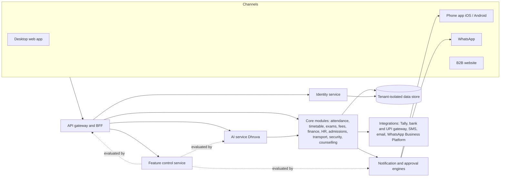

# DhruvaOne: End-to-End Functional Specification

| | |
|---|---|
| **Product** | DhruvaOne school ERP with the Dhruva AI assistant |
| **Document** | Functional specification v1.2 (draft for client review) |
| **Date** | 31 October 2026 (v1.1: API and event conflicts resolved, missing APIs added, website section added; see 10.2, decisions 11 to 25; v1.2: identity APIs found missing while writing the API contracts, decision 26) |
| **Status** | Draft: product body for sign-off, engineering annexes for build. All decisions in 10.2 (1 to 25) confirmed by the client on 31 October 2026 |
| **Sample data** | All names, numbers and amounts are sample data (group "DPS Group", hero campus DPS Gurugram Sec 45, sample day Fri 9 Oct 2026; standalone school "Saraswati Vidya Niketan", Karnal) |
| **Derived from** | The DhruvaOne design prototypes (desktop, phone, WhatsApp, website), the MVP scope and roadmap, and the functional overview (214 pages) |

**Contents**

(see the combined document)

---

# 1. Introduction and conventions

## 1.1 Purpose
This specification defines what DhruvaOne must do, end to end, so that the client can sign it off and engineering can build and test from it. It covers five areas requested by the client: **AI**, **App - Desktop**, **App - Mobile**, **Identity Management** and **WhatsApp**, plus the **B2B website** (Section 11). It adds the capability the client asked for on top of those: **a tenant administrator can enable or disable AI features and other features for a tenant** (Section 4), and the shared platform services every area depends on (Section 9).

## 1.2 Audience and how to read it
Each section has a **product body** in plain language (purpose, requirements with acceptance criteria, business rules, notifications, feature switches) and an **engineering annex** (data entities, APIs, events, state machines, permission matrix). Owners and principals can read the bodies; engineering and QA use the annexes and the acceptance criteria.

## 1.3 What is designed and what this specification adds
The prototypes show how DhruvaOne looks and behaves, but not everything a product needs (for example token lifetimes, retention, error handling or an administration console). Every requirement therefore carries a source tag:

- **[Design]**: behaviour shown in the prototypes. Where a design shows an exact label or message it is quoted.
- **[Spec]**: a requirement this document adds because the product needs it. These are decisions for the client and the team to confirm; they are not drawn anywhere yet. Appendix C lists the screens that still need design.

## 1.4 Requirement format
Every requirement is one block:

```
**IDM-OTP-001 · Must · MVP · flag: idm.web_login · [Design]**
The system shall ...
- Acceptance: Given ... When ... Then ...
- Rules: (optional)
```

| Field | Meaning |
|---|---|
| ID | `AREA-MODULE-nnn`, unique across the whole document. Areas: IDM identity, TFC tenant feature control, AI, DSK desktop, MOB mobile, WAB WhatsApp, XCT cross-cutting, WEB website. |
| Priority | **Must** (needed for the release), **Should** (expected, can slip with agreement), **Could** (nice to have). |
| Phase | **MVP** (build Oct to Dec 2026, go-live Jan to Mar 2027), **P2** (Phase 1 of the roadmap, Apr to Sep 2027), **P3** (Phase 2 of the roadmap, Oct 2027 to Mar 2028). |
| flag | The feature switch (Section 4) that turns the requirement off for a tenant, campus or role. `core` means it can never be switched off (sign-in, audit, consent, safety). Appendix A lists every flag. |
| Source tag | `[Design]` or `[Spec]`, as above. `[Design] + [Spec]` marks a designed behaviour that this document extends. |
| Acceptance | Testable conditions in Given / When / Then form, using exact labels where designed. |

## 1.5 Principles that every requirement follows
1. **Dhruva prepares, a person approves.** Anything that changes a record or reaches a family needs a named person's approval (Section 5).
2. **Manual always works.** Every AI feature has a manual path, so switching AI off never blocks a task.
3. **One thing at a time.** Each role opens on one focus card, then a queue.
4. **One number, many profiles.** Identity comes from the mobile number and the school's record; profiles never mix data (Section 3).
5. **Server-side enforcement.** Roles, scope and feature switches are enforced on the server, never only in the interface (Sections 3, 4).
6. **Everything important is audited**: who did what, when, with whose approval (Section 9).

## 1.6 Requirement counts

| Section | Area | Requirements | MVP | P2 | P3 | Design | Spec | Design + Spec |
|---|---|---|---|---|---|---|---|---|
| 3 | Identity Management (IDM) | 90 | 80 | 9 | 1 | 41 | 49 | 0 |
| 4 | Tenant Administration and Feature Control (TFC) | 102 | 98 | 4 | 0 | 4 | 98 | 0 |
| 5 | AI: the Dhruva assistant (AI) | 89 | 81 | 8 | 0 | 56 | 33 | 0 |
| 6 | App - Desktop (DSK) | 196 | 191 | 1 | 4 | 187 | 4 | 5 |
| 7 | App - Mobile (MOB) | 163 | 160 | 3 | 0 | 126 | 37 | 0 |
| 8 | WhatsApp (WAB) | 122 | 48 | 71 | 3 | 67 | 55 | 0 |
| 9 | Cross-cutting platform (XCT) | 112 | 108 | 4 | 0 | 54 | 58 | 0 |
| 11 | Website (WEB) | 34 | 33 | 1 | 0 | 22 | 12 | 0 |
| | **Total** | **908** | **799** | **101** | **8** | **557** | **346** | **5** |

Priorities across all areas: 726 Must, 168 Should, 14 Could.

## 1.7 Document map

| Section | Title | Contents |
|---|---|---|
| 1 | Introduction and conventions | This section |
| 2 | Platform overview | Surfaces, roles, tenancy model, architecture |
| 3 | Identity Management | Mobile-number and OTP sign-in, profiles and switching, PIN and biometrics, sessions, roles and scope, lifecycle |
| 4 | Tenant Administration and Feature Control | Admin console, feature catalogue, scope and schedule, AI controls, plans, audit and rollback |
| 5 | AI: the Dhruva assistant | Principles, every AI capability, control plane, safety and evaluation |
| 6 | App - Desktop | Shell and every role module (leadership, academics, operations, students) |
| 7 | App - Mobile | App shell and every role on the phone, offline, push, stores |
| 8 | WhatsApp | Business account, parent, teacher and staff flows, handover, compliance |
| 9 | Cross-cutting platform | Notifications, approvals, audit, integrations, data, security, non-functional |
| 10 | Release phasing and decisions | Roadmap mapping, decisions taken, open decisions |
| 11 | Website | B2B website pages, demo and pricing requests, website sign-in |
| Appendix A | Feature flag registry | |
| Appendix B | Glossary | |
| Appendix C | Design gaps | Screens and decisions still to be designed |

---

# 2. Platform overview

## 2.1 Surfaces
| Surface | Who | Notes |
|---|---|---|
| Desktop web app | Office roles: group owner, principal, school admin, academic coordinator, head of department, exam cell, counsellor, teacher, HR and payroll, finance and accounts, admissions, security and IT, transport in-charge; student desktop views | Sidebar with role modules, Ask Dhruva, profile switcher |
| Phone app (iOS and Android) | All of the above on the phone, plus parents, students (Classes 6 to 8 and 9 to 12) and bus attendants | English and Hindi; push notifications; offline queue for attendance and bus taps |
| WhatsApp | Parents, teachers and support staff who do not use the app | Official school account; menus, forms, photo of register or marks, voice notes (Hindi and English), handover to a person |
| B2B website | Prospective schools; anyone who needs the app link or a computer sign-in | Product, trust and pricing pages, demo and pilot requests, mobile-number sign-in (Section 11) |

## 2.2 Tenancy model
- A **group** (sample: DPS Group, 14 campuses, 43,240 students, 2,976 staff) has an owner who sees every campus on one scorecard and approves only what exceeds a campus limit. Each **campus** has its own principal, staff, students and approvals.
- A **standalone school** (sample: Saraswati Vidya Niketan, Karnal) is a separate tenant with its own admin and, where needed, a trustee. It never sees group data.
- A person may hold several **profiles** under one mobile number (for example parent at two campuses and teacher at one). Profiles and tenants never mix data.
- The **Tenant Administrator** is the person who controls the tenant's features and settings: for a group, the Group Owner or a delegated Group Admin; for a standalone school, the School Admin (Section 4).
- **DhruvaOne staff** (the Platform Owner) manage plans, entitlements and kill switches across tenants (Section 4).

## 2.3 Role catalogue
Group Owner, Principal, School Admin (standalone), Academic Coordinator, Head of Department, Exam Cell, Counsellor, Teacher, HR and Payroll, Finance and Accounts, Admissions Counsellor (CRM), Security and IT, Transport In-charge, Bus Attendant, Parent, Student (Classes 6 to 8), Student (Classes 9 to 12), Trustee (approver only), Tenant Administrator and Group Admin (new, Section 4), Platform Owner (DhruvaOne staff). Section 3 defines scope for each.

## 2.4 System context



Reading the diagram: every request passes the gateway, which asks Identity who the caller is and the Feature control service whether the capability is on for that tenant, campus and role. The AI service and the notification engine ask the same Feature control service, so a switch has the same effect on every channel.

## 2.5 API and event conventions
These rules apply to every engineering annex. They were added in v1.1 to remove duplicate and conflicting APIs (Section 10.2, decisions 11 to 22).

- **Paths.** Public platform APIs are under `/v1`, and every annex table writes the full path. Service-to-service APIs are under `/internal/v1` and are never exposed through the public gateway. WhatsApp gateway APIs (`/wa/...`, Section 8) are served by the WhatsApp gateway, not the platform API.
- **One function, one API.** Each API is defined once, in the annex of the section that owns the capability. Other sections refer to it instead of defining their own.

| Owner | APIs it defines |
|---|---|
| Section 3 Identity | Sign-in and OTP, sessions, profiles and switching, PIN and step-up, devices and push tokens, number-add requests, people, profiles, memberships, roles, guardianships, identity policy |
| Section 4 Feature control | Feature switches, change requests, snapshots, tenant settings, AI consent, AI settings, AI pause, AI quota, plans, entitlements, platform kill switches, platform console, tenant administrators and hierarchy |
| Section 5 AI | Ask Dhruva, focus list, suggestions, drafts, mark-sheet reading, homework checking, voice, translation, AI usage, explanations, models and evaluations |
| Section 6 Desktop | Business modules: dashboards, group, onboarding, academics, timetables, exams, counselling, HR and payroll, finance, admissions, security, transport, students |
| Section 7 Mobile | Phone-only services: offline sync, SOS, version policy, deep links, photo upload, parent and bus-attendant views, payment intents |
| Section 8 WhatsApp | The WhatsApp gateway (`/wa/...`) |
| Section 9 Cross-cutting | Notifications and notification preferences, push fan-out, notices, approvals, audit, reports, calendar, search, files, imports, campuses, consent and data requests, provider webhooks, integrations, telemetry, support, status |
| Section 11 Website | Website requests (leads) |

- **Errors.** Every API uses the envelope `{"error":{"code","message","feature?","reason?","request_id"}}` (Section 4).
- **Events.** Names are lower case: `domain.entity.action`, or `domain.action` where the domain is the entity, with underscores inside a multi-word part (for example `ai.quota_threshold`, `change_request.approved`). Each event is defined once, in the owner's annex; other sections list it as consumed.
