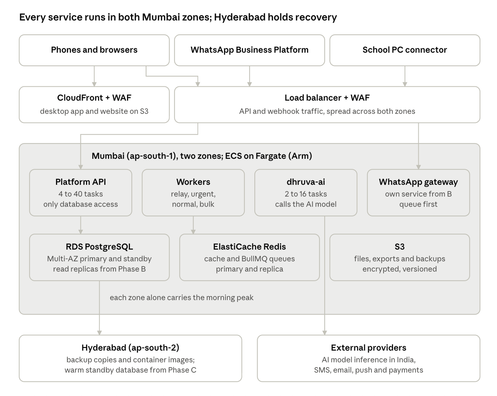
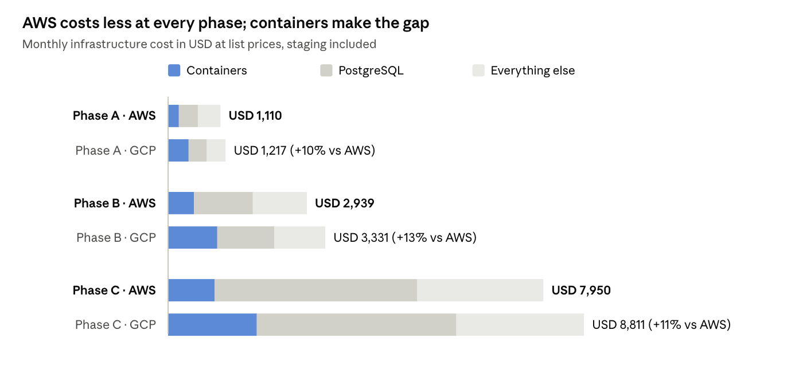
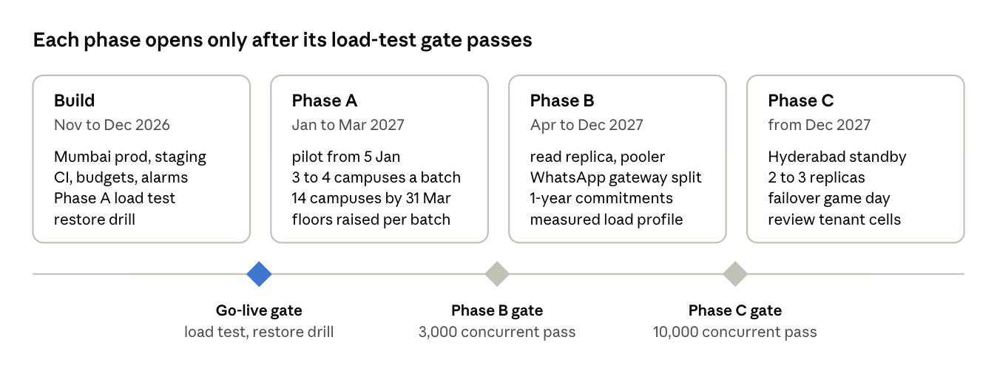

# DhruvaOne Deployment Strategy: AWS vs GCP

Oct 31, 2026 · @Ankit Verma

## Summary and decision

**Deploy DhruvaOne on AWS, with Mumbai (ap-south-1) as the primary region and Hyderabad (ap-south-2) for disaster recovery.** AWS is cheaper than Google Cloud in every phase: about 10% at Phase A, 13% at Phase B and 11% at Phase C on list prices, and 12% to 17% with one-year commitments. It also keeps primary and recovery in India, and the Terraform already built in `dhruva-infra` targets it.

| Phase | Users (peak concurrent) | AWS, list (USD/month) | GCP, list (USD/month) | AWS, 1-year commit | GCP, 1-year commit |
| --- | --- | --- | --- | --- | --- |
| A: to Mar 2027 | 10,000 (1,000) | \~1,110 | \~1,220 | \~925 | \~1,035 |
| B: Apr–Dec 2027 | 50,000 (3,000) | \~2,940 | \~3,330 | \~2,400 | \~2,815 |
| C: after Dec 2027 | 100,000 (5,000–10,000) | \~7,950 | \~8,810 | \~6,300 | \~7,350 |

Figures are infrastructure only, with staging included. AI model costs are shown separately (see AI model costs): they range from about USD 1,900 to 9,400 a month at Phase C depending on the model, and the model can be chosen independently of the cloud. SMS, WhatsApp and payment fees cost the same on either cloud and are not included. The gap comes almost entirely from containers: Fargate on Arm (Graviton) costs about half as much per vCPU as Cloud Run, while the databases cost about the same. Google Cloud would win if the team wanted the least infrastructure work, if a larger credit offer covered the difference, or if the chosen AI model could only run in India on Vertex AI (see the final decision).

Prices are an estimate as of 31 October 2026. Google list prices were read from Google's pricing pages. AWS Mumbai prices could not be fetched from AWS's pages and are approximate, so confirm both in the cloud calculators before you commit.

## What we are deploying

Six of the seven repositories run in the cloud. The seventh, `dhruva-connectors`, runs on each school's own Windows PC and only calls the platform API.

| Repository | Runs as | Notes |
| --- | --- | --- |
| dhruva-platform | API containers plus relay, urgent, normal and bulk worker containers | The only service that touches PostgreSQL and Redis |
| dhruva-ai | Containers | Calls the AI model provider; uses pgvector through the platform |
| dhruva-whatsapp | Containers, its own service from Phase B | Webhook receiver plus workers; in Phase A it runs inside the platform |
| dhruva-apps (desktop) | Static files on object storage behind the CDN | Phone builds go through Expo EAS to the app stores |
| dhruva-site | Static files on object storage behind the CDN | No server and no database (spec 10.2, decision 25) |
| dhruva-infra | Terraform for every environment | Already written for AWS |

These requirements decide where and how it runs:

| Requirement | Source | What it means for hosting |
| --- | --- | --- |
| All production data, backups and logs stay in India | XCT-NFR-008; AI 5.7 for model calls | Primary and recovery regions both in India; AI inference in India |
| 99.5% availability in school hours | XCT-NFR-001 | Two zones, and a zone loss must cost no capacity |
| WhatsApp webhook 99.9%, no lost inbound messages | WAB 8.7 | Queue-first receiver, rolling deploys |
| 40,000 alerts in 5 minutes at full group size | XCT-NFR-003 | Separate urgent worker pool, built and tested to 400 alerts a second |
| Morning peak, 7:30–9:30 am, write-heavy | Architecture workload model | Scale up on a 6:45 am schedule, not by reacting |
| Tenant isolation | XCT-TEN-002 | Row-level security; transaction-mode connection pooler |

## Usage and scaling model

The morning peak sets the size: at Phase C, 10,000 concurrent users make about 1,000 requests a second, with 3,000 a second in 60-second bursts. The figures come from the Technical Architecture's capacity model. It assumes one request every 10 seconds per active user, with students making up about 35% of users, and pilot load tests will replace these numbers.

| Phase | Registered users | Peak concurrent | Requests a second (sustained / burst) | Morning writes a second | Enrolled students | Alerts in the peak 5 minutes |
| --- | --- | --- | --- | --- | --- | --- |
| A: to Mar 2027 | 10,000 | 1,000 | 100 / 300 | 30 | 3,500 | 3,250 |
| B: Apr–Dec 2027 | 50,000 | 3,000 | 300 / 900 | 90 | 17,500 | 16,300 |
| C: after Dec 2027 | 100,000 | 5,000–10,000 | 500–1,000 / 1,500–3,000 | 150–300 | 35,000 | 32,600 |

- **Shape of a school day:** a short, write-heavy morning peak (attendance, bus taps). Then a longer, read-heavy afternoon at about 60% of it (parents and students). Nights and Sundays are near idle. Containers run on scheduled floors, so the bill follows the school day, not the peak.
- **The database is the constraint:** the API scales out by adding containers, while PostgreSQL scales up and adds read replicas. The database is the largest line of the bill on either cloud: about 40% of production cost at Phase A, rising to over 60% at Phase C.
- **Small data:** attendance for 35,000 students is under 10 million rows a year. Storage stays under 1 TB through Phase C.
- **Open point:** the spec has all 14 DPS campuses (43,240 students) live by 31 March 2027. That is Phase B load in Phase A's time window. If those dates hold, Phase B sizing is needed in March 2027, which brings that month's bill to about USD 2,900.

## Target deployment architecture

One region with two zones carries all three phases: growth adds containers, a larger database and replicas, and the Phase C warm standby, with no redesign.

Only the platform API reaches PostgreSQL. Workers send alerts through Redis queues, and dhruva-ai reads data through the platform API. Sizes per phase:

| Component | Phase A | Phase B | Phase C |
| --- | --- | --- | --- |
| API tasks (1 vCPU, 2 GB) | 4, up to 8 | 6 to 12 | 8 to 14 floor, up to 40 |
| Worker tasks (0.5 vCPU, 1 GB) | 4 | 8 | 14 |
| dhruva-ai tasks (1 vCPU, 2 GB) | 2 | 4 | 6, up to 16 |
| WhatsApp gateway tasks | Inside the platform | 2 to 4 | 4 to 8 |
| PostgreSQL, Multi-AZ | db.r7g.large (2 vCPU, 16 GB) | db.r7g.xlarge (4 vCPU, 32 GB) + 1 replica | db.r7g.2xlarge (8 vCPU, 64 GB) + 2 replicas |
| Redis, primary and replica | 3 GB (cache.t4g.medium) | 6 GB (cache.m7g.large) | 13 GB (cache.r7g.large) |
| Hyderabad | Backup copies and images | Backup copies and images | Warm standby database |

## AWS vs Google Cloud

Both clouds meet every hard requirement: each has two India regions, managed PostgreSQL with high availability and replicas, and managed containers. They differ on container cost, how much work containers take to run, and where AI models can run in India.

| Area | AWS | Google Cloud | Edge |
| --- | --- | --- | --- |
| India regions | Mumbai (ap-south-1), 3 zones; Hyderabad (ap-south-2), 3 zones | Mumbai (asia-south1), 3 zones; Delhi (asia-south2), 3 zones | Even |
| Containers | ECS on Fargate; Arm (Graviton) at about 20% below x86 | Cloud Run: the simplest to run, but x86 only and about 1.9× Fargate Arm per vCPU at list price (USD 0.0648 a vCPU-hour, Mumbai) | AWS on cost, GCP on simplicity |
| PostgreSQL | RDS for PostgreSQL Multi-AZ; Aurora later if needed | Cloud SQL Enterprise with HA; AlloyDB later if needed | Even on price, within about 5% |
| Redis (BullMQ queues, cache) | ElastiCache, primary and replica | Memorystore Standard tier | Even |
| Load balancing and firewall | ALB and WAF | Cloud Load Balancing and Cloud Armor | Even |
| Outbound internet from private services | NAT gateway per zone, about USD 82 a month for two zones | Cloud NAT, cheaper at this size | GCP, small |
| Logs | CloudWatch, about USD 0.60 a GB | Cloud Logging, USD 0.50 a GB with 50 GB a month free | GCP, small |
| AI models in India | Amazon Bedrock. Check which Claude and other models run with inference inside ap-south-1: cross-region profiles can route to other APAC regions, which breaks AI 5.7 | Vertex AI. Gemini offers regional endpoints in asia-south1; check Claude availability there | Verify both before the AI build |
| Startup credits | AWS Activate | Google for Startups Cloud Program; historically the larger offer | Check current terms; could offset year one |
| Team and hiring | Largest pool of engineers in India; existing Terraform in `dhruva-infra` | Smaller pool; Terraform would need rewriting | AWS |
| Commitment discounts | Compute Savings Plans (about 20% on Fargate, 1 year); RDS reserved instances (about 30–35%) | Cloud Run committed use (17%); Cloud SQL committed use (25% for 1 year, 52% for 3 years) | AWS for 1 year; GCP on 3-year database terms |

Two cheaper GCP options were not used for the comparison. GKE Autopilot is cheaper than Cloud Run, but it brings back Kubernetes, which the stack decision avoids. Cloud Run request-based billing can scale to zero overnight, but the morning start needs warm instances, so the always-on billing mode is the fair match for Fargate.

## Cost comparison

AWS costs about 10% less at list prices in every phase, and nearly all of the difference is containers. PostgreSQL costs the same on both clouds and is the largest line.

How the model works:

- **Sizes:** taken from the Technical Architecture's capacity plan. Containers are averaged over the week's scaling schedule: morning floor, afternoon floor and overnight minimum.
- **Unit prices:**
  - AWS: Fargate Arm at about USD 0.034 a vCPU-hour and USD 0.0037 a GB-hour; RDS r7g Multi-AZ; ElastiCache.
  - Google Cloud: Cloud Run always-on billing at USD 0.0648 a vCPU-hour and USD 0.0072 a GiB-hour (Mumbai is Tier 1); Cloud SQL Enterprise HA at the Iowa list price plus 20% for Mumbai; Memorystore Standard.
- **Everything else:** Redis, load balancing, NAT, internet egress (300 GB, 1.5 TB and 5 TB a month by phase), logs, object storage, firewall, and staging at 15% of production.
- **One-year commitments:** AWS Compute Savings Plan about 20% and RDS reserved instances about 32%; Google Cloud Run commitment 17% and Cloud SQL commitment 25%. With these, AWS is about USD 925, 2,400 and 6,300 a month by phase, against about USD 1,035, 2,815 and 7,350 on Google Cloud.
- **Not included:** SMS, WhatsApp conversation fees, payment gateway fees and support plans, which cost the same on either cloud. AI model costs follow in the next section.
- **Limits:** the AWS Mumbai unit prices come from memory, not a fetched page, so check them in the [AWS Pricing Calculator](https://calculator.aws/#/addService/RDSPostgreSQL). Prices are in USD before GST.

## AI model costs

The choice of AI model moves the bill more than the choice of cloud. At Phase C, Claude costs about USD 9,400 a month, Amazon Nova about 3,600 and Google Gemini about 1,900 for the same work, against infrastructure of about USD 8,000. Claude is the same price on Bedrock and Vertex AI. Gemini runs only on Google Cloud, and Nova only on AWS.

**Usage model.** About 15 AI requests per registered user a month, with staff heavy and parents light: 150,000 requests a month at Phase A, 750,000 at B and 1.5 million at C. This is well under the spec's capacity requirement of 1 million requests a day.

| Kind of request | Share | Tokens in / out | Examples |
| --- | --- | --- | --- |
| Light | 40% | 1,200 / 150 | Focus-list ranking, suggestions, classification, short translations |
| Ask Dhruva | 45% | 3,500 / 350 | Grounded answers with retrieved records |
| Drafts | 10% | 2,500 / 700 | Notices, replies, lesson plans, question papers |
| Photo reading | 5% | 2,000 / 600 | Marks sheets and registers |

**Models compared:**

- **Claude, on either cloud:** Haiku 4.5 for light work and Ask Dhruva, Sonnet for drafts and photos. List prices plus about 10% for an in-country endpoint.
- **AWS-native:** Amazon Nova Lite for light work, Nova Pro for the rest.
- **Google-native:** Gemini 2.5 Flash-Lite for light work, Gemini 2.5 Flash for the rest.

Voice notes (3,000, 15,000 and 30,000 minutes a month) go through Amazon Transcribe at about USD 0.024 a minute or Google Speech-to-Text at about USD 0.016.

Total monthly cost, infrastructure plus AI, USD at list prices:

| Option | Phase A | Phase B | Phase C |
| --- | --- | --- | --- |
| AWS infrastructure + Gemini through Vertex AI in Mumbai | \~1,380 | \~4,270 | \~10,640 |
| Google Cloud for everything, with Gemini | \~1,460 | \~4,540 | \~11,230 |
| AWS for everything, with Amazon Nova | \~1,540 | \~5,100 | \~12,280 |
| AWS for everything, with Claude | \~2,120 | \~8,000 | \~18,060 |
| Google Cloud for everything, with Claude | \~2,200 | \~8,270 | \~18,680 |

What this means:

- **AWS infrastructure is still the cheaper base.** For any given model the AI cost is the same, or the model runs on only one cloud. The infrastructure saving of about 10% holds whichever model wins.
- **Pick the model by evaluation, not by cloud.** The spec asks for the cheapest model that passes evaluation (AI 5.7). `dhruva-ai`'s provider adapter can call a model on another cloud. Gemini wins on price if it passes the Hindi, photo-reading and grounding evaluations. Claude costs about 4× more and may be needed for drafts or Hindi quality.
- **Mix tiers.** Routing light work to the cheapest passing model and only drafts to a larger one is where most of the saving lies. Per-tenant AI quotas (TFC-AIC-006) cap the exposure.
- **Residency gates all of this.** Each model must run with inference inside India (AI 5.7). Confirm which of Claude, Nova and Gemini are served from ap-south-1 or asia-south1 before the evaluation starts. A cross-cloud call also needs legal sign-off.

The model prices are approximate list prices from memory, as of mid-2026, because no pricing page could be fetched for this section. Check them on the Bedrock and Vertex AI pricing pages. Prompt caching and batch discounts, which both clouds offer, would lower every row.

## Final decision

**AWS: Mumbai primary, Hyderabad recovery, ECS on Fargate (Arm), RDS for PostgreSQL Multi-AZ, ElastiCache, S3 and CloudFront, all managed through the existing Terraform.** From November 2026 to December 2027 (Phases A and B), AWS saves about USD 4,000 at list prices. From Phase C it saves about USD 860 a month, or about USD 1,050 with one-year commitments. On their ability to scale, the two clouds are equal.

Why AWS, in order of weight:

1. **Cost.** It is cheaper at every phase. Containers are the main difference: Fargate Arm costs about half of Cloud Run per vCPU, and container count is what grows with users.
2. **Scaling.** The scaling path is a straight line. Fargate scheduled scaling covers the 6:45 am morning floor. RDS adds read replicas and moves to Aurora without new tooling, and Hyderabad takes the Phase C warm standby.
3. **Speed.** `dhruva-infra` already defines both AWS regions, the network, RDS, ElastiCache, S3 and ECS. Moving to Google Cloud means rewriting it before the January 2027 pilot.
4. **People.** It has the largest hiring and on-call pool in India for a 7:30 am peak that someone must cover.

**AI models are a separate choice.** At Phase C the model costs between USD 1,900 and 9,400 a month, about as much as the infrastructure. Run the AI evaluation on Claude, Gemini and Nova with inference in India, and pick the cheapest that passes, through `dhruva-ai`'s adapter. The cheapest combination modelled is AWS infrastructure plus Gemini on Vertex AI in Mumbai, at about USD 10,600 a month at Phase C. Google Cloud for everything with Gemini comes to about USD 11,200.

What would change the decision:

- **AI residency:** if the AI model the team picks runs in India only on Vertex AI, keep the platform on AWS and call that model through the `dhruva-ai` provider adapter, provided legal accepts the cross-cloud call. Otherwise move to Google Cloud before building.
- **Credits:** if Google's startup credits cover at least USD 15,000 more than AWS's, taking them for year one pays for the Terraform rewrite. Build only on portable pieces: containers, PostgreSQL, Redis and S3-compatible storage.
- **Team size:** if two engineers run everything with no infrastructure specialist, Cloud Run's lower operating effort can be worth its 10% to 13% premium.
- **Client mandate:** if a group client mandates a cloud, follow it; the architecture stays the same.

## Environments and release process

Three AWS accounts under one organisation keep production isolated: dev, staging and prod, plus a small shared account for container images and Terraform state.

| Environment | Purpose | Size and schedule |
| --- | --- | --- |
| dev | Engineers' integration testing | Single zone, smallest sizes, off outside working hours |
| staging | Release candidates, load tests at the next phase's size, the pilot demo tenant | Same shape as prod. About 15% of prod cost because it is shut overnight and on Sundays, and scaled up only for load tests |
| prod | Schools | Two zones in Mumbai; backups and images copied to Hyderabad |

Release path, unchanged from the stack document:

1. **Pull request:** GitHub Actions runs typecheck, tests, the spec coverage gate and the build (the `ci.yml` now on every repo), and Terraform plans infrastructure changes.
2. **Merge to main:** CI builds an Arm container image, signs it, pushes it to ECR in the shared account, and deploys it to staging automatically.
3. **Promote to prod:** a manual approval in GitHub Actions starts a rolling deploy on ECS. The canary is the pilot tenant first, with automatic rollback on error rate. Migrations are expand-then-contract and run before the new code.
4. **Phone apps:** Expo EAS Build and Submit to TestFlight and Play internal testing. Over-the-air updates cover JavaScript fixes; store releases are staged.
5. **Static sites (desktop app, website):** build to S3 and invalidate CloudFront.

No releases on exam days, pay days or a campus's go-live week, and no change windows between 6:30 and 10:00 am on school days. Feature switches (Section 4 of the spec) turn off a bad feature without a deploy.

## Reliability, recovery, security and observability

Losing a zone costs no data and recovers within 5 minutes in every phase. Losing the region becomes a 1-hour recovery once the Hyderabad warm standby arrives at Phase C. These are the Technical Architecture's proposed targets, still awaiting sign-off.

| Phase | Zone loss: data lost, time to recover | Mumbai region loss: data lost, time to recover | Backups |
| --- | --- | --- | --- |
| A | None, within 5 minutes | Up to 5 minutes, within 4 hours, restored from backups in Hyderabad | 14-day point-in-time recovery; daily snapshot copies to Hyderabad |
| B | None, within 5 minutes | As Phase A | As Phase A |
| C | None, within 5 minutes | Up to 1 minute, within 1 hour, to the warm standby in Hyderabad | 35-day point-in-time recovery |

- **Decision needed:** a 4-hour region recovery on its own breaks the 99.5% school-hours target for that month, which allows about 110 minutes of downtime. Either the client accepts a separate disaster allowance, or the warm standby moves into Phase B for about USD 450 a month more (a single-zone 4 vCPU, 32 GB database in Hyderabad).
- **Each zone carries the full peak:** scheduled floors are sized so that one zone can carry the sustained morning peak with 25% spare. The burst is absorbed by autoscaling.
- **Load shedding:** bulk queues pause first, then reports and AI. Attendance, transport, sign-in and safety are never shed.
- **Security:**
  - Private subnets for everything except the load balancer.
  - WAF with rate rules in front of CloudFront and the ALB.
  - KMS encryption at rest; secrets in Secrets Manager.
  - GuardDuty and CloudTrail, with logs to a locked account.
  - The database role owns no tables, and row-level security is tested under load on every release.
- **Observability:**
  - OpenTelemetry from every service, so the cloud tooling can change.
  - Tenant and request IDs on every log line, trace and metric (XCT-NFR-004).
  - Synthetic checks every minute from India, plus a 7:15 am check that the morning scale-up happened.
  - Budgets and cost alerts per environment, with every resource tagged by environment and service.

## Rollout and next steps

Production must be live and load-tested in Mumbai before the 5 January 2027 pilot. After that, each phase starts only when its load-test gate passes.

Only commit to Savings Plans or reserved instances after three months of real usage, from about April 2027.

- [ ] Confirm AWS Mumbai prices for Fargate, RDS, ElastiCache and NAT in the AWS calculator, and Google's Mumbai Cloud SQL price, by Nov 7, 2026
- [ ] Confirm which AI models run with inference inside ap-south-1 (Bedrock) and asia-south1 (Vertex AI), with legal. Then run the AI evaluation on Claude, Gemini and Nova, and check the token prices on the Bedrock and Vertex AI pricing pages, by Nov 7, 2026
- [ ] Apply for AWS Activate and Google for Startups credits; compare the offers against the decision's USD 15,000 threshold, by Nov 30, 2026
- [ ] Client decision on region-loss recovery: a disaster allowance, or the warm standby moved into Phase B, by Nov 30, 2026
- [ ] Apply `dhruva-infra` to dev, staging and prod; run the Phase A load test and a restore drill, by Dec 15, 2026

## Sources

- [DhruvaOne Technical Architecture](https://github.com/Dhruva-One/dhruva-docs/blob/main/Technology/DhruvaOne-Technical-Architecture.md): workload model, capacity plan, recovery targets and delivery gates
- [DhruvaOne Repositories and Technology Stack](https://github.com/Dhruva-One/dhruva-docs/blob/main/Technology/DhruvaOne%20Repositories%20and%20Technology%20Stack.md): the earlier cloud comparison and stack choices
- [DhruvaOne Functional Specification v1.1](https://github.com/Dhruva-One/dhruva-docs/blob/main/Functional/DhruvaOne-Functional-Spec.md): XCT-NFR-001, -003, -004 and -008, AI 5.7, WAB 8.7
- [Google Cloud Run pricing](https://cloud.google.com/run/pricing): per-second rates and Tier 1 status of asia-south1
- [Google Cloud SQL pricing](https://cloud.google.com/sql/pricing): Enterprise edition, HA and committed-use rates (Iowa list)
- [AWS Fargate pricing](https://aws.amazon.com/fargate/pricing/): read, but the Mumbai rates did not load; AWS Mumbai figures in this doc are approximate
