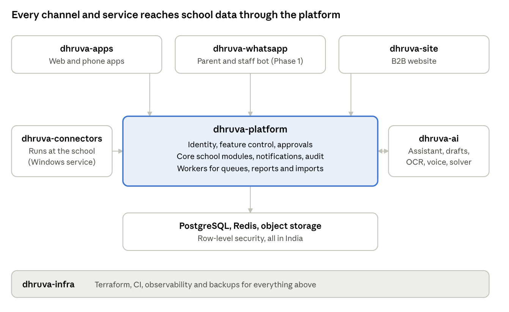
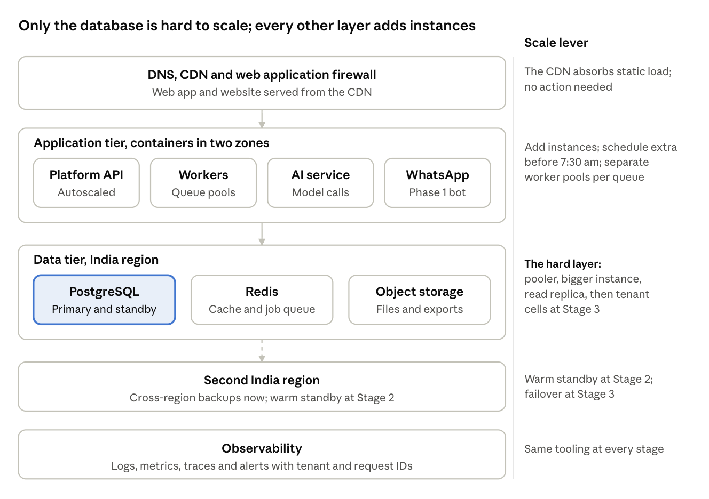

# DhruvaOne Repositories and Technology Stack

Oct 31, 2026 · @Ankit Verma

## Summary

Use 7 code repositories at full scope, of which 5 are needed for the MVP build (Oct to Dec 2026), on a TypeScript-first stack with one Python service for AI. A modular monolith, not microservices, holds the school's business logic.

| Repository | Stack | Needed from |
| --- | --- | --- |
| dhruva-platform | TypeScript, NestJS, PostgreSQL with row-level security, Redis, S3-compatible storage | MVP |
| dhruva-ai | Python, FastAPI, swappable model providers, pgvector, OR-Tools | MVP |
| dhruva-apps | React and Vite (desktop web), React Native with Expo (phone), shared packages, in one monorepo | MVP |
| dhruva-site | Astro (or Next.js) with a headless CMS | MVP |
| dhruva-infra | Terraform, containers on managed Kubernetes or ECS, OpenTelemetry | MVP |
| dhruva-whatsapp | TypeScript, Fastify, queue-first | Phase 1 (Apr to Sep 2027) |
| dhruva-connectors | Go (Windows service for Tally, biometric, later GPS and RFID) | Phase 1 and 2 |

`dhruva-docs` (the spec and decision records) stays as it is, and `dhruva-assets` can be archived once the project cards are imported.

Three reasons drive the choice:

1. **One language where it counts.** TypeScript in four of the seven repositories means shared types, validation and API clients, which suits a small team with about ten weeks to the pilot.
2. **The spec's isolation rule maps directly onto PostgreSQL.** XCT-TEN-002 requires every query to be filtered by tenant and campus in the data layer, which is what row-level security does.
3. **AI is kept behind the platform.** Dhruva reads school data only through the platform's API, so every permission and feature switch applies to AI exactly as to a person.

## What the spec demands of the technology

The functional spec fixes more of the architecture than it first appears: eleven requirements decide the stack before any preference does.

| Requirement (spec reference) | Consequence for the stack |
| --- | --- |
| Every business table carries tenant and campus, filtered in the data layer (XCT-TEN-002) | A database with native row-level security, with tests that call every API as a user of another campus |
| A group never sees a standalone school's data, and platform staff get time-boxed support grants only (XCT-TEN-001, 002) | One tenant-aware data model, not shared tables with filters left to application code |
| All production data, backups and logs in India; AI providers included (XCT-NFR-008, AI 5.7) | An India cloud region with an India disaster-recovery region, and model providers chosen by where inference runs |
| 3,000 teachers marking attendance and 40,000 push alerts in 5 minutes, with 3x headroom (XCT-NFR-003) | Queue-based fan-out and workers that scale separately from the API |
| Attendance in 2 s, search in 1 s, Owner Overview of 14 campuses in 2.5 s, push to device in 5 s (XCT-NFR-002) | Caching, read-optimised roll-ups, and a fast push pipeline to APNs and FCM |
| 99.5% uptime in school hours; WhatsApp webhook 99.9% with no lost inbound messages (XCT-NFR-001, WAB 8.7) | The webhook receiver queues before it processes, and deploys never drop messages |
| iOS 15 and Android 8 or later, 3 GB RAM phones, push, deep links, offline queue, camera, voice (MOB-NFR-001 to 006) | A real native-capable phone toolkit, not a web wrapper |
| English and Hindi everywhere, Devanagari on low-end Android, WCAG 2.1 AA (XCT-NFR-005, 006) | Internationalisation built in from the start, shared across web and phone |
| Payment gateway, TallyPrime, bank feeds, SMS, email, WhatsApp, push behind replaceable adapters (XCT-INT-001 to 005) | An adapter layer in the platform, plus an on-campus connector for Windows-based Tally |
| Dhruva drafts, a person approves; AI must never be the only way to do a task (AI 5.1, flags) | AI as a separate service the platform can switch off per tenant, campus and role |
| Feature switches evaluated the same way on every channel (spec 2.4) | One feature-control module with a client library that every repository calls |

The load figures are modest for modern infrastructure: the largest sample campus has 4,120 students and the whole group 43,240. Peaks are short and predictable (7:30 to 9:30 am and fee due dates), so the design problem is isolation and reliability, not raw scale.

## Repository map

Seven repositories give each deployable thing its own release cycle without splitting the business logic. The split follows four tests: a different language or toolchain, a different release cadence, a different security boundary, or a different place where it runs.

| Repository | Holds | Test it passes |
| --- | --- | --- |
| dhruva-platform | Gateway and BFF, identity, feature control, all core modules (attendance, timetable, exams, fees, finance, HR, admissions, transport, security, counselling), notifications and approvals engines, audit, reports, files, integrations, background workers | The system of record and the only place that enforces tenant isolation and feature switches |
| dhruva-ai | Ask Dhruva, drafts, marks from a photo, timetable and seating generation, voice and translation, evaluations, cost metering | Different language and ecosystem, its own scaling and spend, India-region inference |
| dhruva-apps | Desktop web app, phone app (parents, staff, students, bus attendants), shared packages: API client, design tokens, English and Hindi strings, feature-flag client | One codebase family with one team and a shared contract; web and store releases run as separate pipelines |
| dhruva-site | B2B website: product, trust and pricing pages, demo requests, sign-in entry | Marketing cadence, SEO needs and different contributors |
| dhruva-infra | Terraform, deployment configuration, CI templates, observability, backups, environments | Different access: few people may change production infrastructure |
| dhruva-whatsapp | Webhook receiver, conversation state, template manager, photo and voice intake, handover to a person | A 99.9% availability target and per-tenant rate isolation; holds no business rules |
| dhruva-connectors | TallyPrime connector, biometric import, later bus GPS and RFID ingestion | Runs on Windows machines inside the school, in a different language and install model |

### How they talk

Everything reaches data through `dhruva-platform`. The apps, the WhatsApp gateway and the AI service call its API with the signed-in person's identity, so a permission or feature switch is checked in one place. The platform publishes an OpenAPI description and a set of event schemas; a typed client is generated from them and consumed by `dhruva-apps` and `dhruva-whatsapp`. The contracts live in the platform repository, so they cannot drift from the code.

The apps, the WhatsApp gateway, the website and the AI service call the platform's API; the connectors sit inside the school and push and pull through it. Only the platform touches the database.

### Options considered

| Option | Verdict |
| --- | --- |
| One monorepo for everything | Simplest to start, but mixes a Python service, store-released phone builds, a marketing site and infrastructure under one access model and one CI. Rejected. |
| A repository per service in the spec diagram (12 or more) | Matches the diagram literally, but the load does not justify the operational cost, and cross-service changes would need several pull requests. Rejected. |
| Web and phone in separate repositories | Cleaner ownership on paper, but duplicates the API client, translations, design tokens and flag client, which then drift. Rejected for now; split only if two teams need independent tooling. |
| WhatsApp gateway inside the platform | Fine for the MVP, which only needs alerts and delivery reports. Move it out when the Dhruva bot starts, because its availability target is stricter than the rest. |
| Seven repositories as above | Chosen. |

## Stack decisions and the alternatives

Each choice below lists the realistic options, what separates them for this product, and the pick. Where the answer depends on your team's skills, the table says so.

### Backend platform

| Option | For | Against |
| --- | --- | --- |
| **TypeScript with NestJS (chosen)** | One language with web, phone and WhatsApp gateway; shared types and validation; large hiring pool in India; modular structure suits a modular monolith; strong ecosystem for queues, OpenAPI and testing | Single-threaded runtime needs care for heavy CPU work (kept in workers or the AI service); less strict than Java or .NET |
| Python with Django | Fastest for admin-heavy CRUD, mature ORM and admin site, same language as the AI service | A second language boundary to the web and phone apps; weaker type sharing; async and high-concurrency paths take more effort |
| Java or Kotlin with Spring Boot | Very mature, strong for large teams and long-lived systems, excellent tooling | Heavier to start, slower iteration for a ten-week MVP, no type sharing with the front ends |
| .NET (C#) | Strong typing, excellent performance, good for teams with Microsoft experience | Smaller local hiring pool for startups, no type sharing, more Windows-centric tooling culture |
| Go | Fast, small, easy to deploy | Few batteries for this much business logic; slower to build 30 modules of forms and workflows |

Pick TypeScript and NestJS unless your engineers are clearly stronger elsewhere. If they are, take Django or Spring: the repository split in this document does not change.

### Database

| Option | For | Against |
| --- | --- | --- |
| **PostgreSQL with row-level security (chosen)** | Native row-level security enforces the tenant and campus rule in the data layer (XCT-TEN-002); transactions for fees and payroll; JSON columns for flexible forms; pgvector for AI retrieval; full-text search for the first search version; managed everywhere in India | Needs disciplined migrations and index design; one primary database must be sized for the morning peak |
| MySQL or MariaDB | Familiar, widely hosted | No native row-level security, so isolation falls back to application code |
| MongoDB or other document stores | Flexible schema | Weak fit for money, payroll and approvals that need transactions and relational reporting |
| A database per tenant | Strongest isolation, simple per-tenant backup | Hundreds of schools mean hundreds of migrations and connection pools; heavy for a young team |
| Schema per tenant | Middle ground | Migrations multiply with tenants; group roll-ups across campuses become awkward |

One shared PostgreSQL with row-level security and a tenant and campus column on every table, tested by a suite that tries to read across boundaries. The option to move a very large tenant to its own database later stays open.

### Queue, cache and storage

| Need | Chosen | Alternatives |
| --- | --- | --- |
| Background jobs, notification fan-out | Redis with BullMQ to start; move to a managed queue (Amazon SQS or similar) if volumes or durability demand | Kafka (too heavy for this load), RabbitMQ (fine, one more system to run) |
| Cache and rate limits | Redis | In-process cache only (cannot be shared across instances) |
| Files: photos, documents, report exports, backups | S3-compatible object storage in an India region | Database blobs (do not scale), local disks (not durable) |
| Search | PostgreSQL full-text and trigram search first; add OpenSearch only if the 1-second budget fails | Starting with Elasticsearch or OpenSearch (extra system for no proven need) |

### AI service

| Option | For | Against |
| --- | --- | --- |
| **Python with FastAPI (chosen)** | The ecosystem for models, OCR, speech and optimisation; OR-Tools for timetable and seating; easy to evaluate and test prompts; scales on its own | A second language in the platform; needs a clear API boundary |
| AI inside the TypeScript platform | One codebase | Mixes model spend, long-running calls and ML libraries into the system of record; harder to switch providers or run evaluations |
| A single hosted agent product | Fastest demo | Hard to meet the grounded-answer, per-tenant switch, audit and India-residency rules |

The service uses a provider abstraction so models can change, a retrieval layer over data fetched through the platform API (never direct database reads), a prompt and evaluation registry, and per-tenant cost metering. Model choice is gated by two spec rules: inference for prompts holding student or staff data stays in an India region, and the cheapest model that passes the evaluation is used. Verify region availability with each provider before committing.

### Desktop web app

| Option | For | Against |
| --- | --- | --- |
| **React, TypeScript and Vite as a single-page app (chosen)** | Role modules behind sign-in need no SEO; large component and hiring ecosystem; fast builds; shares types with the platform and phone | Needs a deliberate design system and accessibility testing |
| Next.js | Useful when pages must be indexed or server-rendered | Adds server rendering complexity to an app that sits behind login |
| Angular | Opinionated, good for large teams | No code sharing with React Native; smaller overlap with the phone team |
| Vue or Svelte | Pleasant to write | Smaller shared ecosystem with the phone app |

### Phone app (iOS and Android)

| Option | For | Against |
| --- | --- | --- |
| **React Native with Expo (chosen)** | One codebase for both platforms, shared TypeScript packages with the web app, push, camera, microphone, deep links and secure storage covered, cloud builds, over-the-air fixes for the JavaScript layer | Heavy animation or very low-end devices need profiling; some native modules need custom development builds |
| Flutter | Excellent performance and UI consistency | Dart does not share code with the web app; separate packages for API client, flags and strings |
| Native Swift and Kotlin | Best platform fit and performance | Two codebases and two teams for a ten-week MVP |
| A progressive web app only | Cheapest | Weak push on iOS, no reliable offline queue or biometrics, and no store presence for parents |

The apps must run on 3 GB Android phones and iOS 15. React Native with the Hermes engine handles that; budget profiling time for the attendance and bus-attendant screens, which are the offline-sensitive ones.

### WhatsApp gateway

TypeScript with Fastify, receiving the WhatsApp Business Platform webhooks, writing each inbound message to a queue before processing, and keeping conversation state in its own tables. It calls the platform and AI APIs and holds no business rules. Alternatives are a no-code chatbot builder (loses the audit and tenant isolation the spec demands) or a vendor bot platform (locks conversation data outside your control).

### B2B website

| Option | For | Against |
| --- | --- | --- |
| **Astro (or Next.js) with a headless CMS (chosen)** | Fast static pages, good SEO, marketing can edit content without releases | Two systems (site and CMS) to maintain |
| WordPress | Familiar to marketing teams, quick | A large attack surface and plugin upkeep for a product that sells on trust |
| A website builder | Fastest | Hard to integrate the mobile-number sign-in entry and demo requests |

### Infrastructure and cloud

| Option | For | Against |
| --- | --- | --- |
| **AWS India regions with Terraform (chosen)** | Mumbai plus Hyderabad gives an in-country primary and disaster-recovery pair; widest managed services; large hiring pool | Cost needs watching; check each AI provider's availability in region |
| Azure Central India and South India | Good if the team or clients already use Microsoft | Fewer teams in India with deep experience at startup scale |
| Google Cloud Mumbai and Delhi | Strong data and AI tooling | Smaller managed-service footprint for the rest of the stack |
| A local data-centre provider | Lowest unit cost, clear residency | You operate more yourself; slower to scale for a short build |

Use managed PostgreSQL, managed Redis, object storage, and containers on managed Kubernetes or ECS. Choose one cloud and stay on it; the spec's residency rule is met by any provider that keeps primary, backup and logs in India. Observability uses OpenTelemetry with Grafana or a commercial equivalent, alerting on error rate, latency, queue depth, notification failure and integration failure (XCT-NFR-004).

### Connectors

Go, packaged as a single Windows executable running as a service on the school's network, because TallyPrime runs on a Windows machine inside the school and exposes its data locally. The same agent later takes biometric imports and, in Phase 2, bus GPS and RFID. Alternatives are .NET (equally valid on Windows, heavier to maintain with a Go-light team) or a Node package (needs a runtime installed on every school PC).

## Why this stack as a whole

The stack is chosen to make the first pilot (Gurugram Sec 45, 5 January 2027) safe and fast, while keeping the later phases open. Five principles sit behind it.

1. **Isolation is enforced in the database, not trusted to code.** A school's fees, staff and counselling notes are the product's most sensitive asset. Row-level security plus a cross-campus test suite makes a mistake in application code fail closed.
2. **A modular monolith, extracted only when a module earns it.** At 43,240 students and short morning peaks, one well-structured deployable with separate workers handles the load. It keeps feature switches, approvals and audit in one place, and a change to fees and receipts is one pull request, not four. Module boundaries are enforced in code, so a later extraction is a move, not a rewrite.
3. **One language across the human-facing code.** Types generated from the platform contract reach the web app, phone app and WhatsApp gateway. Fewer translation errors between layers, and one engineer can work across all of them.
4. **AI behind a door the school controls.** Dhruva calls the platform with the person's permissions, can be switched off per tenant, campus, role or date, and never writes a record without approval. The manual path always works, as the spec requires.
5. **Replaceable adapters at every external edge.** Payment, SMS, email, push, WhatsApp, Tally, bank feeds and AI models sit behind adapters, so a provider failure or price change is a configuration change.

### What we give up

- **TypeScript is less strict than Java or .NET.** Mitigated with strict compiler settings, schema validation at every boundary, and contract tests.
- **A shared database is a single point of load.** Mitigated with read replicas, caching of roll-ups and queue-based writes for peaks. The exit is moving the largest tenant to its own database.
- **Two languages (TypeScript and Python) plus Go later.** Each exists because of a real constraint: the ML ecosystem, and Windows deployment inside schools. Keep the count at three.
- **React Native is not fully native.** Mitigated by profiling on a 3 GB Android phone before the pilot.

### When we would choose differently

| If | Then |
| --- | --- |
| Your engineers are strongest in Python or Java | Use Django or Spring for the platform; keep every other decision |
| The client mandates a specific cloud or an Indian provider | Keep the architecture; swap the Terraform and managed services |
| Two separate teams own web and phone | Split `dhruva-apps` into two repositories and publish the shared packages |
| A tenant grows past what one database handles | Move that tenant to its own database; the data model already carries tenant everywhere |
| The AI roadmap moves heavily to on-device or private models | Keep `dhruva-ai` separate and add a model-serving layer inside it |

## Builds, signing and releases

Builds do not live in git: installable files go to the stores' testing channels, a permanent copy goes to private storage in India, and only source and build configuration stay in `dhruva-apps`.

| Need | iOS | Android |
| --- | --- | --- |
| Internal testers (Gurugram staff test, 14 to 18 Dec 2026) | TestFlight | Play Console internal testing track |
| Pilot campus and wider rollout | TestFlight external group, then App Store | Closed testing, then production with staged rollout |
| Permanent copy of every release | `.ipa` archived in a private bucket | `.aab` and `.apk` archived in a private bucket |

- **Build service.** Expo EAS Build builds both platforms in the cloud, so releases do not depend on a Mac; EAS Submit uploads to TestFlight and Play. The alternative is GitHub Actions with macOS runners, which costs more per build and needs more setup.
- **Archive.** Copy each release to a private India-region bucket, for example `dhruva-mobile-builds/ios/1.4.0+212/`, with the symbol files used to read crash reports. CI artifacts expire (GitHub's default is 90 days), so the archive is what lets you reproduce or roll back a version.
- **Signing keys are the most important files to protect.** Keep the Android upload key, iOS distribution certificate, provisioning profiles and App Store Connect key in a secrets manager, with an offline second copy held by two named people. Never commit them. Turn on Play App Signing so a lost upload key can be reset. Register the Apple Developer and Google Play accounts to DhruvaOne the company, not to an individual.
- **Identifiers.** One app for all roles with profile switching, so one bundle ID per platform (for example `in.dhruvaone.app`), plus separate staging and production IDs so testers can install both.
- **Versioning.** Each build number maps to a git tag in `dhruva-apps`; release notes live in `dhruva-docs`. The minimum-supported-version check in the platform uses these numbers to force an update (XCT-ENV-002).
- **Environments and rollback.** Development, staging with synthetic data, then production; releases go to the pilot tenant first, then batches, with rollback in 30 minutes and no releases on exam days, pay days or a campus's first go-live week (XCT-ENV-001, 002). Store releases cannot be pulled back instantly, so use staged rollout and keep server-side feature switches ready to turn a feature off.

## Phasing: what to create when

Create five repositories now and two later, following the roadmap in the MVP scope document. The pilot at Gurugram Sec 45 starts on 5 January 2027, so the first ten weeks go to the platform, the apps and the AI features that the MVP already includes.

| Phase | Dates | Repositories and work |
| --- | --- | --- |
| MVP build | Oct to Dec 2026 | `dhruva-platform`, `dhruva-ai`, `dhruva-apps`, `dhruva-site`, `dhruva-infra`. WhatsApp alerts and delivery reports live in the platform behind an adapter. Tally daily export is a platform module. Gate: principal signs off after the staff test of 14 to 18 Dec |
| Go-live | Jan to Mar 2027 | Pilot at Gurugram Sec 45 from 5 Jan, then 3 to 4 campuses every two weeks; all 14 live by 31 Mar. Hardening, load tests against XCT-NFR-003, no new repositories |
| Phase 1 | Apr to Sep 2027 | Add `dhruva-whatsapp` (Dhruva on WhatsApp, regional languages) and `dhruva-connectors` (two-way Tally sync, biometric import, full payroll integrations) |
| Phase 2 | Oct 2027 to Mar 2028 | Extend `dhruva-connectors` for bus GPS and RFID; open APIs published from `dhruva-platform` |

Move `dhruva-whatsapp` earlier if the client confirms the Dhruva bot belongs in the first release (open question 1 in the WhatsApp section of the spec).

## Risks and open decisions

| Item | Why it matters | Suggested owner and timing |
| --- | --- | --- |
| Team skills | The TypeScript-first choice assumes strong JavaScript and TypeScript engineers; if not, change the platform language (see the table above) | Engineering lead, before repositories are created |
| AI model provider and region | The spec requires India-region inference for prompts with student or staff data, and the list of providers and regions changes; availability must be verified | Engineering lead and legal, before the AI build starts |
| Photo reading (OCR) provider and Hindi handwriting accuracy | Not decided in the spec (AI open question 3); affects the marks-from-photo feature | AI lead, after a short pilot on real mark sheets |
| Cloud choice | Affects cost, region pairs and managed services | Founders and engineering lead, this week |
| Tally phasing | The MVP may need only a daily export; two-way sync is Phase 1 in the roadmap but the prototype shows it now | Product, with the client |
| WhatsApp bot in first release | Decides when `dhruva-whatsapp` is created | Product, with the client |
| Offline mode | Spec marks offline queueing as Phase 1; attendance in poor networks is a real risk for the pilot | Mobile lead, plan a retry-safe design from day one |
| Apple and Google developer accounts | Must be registered to the company and can take days to approve | Operations, this week |

The provider and cloud points need an owner decision before any code is written; the rest can be settled during the first sprint.

## Scalable architecture: start small, grow in three stages

The pilot is small for a database and a few containers: the spec's morning peak of 3,000 teachers marking attendance over about 10 minutes is roughly 5 submissions a second on average, and 40,000 push alerts in 5 minutes is about 130 sends a second. The architecture therefore starts with one region and a handful of managed services, and grows by adding capacity at known points rather than by redesign. Nothing in Stage 1 has to be thrown away in Stage 2 or 3.

|  | Stage 1: Pilot and 14 campuses | Stage 2: Growth, many groups and schools | Stage 3: Scale, thousands of schools |
| --- | --- | --- | --- |
| When | Jan to Mar 2027 | After the 14 campuses are stable and new tenants sign | When one database cluster cannot hold the next tenants |
| Compute | Containers on a managed container service, no Kubernetes; platform API 2 to 4 instances, workers 2, AI service 1 to 2 | Autoscaling API and separate worker pools for urgent notifications, imports and reports; scheduled scale-up before 7:30 am and fee due dates | Kubernetes if the number of services and teams justifies it; workers scale per queue |
| Database | One managed PostgreSQL primary with a standby in a second zone; point-in-time recovery | Connection pooler, one or more read replicas for reports and roll-ups, large tables partitioned by month | Tenant cells: several PostgreSQL clusters, each holding a set of tenants, behind a thin routing layer; very large tenants get their own cluster |
| Async | Redis-backed job queue | Managed queue service for durability; urgent and normal queues separated | Event streaming (a managed Kafka-style service) for audit, analytics and notifications |
| Search and analytics | PostgreSQL full-text and trigram search; reports straight from the database | Search index only if the 1-second search budget fails; materialised roll-ups for the Owner Overview | Data warehouse for group scorecards and AI features |
| Resilience | Two zones in one India region; backups copied to a second India region | Warm standby in the second India region | Second region serves reads; documented regional failover |
| What stays the same | One codebase, one API contract, row-level security, feature switches, adapters |  |  |

The triggers for moving between stages are in the scaling playbook below. They are planning thresholds to calibrate with the load test against XCT-NFR-003, not fixed numbers.

## Runtime architecture and where each layer scales

The application tier, workers and AI service scale by adding instances. The database is the one layer that needs a plan, which is why it is highlighted: pooler first, then a larger instance, then a read replica, and finally tenant cells.

## Scaling playbook

Pull the levers in this order: each is cheaper and less risky than the one after it. Watch the signal, act at the threshold, and calibrate the thresholds with load tests before the pilot.

| Order | Signal to watch | Action | Moves you toward |
| --- | --- | --- | --- |
| 1 | API latency or CPU rising at the 7:30 to 9:30 am peak | Autoscale API instances; schedule extra capacity before the peak and before fee due dates | Stage 1 |
| 2 | Slow or lost side effects after attendance (parent alerts, flags) | Move them to the queue; keep only the record write on the request path | Stage 1 |
| 3 | Database connections near the limit | Add a connection pooler before buying a bigger instance | Stage 1 to 2 |
| 4 | Reports, exports and the 14-campus Owner Overview slowing the primary | Route them to a read replica; precompute roll-ups nightly and at day close | Stage 2 |
| 5 | Notification backlog at peak | Separate urgent and normal queues and worker pools; raise concurrency; enforce provider rate limits in the adapter | Stage 2 |
| 6 | Attendance, audit or notification tables large and slow | Partition by month; archive old partitions to object storage | Stage 2 |
| 7 | Search over 1 second at the 95th percentile (XCT-NFR-002) | Better indexes first, then a search index service | Stage 2 |
| 8 | AI cost or latency above the budgets in AI 5.7 | Cache grounded answers, route simple tasks to smaller models, set per-tenant quotas, batch background drafting | Stage 2 |
| 9 | One tenant using more than its share | Per-tenant rate limits and queue budgets; move that tenant to its own database | Stage 2 to 3 |
| 10 | Primary database at the largest instance size, or the next tenants will not fit | Introduce tenant cells: a routing table maps each tenant to a database cluster; new tenants land on the emptiest cell | Stage 3 |
| 11 | WhatsApp inbound backlog | Scale the gateway horizontally; keep per-tenant throttles so one school cannot exhaust the number's limits | Any stage |

### Why tenant cells are the main scale-out path

Because every table already carries a tenant and campus, and no query crosses tenants except the group roll-ups inside one tenant, a tenant is a natural unit to move. A cell is a copy of the data tier that holds a set of tenants; the API looks up the tenant's cell and connects to it. A group with 14 campuses stays in one cell, so owner roll-ups remain simple. Build the lookup from day one (a single table pointing every tenant at the one pilot database) so that adding a second cell later is a data move, not a code change.

## Reliability, security and cost guardrails from day one

These cost little to set up at Stage 1 and are painful to retrofit. Targets marked as proposals are not in the spec and need your sign-off.

| Area | Guardrail | Basis |
| --- | --- | --- |
| Availability | Two zones in one region for the API, workers and database; health checks and automatic restart; 99.5% monthly in school hours | XCT-NFR-001 |
| Backups and recovery | Continuous point-in-time recovery on the database; daily snapshots copied to a second India region; a restore drill every quarter | Proposal: recovery point 5 minutes, recovery time 4 hours at the pilot, tightened to 1 hour at Stage 2 |
| Data residency | Primary, backups, logs and monitoring in India only; AI model inference in an India region for prompts with student or staff data | XCT-NFR-008, AI 5.7 |
| Network | Application and database in private subnets; only the load balancer and a web application firewall face the internet; webhooks verified by signature | XCT-INT-001, 002 |
| Secrets and keys | A secrets manager and a managed key service; encryption at rest and in transit; no secrets in repositories | Security section of the spec |
| Access | Least-privilege roles; production access by request and logged; platform staff see tenant data only through time-boxed support grants | XCT-TEN-002 |
| Audit | Append-only audit trail kept separate from the application database role that writes business data | Audit section of the spec |
| Observability | Logs, metrics and traces with tenant and request IDs; alerts on error rate, latency, queue depth, notification failures and integration failures; no OTPs, PINs, full phone numbers or counselling content in logs | XCT-NFR-004 |
| Releases | Staging with synthetic data, canary on the pilot tenant, rollback within 30 minutes, database migrations backward compatible for one release | XCT-ENV-001, 002 |
| Cost | Budgets and alerts per environment; tag every resource by environment and service; AI spend metered per tenant and capability; shut staging down overnight; commit to reserved or savings plans only after three months of real usage | AI 5.7 cost requirement |

### A rough Stage 1 cost to plan with

A two-zone pilot setup (managed PostgreSQL with a standby, small Redis, 8 or so container tasks, load balancer, object storage, CDN, firewall, logging) typically lands in the low thousands of US dollars a month before AI model usage. Treat that as an order of magnitude, not a quote: it comes from typical managed-service pricing and has not been checked against current provider price lists. AI model usage is separate and depends on how much Dhruva is used, so cap it per tenant from the first day.

## Which hyperscaler: AWS, with Mumbai as primary and Hyderabad as recovery

Choose AWS unless a check in the list below fails. It is the lowest-risk fit for a small team that needs an in-country primary and recovery pair, mature managed PostgreSQL and containers, and the deepest hiring pool in India.

I could not reach live web sources while writing this, so everything below comes from my own knowledge (to June 2026). Region lists are stable; AI model availability in India regions, credit amounts and prices change often. Verify the items in the final table before you sign.

| Criterion | AWS | Microsoft Azure | Google Cloud |
| --- | --- | --- | --- |
| India regions | Mumbai and Hyderabad: an in-country primary and recovery pair | Central India (Pune), South India (Chennai), West India (Mumbai) | Mumbai and Delhi |
| Managed PostgreSQL with row-level security | RDS or Aurora PostgreSQL, multi-zone, point-in-time recovery, read replicas | Azure Database for PostgreSQL flexible server | Cloud SQL or AlloyDB for PostgreSQL |
| Low-ops containers (no Kubernetes yet) | ECS on Fargate, with EKS when needed | Container Apps, with AKS when needed | Cloud Run, with GKE when needed; the simplest of the three |
| Queue, cache, object storage | SQS, ElastiCache, S3: the reference implementations that most tools target | Service Bus, Azure Cache, Blob Storage | Pub/Sub, Memorystore, Cloud Storage |
| AI models | Amazon Bedrock offers Claude and other models | Microsoft Foundry offers OpenAI models and, as I understand, others including Claude | Vertex AI offers Gemini and Claude |
| Hiring and partners in India | Largest pool and partner network | Strong in enterprises and with Microsoft shops | Smaller pool; strong in data and AI |
| Startup credits | Activate programme | Founders Hub | Google for Startups Cloud Program |
| Main risk for you | Cost control takes discipline; services are many | Fewer teams at startup scale; portal complexity | Smaller managed-service footprint for the rest of the stack |

### Why AWS wins for DhruvaOne

1. **The recovery region is in India.** Mumbai plus Hyderabad keeps primary, backup and recovery inside the country, which is what XCT-NFR-008 requires, with no cross-border step.
2. **Lowest operating burden at Stage 1.** ECS on Fargate gives container deployment without running Kubernetes, and managed PostgreSQL covers backups, standby and replicas. Cloud Run is simpler still, so it is the closest competitor.
3. **Talent and tooling.** Most engineers and agencies in India have used it, which shortens hiring and onboarding and lowers key-person risk.
4. **Stays portable.** Because the stack is containers, PostgreSQL, Redis, S3-compatible storage and Terraform, moving later is a migration project, not a rewrite.

### When to choose differently

| If | Then |
| --- | --- |
| The founding engineers are already strong in Azure or Google Cloud | Use that cloud; the architecture above does not change and your speed matters more than the comparison |
| The AI model you choose cannot run with inference in an India region on AWS but can on another cloud | Choose the cloud that meets the residency rule, or keep the platform on AWS and call a model hosted in India on another cloud through the adapter, if legal approves |
| One provider offers materially larger startup credits | Take the credits for the first year, but build only on portable pieces |
| A group client mandates a cloud | Follow the client; keep Terraform modules per cloud |
| The team is two or three engineers and wants the least infrastructure work | Google Cloud with Cloud Run is a legitimate first choice |

### Verify before you commit

| Check | Why | Owner |
| --- | --- | --- |
| Which AI models run with inference inside an India region on each cloud, and at what price | Required by the AI residency rule; this changes often | Engineering lead and legal |
| Current startup credit amounts, eligibility and duration for all three programmes | Credits can cover the first year of Stage 1 | Founders |
| That every managed service you plan to use is available in the Hyderabad (or second-region) location | Newer regions sometimes lag the first region on some services | Engineering lead |
| Data processing terms and sub-processor lists against the Digital Personal Data Protection Act roles in the spec | The school is the data fiduciary and DhruvaOne the processor | Legal |
| Support plan and response times | School hours are 6 am to 8 pm IST, Monday to Saturday | Operations |
| Egress, NAT and load balancer pricing in a cost calculator | These small items often surprise first bills | Engineering lead |
