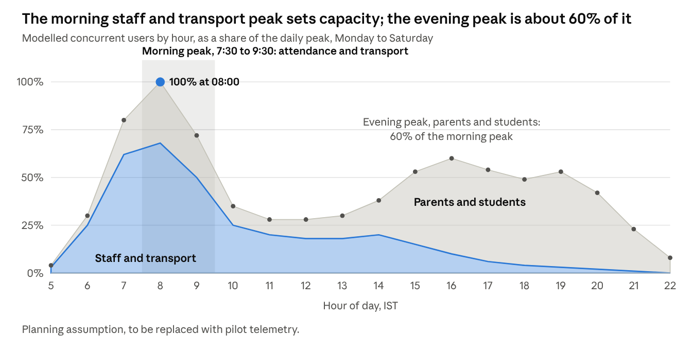
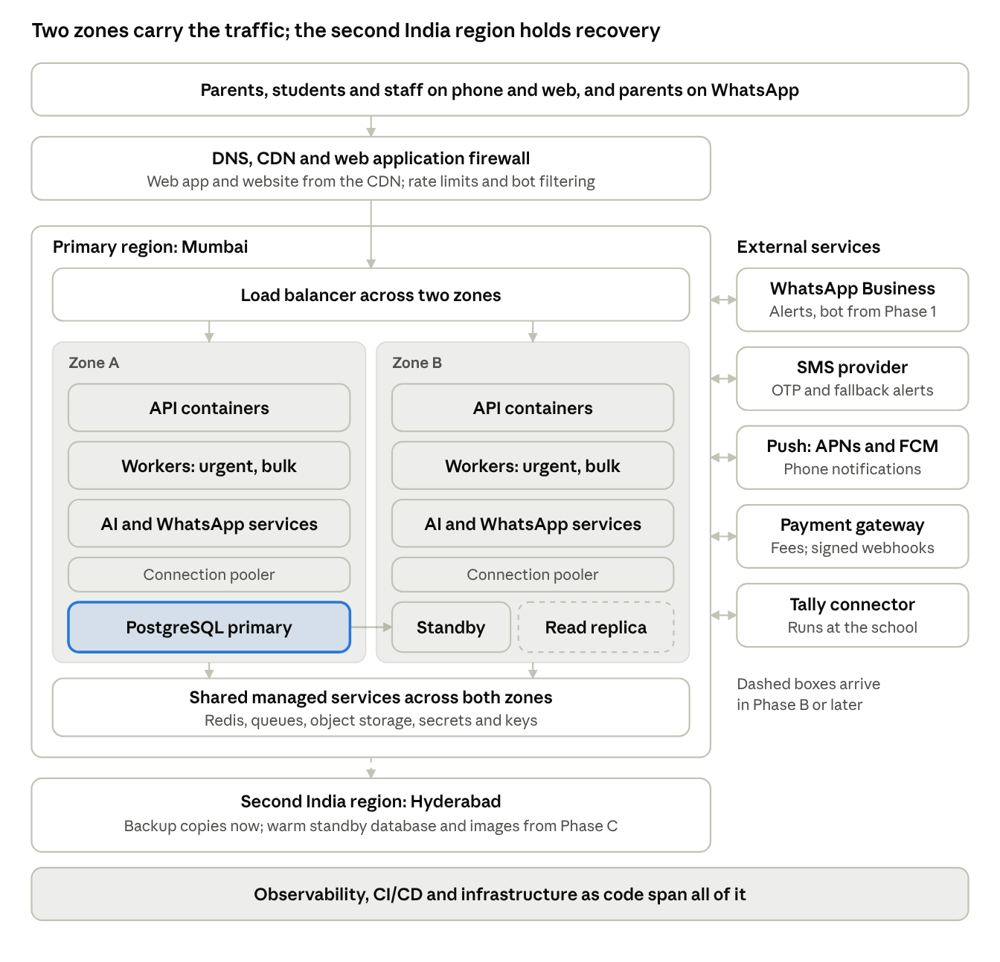
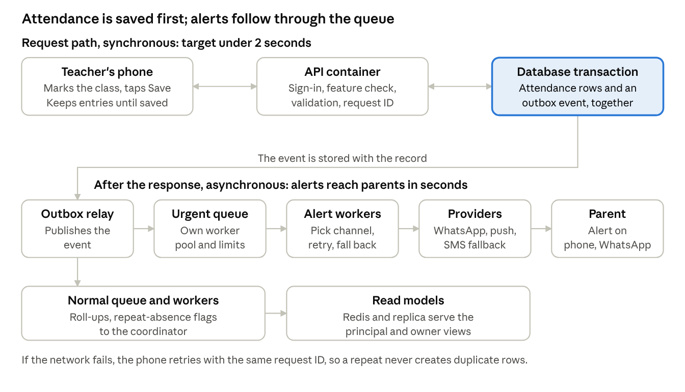

# DhruvaOne Technical Architecture

Oct 31, 2026 · Ankit Verma

## Summary

One region with two zones, a stateless API on containers, one PostgreSQL primary with a standby, and queue-based fan-out carries all three phases, growing by adding capacity rather than by redesign. At 100,000 users and 10,000 concurrent you still do not need sharding or Kubernetes; tenant cells and Kubernetes stay as insurance for later.

| Phase | Registered users | Peak concurrent | Planning peak (API requests a second) | What carries it |
| --- | --- | --- | --- | --- |
| A: now to Mar 2027 | 10,000 | 1,000 | 100 | 4 API containers (2 per zone), 1 database with standby, 1 small Redis; no replica |
| B: Apr to Dec 2027 | 50,000 | 3,000 | 300 | Autoscaling API (6 to 12), separate worker pools, a read replica, a connection pooler |
| C: after Dec 2027 | 100,000 | 5,000 to 10,000 | 500 to 1,000 | Larger database, 2 to 3 replicas, partitioned tables, a warm standby in the second India region |

The planning peak assumes each concurrent user makes about one request every 10 seconds; the capacity model explains this and every other assumption. They are starting points to replace with pilot measurements.

Six decisions shape everything that follows:

1. **Design for the morning, not the evening.** Staff and transport traffic between about 7:30 and 9:30 am sets the capacity. Parents and students in the afternoon are a lower, read-heavy peak. Capacity is scheduled up before 7:30 am and back down after 10 am.
2. **Keep the request path short.** An attendance submit writes the record and returns; parent alerts, flags and roll-ups happen afterwards through a queue, using a transactional outbox so no event is lost.
3. **Fan-out is sized by enrolled students, not by logins.** One attendance run can create thousands of alerts, so notifications run in their own worker pools with separate urgent and bulk queues.
4. **Read-heavy afternoon traffic is cached or sent to replicas.** The parent home screen, bus board and notices come from Redis and read replicas, not the primary.
5. **Rank work under overload.** Attendance, transport, sign-in and safety are never shed; reports, AI and search yield first.
6. **Every dependency has a fallback.** SMS backs up WhatsApp and push, the phone keeps unsent attendance on the device, and the manual path works when AI is off.

One mismatch to resolve: the spec's own sample (all 14 campuses live by 31 Mar 2027, 43,240 students, 40,000 alerts in 5 minutes) is larger than Phase A. The gates at the end of this document therefore test Phase B load before the batch rollout, even though Phase A infrastructure is enough for the pilot campus.

## Workload model

Two populations produce two peaks on a school day, and the morning one is larger, shorter and more important.

*Modelled planning profile from the stated traffic pattern: percent of daily peak, by hour.*

**Morning, about 7:30 to 9:30 am.** Teachers submit attendance for every class within minutes of each other, transport staff tap bus arrivals and departures, and parents check bus alerts. These calls are write-heavy, time-critical and arrive almost together. This peak sets the capacity of the API, the database and the notification workers.

**After school, about 3 to 9 pm.** Parents and students read homework, notices, results and fee dues, and some pay fees. These calls are read-heavy, spread over hours, and tolerate a second or two of delay. They are served from cache and read replicas.

**Midday and overnight** are quiet, which is why capacity is scheduled: scale up at about 6:45 am, scale down after 10 am, hold a modest floor through the evening, and run at the floor overnight. Fee due dates and exam result days are the other predictable spikes and get their own scheduled scale-ups.

The curve is a model built from your description of the traffic, not measured data. The first two weeks of pilot telemetry should replace it.

## Capacity model

The numbers you gave are users and concurrent users. The infrastructure is sized by requests, writes and alerts, so each is derived from stated assumptions. Change an assumption and the table follows.

| Assumption | Value | Why |
| --- | --- | --- |
| Concurrent user | Signed in and active in the last 5 minutes | Matches how you describe 1K, 3K and 5K to 10K |
| Sustained request rate | 0.1 requests a second per concurrent user | One request every 10 seconds: a screen makes 2 to 4 calls and a person acts every 20 to 40 seconds |
| Design headroom | 2x sustained; a burst test at 3x for 60 seconds | Attendance arrives in clumps at the start of each period |
| Writes | 30% of morning requests, 5% of afternoon requests | Morning is attendance and transport taps; afternoon is reading |
| Students | About 35% of users | Users are students, one or two parents each, and staff |
| Alerts in the peak 5 minutes | About 0.93 per enrolled student | Scaled from the spec's 40,000 alerts for 43,240 students (XCT-NFR-003) |

| Phase | Peak concurrent | Sustained requests a second | Design capacity (2x) | Burst (3x, 60 s) | Morning writes a second | Students | Alerts in 5 min | Alerts a second |
| --- | --- | --- | --- | --- | --- | --- | --- | --- |
| A | 1,000 | 100 | 200 | 300 | 30 | 3,500 | 3,250 | 11 |
| B | 3,000 | 300 | 600 | 900 | 90 | 17,500 | 16,300 | 54 |
| C | 5,000 to 10,000 | 500 to 1,000 | 1,000 to 2,000 | 1,500 to 3,000 | 150 to 300 | 35,000 | 32,600 | 109 |

Three readings of the table:

- **Requests.** Phase C at 10,000 concurrent is about 1,000 sustained and 3,000 burst requests a second. That is comfortably within a horizontally scaled API of a few dozen small containers. The database, not the API, is the component to protect.
- **Attendance writes.** The spec's 3,000 teachers submitting attendance over about 10 minutes is roughly 5 submissions a second on average and about 50 at the burst. Each submit writes one batch of about 40 student rows, so about 120,000 rows over 10 minutes, or 200 rows a second. PostgreSQL handles this easily when rows are written in batches.
- **Alerts.** The spec's own test is 133 alerts a second, above the Phase C planning figure. Build and test the alert pipeline to 400 a second so it clears 3x headroom. Fan-out depends on enrolled students rather than logins: a campus with few logins but 4,000 students still sends 4,000 alerts.

**Data volume** is small. Daily attendance for 35,000 students over about 220 school days is under 10 million rows a year, notifications are in the low tens of millions, and with the audit trail the database grows by single-digit to low tens of gigabytes a year before files. Photos and exports go to object storage and are the larger volume.

These are estimates from stated assumptions, not measurements. The load-test plan checks them, and the pilot's telemetry should replace them within two weeks.

## Target architecture

*Target deployment, shown with AWS-style layers. The same shape applies on Azure or Google Cloud.*

Traffic enters through a CDN and firewall, passes a load balancer that spans two zones, and reaches stateless containers in both zones. Each zone runs the same set of services, so losing one zone halves capacity rather than stopping service. The database has one primary, a standby in the other zone that copies every commit, and read replicas from Phase B. Redis, queues and object storage are managed services that already span zones. The second India region holds backup copies from day one and a warm standby from Phase C.

The same shape applies on AWS, Azure or Google Cloud; the labels in the picture are generic and only the product names change. This architecture is a deployment of the repositories in the companion document, with `dhruva-platform`, `dhruva-ai` and `dhruva-whatsapp` as the container services.

## Platform design rules

These rules keep the system scalable and resilient without adding services. Each is cheap to follow from the first commit and expensive to retrofit.

| Rule | How it works | Why |
| --- | --- | --- |
| Stateless API | No user or session state in memory. Short-lived access tokens with refresh tokens; device sessions held in the database and Redis | Any instance can serve any request, so scaling out and losing a zone need no sticky routing |
| Tenant isolation survives pooling | At the start of every transaction the API sets the tenant, campus and role with `SET LOCAL`, and the row-level policies read those values. The pooler runs in transaction mode. The application role owns no tables and cannot bypass the policies; a separate role runs migrations | Transaction pooling lets thousands of requests share a few database connections, and `SET LOCAL` is the pattern that stays correct under it. A session-level `SET` would leak one school's context into another's request |
| Transactional outbox | The business record and its event row are written in one transaction. A relay worker publishes events to the queue; consumers are idempotent | An attendance record and its parent alerts cannot disagree, and a crash between them loses nothing |
| Idempotency keys | The apps send a request ID on every mutating call (attendance submit, bus tap, payment). The server stores the key and result for 24 hours and replays it on retry. Payment webhooks de-duplicate on the gateway's event ID | Phones retry on poor networks, and the spec requires a receipt to be issued once even if a webhook arrives twice (XCT-INT-001) |
| Three queue classes | Urgent (safety, attendance alerts, bus alerts, OTP), normal (notices, homework) and bulk (reports, imports, exports, batch AI). Each has its own worker pool, concurrency and dead-letter queue. Retries use exponential backoff with jitter | A 30,000-recipient notice cannot delay an OTP or a bus alert |
| Cache what parents read | Redis holds the parent home view, today's timetable, bus board state, tenant settings and feature flags with short lifetimes. Keys include the tenant. Writes invalidate through events. Static assets are served by the CDN, and list endpoints use ETags | The afternoon read peak is served without touching the primary database |
| Limits and quotas | Rate limits per user, per tenant and per address; per-tenant budgets on queues; a throttle per WhatsApp number; AI quotas per tenant and capability | One school or one runaway script cannot starve the others (WAB 8.7, AI 5.7) |
| Timeouts, retries and breakers | Every outbound call has a timeout of a few seconds, bounded retries and a circuit breaker. Providers use separate connection pools and queues so one failing dependency cannot take the rest down | The SMS, WhatsApp, payment and AI providers will fail at some point |
| Feature control is cached | Flags are evaluated by one module and cached for 30 to 60 seconds; if it is unreachable the last known values apply | A flag outage cannot block attendance, and a switch still takes effect within a minute everywhere (spec section 4) |
| Short polling before sockets | Live screens (bus board, queues) refresh every 15 to 30 seconds with conditional requests, plus push for the events that matter. WebSockets or server-sent events are added only if live screens reach several thousand simultaneous viewers | Transport in the MVP is driven by stop taps rather than GPS, so second-level updates add cost without value |
| Bounded queries | Keyset pagination, a maximum page size, and reports and exports generated by workers | No single request can hold a database connection for long |
| Versioned contracts | The API carries a version, changes are backward compatible for one release, and the minimum supported app version is enforced by the server | Store releases cannot be pulled back instantly (XCT-ENV-002) |

## Critical flows

### Morning attendance

*Morning attendance flow: request path and asynchronous follow-up.*

The teacher's request ends as soon as one database transaction commits the attendance rows and an outbox event together. Everything else (parent alerts, flags to the coordinator, dashboard roll-ups) happens afterwards, so a slow provider or a busy notification pool never slows the teacher down, and a crash after the commit cannot lose an alert. If the network drops, the phone keeps the entries on screen and retries with the same request ID.

### Transport operations

| Step | Path | Protection |
| --- | --- | --- |
| Attendant taps arrived, picked up, not here, left, reached school | Small idempotent write with a request ID, plus an outbox event | The attendant app should keep taps on the phone and retry; the spec lists offline queueing as Phase 1, but morning bus routes are the clearest case for pulling it into the MVP |
| Parent alert such as "10 minutes away or late" | Urgent queue, then push with WhatsApp or SMS fallback | The cost is the fan-out to every family at a stop, not the number of taps |
| Transport in-charge's live board | Route state held in Redis, updated by workers on each tap; screen refreshes every 15 to 30 seconds with conditional requests | The board never queries the primary database |
| Fee and route mismatches | Reports on a read replica | Heavy queries stay away from the morning writes |

### After school

| Step | Path | Protection |
| --- | --- | --- |
| Parent opens the app | One home request returns the child cards (attendance today, bus status, homework due, fees due, notices) from cached read models, falling back to a replica | A 60-second cache and push-driven invalidation keep the afternoon peak off the primary database |
| Student opens notes or homework | Metadata from the API, files from object storage through the CDN with signed links | Files never pass through the API containers |
| Fee payment | Hosted gateway page, then a signed webhook; the receipt is created once and sent by an urgent job | Webhooks are verified and de-duplicated (XCT-INT-001); fee due dates get a scheduled scale-up |
| Reports and the 14-campus overview | Precomputed roll-ups refreshed at day close and on a schedule | The overview meets its 2.5-second budget without scanning raw rows (XCT-NFR-002) |

## Data tier design

The database is the one layer that needs a plan to grow. At Phase C it holds tens of gigabytes a year and a few hundred writes a second, which one well-tuned PostgreSQL primary handles; the work is in keeping connections, hot rows and heavy reads away from it.

| Topic | Design | Phase |
| --- | --- | --- |
| Schema ownership | `dhruva-platform` owns the school schema through SQL migrations. `dhruva-ai` and `dhruva-whatsapp` have their own small schemas and database roles and cannot read the platform's tables | A |
| Connection budget | Every API and worker instance connects through a pooler in transaction mode. Rule: instances times pool size is what the pooler accepts from clients; the pooler holds a much smaller set of server connections (about 100 to 200 at Phase C) because each PostgreSQL connection costs memory. If a managed proxy is used, test that `SET LOCAL` inside a transaction does not pin the connection | A |
| Timeouts | Statement timeout of about 5 seconds and an idle-in-transaction timeout on the API role; longer limits only for the worker role | A |
| Tenant routing | A lookup table maps each tenant to a database cluster; every connection is obtained through one resolver. At first every tenant points to the pilot cluster | A |
| Indexes | Every index leads with the tenant column; new queries are checked with `EXPLAIN` against test data at Phase C size in CI | A |
| Hot rows | No counters updated on each attendance row. Class, campus and group totals are rolled up by a worker into summary tables | A |
| Read models | Summary tables for the principal and owner views, fee dues and the bus board are filled by workers from events, rather than refreshed as whole materialised views | A |
| Read replicas | One replica serves reports, dashboards and long lists from Phase B, two to three at Phase C. Endpoints are tagged as replica-safe when about 5 seconds of lag is acceptable. A person's own confirmation screen after a write reads from the primary | B |
| Partitioning | Attendance, notification log, audit events, message log and bus events are partitioned by month. Old partitions are detached and archived to object storage once past their retention period | B |
| Maintenance | Autovacuum tuned for high-churn tables (notification status), indexes built concurrently, migrations in expand-then-contract steps and never on exam days or pay days | A |
| Backups | Continuous log archiving for point-in-time recovery (kept 14 to 35 days), daily snapshots copied to the second India region, encrypted with managed keys, restore drilled every quarter | A |
| Object storage | Lifecycle rules by type (for example photos of registers expire quickly per the AI retention default), signed links, uploads scanned and type-checked | A |
| Standby in the second region | Warm standby database kept current by log shipping, with container images mirrored | C |

If one tenant or the total outgrows a single cluster, the routing table is what makes a second cluster a data move rather than a code change (tenant cells, described in the companion document).

## Capacity plan by phase

Two sizing rules produce the numbers below. First, each zone must carry the full sustained peak on its own, with 25% spare, so losing a zone never causes an outage; the burst on top is absorbed by autoscaling within minutes. Second, the planning assumption is that one 1-vCPU, 2 GB API container serves about 200 typical requests a second. That figure is a starting point and the load test replaces it.

| Component | Phase A (to Mar 2027) | Phase B (Apr to Dec 2027) | Phase C (after Dec 2027) | Scale on |
| --- | --- | --- | --- | --- |
| API containers | 4 (2 per zone), up to 8 | 6 to 12 | 8 to 14 as the floor, up to 40 | Requests per container and CPU at 50%, plus the 6:45 am schedule |
| Urgent workers | 2 (1 per zone), up to 4 | 4, up to 8 | 6, up to 16 | Urgent queue depth and age of the oldest message |
| Normal and bulk workers | 1 each, up to 3 | 2 each, up to 4 | 4 each, up to 8 | Queue depth; bulk runs on a schedule outside the peak |
| AI service | 2 | 4 | 6, up to 16 | Concurrent model calls and queue depth |
| WhatsApp gateway | Inside the platform | 2 to 4 as its own service | 4 to 8 | Inbound queue depth |
| PostgreSQL primary and standby | 2 vCPU, 16 GB each, 100 GB storage with growth | 4 vCPU, 32 GB each | 8 to 16 vCPU, 64 to 128 GB each | CPU, connections and replication lag; vertical resize first |
| Read replicas | None | 1 (4 vCPU, 32 GB) | 2 to 3 (8 vCPU, 64 GB) | Replica CPU and report latency |
| Connection pooler | 2 small instances or a managed proxy | 2 to 3 | 3 to 4 | Client connections and wait time |
| Redis | Primary and replica, 2 GB | Primary and replica, 6 GB | Three shards or a larger pair, 13 GB or more | Memory, evictions and command latency |
| Queues, object storage, CDN | Managed, pay as used | Managed | Managed | Cost alerts only |
| Second region | Backups and images | Backups and images | Warm standby database and images | Replication lag |

The container counts assume the per-container figure above. With 14 containers at Phase C, the fleet is about 2,800 requests a second at the planning rate, above the 2,000 requests a second design capacity for 10,000 concurrent users.

Kubernetes is not needed at any of these sizes. Containers on a managed container service cover them; revisit it when the number of distinct services or the scheduling needs outgrow that, not when traffic grows.

## Autoscaling and load shedding

Containers take 30 to 90 seconds to start and the morning peak builds in minutes, so capacity is scheduled ahead of the peak, with reactive scaling only as a safety net. Scale out fast, scale in slowly.

### Scaling schedule

| When (IST) | Capacity | Why |
| --- | --- | --- |
| Monday to Saturday, 6:45 am | Morning floor: the zone-loss sizing for the phase | The morning peak starts about 7:30 and builds quickly |
| 10:00 am | Midday floor, about half the morning floor | Staff traffic falls away |
| 2:30 pm | Afternoon floor, about 60 to 70% of the morning floor | Parents and students arrive; mostly reads |
| 9:30 pm to 6:45 am and Sundays | Overnight floor: two containers per service in two zones | Cost and a safe minimum |
| Fee due dates, result days, campus go-live days | Event floor set from the tenant calendar a day ahead | Predictable spikes should never be a surprise |

### Reactive rules

| Component | Signal | Action |
| --- | --- | --- |
| API containers | CPU above 50% or requests per container above target | Add 50% more containers; scale in one step every 10 to 15 minutes |
| Urgent workers | Oldest message older than 10 seconds | Add 50% more workers; an alert fires if the oldest message passes 30 seconds |
| Normal and bulk workers | Queue depth | Scale on depth; bulk work is paused at peak and drained afterwards |
| AI service | Concurrent model calls near the provider quota or queue age | Add containers up to the per-tenant quotas |
| Database | Not autoscaled | Alerts at CPU 70%, connections 80% and replication lag; resize vertically in a quiet window, add replicas for reads |
| Redis | Memory above 70% or evictions | Resize or add shards; an alert before it matters |

### What gets shed first

Under overload the system protects the work that cannot wait. The thresholds are starting values to tune in the load test.

| Tier | Work | Behaviour |
| --- | --- | --- |
| 0: never shed | Sign-in and OTP, attendance, transport taps and alerts, gate and safety actions, payment webhooks | Reserved capacity and the highest queue priority |
| 1: degrade last | Notices, homework, the parent home view, fee view and payment, approvals | Served from cache when stale data is acceptable |
| 2: shed first | Reports and exports, AI chat and drafts, search, bulk imports, group overview refresh | Queued or refused with "try again shortly" and a retry-after hint |

| Condition | Response |
| --- | --- |
| API 95th percentile above twice its budget for 2 minutes, or database CPU above 80% | Pause bulk queues and shed tier 2 |
| Database CPU above 90% or connection wait growing | Serve tier 1 from cache only; refuse tier 2 |
| A provider failing (AI, WhatsApp, SMS) | Open its circuit breaker; AI switches itself off for the affected scope and the manual path remains; WhatsApp falls back to push, then SMS |

Each step is automatic where it can be, reported on the status banner and in the audit log, and reversed when the condition clears for 10 minutes.

## Resilience

The design assumes every part will fail at some point and makes the common failures invisible to a teacher marking attendance. The table lists each failure, what users see, and the response.

| Failure | What users see | Response |
| --- | --- | --- |
| One container fails | Nothing | Health checks remove it from the load balancer and it is restarted |
| A whole zone is lost | Slightly slower for a few minutes | Traffic shifts to the other zone, the standby database is promoted, and autoscaling restores capacity. The standby copies every commit, so no data is lost |
| Database primary fails | Writes pause for about 1 to 3 minutes | Automatic promotion of the standby, pooler reconnects, apps retry with the same request IDs so nothing is duplicated. Reads continue from replicas from Phase B |
| Redis is lost | Slower screens while the cache refills; live boards reload | Caches rebuild from the database. Because every event is first stored as an outbox row in the database, lost queue messages are republished. Sessions and flags do not depend on Redis alone |
| A queue backs up or a message cannot be processed | Alerts arrive late, never lost | Dead-letter queue, an alert on queue age, and a tool to replay messages |
| WhatsApp, push or SMS provider is down | Alerts arrive by another channel | Circuit breaker, then fallback in order: push, WhatsApp, SMS. Each alert's state is tracked and unsent ones can be resent |
| Payment gateway is slow or a webhook is late | Fee shows "payment pending" | A reconciliation job polls the gateway for pending payments; receipts are created once |
| AI provider is slow or down | Dhruva suggestions disappear; every manual path still works | Circuit breaker switches AI off for the affected scope and queued drafts retry later (spec: AI must never be the only way) |
| The phone has no network | Entries stay on screen and send when back online | Local queue and retry with idempotency keys. Offline attendance is a Phase 1 item in the spec; build it for attendance and bus taps before the pilot |
| A bad release | Errors on a new feature | Canary on the pilot tenant, automatic rollback on error rate, backward-compatible migrations, and a feature switch to turn the feature off |
| One tenant overloads the system | Other schools unaffected | Per-tenant rate limits and queue budgets; move the tenant to its own database if needed |
| Wrong data written, or a person deletes records | Restored data | Point-in-time recovery into a side database, then copy back only the affected rows; the audit trail is kept separately |
| A whole region is lost | Outage until recovery completes | Restore in the second India region; warm standby from Phase C |

### Recovery targets (proposals for sign-off)

| Phase | Zone failure: data loss, recovery | Region loss: data loss, recovery | Backups | Drills |
| --- | --- | --- | --- | --- |
| A | None, within 5 minutes | Up to 5 minutes, within 4 hours, from backups | 14-day point-in-time recovery, daily copies in the second region | Quarterly restore |
| B | None, within 5 minutes | Up to 5 minutes, within 2 hours | 30-day point-in-time recovery | Quarterly restore, one zone-failure game day |
| C | None, within 5 minutes | Up to 1 minute, within 1 hour, to the warm standby | 35-day point-in-time recovery | Quarterly restore, two game days including a region failover |

The spec asks for 99.5% availability in school hours (XCT-NFR-001). Over about 26 school days of 14 hours a month that allows roughly 110 minutes of downtime, so a region loss with a 4-hour recovery would exceed it on its own. That is acceptable for a rare disaster only if the client agrees to count it separately; otherwise bring the warm standby forward from Phase C. This is a decision for you and the client, listed at the end.

## Observability, service levels and load testing

### Service levels

The targets come from the spec; the alert rule on each makes it operable. A flow that misses its target at the 95th percentile for five minutes in school hours pages the on-call engineer.

| Flow | Target (95th percentile) | Source |
| --- | --- | --- |
| Attendance submit | 2 seconds | XCT-NFR-002 |
| Urgent push to device | 5 seconds (the mobile section says 10; design to 5) | XCT-NFR-002, MOB-NFR-002 |
| Attendance alert on WhatsApp | Within 60 seconds of the record | WAB 8.7 |
| Bus alert (5 minutes away) | Within 30 seconds of the trigger | WAB 8.7 |
| Search | 1 second | XCT-NFR-002 |
| Owner Overview, 14 campuses | 2.5 seconds | XCT-NFR-002 |
| Report up to 20,000 rows | 30 seconds | XCT-NFR-002 |
| WhatsApp webhook | 99.9% monthly, no inbound loss during deploys | WAB 8.7 |
| Platform in school hours | 99.5% monthly | XCT-NFR-001 |

### What to measure

- **Per service:** request rate, errors, latency at the 50th, 95th and 99th percentiles, saturation, with tenant and request IDs on every log line, trace and metric (XCT-NFR-004).
- **Database:** CPU, connections and pooler wait, replication lag, lock waits, slowest queries, vacuum lag on busy tables.
- **Queues:** depth and age of the oldest message per class, retry and dead-letter counts, delivery rate per provider.
- **Business leading indicator:** the share of classes with attendance submitted by 9:00 am, per campus. It falls before any technical alert fires.
- **Synthetic checks:** a scripted attendance submit and a parent home load against a test tenant every minute from within India, and a check at 7:15 am that the morning scale-up has happened.

Logs never contain OTPs, PINs, full phone numbers or counselling content.

### Load-test plan

Tests run in staging at Phase C data size (100,000 accounts, 35,000 students, a year of attendance), with k6 or a similar tool. Each phase has a gate it must pass before the next batch of schools goes live.

| Scenario | Load | Pass criteria | Gate |
| --- | --- | --- | --- |
| Morning attendance surge | 3x sustained for 5 minutes, plus a 60-second burst, with 40-row batches | 95th percentile under 2 seconds, no timeouts, oldest urgent message under 10 seconds | Phase B volumes before the 14 Dec staff test; Phase C before Dec 2027 |
| Alert fan-out | 400 alerts a second for 5 minutes | 95% handed to the provider within 5 seconds, none lost, fallback exercised | Before the batch rollout |
| Transport morning | All bus taps plus board polling | Board served from cache, primary database CPU under 50% | Before the batch rollout |
| After-school reads | The concurrent parents for the phase on the home view | 95th percentile under 1 second, at least 90% from cache | Each phase |
| Fee due date | Payment webhooks in a burst, with duplicates | One receipt per payment, no lost webhooks | Before the first fee cycle |
| Soak | 8 hours at 50% of peak | Flat memory, no connection leaks | Each phase |
| Failure drills | Stop a zone's containers, fail the primary, flush Redis, block a provider | Recovery within the targets in the resilience section, no duplicate or lost records | Phase A before pilot; repeat each phase |
| Tenant isolation under load | Cross-campus requests while the system is busy | Every request refused, none returns data | Every release |
| Scale-up timing | Start from the overnight floor, with traffic ramping at 7:15 | Capacity ready before 7:30 | Each phase |

## Delivery gates and open decisions

Move to the next phase only when its gate is met; each gate is something that can be checked, not a date.

| Gate | What must be true |
| --- | --- |
| Before the staff test, 14 to 18 Dec 2026 | Development, staging and production exist; Phase A runs in two zones; the cross-campus isolation test passes on every build; backups restored once in a drill; attendance surge and alert fan-out tests pass at Phase B volumes; synthetic checks and alerts are live |
| Before the pilot, 5 Jan 2027 | Phones retry attendance and bus taps with request IDs (offline queue); someone is on call from 6:45 to 10:00 am on school days; runbooks exist for database failover, queue backlog and provider outage; the status banner works |
| Before each batch of 3 to 4 campuses | The last batch's morning peak was reviewed against the targets; scaling floors were raised for the new total; no change window falls on an exam day or pay day |
| Before Phase B, Apr 2027 | Read replica and monthly partitions are live; the WhatsApp gateway runs as its own service; all load scenarios pass at 3,000 concurrent; first measured profile replaces the modelled one |
| Before Phase C, Dec 2027 | Warm standby in the second region; load tests pass at 10,000 concurrent; a region failover game day has been run; the case for tenant cells has been reviewed against real growth |

### Open decisions

| Decision | Why it matters | Owner |
| --- | --- | --- |
| Reconcile the user numbers with the spec | The spec has all 14 campuses (43,240 students) live by 31 Mar 2027; the plan here says 10,000 users until then. If the spec dates hold, Phase B sizing is needed in March | Product and client |
| Offline queue before the pilot | The spec marks it Phase 1, but morning attendance and bus taps on poor networks are the main operational risk | Product and mobile lead |
| Region-loss recovery against 99.5% | A 4-hour recovery breaks the monthly target on its own; either the client accepts a separate disaster allowance or the warm standby moves earlier | You and the client |
| Urgent push target | The spec says 5 seconds in one place and 10 in another | Product |
| Per-container throughput and users per student | The sizing rests on 200 requests a second per container and students being 35% of users; the first load tests and pilot data replace both | Engineering lead |
| On-call coverage | The peak is at 7:30 to 9:30 am; someone has to be reachable and able to act | Founders and engineering lead |
| Cloud, AI region and credits | Covered in the companion document on repositories and stack | Founders |
