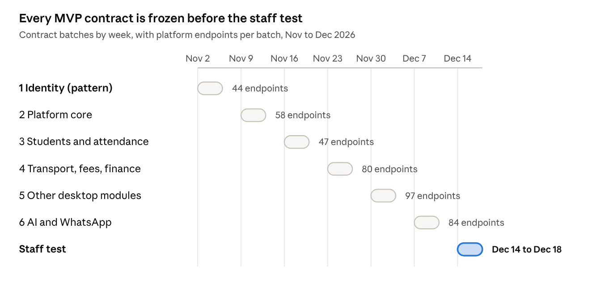

# DhruvaOne Schema and API Contracts Plan

Oct 31, 2026 · @Ankit Verma

Freeze the database schema and API contracts for every MVP module before building it. Identity (IDM) goes first as the pattern, then the modules on the pilot's critical path, so that the staff test on 14 to 18 December runs on contracts that are already signed off.

## Goal and scope

A module is **finalized** when four things are merged in `dhruva-platform` and pass CI:

1. **Migration:** a SQL migration that creates its tables, keys, indexes and row-level security policies.
2. **API contract:** a TypeSpec contract for every endpoint the spec gives the module, with request and response bodies, errors, permissions and requirement IDs.
3. **Event schemas:** one JSON Schema per event the module publishes.
4. **Seed data:** enough rows for the sample school (DPS Gurugram Sec 45) to run its acceptance tests.

| What the spec defines | Count | What still has to be added |
| --- | --- | --- |
| Data entities (annexes 3-A to 11-A) | 173 | Column types, nullability, constraints, indexes, enums, foreign keys |
| Platform endpoints | 349 | Request and response bodies, field types, pagination, examples |
| AI and WhatsApp endpoints | 34 + 27 | The same, for service-to-service calls |
| Events | 182 | The data each event carries, and a version |
| Feature flags | 86 | Already complete in Appendix A |

**Out of scope here:** the user interface, business logic, and the AI prompts. The spec stays the source of truth for behaviour; the contracts only make its annexes exact. Where the two disagree, the spec is fixed first.

## Toolchain

The database is written as plain SQL, and the API as TypeSpec. Everything else is generated from those two, so nothing is typed twice.

| Layer | Written by hand | Generated from it | Tool (version checked 31 Oct 2026) |
| --- | --- | --- | --- |
| Database | `db/migrations/NNNN_<module>.sql` | `src/database/schema.ts` (row types) | PostgreSQL 16, kysely-codegen 0.20 |
| Queries | Kysely queries in each module's repository | | Kysely 0.29 |
| API | `contracts/api/<module>.tsp` | `contracts/openapi/openapi.yaml` (OpenAPI 3.1) | TypeSpec compiler, http, openapi3 1.17 |
| Events | `contracts/events/<module>.tsp` | `contracts/events/schemas/*.json` (JSON Schema) | TypeSpec json-schema 1.17 |
| Apps and gateways | | Typed API clients for dhruva-apps, dhruva-whatsapp, dhruva-ai | openapi-typescript 7 |
| Lint | | Style and breaking-change report on the OpenAPI | Redocly CLI 2 |

**Why these:**

- **SQL with Kysely.** Row-level security, partitions and partial indexes are written directly, with no ORM in the way. Kysely gives typed queries generated from the real schema, and the platform sets `app.tenant_id` per transaction for row-level security.
- **TypeSpec.** Shared models (errors, pages, money, dates) are written once. A module's contract is much shorter than the OpenAPI it generates, which makes one-person review practical for about 400 endpoints.
- **The scaffold already fits.** `dhruva-platform` had `db/migrations/0001_roles_and_core.sql` with row-level security and a `contracts/` folder. This plan extends both rather than replacing them.

## Database conventions

These rules apply to every table. They were settled once, in IDM, and are copied rather than re-decided per module.

| Topic | Rule |
| --- | --- |
| Names | `snake_case`, plural table names (`profiles`), singular columns. Foreign keys are `<table_singular>_id`. |
| Primary keys | `id uuid DEFAULT gen_random_uuid()`. High-volume append tables (attendance marks, audit, outbox) use `bigint` identity and are partitioned by month. |
| Tenancy | Every school table has `tenant_id uuid NOT NULL`; campus-level tables also have `campus_id`. Row-level security is on, and policies read `app.tenant_id` and `app.campus_id`, which are set per transaction. A policy fails closed when the setting is missing. |
| Global tables | People, devices, sessions and sign-in codes belong to a person, not a school, so they have no `tenant_id`. Their policies read `app.person_id` instead; sign-in runs as a separate `dhruva_auth` role that can reach only those tables. |
| Roles | `dhruva_migrator` owns the tables; `dhruva_app` and `dhruva_auth` can read and write rows but never change the schema or bypass row-level security. |
| Status fields | `text` with a `CHECK` list, named after the spec's state machine (for example `state IN ('pending','active','archived')`). No Postgres `ENUM` types; they are hard to change. |
| Time | `timestamptz` in UTC; school-local dates (attendance day, due date) are `date`, with the campus time zone kept on the campus. |
| Money | `amount_paise bigint` plus `currency char(3) DEFAULT 'INR'`. Never floating point. |
| Phone numbers | `mobile_e164 text` with a format check. Where the spec says hashed (`mobile_hash`), store an HMAC with a server-held key. |
| Secrets | Codes, PINs and tokens are stored only as hashes (`argon2id` for PINs, HMAC-SHA-256 for one-time codes and tokens). |
| Change history | Every table has `created_at` and `updated_at`. Changes that matter for audit write an `audit_events` row in the same transaction. |
| Deleting | Records people own are never hard-deleted: they get `state = 'archived'` or `deleted_at`. Erasure under privacy rules is a separate, logged job. |
| Flexible data | `jsonb` only where the spec says the shape varies (form answers, feature settings), always with a `CHECK (jsonb_typeof(...) = 'object')`. |
| Indexes | Every foreign key is indexed. Every list endpoint's filter and sort has a matching index starting with `tenant_id`. |
| Migrations | Forward-only and numbered by module block (shared 0001 to 0099, IDM 0100 to 0199, TFC 0200 to 0299, and so on). Each runs inside a transaction and is tested on an empty database and on the seed data. |

## API contract conventions

The spec's section 2.5 already fixes paths, ownership, the error envelope and event names. The contracts add the rules below, and each one lives once, in `contracts/api/common.tsp`.

| Topic | Rule |
| --- | --- |
| Paths and owners | As in spec 2.5: `/v1` public, `/internal/v1` between services, `/wa/...` on the WhatsApp gateway. One TypeSpec file per spec section, defining only the endpoints that section owns. |
| Traceability | Every operation carries `x-req`, the spec's requirement modules for that endpoint (for example `["IDM-OTP", "MOB-AUT"]`), which must equal what spec-sync lists. CI fails if an operation has no requirement, is not in the spec, or a spec endpoint has no operation. |
| Authentication | Bearer access token (a short-lived JWT) on every `/v1` call, except operations marked public. Service calls use service identity on `/internal/v1`. |
| Permissions | Every operation carries `x-authz`, copied from the annex's "Authz / role scope" column with the capability keys it checks. |
| Feature flags | Operations behind a flag carry `x-flag`; a switched-off feature returns `403` with `error.code = feature_disabled` and `error.feature`. |
| Personal data | Fields with personal data carry `x-pii`, so logs mask them and privacy exports include them. |
| Errors | The spec's envelope, `{"error":{"code","message","feature?","reason?","request_id"}}`. Each operation lists only the codes in its annex row, plus the shared 400, 401, 403 and 429 codes. Codes are `snake_case`. |
| Lists | Cursor pagination: `?cursor=&limit=` (limit 1 to 200, default 50), returning `{"items":[...],"next_cursor":...}`. Filters are named query parameters. |
| Writes | Every `POST` that creates or pays carries an `Idempotency-Key` header, replayed for 24 hours from `idempotency_keys`. Phone-app offline writes also carry `client_event_id` (spec MOB-OFF). |
| Updates | `PATCH` with only the changed fields. Records people edit together carry an `ETag` and require `If-Match`; a stale write returns `412 stale_version`. |
| Field style | JSON fields in `snake_case`, the same as the columns. Dates as `YYYY-MM-DD`, times as RFC 3339 in UTC, money as `{"amount_paise": 125000, "currency": "INR"}`, ids as UUID strings. |
| Versioning | Inside `/v1`, only additive changes: new optional fields or new endpoints. A field is removed only after a deprecation window and a `/v2` path. |
| Events | One TypeSpec model per event, published as JSON Schema with `$id` `<event name>.v<N>`. Every event carries an envelope: `event_id`, `name`, `version`, `occurred_at`, `tenant_id`, `campus_id?`, `actor`, `request_id?`, `data`. A breaking change is a new version, and both versions are published until consumers move. |

## Module order and timeline

Six weekly batches cover all 349 platform endpoints, plus 34 AI and 27 WhatsApp endpoints, by 11 December. That leaves the week of 14 December for the staff test. Each batch depends only on the batches before it, and engineers build a batch the week after its contracts are merged.

| Batch | Week | Platform modules (spec codes) | Endpoints |
| --- | --- | --- | --- |
| 1 Identity | 2 to 6 Nov | identity (IDM, MOB-AUT, MOB-PRF, MOB-SEC), plus the shared conventions | 44 |
| 2 Platform core | 9 to 13 Nov | feature control (TFC), tenant and platform admin, audit, approvals, files | 58 |
| 3 Students and attendance | 16 to 20 Nov | students (DSK-STM, DSK-STS), academics, phone offline sync (MOB-OFF), notifications, calendar | 47 |
| 4 Transport, fees, finance | 23 to 27 Nov | transport (DSK-TRN, MOB-BUS), finance (DSK-FIN), fees, parent app, dashboards | 80 |
| 5 Other desktop modules | 30 Nov to 4 Dec | HR and payroll, admissions, exams, security, group, counselling, imports, reports, search, support, privacy, integrations, website leads | 97 |
| 6 AI and WhatsApp | 7 to 11 Dec | AI gateway on the platform (23), the dhruva-ai service (34), the WhatsApp gateway (27) | 84 |

Batches 4 and 5 are the heaviest for one reviewer, at 80 and 97 endpoints. If a week slips, batch 5's lighter-use modules (counselling, search, support) move after the staff test, because the pilot does not need them on day one.

## Per-module workflow

Each module is one pull request to `dhruva-platform`, on a branch named `contracts/<module>` (for example `contracts/idm`). There is one reviewer, so the checklist does the work a second reviewer would.

1. **Draft:** read the module's spec section and annex; write the migration, the TypeSpec contract, the event schemas and the seed rows.
2. **Generate:** `npm run contracts:build`, `npm run db:reset`, `npm run db:types`, then the checks in the next section.
3. **Open the pull request:** its description lists every decision the spec did not make (a column type, a length limit, an error code), each with the reason.
4. **Review:** work through the checklist below and comment on anything to change.
5. **Fix the spec first:** if review finds the spec wrong or silent, the fix goes to dhruva-docs (and `npm run spec:sync` in dhruva-platform) before the contract changes.
6. **Merge and freeze:** add the module to `contracts/contracted.json`. From then on its contract changes only additively.

**Review checklist:**

- [ ] Every endpoint in the annex has an operation, and nothing extra was added.
- [ ] Every operation's `x-req` names real requirements whose acceptance checks it can satisfy.
- [ ] Request and response fields cover what the requirements' screens show, with no extra personal data.
- [ ] Errors match the annex's "Key errors" column.
- [ ] Every table has `tenant_id` (or is a listed global table), row-level security, and the indexes its list endpoints need.
- [ ] State `CHECK` lists match the spec's state machine.
- [ ] Personal data is marked with `x-pii`.
- [ ] The seed data runs, and the cross-tenant isolation tests pass.
- [ ] Open questions are listed in the pull request, not settled silently.

## CI checks

These run on every pull request to `dhruva-platform` and keep the spec, the schema and the contracts from drifting apart.

| Check | Command | Fails when |
| --- | --- | --- |
| Spec parses | `npm run spec:check` | The spec no longer parses, or a requirement or endpoint lost its owner |
| Contract coverage | `npm run contracts:check` | A contracted module's endpoint has no operation, an operation is not in the spec, `x-req` differs from the spec, `x-authz` is missing, or an event has no schema |
| Contract lint | part of `contracts:check` | Redocly finds the OpenAPI invalid |
| Generated files committed | `git diff --exit-code` | `openapi.yaml`, the event schemas or `schema.ts` differ from what the sources generate |
| Migrations and seed | `npm run db:reset` | Any migration or seed fails on an empty PostgreSQL 16 |
| Row-level security | `npm run db:test` | A table is readable or writable across tenants, the sign-in role reaches school data, the audit log can be changed, or a spec limit is not enforced |

Still to add: Redocly's breaking-change check against main, from batch 2 onwards.

In dhruva-docs, `python3 tools/split_spec.py --check` fails when a file in `Functional/spec/` no longer matches the combined spec.

## Batch 1: Identity

Identity is drafted on branch `contracts/idm` in `dhruva-platform`: all 44 endpoints and 26 events match the spec, and every local check passes.

| Deliverable | What it contains |
| --- | --- |
| `db/migrations/0010_shared_context_and_audit.sql` | `app.person_id` and `app.campus_id` helpers, the `dhruva_auth` sign-in role, and the audit log (append-only, partitioned by month) |
| `db/migrations/0100_identity.sql` | 18 tables with row-level security, and 22 system roles with their identity capabilities |
| `db/seed/0110_identity_seed.sql` | Sample people at DPS Gurugram and at a second school |
| `db/tests/0100_identity_rls.sql` | 22 tests: cross-tenant reads and writes, own profiles across schools, the sign-in role's limits, append-only audit, spec limits |
| `contracts/api/common.tsp`, `contracts/api/idm.tsp` | 44 operations with request and response bodies, errors, `x-req`, `x-authz`, `x-flag`, `x-pii` |
| `contracts/events/envelope.tsp`, `contracts/events/idm.tsp` | 26 event schemas on a shared envelope |
| `src/database/schema.ts` | Kysely types for every table |

**Decisions the spec did not make:**

1. **A profile keeps the school's number.** An imported or invited profile has no person until that number signs in for the first time; sign-in then links them. The annex's Person is "one per verified number", so an unverified number cannot be a person yet.
2. **PIN fields live only in `pin_credentials`.** The annex lists them on Person and on PinCredential; keeping one copy avoids drift.
3. **Four tables the annex does not list:** `refresh_tokens` (rotation and reuse detection need one row per token), `number_changes`, `idm_policies` and `break_glass_grants` (the spec has their APIs or state machines but no entity).
4. **The audit table is shared.** It sits in migration 0010 because every module writes to it; its APIs stay with Section 9.
5. **Consents are stored here, but Section 9 owns their APIs** and the list of purposes.
6. **Student and department links have no foreign key yet.** Batch 3 adds them when the students and academics tables exist.
7. **"Teacher (subject) and Class Teacher" are two roles**, `subject_teacher` and `class_teacher`, because their capabilities differ.
8. **Resend uses the same endpoint.** `POST /v1/auth/otp/request` takes `previous_challenge_id`, which makes the old code stop working at once (IDM-OTP-004).
9. **On the web, the refresh token is only a cookie** and is left out of the response body (IDM-SES-002).
10. **Error codes added to the annex's lists:** `attestation_failed` on code verification, `stepup_required` on sign-out-everywhere, `wrong_pin`, `self_assignment`, `consent_required`, and `stale_version` for edits made at the same time.

**Gaps found in the spec.** The first four are fixed in spec v1.2 (section 10.2, decision 26); the last two are open questions 14 and 15 in section 3.8.

- [x] No API ended a role assignment. Added: `PATCH /v1/idm/memberships/{id}`.
- [x] No API let the office handle "add my number" requests (IDM-NF-003). Added: `GET /v1/idm/number-add-requests` and `PATCH /v1/idm/number-add-requests/{id}`.
- [x] No API opened or ended break-glass access (IDM-ADM-007). Added: `GET`, `POST` and `DELETE /v1/idm/break-glass-grants`.
- [x] No API signed one person out everywhere (IDM-ADM-001). Added: `POST /v1/idm/people/{id}/revoke-sessions`.
- [ ] The device limit behind `409 too_many_devices` has no number. Proposed: 5 active devices per person.
- [ ] Which child links need the two-person check (`403 two_person_required`) is not stated.

## Open questions and risks

| Item | Why it matters | Proposed answer |
| --- | --- | --- |
| One reviewer for about 430 endpoints in six weeks | Batches 4 and 5 are 80 and 97 endpoints; review is the bottleneck, not drafting | Review decisions and gaps first, not every field. Move counselling, search and support after the staff test if a week slips |
| Spec gaps found while contracting | Each needs a dhruva-docs change before the contract can include it; IDM found six | Fix them in one spec pull request per batch, with a numbered decision in 10.2 |
| Engineers build while later contracts are drafted | A change to a merged contract breaks code already written | After merge, contracts change only additively; the breaking-change check enforces it from batch 2 |
| Old event file `attendance.marked.v1.json` | It uses camelCase and no envelope, unlike the new convention | Replace it in batch 3 |
| Size of the generated OpenAPI | About 100 lines per endpoint, so roughly 40,000 lines for the platform | Acceptable as a generated file; reviewers read the TypeSpec, not the YAML |
